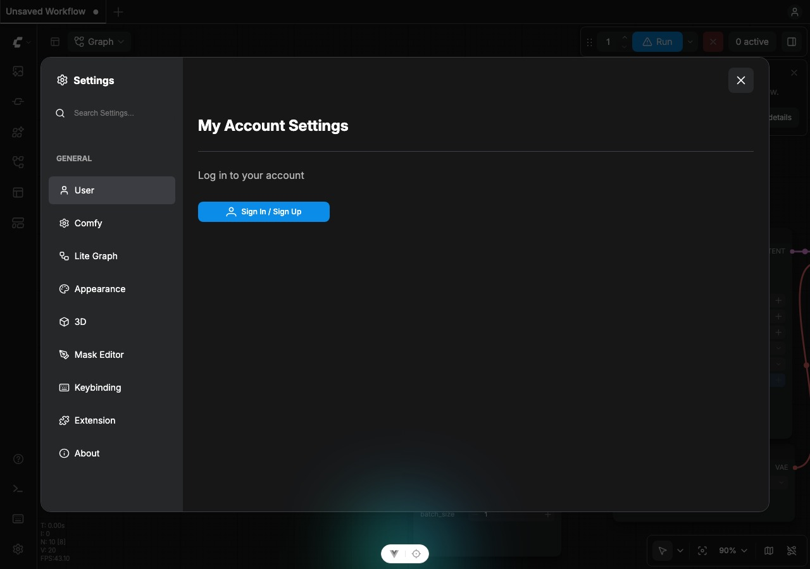
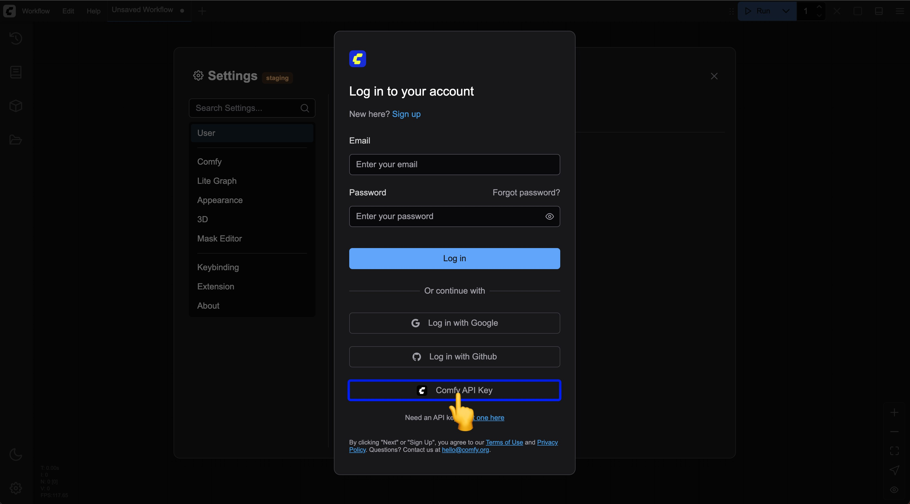
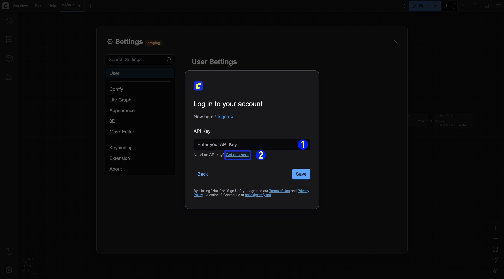
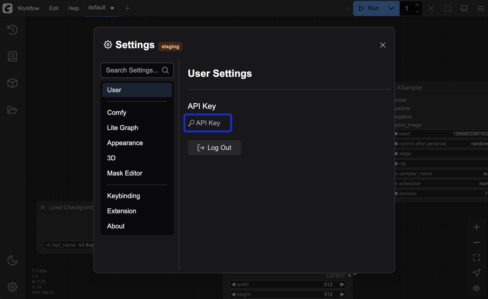
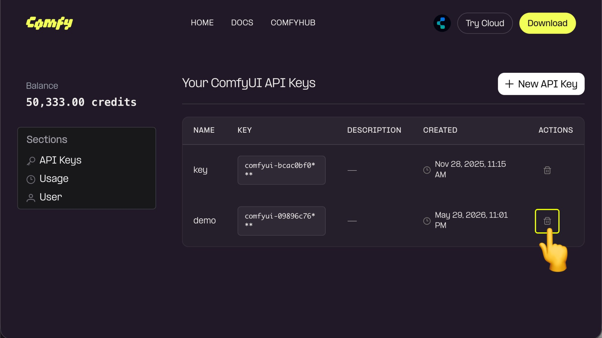
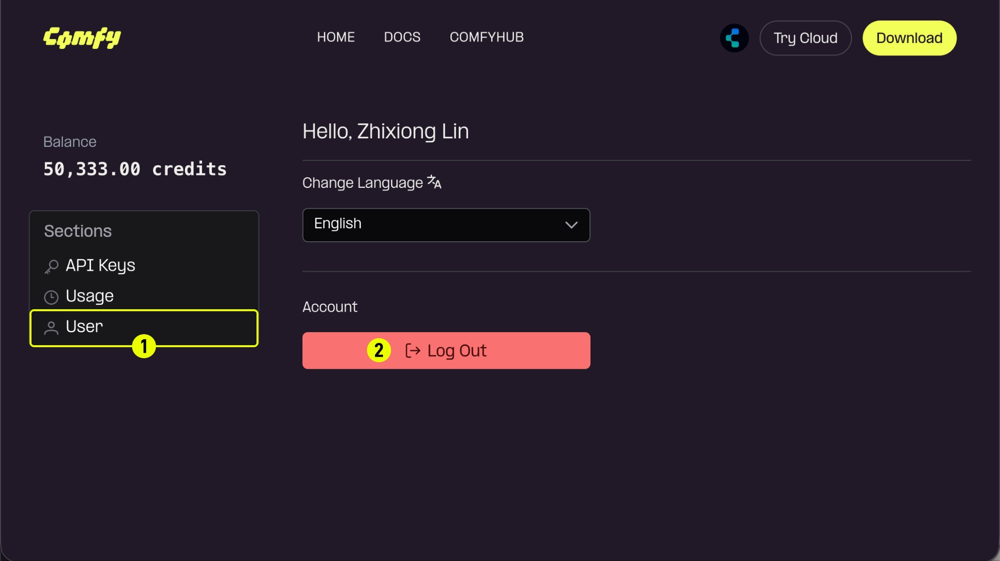

import GetApiKey from '/snippets/get-api-key.mdx'

Your Comfy account gives you access to [partner nodes (Partner Node)](/tutorials/partner-nodes/overview) and [cloud subscriptions](https://www.comfy.org/cloud), enabling you to use premium features and services across the ComfyUI platform.

## Supported login methods

ComfyUI supports the following login methods:
- **Email**: Log in with your email address and password
- **Google**: Log in with your Google account
- **GitHub**: Log in with your GitHub account
- **Single sign-on (SSO)**: Log in through your organization's identity provider

## Sign in with single sign-on (SSO)

If your organization manages Comfy accounts through an identity provider, you sign in with **Continue with SSO** instead of an email address and password, Google, or GitHub.

1. On the sign-in page, enter your email address, or click **Continue with SSO** first.
2. If prompted, click **Continue with SSO**.
3. Finish signing in on your identity provider's page. You return to Comfy Cloud signed in.

If single sign-on is not set up, or an administrator turned it off for your organization, contact your administrator.

<Note>
SSO accounts cannot sign in to the ComfyUI desktop app yet. Use the browser instead. Workspace invite links also cannot be accepted from an SSO account yet, so ask a workspace admin to add you directly.
</Note>

## Logging in on Comfy Cloud

To access your Comfy account for ComfyUI on Comfy Cloud:

1. Navigate to [Comfy Cloud](https://www.comfy.org)
2. Click **Log in** or **Sign in**
3. Choose your login method:
   - **Email**: Enter your email address and password, then click **Log in**
   - **Google**: Click the Google login button and authenticate
   - **GitHub**: Click the GitHub login button and authenticate
   - **SSO**: Click **Continue with SSO** (enter your email first, or go straight to SSO) and finish on your identity provider

## Logging in locally

If you have ComfyUI installed locally:

1. Open ComfyUI on your local machine
2. Navigate to **Settings** in the interface
3. Go to the **User** section (see [User settings](/interface/user) for details)
4. Choose your login method:
   - **Email**: Enter your email address and password
   - **Google**: Click the Google login button and authenticate
   - **GitHub**: Click the GitHub login button and authenticate
   - **API Key**: Use an API Key for non-whitelisted deployments (see below)

### Logging in with an API Key

Since not all ComfyUI deployments are on our domain authorization whitelist, we have provided API Key login in a recent update (2025-05-10) for logging in through non-whitelisted sites. Below are the steps for logging in with an API Key:

<video
  controls
  className="w-full aspect-video"
  src="/images/interface/setting/user/api_login.mp4"
></video>

<Tabs>

  <Tab title="Have an API Key">

  <Steps>
  <Step title="Select Comfy API Key Login on the Login Screen">
    Select `Comfy API Key` login in the login popup
    
  </Step>

  <Step title="Enter Your API Key">
    
    1. Enter your API Key and save it
    2. If you don't have an API Key, click the `Get one here` link to go to the [Comfy Platform login page](https://platform.comfy.org/login) and log in to obtain it.
  </Step>
  <Step title="Login Successful">
  After a successful login, you can see the corresponding API Key login information in the settings menu
    
  </Step>
</Steps>

  </Tab>
  <Tab title="No API Key, Apply for an API Key First">
Please refer to the following steps to apply for and obtain an API Key:

<GetApiKey />

<Steps>
  <Step title="API Key Management">
    
    For unused API Keys or those at risk of being leaked, you can click `Delete` to remove them to prevent unnecessary losses.
  </Step>
  <Step title="(Optional) Log Out">
    
    If you have obtained an API Key and are logged in on a public device, please log out promptly.
  </Step>
</Steps>

  </Tab>
</Tabs>

## Forgot your password

If you can't remember your password (for email login):

1. Click the **Forgot password?** link on the login page
2. Enter your registered email address
3. Check your email for password reset instructions
4. Click the reset link in the email
5. Create a new password
6. Log in with your new password

## Troubleshooting login issues

If you're having trouble logging in:

- Verify your email address is correct
- Check that Caps Lock is not enabled when entering your password
- Clear your browser cookies and cache
- Try using a different browser or incognito mode
- Ensure your account email has been verified
- Contact [support](/support/contact-support) if issues persist

## Security tips

To keep your account secure:
- Use a strong, unique password
- Don't share your login credentials
- Log out when using shared devices
- Regularly update your password
