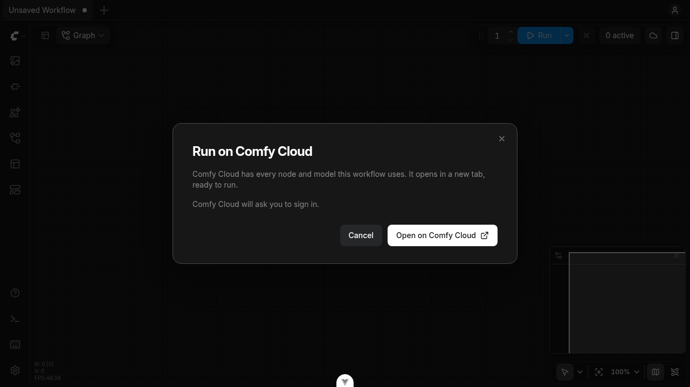
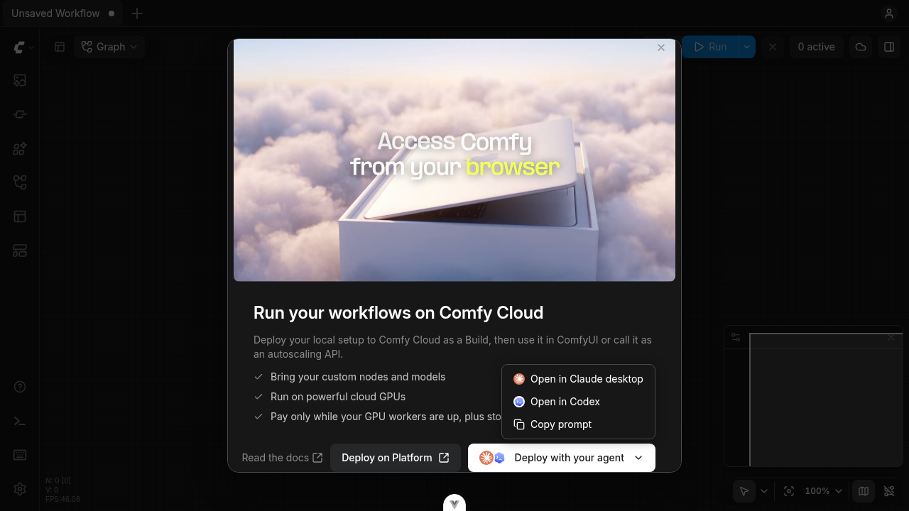

## Overview

The Cloud button in the Run bar sends the workflow you have open to Comfy Cloud. ComfyUI checks the workflow against Cloud first, then opens it in a new browser tab with the graph loaded.

The button appears only when ComfyUI runs on your own machine (localhost, a private LAN address, or the Desktop app) and the Open on Cloud rollout is enabled for your account. Comfy Cloud itself does not show it. If it is missing, update ComfyUI to the latest version and reload the page.

## Open the workflow on Comfy Cloud

1. Open the workflow you want to run on Cloud.
2. Click the cloud icon in the Run bar. ComfyUI checks which node packs and models the workflow uses.
3. If Cloud has all of them, the **Run on Comfy Cloud** dialog opens. Click **Open on Comfy Cloud**.
4. Comfy Cloud opens in a new tab and loads the workflow into the editor. Sign in there if it asks.

Some model inputs cannot be checked from the local side, such as a linked model input or a model file that matches more than one local folder. The dialog lists those as unchecked, and they do not stop the workflow from opening.

Leave the local tab open until the workflow shows up in Cloud. The graph is handed over once the Cloud tab finishes loading, and ComfyUI gives up after 10 minutes. If it never arrives, click the Cloud button again.

If your browser blocks the new tab, allow pop-ups for your ComfyUI address and try again. A workflow with no active nodes is refused with a message, so add or unmute nodes, save, and click the button again.

## When Cloud is missing model files

If the only gap is model files, the dialog lists the files Cloud does not have and offers no open action. Uploading from your ComfyUI is not available there either, so close it and import those files into Cloud instead. See [Import models](/cloud/import-models).

## When the workflow needs custom nodes or unusual models

If the workflow uses custom node packs that Cloud does not have, or a model that Cloud cannot resolve to a single file, the dialog offers to deploy your setup instead. **Deploy on Platform** packages your custom nodes and models into a Build on the Developer Platform. **Deploy with your agent** hands the same setup to Claude desktop or Codex, or copies the prompt; it asks you to save the workflow first. See [Custom Builds](/development/deploy/cloud-custom-builds).

## In the Desktop app

The Desktop app hands the workflow to Cloud through its own relay. When the relay is not available, ComfyUI downloads the workflow as a JSON file, opens Comfy Cloud, and asks you to drop the file onto the Cloud editor.
