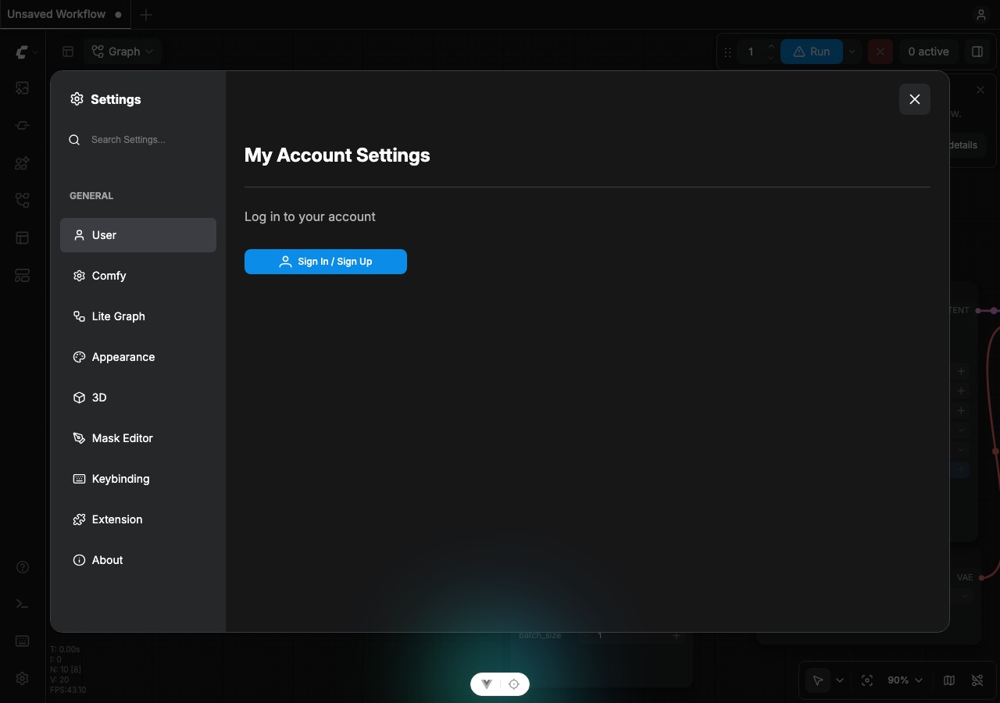
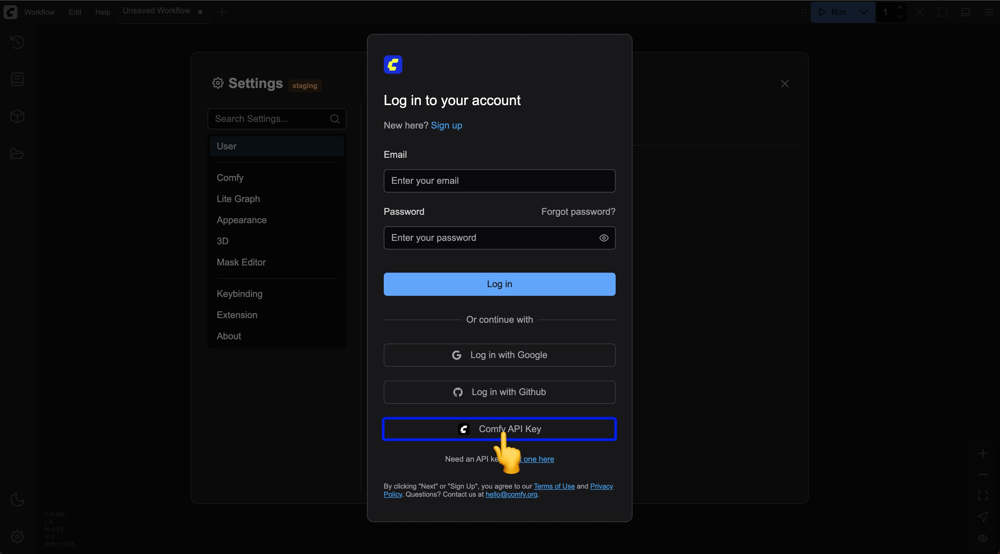
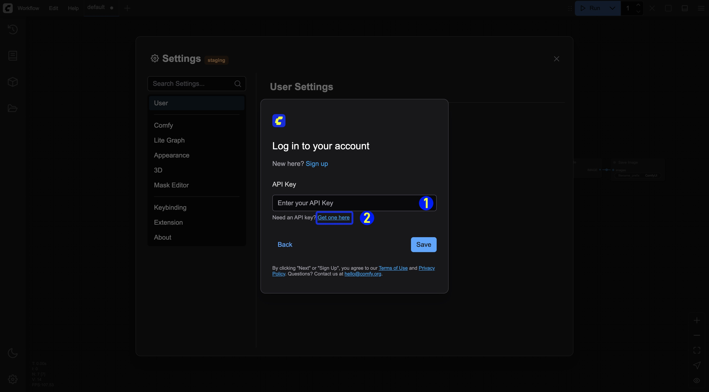
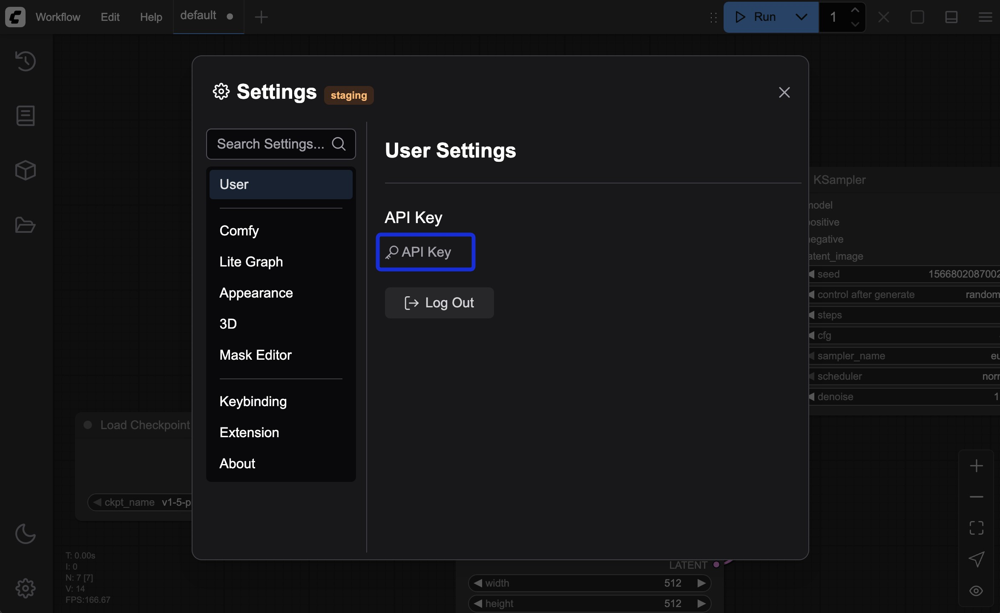
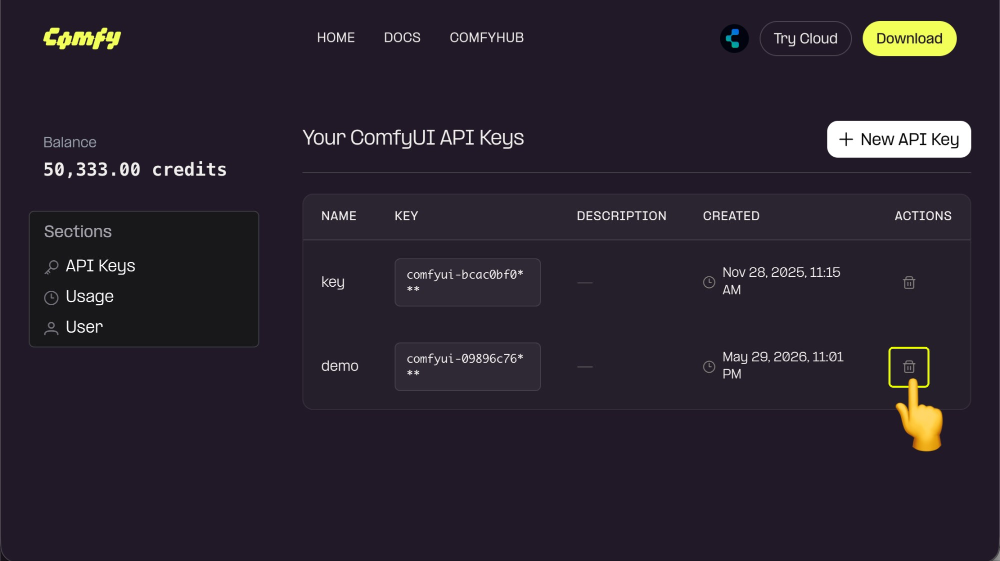
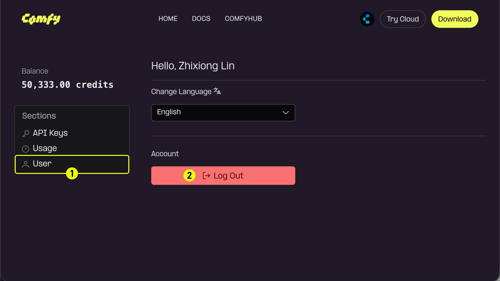

import GetApiKey from "/snippets/de/get-api-key.mdx"

Ihr Comfy-Konto bietet Ihnen Zugriff auf [Partner-Nodes (Partner Node)](/de/tutorials/partner-nodes/overview) und [Cloud-Abonnements](https://www.comfy.org/cloud), sodass Sie Premium-Funktionen und -Dienste auf der gesamten ComfyUI-Plattform nutzen können.

## Unterstützte Anmeldemethoden

ComfyUI unterstützt die folgenden Anmeldemethoden:
- **E-Mail**: Melden Sie sich mit Ihrer E-Mail-Adresse und Ihrem Passwort an
- **Google**: Melden Sie sich mit Ihrem Google-Konto an
- **GitHub**: Melden Sie sich mit Ihrem GitHub-Konto an
- **Single Sign-on (SSO)**: Melden Sie sich über den Identitätsanbieter Ihrer Organisation an

## Mit Single Sign-on (SSO) anmelden

Wenn Ihre Organisation Comfy-Konten über einen Identitätsanbieter verwaltet, melden Sie sich mit **Continue with SSO** an statt mit E-Mail-Adresse und Passwort, Google oder GitHub.

Single Sign-on ist verfügbar, nachdem Ihre Organisation es aktiviert hat. Bis dahin verwenden Sie E-Mail, Google oder GitHub.

1. Geben Sie auf der Anmeldeseite Ihre E-Mail-Adresse ein, oder klicken Sie zuerst auf **Continue with SSO**.
2. Wenn Sie dazu aufgefordert werden, klicken Sie auf **Continue with SSO**.
3. Schließen Sie die Anmeldung auf der Seite Ihres Identitätsanbieters ab. Sie kehren angemeldet zu Comfy Cloud zurück.

Wenn Single Sign-on nicht eingerichtet ist oder ein Administrator es für Ihre Organisation deaktiviert hat, wenden Sie sich an Ihren Administrator.

<Note>
SSO-Konten können sich noch nicht in der ComfyUI Desktop-App anmelden. Verwenden Sie stattdessen den Browser. Workspace-Einladungslinks können mit einem SSO-Konto ebenfalls noch nicht angenommen werden; bitten Sie daher einen Workspace-Administrator, Sie direkt hinzuzufügen.
</Note>

## Bei Comfy Cloud anmelden

So greifen Sie auf Ihr Comfy-Konto für ComfyUI in Comfy Cloud zu:

1. Rufen Sie [Comfy Cloud](https://www.comfy.org) auf
2. Klicken Sie auf **Log in** oder **Sign in**
3. Wählen Sie Ihre Anmeldemethode:
   - **E-Mail**: Geben Sie Ihre E-Mail-Adresse und Ihr Passwort ein und klicken Sie dann auf **Log in**
   - **Google**: Klicken Sie auf die Google-Anmeldeschaltfläche und authentifizieren Sie sich
   - **GitHub**: Klicken Sie auf die GitHub-Anmeldeschaltfläche und authentifizieren Sie sich
   - **SSO**: Klicken Sie auf **Continue with SSO** (geben Sie zuerst Ihre E-Mail-Adresse ein oder gehen Sie direkt zu SSO) und schließen Sie die Anmeldung bei Ihrem Identitätsanbieter ab

## Lokal anmelden

Wenn Sie ComfyUI lokal installiert haben:

1. Öffnen Sie ComfyUI auf Ihrem lokalen Rechner
2. Navigieren Sie in der Oberfläche zu **Settings**
3. Gehen Sie zum Bereich **User** (Details finden Sie unter [Benutzereinstellungen](/de/interface/user))
4. Wählen Sie Ihre Anmeldemethode:
   - **Email**: Geben Sie Ihre E-Mail-Adresse und Ihr Passwort ein
   - **Google**: Klicken Sie auf die Google-Anmeldeschaltfläche und authentifizieren Sie sich
   - **GitHub**: Klicken Sie auf die GitHub-Anmeldeschaltfläche und authentifizieren Sie sich
   - **API Key**: Verwenden Sie einen API-Schlüssel für nicht auf der Whitelist stehende Deployments (siehe unten)

### Mit einem API-Schlüssel anmelden

Da nicht alle ComfyUI-Deployments auf der Whitelist für Domain-Autorisierungen stehen, haben wir in einem aktuellen Update (2025-05-10) die Anmeldung per API-Schlüssel für den Zugriff über nicht auf der Whitelist stehende Sites bereitgestellt. Im Folgenden finden Sie die Schritte für die Anmeldung mit einem API-Schlüssel:

<video
  controls
  className="w-full aspect-video"
  src="/images/interface/setting/user/api_login.mp4"
></video>

<Tabs>

  <Tab title="API-Schlüssel vorhanden">

  <Steps>
  <Step title="Comfy API-Schlüssel-Anmeldung im Anmeldefenster auswählen">
    Wählen Sie im Anmeldefenster die Anmeldung `Comfy API Key` aus
    
  </Step>

  <Step title="API-Schlüssel eingeben">
    
    1. Geben Sie Ihren API-Schlüssel ein und speichern Sie ihn
    2. Wenn Sie keinen API-Schlüssel haben, klicken Sie auf den Link `Get one here`, um zur [Anmeldeseite der Comfy Platform](https://platform.comfy.org/login) zu gelangen, und melden Sie sich dort an, um einen zu erhalten.
  </Step>
  <Step title="Anmeldung erfolgreich">
  Nach einer erfolgreichen Anmeldung sehen Sie im Einstellungsmenü die entsprechenden Anmeldeinformationen zum API-Schlüssel
    
  </Step>
</Steps>

  </Tab>
  <Tab title="Kein API-Schlüssel vorhanden: API-Schlüssel zuerst beantragen">
Bitte folgen Sie den folgenden Schritten, um einen API-Schlüssel zu beantragen und zu erhalten:

<GetApiKey />

<Steps>
  <Step title="API-Schlüssel-Verwaltung">
    
    Bei nicht verwendeten API-Schlüsseln oder solchen, bei denen die Gefahr besteht, dass sie geleakt werden, können Sie auf `Delete` klicken, um sie zu entfernen und unnötige Verluste zu vermeiden.
  </Step>
  <Step title="(Optional) Abmelden">
    
    Wenn Sie einen API-Schlüssel erhalten haben und auf einem öffentlichen Gerät angemeldet sind, melden Sie sich bitte umgehend ab.
  </Step>
</Steps>

  </Tab>
</Tabs>

## Passwort vergessen

Wenn Sie sich nicht mehr an Ihr Passwort erinnern (bei der Anmeldung per E-Mail):

1. Klicken Sie auf der Anmeldeseite auf den Link **Forgot password?**
2. Geben Sie Ihre registrierte E-Mail-Adresse ein
3. Prüfen Sie Ihre E-Mails auf Anweisungen zum Zurücksetzen des Passworts
4. Klicken Sie auf den Link zum Zurücksetzen in der E-Mail
5. Erstellen Sie ein neues Passwort
6. Melden Sie sich mit Ihrem neuen Passwort an

## Anmeldeprobleme beheben

Wenn Sie Probleme bei der Anmeldung haben:

- Prüfen Sie, ob Ihre E-Mail-Adresse korrekt ist
- Stellen Sie sicher, dass Caps Lock beim Eingeben Ihres Passworts nicht aktiviert ist
- Leeren Sie Ihre Browser-Cookies und den Cache
- Versuchen Sie es mit einem anderen Browser oder im Inkognito-Modus
- Stellen Sie sicher, dass die E-Mail-Adresse Ihres Kontos verifiziert wurde
- Kontaktieren Sie den [Support](/de/support/contact-support), wenn die Probleme weiterhin bestehen

## Sicherheitstipps

So halten Sie Ihr Konto sicher:
- Verwenden Sie ein starkes, einzigartiges Passwort
- Geben Sie Ihre Anmeldedaten nicht weiter
- Melden Sie sich ab, wenn Sie gemeinsam genutzte Geräte verwenden
- Aktualisieren Sie Ihr Passwort regelmäßig
