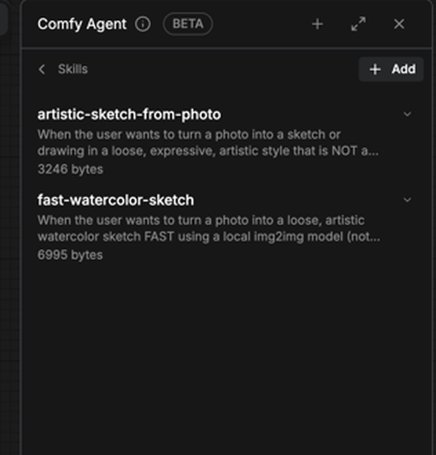

## Was ist ein persönlicher Skill?

Ein persönlicher Skill ist eine wiederverwendbare Sammlung von Anweisungen für Comfy Agent. Er enthält einen Namen, eine einzeilige Beschreibung, wann er verwendet werden soll, und die Anweisungen selbst.

Verwenden Sie persönliche Skills, um Anweisungen wie „quadratische Bilder erstellen“, „einen weißen Hintergrund verwenden“ oder „Node-Verbindungen vor dem Ausführen prüfen“ wiederzuverwenden.

Persönliche Skills werden in Ihrem Konto gespeichert. Der Agent lädt einen Skill, wenn seine Beschreibung zu Ihrer Anfrage passt oder wenn Sie ihn beim Namen nennen.

## Skill im Chat erstellen {#create-a-skill-in-chat}

Teilen Sie dem Agenten mit, was gespeichert werden soll, wie der Skill heißen soll und wann er verwendet werden soll:

> Speichern Sie dies als Skill namens product-shot: Wenn ich ein Produktbild anfrage, verwenden Sie einen quadratischen Canvas mit 1024 × 1024, einen neutralen grauen Hintergrund und einen Save Image Node. Validieren Sie den Workflow, bevor Sie ihn ausführen.

Der Agent speichert den Skill für zukünftige Nachrichten. Ein neuer oder aktualisierter Skill wird mit Ihrer nächsten Nachricht wirksam.

## Skills im Agent-Panel verwalten

Das **+**-Menü im Nachrichtenfeld enthält ein Untermenü **Skills**, das Ihre Skills auflistet. Wählen Sie einen Eintrag aus, um ihn an Ihre Nachricht anzuhängen, oder wählen Sie **Skills verwalten**, um die Skills-Ansicht zu öffnen, in der Sie Skills hinzufügen, bearbeiten und löschen können.

Der Name eines Skills kann nach dem Speichern nicht mehr geändert werden. Um einen Skill umzubenennen, löschen Sie ihn und fügen ihn erneut hinzu. Wenn Sie das Formular verlassen, ohne zu speichern, bleibt Ihre Eingabe auf diesem Gerät als Entwurf erhalten, bis Sie sie speichern oder verwerfen.

## Skill-Felder

| Feld | Zweck | Regeln |
| --- | --- | --- |
| **Name** | Der Bezeichner, unter dem der Agent den Skill lädt. | Bis zu 64 Zeichen aus ASCII-Buchstaben, Ziffern, `.`, `_` und `-`. Der Name muss eindeutig sein, und die Namen der integrierten Skills, die immer geladen werden, sind reserviert. |
| **Wann verwenden** | Eine Zeile, die angibt, wann der Skill geladen werden soll. Sie wird mit jeder Nachricht übertragen, unabhängig davon, ob der Skill verwendet wird. | Eine einzelne Zeile mit bis zu 1.024 Zeichen. Halten Sie sie kurz. |
| **Anweisungen** | Was der Agent befolgt, sobald der Skill geladen ist. | Erforderlich. |

## Größenbeschränkungen

Die Liste zeigt die Größe jedes Skills in Byte. Skills teilen sich ein Größenbudget für Ihr Konto. Das Formular lehnt einen Speichervorgang ab, der dieses überschreiten würde, und fordert Sie auf, zuerst einen Skill zu entfernen.

## Skill verwenden

Fragen Sie einen Skill über seinen Namen an:

> Verwenden Sie meinen Product-Shot-Skill, um einen Studiofoto-Workflow für einen roten Sneaker zu erstellen.

Der Agent kann außerdem automatisch einen Skill auswählen, wenn Ihre Anfrage seiner Beschreibung entspricht. Um einen Skill aus Ihrer Liste auszuwählen, geben Sie `/` im Nachrichtenfeld ein und wählen Sie ihn im Abschnitt **Skills** des Menüs aus.

## Skill aktualisieren oder löschen

Verwenden Sie denselben Skill-Namen, um seine Anweisungen zu ersetzen:

> Aktualisieren Sie meinen product-shot Skill, um einen weißen Hintergrund und einen 1536 × 1536 großen Canvas zu verwenden.

Löschen Sie einen Skill nach Namen:

> Löschen Sie meinen product-shot Skill.

## Vorhandene Skill-Datei speichern

Fügen Sie den Inhalt Ihrer `SKILL.md`-Datei in den Chat ein und bitten Sie den Agent, ihn als persönlichen Skill zu speichern. Der Agent liest den Namen und die Beschreibung aus dem Header oben in der Datei. Der gespeicherte Skill ist ab Ihrer nächsten Nachricht verfügbar.

## Öffentliche Skills verwenden

Öffentliche Skills sind geteilte Skills, die jeder verwenden kann, nicht nur die, die Sie selbst erstellt haben. Fragen Sie einen öffentlichen Skill über seinen Namen an oder beschreiben Sie, was Sie tun möchten, und der Agent verwendet ihn genauso wie einen Ihrer eigenen:

> Verwenden Sie den öffentlichen Skill product-shot für einen roten Sneaker auf einem neutralen grauen Hintergrund.

## Integrierte Guidance und Coding-Agent-Skills

Comfy Agent enthält Guidance zum Erstellen von Workflows und zur Auswahl von Modellen. Persönliche und öffentliche Skills ergänzen diese Guidance um Anweisungen für wiederkehrende Aufgaben.

[Skills für Coding-Agenten](/de/agent-tools/skills) werden separat in Tools wie Claude Code installiert. Wenn Sie dort einen Skill installieren, wird dieser dadurch nicht zu Comfy Agent hinzugefügt.

Halten Sie API-Schlüssel, Passwörter und Zugriffstoken aus Skill-Anweisungen heraus. Informationen zum Umgang mit Daten finden Sie unter [Daten und Datenschutz](/de/agent-tools/in-app-agent-data-privacy#skills-und-guidance).
