## Überblick

**Comfy MCP** verbindet KI-Agenten über das [Model Context Protocol](https://modelcontextprotocol.io) mit ComfyUI. Sobald die Verbindung steht, können Sie Bilder, Video, Audio und 3D generieren, Modelle, Nodes und Vorlagen durchsuchen und echte ComfyUI-Workflows aus einem Chat mit Ihrem Agenten heraus ausführen.

Es gibt zwei Verbindungen: eine **Comfy Cloud**-Verbindung und eine **lokale ComfyUI**-Verbindung, wobei die lokale vollständig Open Source ist.

<Tip>
  **Sie kommen bei einem der folgenden Punkte nicht weiter? Geben Sie diese Seite am besten Ihrem Agenten und bitten Sie um Hilfe.**
</Tip>

### Welche Verbindung soll ich wählen?

**Neuen Nutzern empfehlen wir, mit der Cloud-Verbindung zu beginnen:** Sie ist das einfachste Setup. Wenn Sie claude.ai, ChatGPT oder die Claude Desktop-Chat-App verwenden, ist die Cloud-Verbindung zudem die kompatiblere Wahl.

**Wenn Sie ComfyUI bereits lokal oder in Ihrer eigenen bereitgestellten Umgebung betreiben oder überwiegend in einem Coding-Agenten** wie Claude Code, Cursor oder Codex arbeiten, beginnen Sie mit der **lokalen** Verbindung.

<Info>
  **Wenn Sie einen Mac verwenden und Open-Source-Modelle ausführen möchten, empfehlen wir die Cloud-Verbindung.** Die heutigen Open-Weight-Modelle, also die lokalen Versionen von MiniMax H3, LTX-2.3 und ähnlichen, sind groß und laufen auf der Apple GPU nicht mit brauchbarer Geschwindigkeit.
</Info>

Beide gleichzeitig zu betreiben ist normal, und die meisten Clients hosten problemlos zwei MCP-Server. Sie melden sich beim selben Comfy-Konto an, aber **getrennt** voneinander: Eine Anmeldung deckt die andere nicht ab.

## Comfy Cloud MCP-Verbindung

Die gehostete Verbindung, die Ihren Agenten mit Ihrem **Comfy Cloud**-Konto verknüpft. Nichts zu installieren, und Workflows werden auf Comfy Cloud GPUs ausgeführt. Mehr über Comfy Cloud erfahren Sie unter [Comfy Cloud](/de/get_started/cloud).

### Cloud-Verbindung einrichten

<Info>
  Sie benötigen ein [Comfy Cloud](https://cloud.comfy.org)-Konto, bevor Sie sich verbinden. [Registrieren Sie sich](https://cloud.comfy.org), falls Sie noch keines haben; neue Benutzer erhalten **5 kostenlose Ausführungen** zum Ausprobieren. Die OAuth-Anmeldung während der Einrichtung verwendet Ihr Comfy-Konto.
</Info>

Comfy Cloud MCP läuft unter:

```
https://cloud.comfy.org/mcp
```

Wählen Sie Ihren Client:

<Tabs><Tab title="Claude Desktop">
    Claude Desktop fügt Comfy Cloud über seine Benutzeroberfläche als **benutzerdefinierten Connector** hinzu und führt anschließend die OAuth-Anmeldung durch.

    <video
      controls
      className="w-full aspect-video rounded-xl"
      src="/images/agent_tools/Claude_desktop.mp4"
    ></video>

    <Steps>
      <Step title="Anpassen öffnen">
        Klicken Sie in der Seitenleiste auf **Anpassen** (mit **1** gekennzeichnet).

        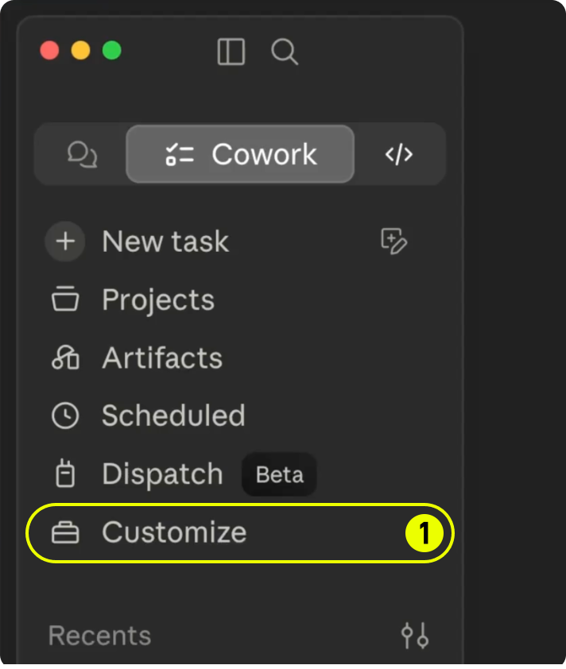
      </Step>
      <Step title="Connectors öffnen">
        Klicken Sie auf **Connectors** (mit **2** gekennzeichnet).

        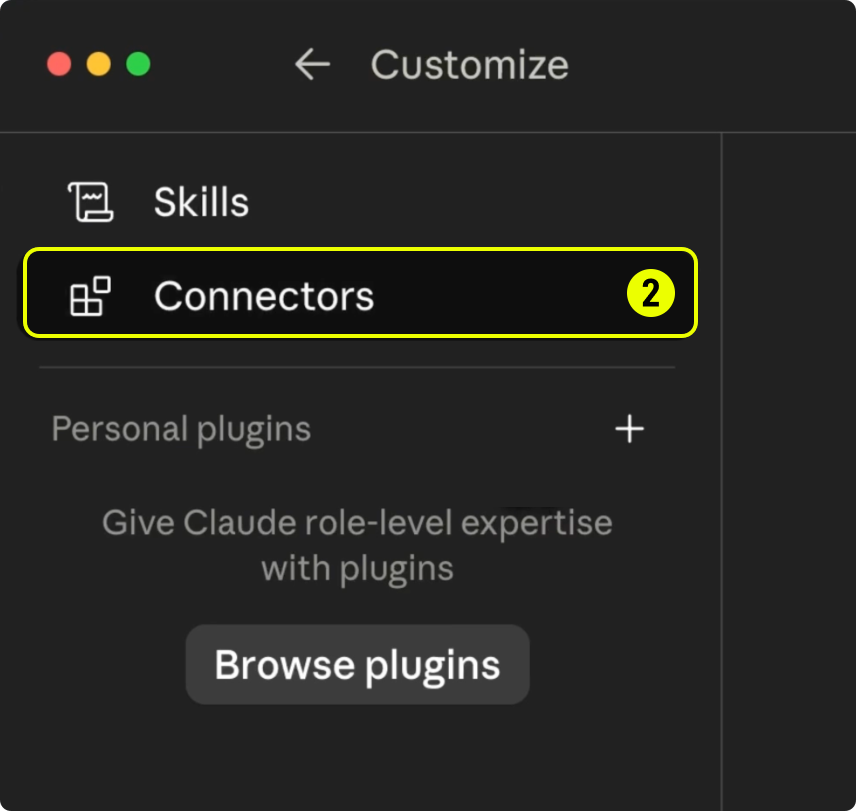
      </Step>
      <Step title="Benutzerdefinierten Connector hinzufügen">
        1. Klicken Sie in der Kopfzeile von Connectors auf die Schaltfläche **+** (mit **3** gekennzeichnet).
        2. Wählen Sie **Benutzerdefinierten Connector hinzufügen** (mit **4** gekennzeichnet).

        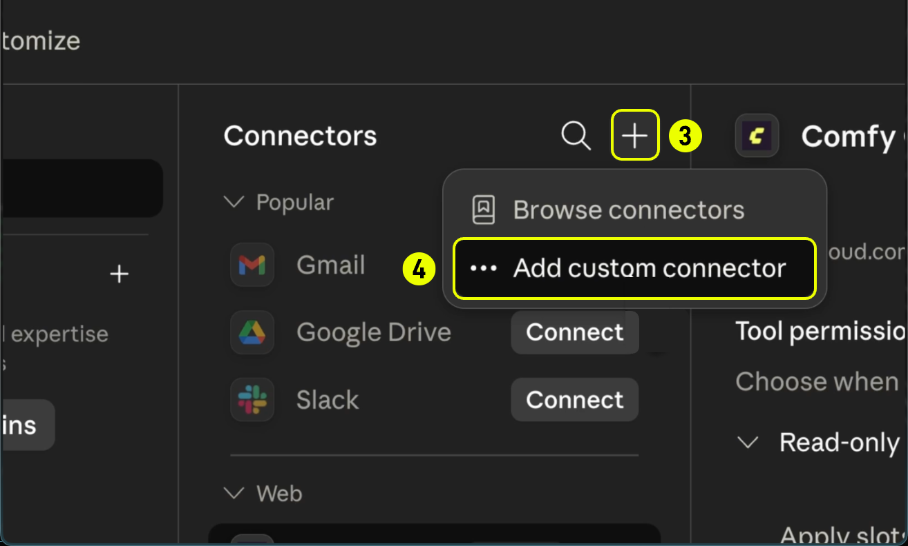
      </Step>
      <Step title="Serverdetails eingeben">
        1. Geben Sie im Feld **Name** (mit **5** gekennzeichnet) einen Namen wie **Comfy Cloud MCP** ein.
        2. Setzen Sie die **Remote MCP server URL** (mit **6** gekennzeichnet) auf `https://cloud.comfy.org/mcp`.
        3. Klicken Sie auf **Hinzufügen** (mit **7** gekennzeichnet).

        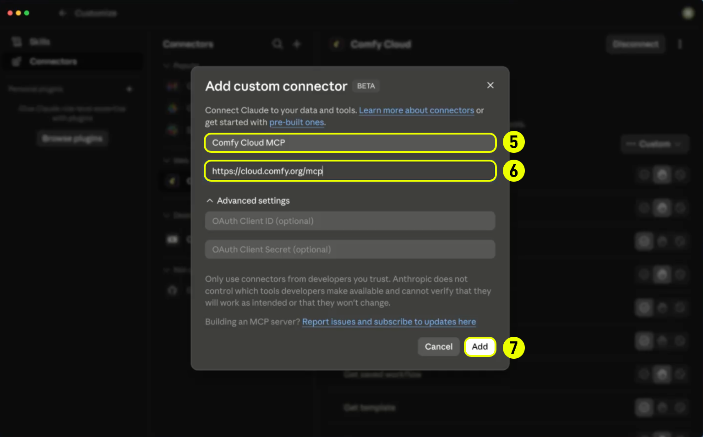
      </Step>
      <Step title="Anmelden">
        1. Wählen Sie im sich öffnenden Browser Ihren Workspace aus (zum Beispiel **Persönlicher Workspace**).
        2. Klicken Sie auf **Fortfahren**, um den Connector zu autorisieren. Sie sind verbunden.

        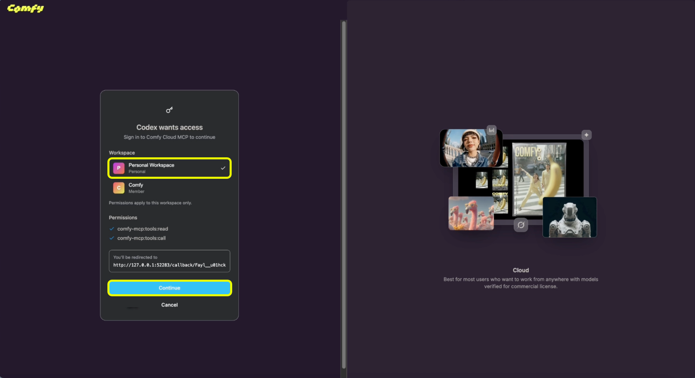
      </Step>
    </Steps>

  </Tab><Tab title="Claude Code">
    Installieren Sie das Plugin **comfy-cloud**. Es fügt die MCP-Verbindung und die Slash-Befehle in einem Schritt hinzu. Das Plugin wird über das Repository [Comfy Skills](https://github.com/Comfy-Org/comfy-skills/) veröffentlicht, in dem Claude-Code-Plugins und Agent-Skills der Community für Comfy gehostet werden.

    <Steps>
      <Step title="Marketplace hinzufügen">
        Registrieren Sie den Marketplace Comfy Skills (einmalig):

        ```
        /plugin marketplace add Comfy-Org/comfy-skills
        ```
      </Step>
      <Step title="Plugin installieren">
        ```
        /plugin install comfy-cloud@comfy-skills
        ```
      </Step>
      <Step title="Anmelden">
        Führen Sie `/mcp` aus und wählen Sie **comfy-cloud** → **Authenticate**. Ihr Browser öffnet sich zur Anmeldung, und die Tokens werden automatisch aktualisiert.
      </Step>
    </Steps>

    Das Plugin fügt diese Slash-Befehle hinzu:

    | Befehl | Funktion |
    | --- | --- |
    | `/comfy-cloud:generate-image` | Ein Bild generieren, bearbeiten oder verändern |
    | `/comfy-cloud:generate-video` | Ein Video generieren, bearbeiten oder verlängern |
    | `/comfy-cloud:generate-audio` | Audio, Musik oder Soundeffekte generieren |
    | `/comfy-cloud:generate-3d` | Ein 3D-Modell aus Text oder einem Bild generieren |
    | `/comfy-cloud:remove-background` | Den Hintergrund aus einem Bild entfernen |
    | `/comfy-cloud:upscale-image` | Ein Bild auf eine höhere Auflösung hochskalieren |
    | `/comfy-cloud:search-templates` | Vorgefertigte Workflow-Vorlagen auf [comfy.org](https://comfy.org) finden |
    | `/comfy-cloud:search-models` | Verfügbare Modelle suchen |
    | `/comfy-cloud:search-nodes` | Nodes suchen und Vorschläge zur Verbindung erhalten |
    | `/comfy-cloud:help` | Sehen, was Sie mit ComfyUI Cloud machen können |

    <Accordion title="Lieber nur die Verbindung, ohne das Plugin?">
      Fügen Sie den Server direkt hinzu:

      ```bash
      claude mcp add --transport http comfy-cloud https://cloud.comfy.org/mcp
      ```

      Führen Sie dann `/mcp` aus und wählen Sie **comfy-cloud** → **Authenticate**. Mit `-s user` steht die Verbindung in allen Ihren Projekten zur Verfügung.

      Dieser Weg stellt dieselben Workflows weiterhin als MCP-Prompts bereit: `/mcp__comfy-cloud__generate-image`, `/mcp__comfy-cloud__search-models` und so weiter (das Präfix `/mcp__<name>__` verwendet den Namen, den Sie an `claude mcp add` übergeben haben). Das oben beschriebene Plugin wird empfohlen, da es diese als die freundlicheren `/comfy-cloud:*`-Befehle bereitstellt.
    </Accordion>
  </Tab><Tab title="Cursor">
    Cursor verbindet sich über HTTP mit entfernten MCP-Servern. Cursor unterstützt **kein** MCP-OAuth. Fügen Sie Comfy Cloud mit einem Comfy Cloud API-Schlüssel in Ihrer MCP-Konfiguration hinzu.

    <Steps>
      <Step title="Cursor-Einstellungen öffnen">
        Klicken Sie auf das Zahnrad **Settings** oben rechts (gekennzeichnet mit **1**).

        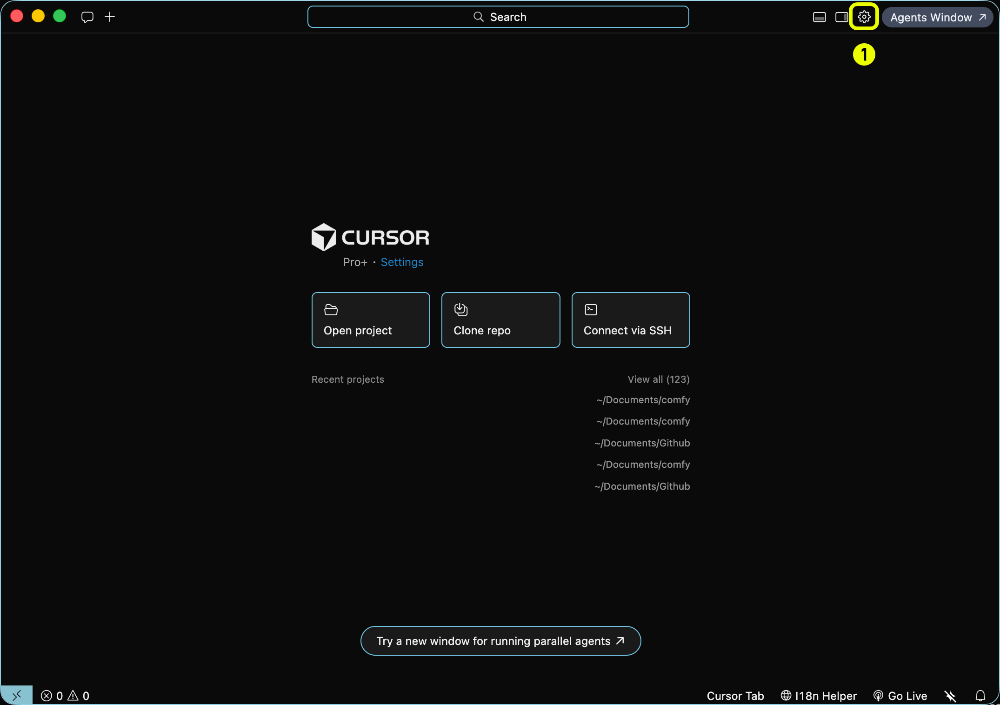
      </Step>
      <Step title="Tools & MCPs öffnen">
        1. Klicken Sie in der Seitenleiste auf **Tools & MCPs** (gekennzeichnet mit **2**).
        2. Klicken Sie auf **+ New MCP Server** (gekennzeichnet mit **3**) → **Add a Custom MCP Server**.

        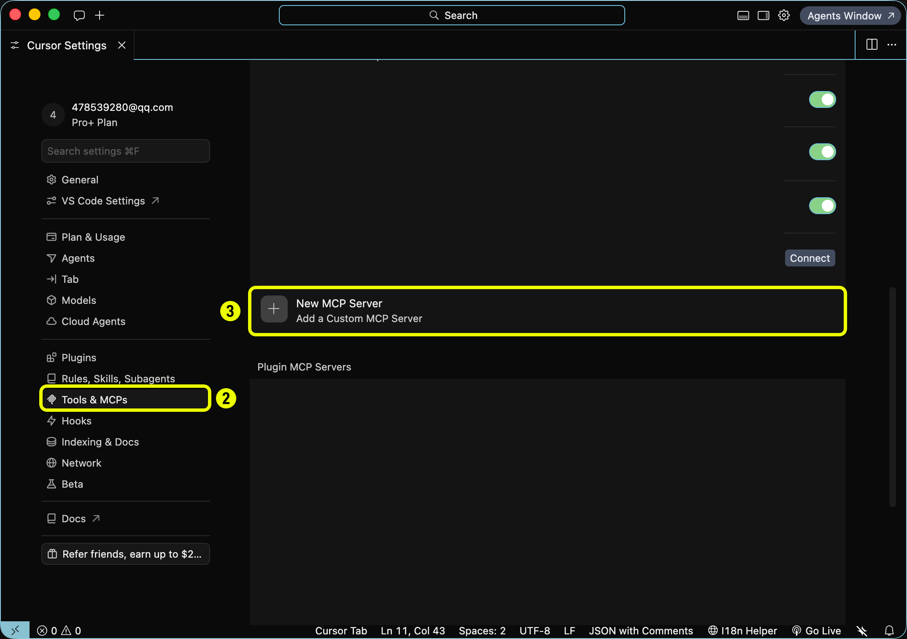
      </Step>
      <Step title="API-Schlüssel hinzufügen">
        Bearbeiten Sie `~/.cursor/mcp.json` (global) oder `.cursor/mcp.json` (projektbezogen). Legen Sie die Server-URL fest und übergeben Sie Ihren Comfy Cloud API-Schlüssel im Header `X-API-Key`. Erstellen Sie einen Schlüssel unter [platform.comfy.org/profile/api-keys](https://platform.comfy.org/profile/api-keys) (beginnt mit `comfyui-`):

        ```json
        {
          "mcpServers": {
            "comfy-cloud": {
              "url": "https://cloud.comfy.org/mcp",
              "headers": {
                "X-API-Key": "${env:COMFY_API_KEY}"
              }
            }
          }
        }
        ```

        Legen Sie `COMFY_API_KEY` in Ihrer Shell oder in den Systemumgebungsvariablen fest. Verwenden Sie lieber `${env:COMFY_API_KEY}` als den Schlüssel fest in eine Datei zu schreiben, die Sie möglicherweise in Git committen.

        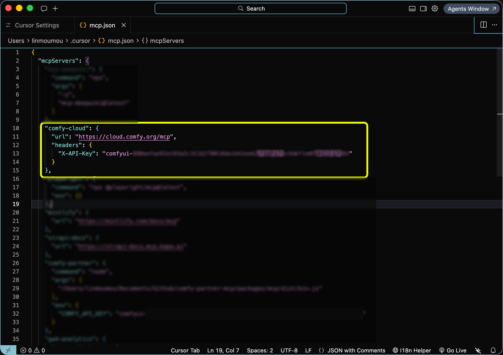
      </Step>
      <Step title="Mit dem Generieren beginnen">
        Fragen Sie in natürlicher Sprache nach („generate an image of a cat astronaut“, „find a Wan 2.2 video template“). Cursor ruft die MCP-Tools in Ihrem Namen auf.
      </Step>
    </Steps>
  </Tab><Tab title="Codex">
    [Codex](https://developers.openai.com/codex/cli) verbindet sich über Streamable HTTP mit Comfy Cloud. Fügen Sie den Server in den Einstellungen hinzu und melden Sie sich dann per OAuth an.

    <video
      controls
      className="w-full aspect-video rounded-xl"
      src="/images/agent_tools/CodeX_Oauth_mcp.mp4"
    ></video>

    <Steps>
      <Step title="Einstellungsfenster öffnen">
        1. Klicken Sie unter *Logged in with API key* auf **Settings** (markiert mit **1**).
        2. Klicken Sie auf **Settings** (markiert mit **2**), um das vollständige Einstellungsfenster zu öffnen.

        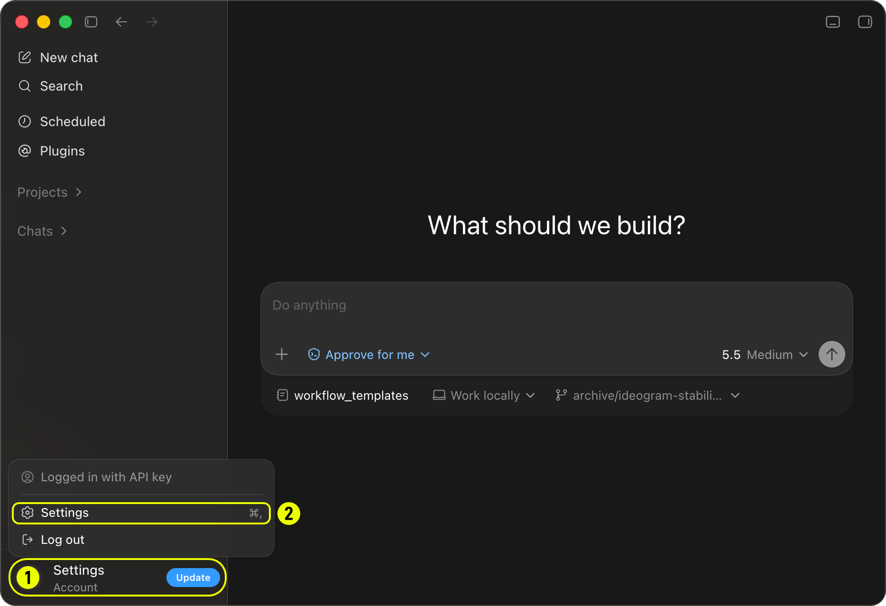
      </Step>
      <Step title="MCP-Server-Einstellungen öffnen">
        1. Klicken Sie in der Einstellungsliste auf **MCP servers** (markiert mit **3**).
        2. Klicken Sie auf **+ Add server** (markiert mit **4**), um einen neuen MCP-Server hinzuzufügen.

        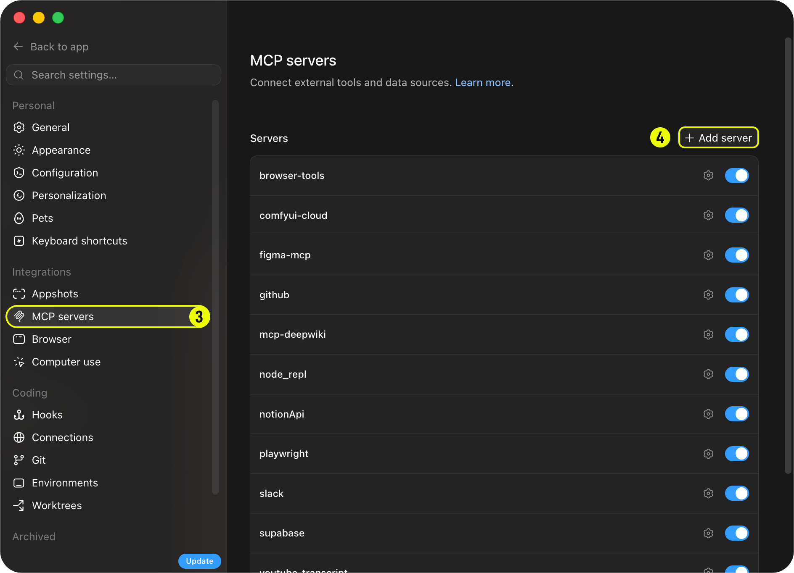
      </Step>
      <Step title="Mit Comfy Cloud verbinden">
        1. Wählen Sie **Streamable HTTP** als Verbindungstyp.
        2. Geben Sie im Feld **Name** (markiert mit **5**) einen Namen wie **Comfy Cloud MCP** ein.
        3. Geben Sie im Feld **URL** (markiert mit **6**) die URL `https://cloud.comfy.org/mcp` ein.
        4. Klicken Sie auf **Save** (markiert mit **7**).

        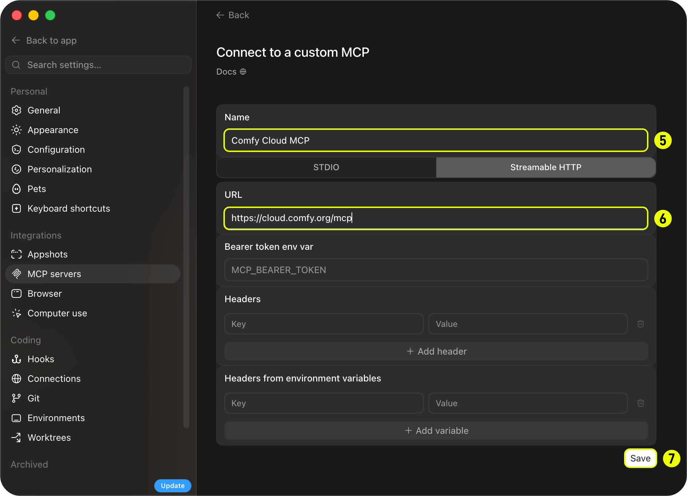
      </Step>
      <Step title="Authentifizieren">
        1. Klicken Sie beim gespeicherten Servereintrag auf **Authenticate** (markiert mit **8**).

        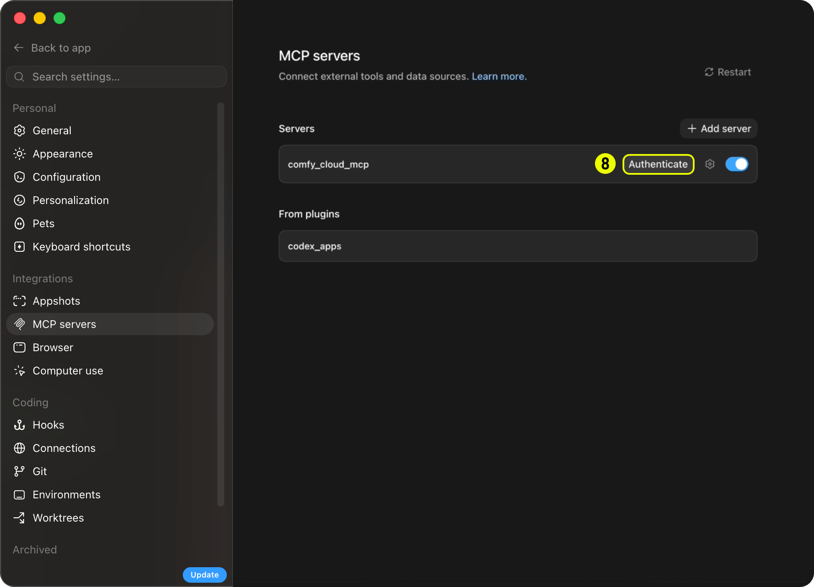

        2. Wählen Sie im Browser-Popup Ihren Workspace und klicken Sie auf **Continue**, um die Anmeldung abzuschließen. Sie sind verbunden.

        
      </Step>
    </Steps>

    Formulieren Sie Ihre Anfrage in normaler Sprache („Bild eines Katzen-Astronauten generieren“, „Wan 2.2 Video-Vorlage finden“). Codex ruft die MCP-Tools in Ihrem Namen auf.

    <Accordion title="Lieber die CLI verwenden?">
      Registrieren und anmelden im Terminal:

      ```bash
      codex mcp add comfy-cloud --url https://cloud.comfy.org/mcp
      codex mcp login comfy-cloud
      ```

      Dadurch wird ein Eintrag in `~/.codex/config.toml` geschrieben (oder in `.codex/config.toml` in einem vertrauenswürdigen Projekt).
    </Accordion>

    <Accordion title="API-Schlüssel statt OAuth (headless oder CI)">
      Wenn kein Browser verfügbar ist, fügen Sie den Server mit einem Header hinzu, der aus einer Umgebungsvariable gelesen wird. Erstellen Sie einen Schlüssel unter [platform.comfy.org/profile/api-keys](https://platform.comfy.org/profile/api-keys) (beginnt mit `comfyui-`) und fügen Sie ihn dann zu `~/.codex/config.toml` hinzu:

      ```toml
      [mcp_servers.comfy-cloud]
      url = "https://cloud.comfy.org/mcp"
      env_http_headers = { "X-API-Key" = "COMFY_API_KEY" }
      ```

      Legen Sie `COMFY_API_KEY` in Ihrer Shell oder der Systemumgebung fest. Committen Sie den Schlüssel nicht in die Versionsverwaltung.
    </Accordion>

    <Accordion title="Codex fordert Sie immer wieder zum Anmelden auf (invalid_grant oder Wiederverwendung von Refresh-Tokens)">
      **Symptom:** Codex meldet Sie bei Comfy Cloud ab und fordert Sie immer wieder zur erneuten Authentifizierung auf, manchmal alle paar Minuten. Codex-Warnungen oder -Protokolle erwähnen möglicherweise `invalid_grant`, ein Refresh-Token, das bereits verwendet oder widerrufen wurde, oder eine fehlgeschlagene Aktualisierung des OAuth-Tokens.

      **Ursache:** Das liegt daran, wie Codex die MCP-OAuth-Anmeldedaten speichert und aktualisiert, nicht an Comfy Cloud. Wenn mehrere Codex-Prozesse (TUI-Sitzungen, der App-Server, `codex mcp`-Befehle) sich einen OAuth-Server teilen, kann ein Prozess mit einem Token aktualisieren, das ein anderer bereits rotiert hat. Der Autorisierungsserver wertet das als Wiederverwendung eines Tokens und beendet die Sitzung. Nutzer anderer OAuth-MCP-Server melden dasselbe Verhalten. Diese Probleme sind im Codex-Repository offen, sodass Sie ihren aktuellen Status prüfen können:

      - [openai/codex#46028](https://github.com/openai/codex/issues/46028): langlebige Clients verwenden rotierte Refresh-Tokens erneut
      - [openai/codex#48507](https://github.com/openai/codex/issues/48507): gleichzeitige Prozesse konkurrieren bei der Rotation des Refresh-Tokens, und der nächste Start endet mit `invalid_grant`
      - [openai/codex#41133](https://github.com/openai/codex/issues/41133): beim Herunterfahren kann ein rotiertes Refresh-Token verloren gehen
      - [openai/codex#17265](https://github.com/openai/codex/issues/17265): Codex aktualisiert gespeicherte MCP-OAuth-Tokens nicht

      **Workaround 1: Aktivieren Sie das Flag für die Refresh-Koordination von Codex.** Codex hat ein Feature-Flag, `mcp_oauth_refresh_coordination`, das OAuth-Token-Aktualisierungen zwischen Codex-Prozessen koordiniert. Es ist eine Codex-Einstellung, keine von Comfy. Codex führt es als in Entwicklung befindlich und standardmäßig deaktiviert, und weder Codex noch Comfy unterstützt es als offizielle Lösung. In openai/codex#46028 hat das Aktivieren die Wiederverwendung veralteter Tokens im Test des Meldenden beendet. Wenn es in Ihrer Codex-Version noch deaktiviert ist, fügen Sie es zu `~/.codex/config.toml` hinzu:

      ```toml
      [features]
      mcp_oauth_refresh_coordination = true
      ```

      Schließen Sie alle laufenden Codex-Sitzungen und starten Sie sie neu, damit alle das Flag übernehmen. Wenn Codex **comfy-cloud** bereits als abgemeldet anzeigt, melden Sie sich einmal erneut an (`codex mcp login comfy-cloud` oder **Authenticate** in den Einstellungen). Wenn eine spätere Codex-Version dies standardmäßig aktiviert oder das Flag entfernt, können Sie diesen Schritt überspringen.

      **Workaround 2: Sorgen Sie dafür, dass nur ein Codex-Prozess jeden Server aktualisiert.** Wenn das Flag nicht verfügbar ist oder nicht hilft, verschieben Sie den Eintrag `[mcp_servers.comfy-cloud]` aus der globalen `~/.codex/config.toml` in eine `.codex/config.toml` in einem vertrauenswürdigen Projekt, sodass nur Sitzungen in diesem Projekt ihn laden und aktualisieren. Vermeiden Sie es, viele Codex-Sitzungen gleichzeitig gegen Comfy Cloud laufen zu lassen, und schließen Sie Codex-Sitzungen, bevor Sie Ihren Computer neu starten. Dies ist der in openai/codex#48507 gemeldete Workaround.

      Das Verschieben des Eintrags stoppt keine Codex-Prozesse, die die globale Konfiguration bereits geladen haben; diese aktualisieren weiterhin die alte Serverdefinition. Schließen Sie nach dem Verschieben jede laufende Codex-Sitzung und stoppen Sie den Codex-App-Server, und starten Sie Codex dann nur in dem Projekt, das den Eintrag enthält.Wenn Sie OAuth nicht benötigen, verwendet die oben beschriebene API-Schlüssel-Einrichtung keine Refresh-Tokens.

      Diese Schritte reduzieren Abmeldungen, können sie aber möglicherweise nicht vollständig verhindern. Wir arbeiten außerdem an Änderungen auf der Comfy Cloud-Seite, um die Häufigkeit zu verringern.
    </Accordion>
  </Tab><Tab title="OpenClaw">
    Installieren Sie den **Comfy Cloud**-Skill von [ClawHub](https://clawhub.ai/comfy-org/skills/comfy). Er verbindet OpenClaw mit dem gehosteten MCP-Server (`cloud.comfy.org/mcp`). Nur Cloud: eine lokale ComfyUI-Installation wird damit nicht angesteuert.

    <Steps>
      <Step title="Skill installieren">
        ```bash
        openclaw skills install @comfy-org/comfy
        ```

        Skill-Seite: [clawhub.ai/comfy-org/skills/comfy](https://clawhub.ai/comfy-org/skills/comfy).
      </Step>
      <Step title="Mit OAuth verbinden (EMPFOHLEN)">
        Registrieren Sie den MCP-Server und melden Sie sich mit Ihrem Comfy-Konto an:

        ```bash
        openclaw mcp set comfy '{"url":"https://cloud.comfy.org/mcp","transport":"streamable-http","auth":"oauth"}'
        openclaw mcp login comfy
        openclaw gateway restart
        ```

        `openclaw mcp login` gibt eine Autorisierungs-URL aus. Öffnen Sie sie, melden Sie sich an und schließen Sie den Ablauf so ab, wie die CLI es vorgibt (möglicherweise werden Sie aufgefordert, den Befehl mit einem `--code`-Wert erneut auszuführen). Prüfen Sie das Ergebnis mit `openclaw mcp status --verbose`.

        <Note>
          Wenn `auth: "oauth"` gesetzt ist, ignoriert OpenClaw statische `headers` in diesem Server-Eintrag. Kombinieren Sie OAuth nicht mit einem fest codierten API-Schlüssel-Header.
        </Note>
      </Step>
      <Step title="Mit dem Generieren beginnen">
        Fragen Sie einfach in normaler Sprache nach („generiere ein Bild einer Katze als Astronaut", „finde eine Wan-2.2-Video-Vorlage"). OpenClaw ruft die MCP-Tools in Ihrem Auftrag auf.
      </Step>
    </Steps>

    <Accordion title="API-Schlüssel statt OAuth (headless oder CI)">
      Erstellen Sie einen Schlüssel unter [platform.comfy.org/profile/api-keys](https://platform.comfy.org/profile/api-keys) (beginnt mit `comfyui-`), exportieren Sie ihn und registrieren Sie anschließend den Server:

      ```bash
      export COMFY_API_KEY="comfyui-..."
      openclaw mcp set comfy '{"url":"https://cloud.comfy.org/mcp","transport":"streamable-http","headers":{"Authorization":"Bearer ${COMFY_API_KEY}"}}'
      openclaw gateway restart
      ```

      Bevorzugen Sie bei OpenClaw `Authorization: Bearer` gegenüber einem benutzerdefinierten `X-API-Key`-Header. Einige OpenClaw-Builds verwerfen benutzerdefinierte Header bei streamable-http-Transporten; Bearer übersteht Proxys zuverlässiger. Legen Sie `COMFY_API_KEY` in Ihrem Shell-Profil oder in der OpenClaw-Umgebung ab. Committen Sie den Schlüssel nicht.
    </Accordion>
  </Tab><Tab title="Andere Clients">
    Jeder MCP-Client, der **Remote-HTTP**-Transport unterstützt, kann eine Verbindung zu Comfy Cloud herstellen. Die Server-URL ist immer `https://cloud.comfy.org/mcp`.

    <Steps>
      <Step title="Server-URL hinzufügen">
        Fügen Sie einen Remote-MCP-Eintrag hinzu, der auf `https://cloud.comfy.org/mcp` verweist. Die meisten Clients verwenden eine JSON-Konfiguration mit einem `url`-Feld:

        ```json
        {
          "mcpServers": {
            "comfy-cloud": {
              "url": "https://cloud.comfy.org/mcp"
            }
          }
        }
        ```

        **Windsurf** verwendet `serverUrl` anstelle von `url`. **Amp** verwendet dieselbe `mcpServers`-Form in **Settings → MCP Servers** oder `~/.config/amp/settings.json`.
      </Step>
      <Step title="Authentifizieren">
        Wenn Ihr Client MCP OAuth unterstützt, melden Sie sich bei Aufforderung über den Browser an. Andernfalls fügen Sie einen API-Schlüssel-Header hinzu (siehe unten).
      </Step>
      <Step title="Neustarten und überprüfen">
        Starten Sie Ihren Client neu. Sie sollten die Comfy Cloud-Werkzeuge (`search_templates`, `submit_workflow`, `get_output` und weitere) sehen, die unter dem Server **comfy-cloud** registriert sind.
      </Step>
    </Steps>

    **Headless / CI (API-Schlüssel):** Wenn OAuth nicht verfügbar ist, erstellen Sie einen Schlüssel unter [platform.comfy.org/profile/api-keys](https://platform.comfy.org/profile/api-keys) und übergeben Sie ihn als Header `X-API-Key`:

    ```json
    {
      "mcpServers": {
        "comfy-cloud": {
          "url": "https://cloud.comfy.org/mcp",
          "headers": {
            "X-API-Key": "comfyui-…"
          }
        }
      }
    }
    ```

    Für Claude Code im Terminal:

    ```bash
    claude mcp add --transport http comfy-cloud https://cloud.comfy.org/mcp -H "X-API-Key: comfyui-…"
    ```

    Bevorzugen Sie `${env:COMFY_API_KEY}` oder die Secret-Interpolation Ihres Clients, anstatt Schlüssel fest in Konfigurationsdateien zu codieren, die Sie in Git committen.
  </Tab>
</Tabs>

### Was Ihr Agent tun kann

Sie rufen die MCP-Werkzeuge nicht selbst auf. Ihr Agent wählt das passende Werkzeug basierend auf Ihrer Anfrage aus. Slash-Befehle und Prompts (unten) sind Abkürzungen, die den Agenten zu häufigen Aufgaben führen, aber auch einfache Sprache funktioniert („ein Bild eines Katzen-Astronauten generieren“, „dieses Foto hochskalieren“, „eine Wan 2.2-Video-Vorlage finden“).

Typischer Ablauf:

1. **Entdecken** Sie, was verfügbar ist (`search_templates`, `search_models`, `search_nodes` oder `cql` für Fragen zum Node-Graph).
2. **Ausführen** einer Generierung: `run_template` für eine passende vorgefertigte Vorlage, `submit_workflow` für einen benutzerdefinierten Workflow (mit `upload_file`, wenn ein Eingabebild benötigt wird) oder `partner_generate` für Partnermodelle wie Flux, Grok, Gemini, OpenAI, Ideogram und Seedance.
3. **Warten und abrufen** von Ausgaben (`wait_for_job`, dann gibt `get_output` einen Download-Befehl zurück, den Ihr Agent in Ihrer Shell ausführt).

Der Server zieht das Abgleichen mit [vorgefertigten Vorlagen](https://comfy.org/workflows) dem Erstellen eines Workflows von Grund auf vor, was in der Regel schneller zu besseren Ergebnissen führt.

### Cloud MCP-Tools

Dies sind die Tools, auf die Ihr Agent nach dem Verbinden zugreifen kann. Die Namen entsprechen denen in den Logs des MCP-Clients und in der Debug-Ausgabe.

**Erkundung**

| Tool | Beschreibung |
| --- | --- |
| `search_templates` | Vorgefertigte Workflow-Vorlagen von [comfy.org](https://comfy.org/workflows) nach Text, Tag, Medientyp oder Modell durchsuchen |
| `get_template` | Das vollständige Workflow-JSON einer Vorlage zum Prüfen oder manuellen Bearbeiten abrufen |
| `get_template_schema` | Anzeigen, welche Parameter einer Vorlage zur Laufzeit überschrieben werden können |
| `search_models` | Den Modellkatalog nach Text, Typ, Basismodell oder Quelle durchsuchen |
| `search_nodes` | Verfügbare Nodes nach Text, Kategorie oder Eingabe-/Ausgabetypen durchsuchen. Zeigt außerdem **Subgraph-Blueprints** an (bereits verbundene Node-Gruppen wie Text zu Bild oder Hintergrund entfernen) |
| `get_node` | Die vollständige Eingabespezifikation für bestimmte Nodes abrufen, einschließlich aller Optionslisten |
| `cql` | Eine [CQL](https://github.com/Comfy-Org/cql)-Graphabfrage für strukturelle Fragen ausführen (zum Beispiel, welche Nodes Bilder erzeugen oder welche Pfade zwischen Node-Typen bestehen). Verwenden Sie `search_nodes`, wenn Sie vollständige Eingabespezifikationen für einen bestimmten Node benötigen |
| `get_prompting_guide` | Prompt-Stil und empfohlene Einstellungen (Steps, cfg, Sampler, Auflösung) je Modellfamilie |
| `get_catalog_overview` | Überblickskarte des Katalogs: die verfügbaren Facetten für Modelle, Vorlagen und Nodes sowie Modellanzahlen nach Quelle. Ein nützlicher erster Aufruf zur Orientierung |
| `get_creative_technique` | Ein Rezept für eine benannte kreative Technik (empfohlene Nodes und Einstellungen) abrufen, bevor Sie zu dem Schluss kommen, dass ein Ziel nicht erreichbar ist |
| `estimate_credits` | Offline-Kostenschätzung vor der Ausführung für einen Workflow oder eine Vorlage. Sie bepreist nur bezahlte **API-Nodes** (Partnermodelle wie Flux oder Grok) und schließt GPU-, Warteschlangen- und Speicherzeit aus. Eine Schätzung von `0` bedeutet daher „nicht bepreist“, nicht „kostenlos“. Siehe [Credits und Ausgaben](#credits-and-spending) |

**Generierung**

| Tool | Beschreibung |
| --- | --- |
| `run_template` | Eine vorgefertigte Vorlage anhand ihres Namens ausführen, mit optionalen Parameter-Überschreibungen: der bevorzugte Weg, wenn eine Vorlage passt |
| `submit_workflow` | Einen Workflow im ComfyUI-API-Format zur Ausführung auf Comfy Cloud übermitteln |
| `partner_generate` | Mit Modellen der Partner-API generieren (Flux/BFL, Grok, Gemini, OpenAI, Ideogram, Seedream/Seedance und weitere) |
| `upload_file` | Ein Eingabebild oder eine Datei zur Verwendung in Workflows hochladen (zum Beispiel mit LoadImage) |
| `apply_slots` | Parameter-Überschreibungen auf die inneren Werte eines Workflows anwenden und den geänderten Workflow zurückgeben |

**Jobs und Batches**

| Tool | Beschreibung |
| --- | --- |
| `get_job_status` | Den Ausführungsstatus eines übermittelten Workflows abfragen |
| `wait_for_job` | Warten, bis ein Job abgeschlossen ist, statt wiederholt abzufragen |
| `get_output` | Ausgabebilder, Videos oder Audio aus einem abgeschlossenen Workflow abrufen |
| `use_previous_output` | Workflows verketten, indem die Ausgabe eines Laufs als Eingabe für einen anderen wiederverwendet wird |
| `cancel_job` | Einen ausstehenden oder laufenden Job abbrechen |
| `get_queue` | Prüfen, wie viele Jobs laufen und ausstehend sind |
| `submit_batch`, `get_batch_status`, `get_batch_output`, `wait_for_batch` | Viele Generierungen in einem Aufruf übermitteln und später gemeinsam abholen: Die Batch-ID bleibt über Sitzungen hinweg gültig |

**Gespeicherte Workflows**

| Tool | Beschreibung |
| --- | --- |
| `list_saved_workflows` | Ihre gespeicherten Workflows aus Comfy Cloud durchsuchen |
| `get_saved_workflow` | Nodes, Eingaben und anpassbare Einstellungen eines gespeicherten Workflows prüfen |
| `save_workflow` | Einen Workflow in Ihrem Comfy Cloud-Konto speichern |
| `update_workflow` | Einen vorhandenen Workflow direkt als neue Version aktualisieren (frühere Versionen bleiben wiederherstellbar) |
| `run_saved_workflow` | Einen gespeicherten Workflow anhand des Dateinamens ausführen: Der Server konvertiert ihn automatisch vom Editor-Format in das ausführbare Format |
| `get_workflow_upload_url` | Eine einmalig nutzbare Upload-URL für eine Workflow-Datei abrufen. Nach Abschluss des Uploads wird der Workflow in Ihrem Comfy Cloud-Konto gespeichert, was praktisch für Workflows ist, die zu groß sind, um sie direkt zu übergeben |

**Workflows teilen**

| Tool | Beschreibung |
| --- | --- |
| `share_workflow` | Einen gespeicherten Workflow veröffentlichen und eine `?share=<id>`-URL zurückgeben, die jeder öffnen kann |
| `import_shared_workflow` | Eine Freigabe-URL oder eine reine Freigabe-ID in Workflow-JSON auflösen und optional in Ihrem Konto speichern |

**Freigabe-IDs in Hub-URLs:** Das abschließende, durch Bindestriche abgetrennte Hex-Token in einer Hub-URL der Form `comfy.org/workflows/<slug>-<hex>` ist die Freigabe-ID. Zum Beispiel hat `comfy.org/workflows/topaz-starlight-upscale-1c77e82713b7` die Freigabe-ID `1c77e82713b7`. Übergeben Sie dieses Token als `share_id` an `import_shared_workflow`. Der Parameter `share_url` akzeptiert nur Abfrage-URLs der Form `?share=<id>` wie `https://cloud.comfy.org/?share=...`, keine Hub-Seiten-URLs.

**Apps und Links**

| Tool | Beschreibung |
| --- | --- |
| `create_app` | Einen gespeicherten Workflow in eine App im App-Modus umwandeln: eine vereinfachte Ansicht „Diesen Workflow ausführen“ mit ausgewählten Eingaben und Ausgaben |
| `get_app_mode_url` | Den stabilen Link abrufen, der einen Workflow als ausführbare App öffnet |
| `get_workflow_canvas_url` | Einen Link abrufen, der einen Workflow direkt auf dem Comfy Cloud-Canvas öffnet, bereit zum Ansehen, Bearbeiten oder Ausführen |

**Abrechnung und Nutzung**

| Tool | Beschreibung |
| --- | --- |
| `get_usage_report` | Durch Rechnungen belegte Nutzung und Ausgaben im Nachhinein. Ein aktuelles Credit-Guthaben ist darin nicht enthalten |
| `get_billing_activity` | Ein Feed mit der Nutzung pro Job und Kontoereignissen, Neueste zuerst. Er kommt den Kosten pro Job am nächsten: Cloud-GPU-Jobs melden GPU-Sekunden, und API-Node-Jobs melden die verbrauchten Credits |
| `get_billing_status` | Credit-Guthaben, Abonnement-Stufe und Abrechnungslink. **Nicht allgemein verfügbar:** standardmäßig deaktiviert und ausgeblendet, bis die Abrechnungsabstimmung ausgeliefert wird, daher werden die meisten Verbindungen dieses Tool nicht bereitstellen. Für Ausgaben verwenden Sie `get_usage_report` oder `get_billing_activity` |

**Konto und Sitzung**

| Tool | Beschreibung |
| --- | --- |
| `get_server_info` | Bestätigen, welchen Server der Agent erreicht hat: Umgebung, Host, Version und Authentifizierungsstatus |
| `submit_feedback` | Den Link zur Feedback-Umfrage abrufen || `report_session_summary` | Eine anonymisierte Sitzungszusammenfassung mit dem Comfy-Team teilen: **nur mit Ihrer ausdrücklichen Zustimmung**; der Agent muss zuerst nachfragen, und es sind keine Prompts, Dateipfade oder persönlichen Informationen enthalten |

**Prompts (Claude Desktop)**

Claude Desktop unterstützt keine Slash-Befehle von Claude Code. Öffnen Sie stattdessen für dieselben Workflows die **Prompt-Auswahl**:

| Prompt | Beschreibung |
| --- | --- |
| `generate-image` | Ein Bild aus einer Textbeschreibung generieren |
| `generate-video` | Ein Video aus Text oder einem Bild generieren |
| `generate-audio` | Audio, Musik oder Toneffekte generieren |
| `generate-3d` | Ein 3D-Modell aus Text oder einem Bild generieren |
| `upscale-image` | Ein Bild auf eine höhere Auflösung hochskalieren |
| `remove-background` | Den Hintergrund aus einem Bild entfernen |
| `search-templates` | Vorgefertigte Workflow-Vorlagen finden |
| `search-models` | Modelle suchen (Checkpoints, LoRAs, VAEs) |
| `search-nodes` | Nodes durchsuchen und Vorschläge für die Verkabelung erhalten |
| `help` | Erfahren Sie, was Sie mit ComfyUI Cloud alles machen können |

Sie können Prompts auch überspringen und in normaler Sprache fragen. Die MCP-Tools funktionieren genauso.

### Credits und Ausgaben

Die Suche ist kostenlos: `search_templates`, `search_models` und `search_nodes` funktionieren schon mit einem [Comfy-Konto](https://cloud.comfy.org). Für das Ausführen von Generierungen ist ein aktives Comfy Cloud-Abonnement erforderlich. Ein Guthaben aus Credits oder einem aufgeladenen Betrag allein gewährt keinen Zugriff: Sie benötigen ein aktives Abonnement, um Generierungen auszuführen, selbst wenn Sie nicht genutzte Credits haben.

**Läufe mit Standardmodellen kosten weiterhin Credits.** Ein Cloud-Lauf mit einem Standardmodell (ohne Partner-Node) wird pro aktiver GPU-Sekunde abgerechnet. `estimate_credits` berechnet diese Zeit nicht: Der Aufruf deckt nur kostenpflichtige **API-Nodes** ab (Partnermodelle wie Flux oder Grok). Eine Schätzung von `0` bedeutet daher, dass der Lauf keine bepreisten API-Nodes enthält, und nicht, dass der Lauf kostenlos ist. Was ein Lauf tatsächlich verbraucht hat, erfahren Sie über `get_usage_report` oder `get_billing_activity`, der GPU-Sekunden pro Aufgabe ausweist.

### Hochladen und Herunterladen

Der MCP-Server läuft in der Cloud, und das MCP selbst schreibt keine Dateien auf Ihren Rechner. Wenn eine Generierung abgeschlossen ist, ruft Ihr Agent `get_output` auf, was Folgendes zurückgibt:

1. Eine **temporäre signierte Download-URL** (für ein kurzes Zeitfenster gültig).
2. Einen sofort ausführbaren **Shell-Befehl** (`curl` unter macOS und Linux, `curl.exe` unter Windows).

Ihr Agent sollte diesen Befehl in Ihrer Shell ausführen. Der Befehl enthält den Zielpfad und den Dateinamen.

<Warning>
  Führen Sie den zurückgegebenen Befehl **wörtlich** aus. Kodieren Sie die signierte URL nicht neu und bearbeiten Sie sie nicht. Die Signatur befindet sich im Query-String und wird ungültig, wenn die URL verändert wird.
</Warning>

Wenn Ihr MCP-Client keine Shell-Befehle ausführen kann (bei einigen reinen GUI-Setups), kopieren Sie den Befehl und führen Sie ihn selbst in einem Terminal aus.

Das Hochladen und Herunterladen von Assets hängt vom Dateizugriff des Clients ab. Wenn Claude Desktop oder ein anderer Agent-Client Probleme beim Hochladen oder Herunterladen von Assets hat, kann dies mit dem Zugriff des Agenten auf Ihre lokalen Dateiverzeichnisse zusammenhängen. Für Claude-Nutzer empfehlen wir **Claude Code** (Desktop-App oder Terminal); es bietet mehr Funktionen. Ähnlich ist bei anderen Agent-Familien der Coding-Agent normalerweise besser als die Web-Chat-Version.

### Bekannte Einschränkungen

Comfy Cloud MCP ist eine frühe Version. Diese Einschränkungen sind bekannt und werden bearbeitet:

**Workflows**

- **Über `submit_workflow` generierte Assets enthalten möglicherweise keine Workflow-Metadaten.** Beim Öffnen in ComfyUI wird möglicherweise nicht der ursprüngliche Workflow erneut geöffnet.
- **Die Workflow-Erstellung hängt von der Genauigkeit des Agenten ab.** Komplexe Multi-Node-Workflows müssen möglicherweise erneut versucht oder verfeinert werden.

**Dateiverarbeitung**

- **Ausgaben erfordern einen Schritt zum Herunterladen über die Shell.** Siehe [Hochladen und Herunterladen](#uploads-and-downloads).
- **Größenbeschränkungen beim Hochladen** können je nach Ihrem MCP-Client gelten. Einige Clients setzen eigene Grenzen für das Hochladen von Dateien.

**Authentifizierung**

- **OAuth oder API-Schlüssel.** Claude Code und Claude Desktop verwenden einen einmaligen OAuth-Flow im Browser. **Cursor** erfordert einen Comfy Cloud API-Schlüssel in Ihrer MCP-Konfiguration (kein OAuth). Andere Headless-Clients können stattdessen einen Comfy Cloud API-Schlüssel über den Header `X-API-Key` übergeben. Ein Device-Code-OAuth-Flow für Clients, die keinen Browser öffnen können, ist geplant.

## Lokale Comfy-MCP-Verbindung

Die Open-Source-Verbindung: Ihr Client startet den Server auf Ihrem Rechner, und dieser steuert das dort installierte ComfyUI.

[**comfy-mcp**](https://github.com/Comfy-Org/comfy-mcp) ist Comfys **eigener lokaler MCP-Server**: der offizielle Weg, eine **lokale** ComfyUI-Installation von KI-Agenten (Claude Code, Claude Desktop, Cursor und anderen MCP-Clients) aus zu steuern.

Anders als die Cloud- und Partner-Server spricht er mit dem ComfyUI, das auf **Ihrem eigenen Rechner** läuft. So kann er Ihre Workflows ausführen und die Nodes, Custom Nodes und Modelle prüfen, die in Ihrer Installation tatsächlich vorhanden sind.

<Tip>
  **Die schnellste Einrichtung: Übergeben Sie es an Ihren Agenten.** Fügen Sie `https://docs.comfy.org/agent-tools/mcp#installation` in Ihren KI-Client ein und bitten Sie ihn, die lokale Verbindung für Sie einzurichten.
</Tip>

### Anforderungen

- **Python 3.10+**
- **[comfy-cli](https://github.com/Comfy-Org/comfy-cli)** in Ihrem `PATH` (`pip install "comfy-cli>=1.14.0"`), die Engine, die jedes Tool umschließt
- **Ein ComfyUI-Workspace**: Erstellen Sie einen mit `comfy install`, falls Sie noch keinen haben (ein vorhandener Checkout funktioniert über `comfy set-default <path>`)
- **Ein laufendes ComfyUI für Ausführungs-Tools.** Starten Sie es mit `comfy launch` oder rufen Sie `launch_comfyui` auf. Der Server startet ComfyUI nicht implizit.

---

### Installation

Aus [PyPI](https://pypi.org/project/comfy-mcp/):

```bash
pip install comfy-mcp
```

Damit liegt ein `comfy-mcp`-Konsolenskript in Ihrem `PATH`: Dieser Befehl ist der MCP-Server (er spricht MCP über stdio). Verweisen Sie Ihren KI-Client weiter unten darauf. (Sie möchten am Server selbst arbeiten? Dann installieren Sie stattdessen `pip install -e .` aus einem Checkout des [Repository](https://github.com/Comfy-Org/comfy-mcp).)

<Note>
  **`COMFY_BIN` (optional).** MCP-Clients starten den Server mit ihrer eigenen Umgebung, die häufig **nicht** den `PATH` Ihrer Shell enthält. Wenn `comfy` in einer virtuellen Umgebung oder an einem nicht standardisierten Ort liegt, setzen Sie `COMFY_BIN` auf seinen absoluten Pfad (zum Beispiel `/path/to/venv/bin/comfy`). Jedes Client-Beispiel unten zeigt, wo der Eintrag hingehört; lassen Sie ihn weg, wenn `comfy` bereits in der Umgebung liegt, mit der Ihr Client den Server startet.
</Note>

---

### Manuelle Konfiguration

Alle Clients verwenden denselben MCP-stdio-Vertrag: Führen Sie den Befehl `comfy-mcp` als Server aus. Wählen Sie Ihren Client:

<Tabs>
  <Tab title="Claude Desktop">
    Bearbeiten Sie `claude_desktop_config.json` (Settings → Developer → Edit Config; unter macOS liegt sie unter `~/Library/Application Support/Claude/claude_desktop_config.json`), fügen Sie den Server hinzu und starten Sie Claude Desktop dann neu:

    ```json
    {
      "mcpServers": {
        "comfy-mcp": {
          "command": "comfy-mcp",
          "env": { "COMFY_BIN": "/path/to/venv/bin/comfy" }
        }
      }
    }
    ```
  </Tab>

  <Tab title="Claude Code">
    Ein Befehl registriert den Server:

    ```bash
    claude mcp add comfy-mcp -e COMFY_BIN=/path/to/venv/bin/comfy -- comfy-mcp
    ```

    Oder nehmen Sie ihn mit einer `.mcp.json` im Repo-Stamm in ein Projekt auf:

    ```json
    {
      "mcpServers": {
        "comfy-mcp": {
          "command": "comfy-mcp",
          "env": { "COMFY_BIN": "/path/to/venv/bin/comfy" }
        }
      }
    }
    ```
  </Tab>

  <Tab title="Cursor">
    Fügen Sie den Server zu `~/.cursor/mcp.json` (global) oder `.cursor/mcp.json` (pro Projekt) hinzu:

    ```json
    {
      "mcpServers": {
        "comfy-mcp": {
          "command": "comfy-mcp",
          "env": { "COMFY_BIN": "/path/to/venv/bin/comfy" }
        }
      }
    }
    ```
  </Tab>
</Tabs>

---

### Schnellstart

Von null zum generierten Bild:

<Steps>
  <Step title="Die Komponenten installieren">
    ```bash
    pip install "comfy-cli>=1.14.0"  # die Engine
    comfy install                    # einen ComfyUI-Workspace erstellen (überspringen, wenn Sie einen haben)
    pip install comfy-mcp            # dieser MCP-Server → der Befehl `comfy-mcp`
    ```
  </Step>
  <Step title="ComfyUI starten und laufen lassen">
    ```bash
    comfy launch
    ```
  </Step>
  <Step title="Den Server zu Ihrem Client hinzufügen">
    Verwenden Sie den Snippet für Ihren Client von oben und starten Sie ihn dann neu bzw. laden Sie ihn neu, damit die Tools erscheinen.
  </Step>
  <Step title="Ihren Agenten bitten, einen Workflow auszuführen">
    Zum Beispiel:

    > "Bestätigen Sie, dass mein lokales ComfyUI läuft, führen Sie dann den Workflow unter `~/workflows/txt2img.json` aus und zeigen Sie mir das Bild."

    Im Hintergrund ruft der Agent `server_info` auf, um zu bestätigen, dass ComfyUI läuft, `run_workflow`, um das Workflow-JSON auszuführen, und `fetch_outputs`, um das Ergebnis einzusammeln.
  </Step>
</Steps>

---

### Tools

Jedes Tool entspricht einem `comfy-cli`-Befehl, ausgeführt mit `--where local`. Eine Auswahl:

| Tool | Zweck |
|---|---|
| `server_info()` | Läuft ein lokales ComfyUI, wo, und in welchem Workspace. **Zuerst aufrufen.** |
| `run_workflow(workflow_path, wait=True)` | Führt ein Workflow-JSON aus; `wait=False` übergibt asynchron und gibt eine `prompt_id` zurück. |
| `job_status` / `wait_for_job` / `watch_job` | Einen übergebenen Job abfragen, auf ihn warten oder ihn streamen. |
| `fetch_outputs(prompt_id, out_dir)` | Die Ausgaben eines abgeschlossenen Jobs nach `out_dir` kopieren. |
| `launch_comfyui` / `stop_comfyui` | Das lokale ComfyUI starten oder stoppen. |
| `search_templates` / `fetch_template` | Eine integrierte Vorlage finden und ihr ausführbares Workflow-JSON schreiben. |
| `search_nodes` / `get_node` / `list_nodes` | Die Node-Klassen in Ihrer **live lokalen** Installation prüfen (inklusive Custom Nodes). |
| `search_models` | Die Modelldateien auf dem Datenträger auflisten. |
| `validate_workflow` | Einen Workflow vor einem langsamen Lauf vorab gegen das live `object_info` prüfen. |

Node-Introspektion und Modellsuche lesen Ihre **live Installation**, inklusive Custom Nodes. Das unterscheidet die lokale von der Cloud-Verbindung. Die vollständige Tool-Liste und Referenz finden Sie im [Repository](https://github.com/Comfy-Org/comfy-mcp).

---

## Weiterführende Ressourcen

| Ressource | Wofür sie gedacht ist |
| --- | --- |
| [Comfy Skills](https://github.com/Comfy-Org/comfy-skills/) | Marktplatz für Claude-Code-Plugins und Community-Bibliothek für Skills. Das oben verwendete Plugin **comfy-cloud** wird hier verteilt; durchsuchen Sie weitere Skills für Comfy-Workflows oder tragen Sie eigene bei. |
| [Comfy Cloud auf ClawHub](https://clawhub.ai/comfy-org/skills/comfy) | OpenClaw-Skill (`openclaw skills install @comfy-org/comfy`) für den gehosteten Comfy Cloud MCP-Server. |
| [Comfy CLI](/agent-tools/cli) | Kommandozeilenwerkzeug zum lokalen Installieren und Starten von ComfyUI sowie zum Aufrufen gehosteter Partner-Nodes aus Skripten oder CI (`comfy generate`, in der Beta). Ergänzt MCP, wenn Sie Terminal- oder Automatisierungs-Workflows benötigen. |
| [Einen Workflow auf Comfy Cloud teilen](/de/cloud/share-workflow) | Teilen Sie Workflows über die Comfy Cloud UI (das MCP-Werkzeug `share_workflow` erledigt dies aus einer Agent-Sitzung heraus). |

## Verwandt: Comfy Agent

Sie möchten das Agent-Erlebnis **innerhalb** von ComfyUI und nicht als externen MCP-Client?

<Card title="Comfy Agent" icon="comments" href="/de/agent-tools/in-app-agent">
  Integrierter ComfyUI-Assistent zum Erstellen, Bearbeiten und Ausführen von Workflows. **Allgemein verfügbar in Cloud.** Lokal (Comfy Desktop) demnächst verfügbar.
</Card>

## Feedback

Testen Sie Comfy MCP und teilen Sie uns mit, was funktioniert und was nicht:

- **[Feedbackumfrage](https://links.comfy.org/cloudmcpbeta)**: Melden Sie Fehler, schlagen Sie Funktionen vor oder teilen Sie allgemeine Eindrücke.
- **Discord**: [#comfy-mcp-and-cli](https://discord.gg/xWJn6nhE3R) im Comfy Discord für Fragen und Diskussion.

## FAQ

### Erste Schritte

<AccordionGroup>
  <Accordion title="Welche Clients werden unterstützt?">
    Jeder MCP-kompatible Client.

    Die **Cloud-Verbindung** benötigt Unterstützung für Remote-HTTP. **Claude Code**, **Claude Desktop**, **Cursor**, **Codex** und **OpenClaw** haben oben eine eigene Einrichtung; **Windsurf**, **Amp** und andere verwenden dieselbe URL mit OAuth oder einem API-Schlüssel.

    Die **lokale Verbindung** benötigt einen Client, der einen lokalen stdio-Server als Unterprozess starten kann. Browserbasierte Clients scheiden damit aus. [claude.ai](https://claude.ai) und ChatGPT akzeptieren nur Remote-Konnektoren.
  </Accordion>
  <Accordion title="Wie lautet die Server-URL?">
    Die Cloud-Verbindung läuft unter `https://cloud.comfy.org/mcp`.

    Die lokale Verbindung hat keine URL. Ihr Client startet den Befehl `comfy-mcp` direkt und kommuniziert über stdio damit.
  </Accordion>
  <Accordion title="Kann ich sie mit meinem lokalen ComfyUI verwenden?">
    Ja. Das ist die [Lokale Comfy-MCP-Verbindung](#local-comfy-mcp-connection). Sie steuert das ComfyUI, das auf Ihrem eigenen Rechner installiert ist. Ihr Agent sieht damit die Modelle, LoRAs und Custom Nodes, die Sie tatsächlich haben, und läuft auf Ihrer GPU.
  </Accordion>
  <Accordion title="Kann ich Cloud- und lokale Verbindung gleichzeitig nutzen?">
    Ja, und wir empfehlen das, wenn Sie ComfyUI lokal betreiben. Die meisten Clients betreiben problemlos zwei MCP-Server, und Ihr Agent hält sie auseinander. Jede Verbindung führt ihre eigenen Workflows aus und liefert ihre eigenen Ergebnisse.

    Die beiden Anmeldungen sind jedoch **getrennt**. Eine Anmeldung bei der einen meldet Sie nicht bei der anderen an, obwohl es dasselbe Comfy-Konto ist.
  </Accordion>
  <Accordion title="Woran erkenne ich, ob mein Rechner die lokale Verbindung ausführen kann?">
    Fragen Sie Ihren Agenten. Er liest Ihre Hardware aus, bevor er etwas Aufwendiges startet.

    Auf einem **Mac** verwenden Sie zum Generieren die Cloud-Verbindung: Die heutigen Open-Weight-Modelle sind zu groß, um auf der Apple-GPU mit brauchbarer Geschwindigkeit zu laufen. Auf einem **PC mit dedizierter Grafikkarte** reichen 24 GB oder mehr VRAM für die meisten Aufgaben einschließlich Video; 8–24 GB genügen für Bilder, aber Video wird langsam sein oder nicht passen; unter 8 GB verwenden Sie die Cloud.
  </Accordion>
  <Accordion title="Ist es allgemein verfügbar?">
    Ja. Die Cloud-Verbindung ist allgemein verfügbar, und die lokale Verbindung steht für lokale ComfyUI-Installationen zur Verfügung. Unter [Feedback](#feedback) können Sie Probleme melden oder Anregungen teilen.
  </Accordion>
</AccordionGroup>

### Kosten und Zugriff

<AccordionGroup>
  <Accordion title="Kostet das etwas?">
    Das Durchsuchen ist bei beiden Verbindungen kostenlos: Vorlagen, Modelle und Nodes zu suchen erfordert nur ein Comfy-Konto.

    Bei der **Cloud-Verbindung** erfordert das Ausführen von Generierungen ein aktives Abonnement für Comfy Cloud; neue Nutzer erhalten 5 kostenlose Durchläufe. Bei der **lokalen Verbindung** sind Durchläufe kostenlos, da sie auf Ihrer Hardware stattfinden. Eine Ausnahme gibt es: Partnermodelle werden auf der Infrastruktur der Partner ausgeführt und verbrauchen Credits.
  </Accordion>
  <Accordion title="Benötigen Sie einen API-Schlüssel?">
    Nicht bei interaktiven Clients, die OAuth unterstützen, darunter Claude Code, Claude Desktop, Codex und OpenClaw.

    **Cursor** benötigt einen Comfy Cloud API-Schlüssel in Ihrer MCP-Konfiguration; dort gibt es noch kein MCP-OAuth. Headless- und CI-Setups ohne Browser benötigen ebenfalls einen. Siehe die Tabs **Cursor** und **Other clients** unter [Cloud-Verbindung einrichten](#set-up-the-cloud-connection).
  </Accordion>
</AccordionGroup>

### Verwendung

<AccordionGroup>
  <Accordion title="Was kann mein Agent, sobald er verbunden ist?">
    Sie rufen die MCP-Tools nicht selbst auf: Ihr Agent wählt sie danach aus, was Sie anfragen. Typischerweise **ermittelt** er, was verfügbar ist (`search_templates`, `search_models`, `search_nodes`), **startet** eine Generierung und **wartet dann und ruft** die Ausgabe ab. Siehe [Was Ihr Agent tun kann](#what-your-agent-can-do).
  </Accordion>
  <Accordion title="Wohin gehen meine Ausgaben?">
    Bei der **Cloud-Verbindung** schreibt der Server nie auf Ihren Rechner: `get_output` liefert eine temporäre signierte URL und einen sofort ausführbaren Download-Befehl, den Ihr Agent in Ihrer Shell ausführt. Siehe [Uploads und Downloads](#uploads-and-downloads).

    Bei der **lokalen Verbindung** schreibt ComfyUI in das Verzeichnis `output/` Ihres Workspace, und `fetch_outputs(prompt_id, out_dir)` kopiert die Dateien einer abgeschlossenen Aufgabe an einen beliebigen von Ihnen angegebenen Ort.
  </Accordion>
  <Accordion title="Ich habe mit einer Verbindung begonnen und brauche jetzt die andere. Was mache ich?">
    Nichts rückgängig zu machen: Fügen Sie die zweite Verbindung neben der ersten hinzu.

    Der Weg **lokal → Cloud** (Sie brauchen Cloud-GPUs oder Partnermodelle): Lassen Sie sich von Ihrem Agenten anmelden und fügen Sie dann `https://cloud.comfy.org/mcp` zu Ihrem Client hinzu.

    Der Weg **Cloud → lokal** (Sie möchten Ihre eigenen Modelle und Custom Nodes): Installieren Sie ComfyUI und den lokalen Server und richten Sie dann Ihren Client darauf aus. Ihr Agent kann das meiste davon für Sie erledigen.
  </Accordion>
  <Accordion title="Wie wechsle ich zwischen der lokalen und der Cloud-Verbindung?">
    Fragen Sie einfach Ihren Agenten. Wenn beide Verbindungen hinzugefügt sind, sagen Sie, wo eine Aufgabe laufen soll: „Führen Sie diese auf Comfy Cloud aus“, „machen Sie das lokal“, und er nutzt die richtige Verbindung. Es gibt keinen Modus zum Umschalten und nichts, was zwischen den Läufen neu konfiguriert werden muss.

    Wenn sich ein Workflow als zu schwer für Ihren Rechner erweist, kann Ihr Agent Sie darauf hinweisen und anbieten, ihn stattdessen auf Comfy Cloud auszuführen. Und wenn nur eine Verbindung eingerichtet ist, bitten Sie ihn, die andere hinzuzufügen: Siehe [Cloud-Verbindung einrichten](#set-up-the-cloud-connection) oder [Lokale Comfy MCP-Verbindung](#local-comfy-mcp-connection).
  </Accordion>
  <Accordion title="Wie aktualisiere ich Comfy MCP?">
    Bei der **Cloud-Verbindung** gibt es nichts zu tun: Sie wird gehostet, daher sind Sie immer auf der aktuellen Version.

    Bei der **lokalen Verbindung** bitten Sie Ihren Agenten darum. **Starten Sie danach Ihren Client neu** oder beginnen Sie eine neue Sitzung: MCP-Server werden beim Start einer Sitzung geladen, daher liefert ein laufender weiterhin die alte Version, bis Sie das tun.
  </Accordion>
</AccordionGroup>

### Fehlerbehebung

<AccordionGroup>
  <Accordion title="Funktionieren Slash-Befehle in Claude Desktop?">
    Nein. Slash-Befehle sind im Claude Code Plugin enthalten. Claude Desktop verbindet sich mit demselben MCP-Server: Die Tools funktionieren, wenn Sie in natürlicher Sprache danach fragen oder die Prompt-Auswahl verwenden, aber Claude Desktop unterstützt weder Claude Code Plugins noch Slash-Befehle.
  </Accordion>
  <Accordion title="Warum erscheint nach /comfy oder /cloud nichts?">
    Es gibt keinen Befehl `/comfy` oder `/cloud`. Befehle erscheinen unter einem von zwei Präfixen, je nachdem, wie Sie sich verbunden haben:

    - **Plugin (empfohlen):** `/comfy-cloud:generate-image`, `/comfy-cloud:generate-video`, … Tippen Sie `/comfy-cloud:`, um alle zu sehen.
    - **Direkte Verbindung (ohne Plugin):** `/mcp__comfy-cloud__generate-image`, … Tippen Sie `/mcp__`, um sie zu sehen.

    In beiden Fällen können Sie einfach in natürlicher Sprache fragen („generiere ein Bild von …“). Die MCP-Tools werden vom Modell aufgerufen und benötigen keinen Slash-Befehl.
  </Accordion>
  <Accordion title="Die Anmeldung hat keinen Browser geöffnet.">
    Führen Sie in Claude Code `/mcp` aus, wählen Sie **comfy-cloud** und dann **Authenticate**. Öffnen Sie in Claude Desktop den Connector erneut unter **Anpassen → Connectors** und lösen Sie die Anmeldung aus.
  </Accordion>
</AccordionGroup>
