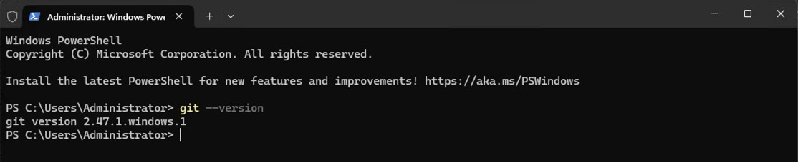
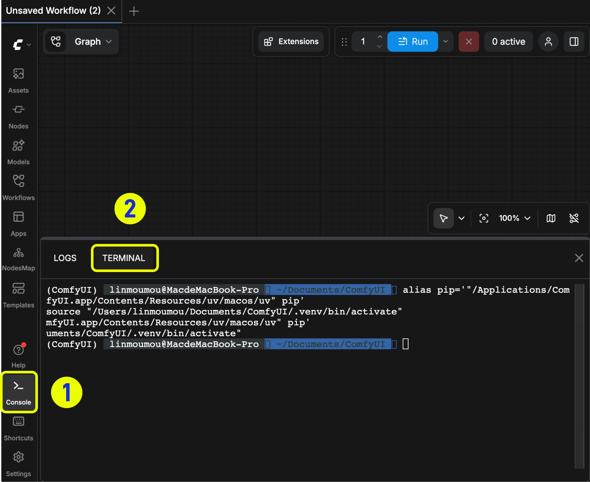
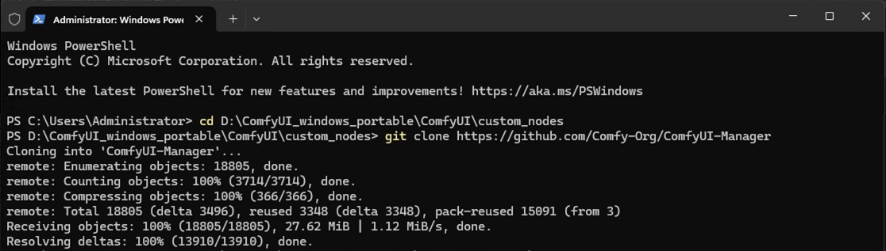
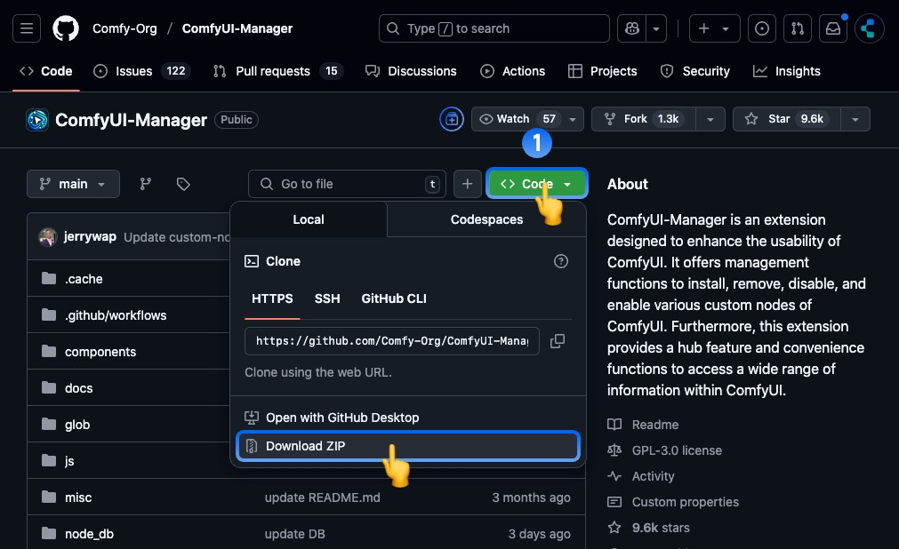
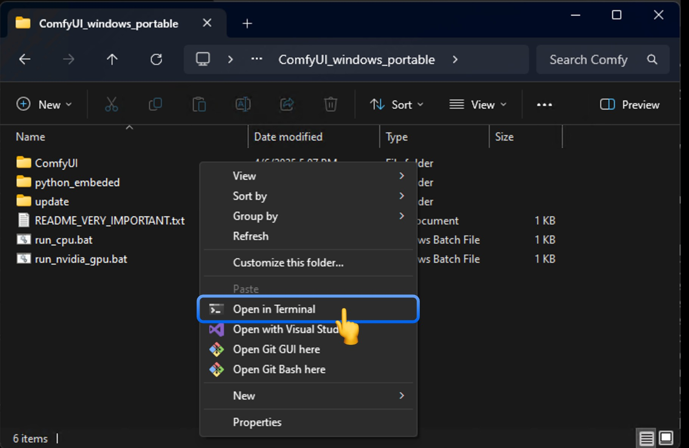
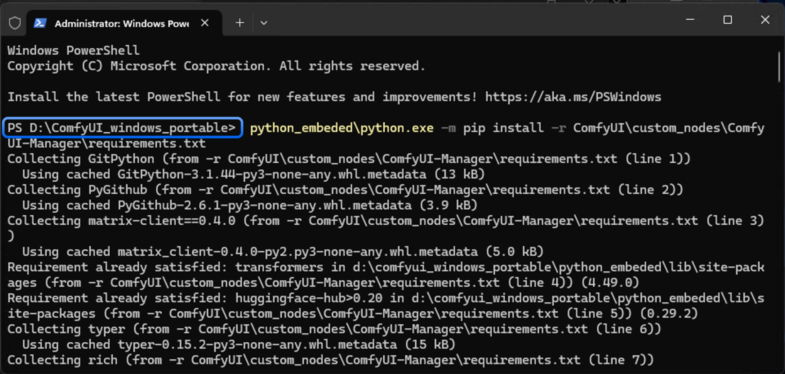
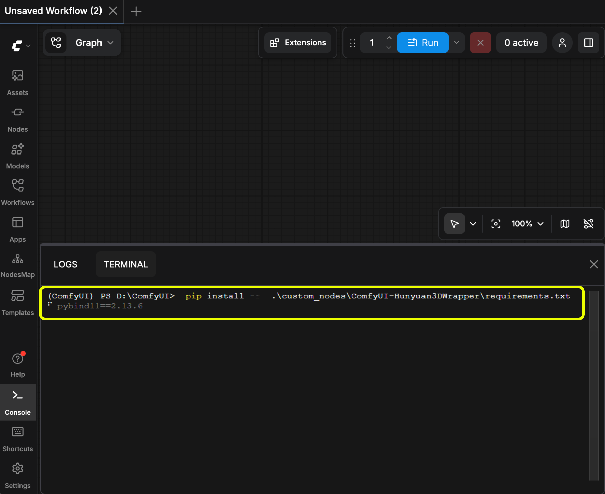
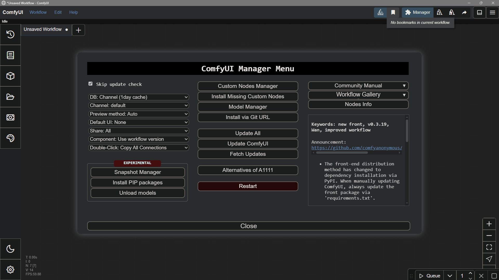

## Über Custom Nodes

Nach der Installation von ComfyUI werden Sie feststellen, dass es viele integrierte Nodes enthält. Diese nativen Nodes werden als **Comfy Core**-Nodes bezeichnet und offiziell von ComfyUI gepflegt.

Darüber hinaus gibt es zahlreiche [**Custom Nodes**](https://registry.comfy.org), die von verschiedenen Autorinnen und Autoren aus der ComfyUI-Community erstellt wurden. Diese Custom Nodes bringen umfangreiche Funktionalität in ComfyUI und erweitern die Möglichkeiten und Grenzen der Funktionalität erheblich.

In dieser Anleitung behandeln wir verschiedene Operationen im Zusammenhang mit Custom Nodes, einschließlich Installation, Aktualisierung, Deaktivierung, Deinstallation und Installation von Abhängigkeiten.

Jede und jeder kann eigene Erweiterungen für ComfyUI entwickeln und mit anderen teilen. Viele Custom Nodes aus der Community finden Sie [hier](https://registry.comfy.org). Wenn Sie eigene Custom Nodes entwickeln möchten, sehen Sie sich den folgenden Abschnitt an, um loszulegen:

<Card title="Mit der Entwicklung von Custom Nodes beginnen" icon="link" href="/de/custom-nodes/overview">
  Erfahren Sie, wie Sie mit der Entwicklung eines Custom Node beginnen
</Card>

## Verwaltung von Custom Nodes

In diesem Abschnitt behandeln wir:
- Custom Nodes installieren
- Node-Abhängigkeiten installieren
- Versionskontrolle für Custom Nodes
- Custom Nodes deinstallieren
- Custom Nodes vorübergehend deaktivieren
- Abhängigkeitskonflikte von Custom Nodes behandeln


### 1. Custom Nodes installieren {#1-installing-custom-nodes}

Derzeit unterstützt ComfyUI mehrere Methoden zum Installieren von Custom Nodes, darunter:

- [Installation über ComfyUI Manager (empfohlen)](#install-via-comfyui-manager)
- Installation über Git
- Manuelle Installation

Wir empfehlen, Custom Nodes über **ComfyUI Manager** zu installieren. Dieses Werkzeug ist im Ökosystem der ComfyUI Custom Nodes von großer Bedeutung. Es macht die Verwaltung von Custom Nodes (etwa Suchen, Installieren, Aktualisieren, Deaktivieren und Deinstallieren) einfach: Sie müssen nur den gewünschten Node in ComfyUI Manager suchen und auf Installieren klicken.

Da jedoch alle Custom Nodes derzeit auf GitHub gehostet werden, haben wir für Regionen, in denen GitHub nicht regulär erreichbar ist, in dieser Anleitung ausführliche Anweisungen zu den verschiedenen Installationsmethoden für Custom Nodes zusammengestellt.

Da wir außerdem **ComfyUI Manager** für die Verwaltung von Plugins empfehlen, empfehlen wir, dieses Werkzeug für die Plugin-Verwaltung zu verwenden. Den Quellcode finden Sie [hier](https://github.com/Comfy-Org/ComfyUI-Manager).
Daher verwenden wir in dieser Dokumentation die Installation von ComfyUI Manager als Beispiel für die Installation von Custom Nodes und ergänzen in den relevanten Einführungsabschnitten, wie Sie ihn zur Verwaltung von Nodes einsetzen.

<Tabs><Tab title="Über ComfyUI Manager installieren">

Da ComfyUI Manager einen sehr großen Funktionsumfang bietet, wird die Installation über ComfyUI Manager in einem eigenen Dokument behandelt. Im folgenden Link erfahren Sie, wie Sie mit ComfyUI Manager Custom Nodes installieren.

<Card title="Custom Nodes mit ComfyUI Manager installieren" icon="link" href="/de/installation/install_custom_node#method-1-comfyui-manager-recommended">
  Erfahren Sie, wie Sie mit ComfyUI Manager Custom Nodes installieren
</Card>
</Tab><Tab title="Über Git installieren">

<Steps>

<Step title="Prüfen, ob Git installiert ist">
Zunächst müssen Sie sicherstellen, dass Git auf Ihrem System installiert ist. Ob Git installiert ist, können Sie prüfen, indem Sie den folgenden Befehl in Ihrem Systemterminal eingeben:

```bash
git --version
```

Wenn Git installiert ist, sehen Sie eine Ausgabe ähnlich der folgenden:



Wenn Git noch nicht installiert ist, besuchen Sie bitte [git-scm.com](https://git-scm.com/), um das passende Installationspaket herunterzuladen. Linux-Nutzer finden die Installationsanweisungen unter [git-scm.com/downloads/linux](https://git-scm.com/downloads/linux).

<Tip>
In der Comfy Desktop-Version können Sie das unten gezeigte Desktop-Terminal verwenden, um die Installation abzuschließen.

</Tip>
</Step>

<Step title="Custom-Node-Code in das Verzeichnis klonen">

Nachdem Sie die Git-Installation abgeschlossen haben, benötigen wir die Repository-Adresse des Custom Node. Hier verwenden wir die Repository-Adresse von ComfyUI-Manager als Beispiel:

```bash
https://github.com/Comfy-Org/ComfyUI-Manager
```

<Tip>In Regionen, in denen GitHub nicht zuverlässig erreichbar ist, können Sie versuchen, das entsprechende Repository über andere Code-Hosting-Websites zu forken und dann diese Repository-Adresse für die Node-Installation zu verwenden, etwa gitee usw.</Tip>

Zuerst müssen wir in das Verzeichnis der ComfyUI-Custom-Nodes wechseln. Am Beispiel der portablen ComfyUI-Version: Wenn der Ordner unter `D:\ComfyUI_windows_portable` liegt, sollten Sie den Ordner für Custom Nodes unter `D:\ComfyUI_windows_portable\ComfyUI\custom_nodes` finden. Zuerst müssen wir mit dem Befehl `cd` in das entsprechende Verzeichnis wechseln:

```bash
cd D:\ComfyUI_windows_portable\ComfyUI\custom_nodes
```

Dann schließen wir die Node-Installation mit dem Befehl `git clone` ab:

```bash
git clone https://github.com/Comfy-Org/ComfyUI-Manager
```

Wenn alles reibungslos verläuft, sehen Sie eine Ausgabe ähnlich der folgenden:



Das bedeutet, dass Sie den Code des Custom Node erfolgreich geklont haben. Als Nächstes müssen wir die entsprechenden Abhängigkeiten installieren.
</Step>
<Step title="Abhängigkeiten installieren">
Zur Installation der Abhängigkeiten beachten Sie bitte die Anweisungen im Abschnitt [Node-Abhängigkeiten installieren](#2-installing-node-dependencies).
</Step>
</Steps>

</Tab><Tab title="Manuelle Installation">
Die manuelle Installation ist nicht die empfohlene Installationsmethode, sie dient jedoch als Ausweichmöglichkeit, wenn die Installation über git nicht reibungslos funktioniert.

<Warning>
Plugins, die auf diese Weise installiert werden, verlieren die zugehörigen git-Versionsinformationen und sind für die spätere Versionsverwaltung nicht mehr komfortabel.
</Warning>

<Steps>
<Step title="ZIP-Paket mit dem Code des Custom Node herunterladen">

Für die manuelle Installation müssen wir zunächst den entsprechenden Node-Code herunterladen und ihn anschließend in das passende Verzeichnis entpacken.



Rufen Sie die Seite des entsprechenden Custom-Node-Repositorys auf:
1. Klicken Sie auf die Schaltfläche `Code`
2. Klicken Sie anschließend auf die Schaltfläche `Download ZIP`, um das ZIP-Paket herunterzuladen
3. Entpacken Sie das ZIP-Paket

</Step>
<Step title="Dateien in das Custom-Nodes-Verzeichnis von ComfyUI kopieren">
Kopieren Sie den in den obigen Schritten entpackten Code in das Custom-Nodes-Verzeichnis von ComfyUI. Am Beispiel der portablen Version von ComfyUI: Wenn der Ordner unter `D:\ComfyUI_windows_portable` liegt, finden Sie den Ordner für Custom Nodes unter `D:\ComfyUI_windows_portable\ComfyUI\custom_nodes`. Kopieren Sie den in den obigen Schritten entpackten Code in das entsprechende Verzeichnis.

</Step>
<Step title="Abhängigkeiten installieren">
Zur Installation der Abhängigkeiten beachten Sie bitte die Anweisungen im Abschnitt [Node-Abhängigkeiten installieren](#2-installing-node-dependencies).
</Step>
</Steps>
</Tab>

</Tabs>

### 2. Node-Abhängigkeiten installieren {#2-installing-node-dependencies}

Custom Nodes erfordern stets die Installation der zugehörigen Abhängigkeiten. Für ComfyUI-Manager können Sie beispielsweise die Datei [requirements.txt](https://github.com/Comfy-Org/ComfyUI-Manager/blob/main/requirements.txt) aufrufen, um die Anforderungen an die Abhängigkeitspakete einzusehen.

In den vorherigen Schritten haben wir den Code der Custom Nodes nur lokal geklont und die entsprechenden Abhängigkeiten nicht installiert. Als Nächstes müssen wir daher die entsprechenden Abhängigkeiten installieren.

<Note>
Wenn Sie Plugins mit ComfyUI-Manager installieren, übernimmt ComfyUI Manager die Installation der Abhängigkeiten tatsächlich automatisch für Sie. Sie müssen ComfyUI nach der Installation des Plugins nur neu starten. Deshalb empfehlen wir dringend, Custom Nodes mit ComfyUI Manager zu installieren.

In manchen Situationen können Sie ComfyUI Manager jedoch möglicherweise nicht reibungslos zur Installation von Custom Nodes verwenden. Deshalb stellen wir diese ausführlichere Anleitung zur Installation von Abhängigkeiten bereit.
</Note>

Im Kapitel [Abhängigkeiten](/de/basic-concepts/dependencies) haben wir die relevanten Inhalte zu Abhängigkeiten in ComfyUI vorgestellt. ComfyUI ist ein auf **Python** basierendes Projekt, und wir haben eine eigenständige **Python**-Laufzeitumgebung für die Ausführung von ComfyUI eingerichtet. Alle zugehörigen Abhängigkeiten müssen in dieser eigenständigen **Python**-Laufzeitumgebung installiert werden.

Wenn Sie `pip install -r requirements.txt` direkt in einem Terminal auf Systemebene ausführen, werden die entsprechenden Abhängigkeiten möglicherweise in der **Python**-Umgebung auf Systemebene installiert. Dadurch fehlen die Abhängigkeiten in der Umgebung von ComfyUI weiterhin, und die entsprechenden Custom Nodes können nicht ordnungsgemäß ausgeführt werden.

Als Nächstes müssen wir daher die eigenständige Python-Laufzeitumgebung von ComfyUI verwenden, um die Installation der Abhängigkeiten abzuschließen.

Je nach ComfyUI-Version verwenden wir unterschiedliche Methoden, um die entsprechenden Abhängigkeiten zu installieren:

<Tabs>
<Tab title="ComfyUI Portable">
Die portable Version von ComfyUI verwendet ein eingebettetes Python im Verzeichnis `\ComfyUI_windows_portable\python_embeded`. Wir müssen dieses Python verwenden, um die Installation der Abhängigkeiten abzuschließen.

Öffnen Sie zunächst ein Terminal im Verzeichnis der portablen Version, oder wechseln Sie nach dem Öffnen des Terminals mit dem Befehl `cd` in das Verzeichnis `\ComfyUI_windows_portable\`.



Stellen Sie sicher, dass das Terminal-Verzeichnis `\ComfyUI_windows_portable\` ist, wie unten für `D:\ComfyUI_windows_portable\` gezeigt.



Verwenden Sie dann `python_embeded\python.exe`, um die Installation der Abhängigkeiten abzuschließen:

```bash
python_embeded\python.exe -m pip install -r ComfyUI\custom_nodes\ComfyUI-Manager\requirements.txt
```
Selbstverständlich können Sie ComfyUI-Manager durch den Namen des Custom Node ersetzen, den Sie tatsächlich installiert haben. Stellen Sie jedoch sicher, dass im entsprechenden Node-Verzeichnis eine Datei `requirements.txt` vorhanden ist.
</Tab>

<Tab title="Comfy Desktop">

<Tip>
Da Comfy Desktop ComfyUI-Manager und dessen Abhängigkeiten bereits während des Installationsvorgangs installiert, und da diese Anleitung ComfyUI Manager als Beispiel für die Installation von Custom Nodes verwendet, müssen Sie in der Desktop-Version die Installation der Abhängigkeiten von ComfyUI Manager tatsächlich nicht durchführen.
Wenn keine unerwarteten Probleme auftreten, empfehlen wir, Custom Nodes mit ComfyUI Manager zu installieren, sodass Sie die Abhängigkeiten nicht manuell installieren müssen.
</Tip>


 
Verwenden Sie anschließend den folgenden Befehl, um die Abhängigkeiten für das entsprechende Plugin zu installieren:

```bash
pip install -r .\custom_nodes\<corresponding_custom_node_name>\requirements.txt
```
Wie unten gezeigt, handelt es sich hier um die Installation der Abhängigkeiten für ComfyUI-Hunyuan3Dwrapper:



</Tab>

<Tab title="Nutzer eigener Python-Umgebungen">
Für Nutzer mit eigenen Python-Umgebungen empfehlen wir, die Installation der Abhängigkeiten mit `pip install -r requirements.txt` abzuschließen.
</Tab>

</Tabs>

### Versionskontrolle für Custom Nodes

Die Versionskontrolle von Custom Nodes basiert eigentlich auf der Git-Versionskontrolle. Sie können Node-Versionen über Git verwalten, aber der ComfyUI Manager integriert diese Versionsverwaltung bereits sehr gut. Vielen Dank an [@Dr.Lt.Data](https://github.com/ltdrdata), der uns ein so praktisches Werkzeug zur Verfügung stellt.

In diesem Abschnitt erläutern wir weiterhin diese beiden unterschiedlichen Methoden der Versionsverwaltung von Plugins. Wenn Sie jedoch ZIP-Pakete für die manuelle Installation verwenden, gehen die entsprechenden Git-Versionsverlaufsinformationen verloren, sodass keine Versionsverwaltung möglich ist.

<Tabs>

<Tab title="Versionsverwaltung mit dem ComfyUI Manager">

<Tip>Da wir den ComfyUI Manager ständig weiterentwickeln, können sich die tatsächliche aktuelle Oberfläche und die Schritte erheblich ändern</Tip>

<Steps>
<Step title="Node-Verwaltungsoberfläche aufrufen">
Führen Sie die entsprechenden Operationen aus, um die Oberfläche des ComfyUI Manager aufzurufen
</Step>
<Step title="Das entsprechende Custom-Node-Paket finden">
Sie können die entsprechenden Filter verwenden, um installierte Node-Pakete herauszufiltern und anschließend die entsprechende Node-Verwaltung durchzuführen
</Step>
<Step title="Version wechseln">
Wechseln Sie zur entsprechenden Version. Der Manager hilft Ihnen dabei, die entsprechenden Abhängigkeiten zu aktualisieren und zu installieren. In der Regel müssen Sie ComfyUI nach dem Versionswechsel neustarten, damit die Änderungen wirksam werden.
</Step>
</Steps>

</Tab>

<Tab title="Versionsverwaltung mit Git">

<Steps>
<Step title="Über die Befehlszeile in das Verzeichnis wechseln">

Suchen Sie den Verzeichnisordner, in dem sich Ihr entsprechender Node befindet, zum Beispiel `ComfyUI/custom_nodes/ComfyUI-Manager`
Verwenden Sie den Befehl `cd`, um in den entsprechenden Ordner zu wechseln:
```bash
cd <your_installation_directory>/ComfyUI/custom_nodes/ComfyUI-Manager
```

</Step>
<Step title="Versionen mit Git-Befehlen anzeigen">

Sie können den folgenden Befehl verwenden, um alle verfügbaren Tags und Releases anzuzeigen:
```bash
git tag
```
Damit werden alle Versions-Tags aufgelistet, und Sie können die Version auswählen, zu der Sie wechseln möchten.

</Step>
<Step title="Auf eine bestimmte Version wechseln">
Verwenden Sie den folgenden Befehl, um auf ein bestimmtes Tag oder Release zu wechseln:
```bash
git checkout <tag_name>
```
Ersetzen Sie `<tag_name>` durch das spezifische Versions-Tag, zu dem Sie wechseln möchten.

</Step>
<Step title="Auf einen bestimmten Commit wechseln">
Wenn Sie auf einen bestimmten Commit-Stand wechseln möchten, können Sie den folgenden Befehl verwenden:
```bash
git checkout <commit_hash>
```
Ersetzen Sie `<commit_hash>` durch den spezifischen Commit-Hash, zu dem Sie wechseln möchten.

</Step>
<Step title="Abhängigkeiten installieren">
Da sich die Abhängigkeiten des entsprechenden Custom-Node-Pakets nach einem Versionswechsel ändern können, müssen Sie die Abhängigkeiten für den entsprechenden Node neu installieren. Bitte beachten Sie die Anweisungen im Abschnitt [Installing Node Dependencies](#2-installing-node-dependencies), um die entsprechende Umgebung für die Installation aufzurufen.
</Step>
</Steps>

</Tab>

</Tabs>

### Custom Nodes deinstallieren

Wird aktualisiert

### Custom Nodes vorübergehend deaktivieren

Wird aktualisiert

### Konflikte bei Custom-Node-Abhängigkeiten

Wird aktualisiert

## ComfyUI Manager



Dieses Werkzeug ist derzeit standardmäßig in der [Desktop-Version](/de/installation/desktop/windows) enthalten, während Sie in der [Portable-Version](/de/installation/comfyui_portable_windows) die Installationsanweisungen im Abschnitt [Manager installieren](#1-installing-custom-nodes) dieses Dokuments beachten müssen.

<Note>
Während ComfyUI sich weiterentwickelt, spielt der ComfyUI Manager eine zunehmend wichtige Rolle in ComfyUI. Mittlerweile ist ComfyUI-Manager offiziell der Comfy Org beigetreten, ist offiziell Teil der Kernabhängigkeiten von ComfyUI geworden und wird weiterhin vom ursprünglichen Autor [Dr.Lt.Data](https://github.com/ltdrdata) gepflegt. Weitere Informationen finden Sie in [diesem Blogbeitrag](https://blog.comfy.org/p/comfyui-manager-joins-comfy-org).
In zukünftigen Versionen werden wir die Nutzung des ComfyUI Managers deutlich optimieren, daher kann die in dieser Dokumentation gezeigte Oberfläche von der neuesten Version des ComfyUI Managers abweichen.
</Note>

### Manager installieren

Wenn Sie die ComfyUI-Serveranwendung ausführen, müssen Sie den Manager installieren. Wenn ComfyUI läuft, schließen Sie es bitte, bevor Sie fortfahren.

Der erste Schritt ist die Installation von Git, einer Befehlszeilenanwendung für die Software-Versionskontrolle. Git lädt den ComfyUI Manager von [github.com](https://github.com) herunter. Laden Sie Git von [git-scm.com](https://git-scm.com/) herunter und installieren Sie es.

Navigieren Sie nach der Installation von Git zum Verzeichnis des ComfyUI-Serverprogramms und öffnen Sie den Ordner **custom_nodes**. Öffnen Sie ein Befehlsfenster oder ein Terminal. Stellen Sie sicher, dass die Befehlszeile den aktuellen Verzeichnispfad als **custom_nodes** anzeigt. Führen Sie den folgenden Befehl aus, um das ComfyUI-Manager-Repository zu klonen:

```bash
git clone https://github.com/Comfy-Org/ComfyUI-Manager.git
```

Dadurch wird der Manager heruntergeladen. Technisch gesehen nennt man dies _Klonen eines Git-Repositorys_.

### Fehlende Nodes erkennen

Nach der Installation des Managers können Sie im Manager fehlende Nodes erkennen.


## Custom Node entwickeln

Wenn Sie über Entwicklungsfähigkeiten verfügen, beginnen Sie mit der untenstehenden Dokumentation, um zu erfahren, wie Sie mit der Entwicklung eines Custom Node beginnen.

<Card title="Mit der Entwicklung von Custom Nodes beginnen" icon="link" href="/de/custom-nodes/overview">
  Erfahren Sie, wie Sie mit der Entwicklung eines Custom Node beginnen.
</Card>
