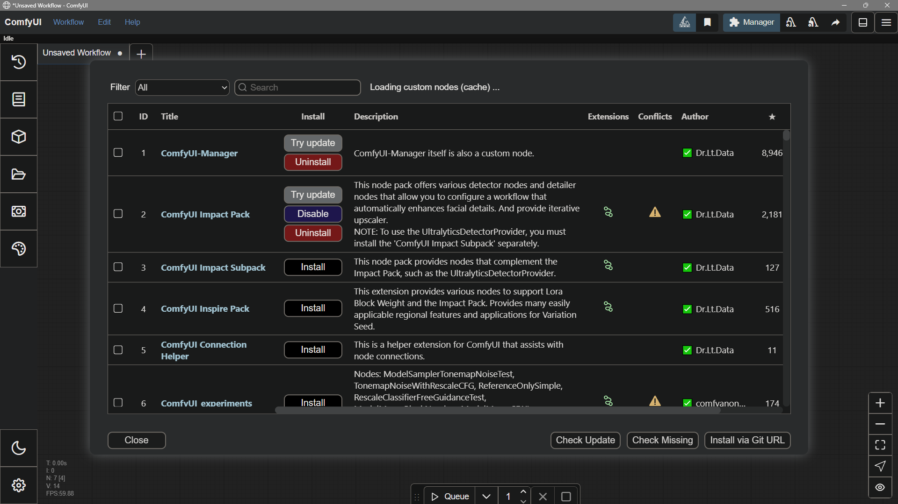

{/*
description: "Assets und Software-Abhängigkeiten in ComfyUI verstehen"
*/}

## Eine Workflow-Datei hängt von anderen Dateien ab

Häufig beziehen wir verschiedene Workflow-Dateien aus der Community und stellen dann oft fest, dass der Workflow nach dem Laden nicht direkt ausgeführt werden kann. Das liegt daran, dass eine Workflow-Datei neben dem Workflow selbst auch von anderen Dateien abhängt, etwa von Medien-Assets als Eingänge, Modellen, Custom Nodes, zugehörigen Python-Abhängigkeiten usw. ComfyUI-Workflows können nur ordnungsgemäß ausgeführt werden, wenn alle relevanten Abhängigkeiten erfüllt sind.

Die Abhängigkeiten von ComfyUI-Workflows lassen sich hauptsächlich in die folgenden Kategorien einteilen:

- Assets (Mediendateien wie Audio, Video, Bilder und weitere Eingänge)
- Custom Nodes
- Python-Abhängigkeiten
- Modelle (z. B. Stable Diffusion-Modelle usw.)

## Assets

Ein KI-Modell ist ein Beispiel für ein **_Asset_**. In der Medienproduktion ist ein Asset eine Mediendatei, die Eingabedaten liefert. Ein Videoschnittprogramm arbeitet zum Beispiel mit Filmdateien, die auf der Festplatte gespeichert sind. Die Projektdatei des Schnittprogramms enthält Verweise auf diese Filmdatei-Assets und ermöglicht so eine nicht-destruktive Bearbeitung, bei der die ursprünglichen Filmdateien unverändert bleiben.

ComfyUI funktioniert genauso. Ein Workflow kann nur ausgeführt werden, wenn alle erforderlichen Assets gefunden und geladen werden. Generative KI-Modelle, Bilder, Videos und Töne sind einige Beispiele für Assets, von denen ein Workflow abhängen kann. Sie werden daher als **_abhängige Assets_** oder **_Asset-Abhängigkeiten_** bezeichnet.

## Custom Nodes

Custom Nodes sind ein wichtiger Bestandteil von ComfyUI und erweitern dessen Funktionalität. Sie werden von der Community erstellt und können installiert werden, um Ihren Workflows neue Möglichkeiten hinzuzufügen.

## Python-Abhängigkeiten

ComfyUI ist ein Python-basiertes Projekt. Wir erstellen eine eigenständige Python-Umgebung, um ComfyUI auszuführen, und alle zugehörigen Abhängigkeiten werden in dieser isolierten Python-Umgebung installiert.

### ComfyUI-Abhängigkeiten

Die aktuellen Abhängigkeiten von ComfyUI finden Sie in der Datei [requirements.txt](https://github.com/Comfy-Org/ComfyUI/blob/master/requirements.txt):

{/* Hinweis: Dies sind die Anforderungen zum Zeitpunkt der Erstellung dieses Textes, nicht unbedingt die zuletzt aktualisierte Version. Die neueste Version finden Sie über den obigen GitHub-Link. */}

```text
comfyui-frontend-package==1.49.6
comfyui-workflow-templates==0.11.48
comfyui-embedded-docs==0.5.10
torch
torchsde
torchvision
torchaudio
numpy>=1.25.0
einops
transformers>=4.50.3
tokenizers>=0.13.3
sentencepiece
safetensors>=0.4.2
aiohttp>=3.11.8
yarl>=1.18.0
pyyaml
Pillow
scipy
tqdm
psutil
alembic
SQLAlchemy>=2.0.0
filelock
av>=17.0.0
comfy-kitchen==0.2.31
comfy-aimdo==0.4.15
requests
simpleeval>=1.0.0
blake3

#Nicht wesentliche Abhängigkeiten:
kornia>=0.7.1
spandrel
pydantic~=2.0
pydantic-settings~=2.0
PyOpenGL>=3.1.8
comfy-angle
```

Da sich ComfyUI weiterentwickelt, passen wir die Abhängigkeiten entsprechend an, zum Beispiel indem wir neue Abhängigkeiten hinzufügen oder nicht mehr benötigte entfernen.
Wenn Sie ComfyUI per Git aktualisieren, müssen Sie daher nach dem Abrufen der neuesten Änderungen den folgenden Befehl in der entsprechenden Umgebung ausführen:

```bash
pip install -r requirements.txt
```

So stellen Sie sicher, dass die Abhängigkeiten von ComfyUI auf dem neuesten Stand sind und ComfyUI ordnungsgemäß funktioniert. Sie können auch die Versionsangaben einzelner Pakete ändern, um bestimmte Abhängigkeiten zu upgraden oder herunterzustufen.

Darüber hinaus wird das Frontend von ComfyUI, [ComfyUI_frontend](https://github.com/Comfy-Org/ComfyUI_frontend), derzeit als separates Projekt gepflegt. Wir aktualisieren die Abhängigkeitsversion `comfyui-frontend-package`, sobald die entsprechende Version stabil ist. Wenn Sie zu einer anderen Frontend-Version wechseln möchten, finden Sie die Versionsinformationen [hier](https://pypi.org/project/comfyui-frontend-package/#history).

### Abhängigkeiten von Custom Nodes

Dank des Engagements vieler Autorinnen und Autoren in der ComfyUI-Community können wir die Funktionalität von ComfyUI durch verschiedene Custom Nodes erweitern und beeindruckende kreative Ergebnisse erzielen.

In der Regel hat jeder Custom Node seine eigenen Abhängigkeiten und eine eigene `requirements.txt`-Datei.
Wenn Sie [ComfyUI Manager](https://github.com/Comfy-Org/ComfyUI-Manager) verwenden, um Custom Nodes zu installieren, installiert ComfyUI Manager die entsprechenden Abhängigkeiten normalerweise automatisch.

Es gibt auch Fälle, in denen Sie Abhängigkeiten manuell installieren müssen. Derzeit werden alle Custom Nodes im Verzeichnis `ComfyUI/custom_nodes` installiert.

Sie müssen in Ihrer ComfyUI-Python-Umgebung in das Verzeichnis des entsprechenden Plugins wechseln und `pip install -r requirements.txt` ausführen, um die Abhängigkeiten zu installieren.

Wenn Sie die [Windows Portable Version](/de/installation/comfyui_portable_windows) verwenden, können Sie im Verzeichnis `ComfyUI_windows_portable` den folgenden Befehl verwenden:
```
python_embeded\python.exe -m pip install -r ComfyUI\custom_nodes\<custom_node_name>\requirements.txt
```
um die Abhängigkeiten für den entsprechenden Node zu installieren.

### Abhängigkeitskonflikte

Abhängigkeitskonflikte sind ein häufiges Problem bei der Verwendung von ComfyUI. Es kann vorkommen, dass nach der Installation oder Aktualisierung eines Custom Node zuvor installierte Custom Nodes nicht mehr in der Node-Bibliothek von ComfyUI gefunden werden oder Fehlermeldungen erscheinen. Eine mögliche Ursache sind Abhängigkeitskonflikte.

Für Abhängigkeitskonflikte kann es viele Ursachen geben, zum Beispiel:

1. Feste Versionsbindung bei Custom Nodes

Einige Plugins legen die exakte Version einer Abhängigkeitsbibliothek fest (z. B. `open_clip_torch==2.26.1`), während andere Plugins eine höhere Version verlangen (z. B. `open_clip_torch>=2.29.0`). Dadurch lassen sich beide Versionsanforderungen nicht gleichzeitig erfüllen.

**Lösung**: Sie können versuchen, die feste Versionsangabe in eine Bereichsangabe zu ändern, zum Beispiel `open_clip_torch>=2.26.1`, und die Abhängigkeiten anschließend neu zu installieren, um diese Probleme zu beheben.

2. Verunreinigung der Umgebung

Bei der Installation der Abhängigkeiten von Custom Nodes kann es Versionen von Bibliotheken überschreiben, die bereits von anderen Plugins installiert wurden. Beispielsweise können mehrere Plugins von `PyTorch` abhängen, aber unterschiedliche CUDA-Versionen verlangen; das zuletzt installierte Plugin macht dann die bestehende Umgebung unbrauchbar.

**Lösungen**:
- Sie können versuchen, bestimmte Versionen der Abhängigkeiten manuell in der virtuellen Python-Umgebung zu installieren, um solche Probleme zu beheben.
- Oder betreiben Sie eine zweite ComfyUI-Instanz in einer eigenen Python-Umgebung, wenn Sie inkompatible Versionen benötigen: Plugins werden in die Umgebung geladen, in der ComfyUI selbst läuft, eine separate Umgebung allein hilft also nicht.
- Installieren Sie Plugins einzeln und starten Sie ComfyUI nach jeder Installation neu, um zu beobachten, ob Abhängigkeitskonflikte auftreten.

3. Abhängigkeitsversionen von Custom Nodes sind mit den Abhängigkeitsversionen von ComfyUI nicht kompatibel

Diese Art von Abhängigkeitskonflikten lässt sich möglicherweise schwieriger beheben. Eventuell müssen Sie ComfyUI upgraden oder herunterstufen oder die Abhängigkeitsversionen der Custom Nodes ändern, um diese Probleme zu lösen.

**Lösung**: Diese Art von Abhängigkeitskonflikten lässt sich möglicherweise schwieriger beheben. Eventuell müssen Sie ComfyUI upgraden oder herunterstufen oder die Abhängigkeitsversionen der Custom Nodes ändern, um diese Probleme zu lösen.

## Modelle

Modelle sind für ComfyUI eine wesentliche Ressourcenabhängigkeit. Verschiedene Custom Nodes und Workflows basieren auf bestimmten Modellen, etwa der Stable-Diffusion-Serie, der Flux-Serie, Ltxv und anderen.
Diese Modelle sind eine wesentliche Grundlage für das Erstellen mit ComfyUI. Daher müssen Sie sicherstellen, dass die von Ihnen verwendeten Modelle ordnungsgemäß verfügbar sind. In der Regel werden Ihre Modelle im entsprechenden Verzeichnis unter `ComfyUI/models/` gespeichert. Natürlich können Sie auch eine [extra_model_paths.yaml](https://github.com/Comfy-Org/ComfyUI/blob/master/extra_model_paths.yaml.example) erstellen, indem Sie die Vorlage anpassen, damit zusätzliche Modellpfade von ComfyUI erkannt werden.
Dadurch können mehrere ComfyUI-Instanzen dieselbe Modellbibliothek gemeinsam nutzen, was den Speicherplatzbedarf verringert.

## Software

Eine erweiterte Anwendung wie ComfyUI besitzt auch **_Softwareabhängigkeiten_**. Dabei handelt es sich um Bibliotheken aus Programmcode und Daten, die für die Ausführung der Anwendung erforderlich sind. Custom Nodes sind Beispiele für Softwareabhängigkeiten. Auf einer noch grundlegenderen Ebene ist die Python-Programmierumgebung die ultimative Abhängigkeit für ComfyUI. Um eine bestimmte Version von ComfyUI auszuführen, ist die passende Python-Version erforderlich. Updates für Python, ComfyUI und Custom Nodes lassen sich alle im Fenster **ComfyUI Manager** verwalten.


