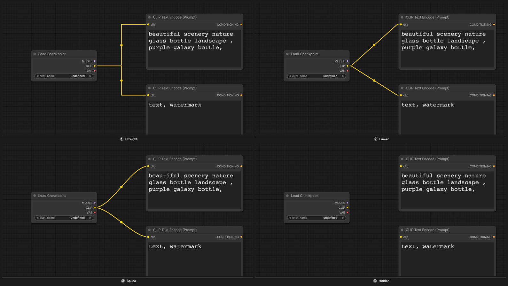
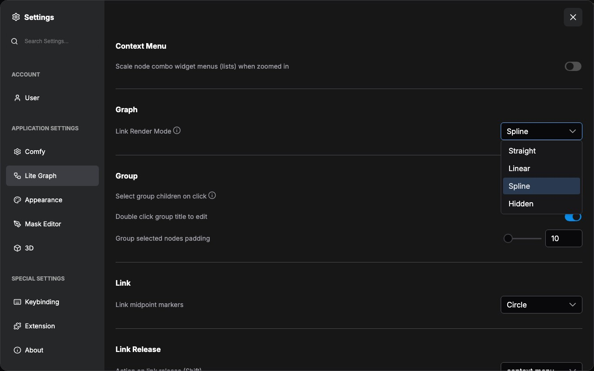
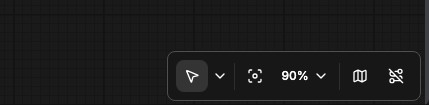
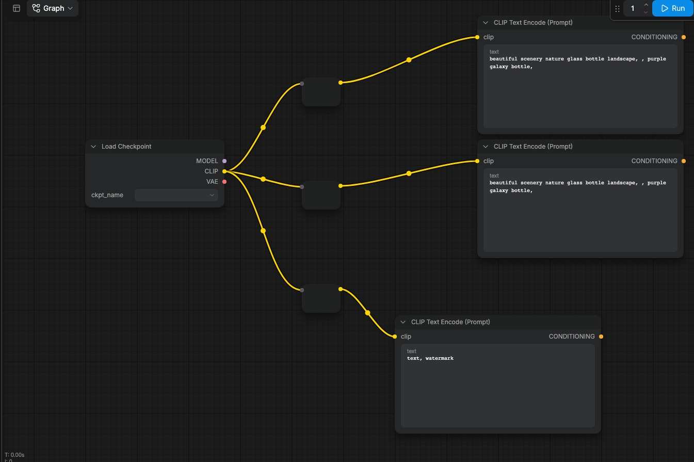
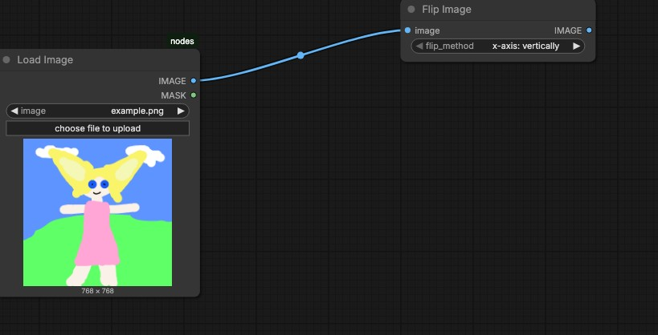
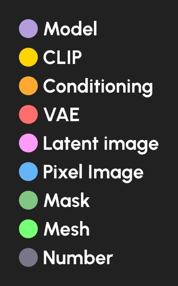

## Verbindungen zwischen Nodes

In ComfyUI heißen die Linien oder Kurven, die zwischen Nodes gezeichnet werden, **_Verbindungen_** (englisch **_links_**, auch als **_connections_** oder Drähte bezeichnet). Sie transportieren Daten von der Ausgabe eines Nodes zur Eingabe eines anderen Nodes und definieren damit den Datenfluss Ihres Workflows.

Verbindungen können in mehreren visuellen Stilen dargestellt werden: als Kurven, rechte Winkel, gerade Linien oder vollständig ausgeblendet.

Um den Verbindungsstil zu ändern, wechseln Sie zu **Setup Menu** → **Display (Lite Graph)** → **Graph** → **Link Render Mode**.

Sie können außerdem alle Verbindungen vorübergehend über das **Canvas Menu** ausblenden.

<Tip>
Das Einblenden von Verbindungen ist besonders hilfreich, wenn Sie einen Workflow kennenlernen, teilen oder Fehler darin suchen. Sie machen den Datenfluss auf einen Blick sichtbar. Bei abgeschlossenen Workflows, die nicht bearbeitet werden sollen, kann das Ausblenden der Verbindungen die Ansicht übersichtlicher machen.
</Tip>

### Reroute-Node

Wenn ein Workflow komplex wird, können sich Verbindungslinien überlappen oder hinter Nodes verlaufen, was die Lesbarkeit erschwert. Mit dem **Reroute**-Node können Sie eine Verbindungslinie manuell durch einen beliebigen Punkt im zweidimensionalen Graphraum leiten, sodass das Layout sauber und gut lesbar bleibt.

ComfyUI bietet außerdem eine native Umleitungsfunktion direkt im Graph-Canvas. Für neue Workflows empfehlen wir, diese zu verwenden.

## Farbcodierung

Jeder Datentyp in ComfyUI hat eine eigene Farbe. Die Eingabe- und Ausgabeports der Nodes sowie die Verbindungslinien dazwischen verwenden dasselbe Farbschema. **Sie können nur Ports mit derselben Farbe verbinden**. So ist Typensicherheit in Ihrem gesamten Workflow gewährleistet.

| Datentyp                          | Farbe       |
|-----------------------------------|-------------|
| Diffusion-Modell                  | Lavendel    |
| CLIP-Modell                       | Gelb        |
| VAE-Modell                        | Rosé        |
| Konditionierung                   | Orange      |
| Latent-Bild                       | Pink        |
| Pixelbild                         | Blau        |
| Maskierung                        | Grün        |
| Zahl (Ganzzahl oder Fließkommazahl) | Grau      |
| Mesh                              | Hellgrün    |