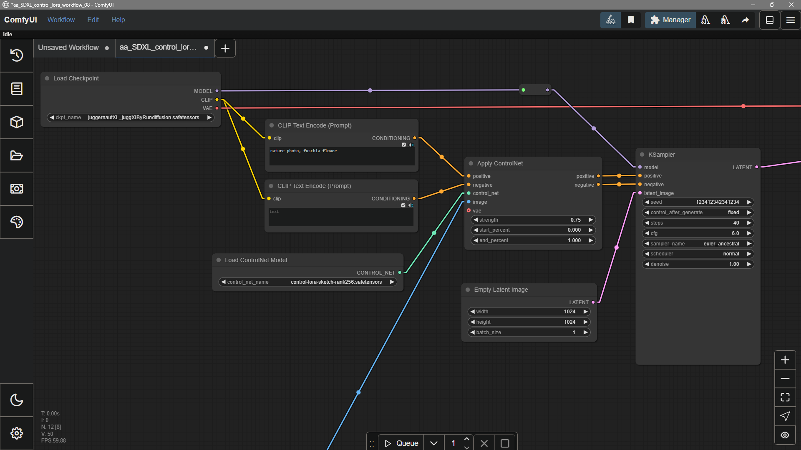

import ExternalModels from "/snippets/de/install/add-external-models.mdx"

## Modelle in einfachen Worten

In ComfyUI sind **Modelle** die Gewichtsdateien, die Ihren Workflow tatsächlich ausführen. Sie umfassen **Checkpoints**, **VAEs**, **LoRAs**, **ControlNets** und Upscaler. Die App-Installation selbst ist klein. Diese Dateien sind standardmäßig **nicht** enthalten. Üblicherweise **laden Sie sie aus dem Web herunter**, legen sie unter `ComfyUI/models/` ab (oder folgen den Prompts einer Vorlage) und wählen die Datei anschließend im richtigen **Loader-Node** aus (auf dem Canvas erscheinen diese häufig als Nodes, deren Namen mit **Load** beginnen).

### Unterstützte Modelle in ComfyUI

- **Die integrierte bzw. offizielle Abdeckung ist bewusst begrenzt**, wächst aber mit der Zeit, während sich ComfyUI und das Open-Source-Ökosystem weiterentwickeln. Wenn ein Modell erstklassigen Support erhält, **sehen Sie in der Regel einen neuen Eintrag in der [Vorlagenbibliothek für Workflows](/interface/features/template)**, der den erwarteten Graphen und die Modellpaarung zeigt.
- **Nicht jeder Checkpoint und nicht jede Gewichtsdatei funktioniert sofort.** Halten Sie ComfyUI für **nativ unterstützte Modelle und deren übliche Begleitgewichte** **[auf dem aktuellen Stand](/de/installation/update_comfyui)** und bestätigen Sie, dass der passende Workflow in der **[Vorlagenbibliothek](/interface/features/template)** existiert, bevor Sie annehmen, dass Ihre Dateien am falschen Ort liegen.
- **Viele weitere Modelle werden über Custom Nodes aus der Community ermöglicht.** Pfade, Loader-Nodes und der Aufbau des Graphen können von der allgemeinen Anleitung zu `ComfyUI/models/` auf dieser Seite abweichen. **Folgen Sie stets der README oder der Dokumentation des jeweiligen Projekts.** ComfyUI ist sehr erweiterbar, daher unterscheiden sich die Implementierungen je nach Autor. Informationen zu Installation und Fehlerbehebung finden Sie unter [Eigene Nodes installieren](/de/installation/install_custom_node).

## Modelle in ComfyUI verwenden

1. **Die Dateien an den richtigen Ort bringen.** Laden Sie von Community-Websites wie [Hugging Face](https://huggingface.co), [Civitai](https://civitai.green) oder von der Projektseite auf [GitHub](https://github.com) herunter und legen Sie sie unter `ComfyUI/models/` im Unterordner für den jeweiligen Typ ab (zum Beispiel `checkpoints`, `loras`, `vae`).
2. **Den passenden Loader-Node hinzufügen.** Wählen Sie den Loader für diesen Modelltyp (Checkpoint, LoRA, VAE usw.). In der Node-Liste beginnen die Titel häufig mit **Load**.
3. **Die Datei auswählen** im Dropdown-Menü dieses Loader-Nodes.
4. **Den Loader-Node verbinden** mit dem restlichen Graphen. Wenn Sie Dateien bei geöffnetem ComfyUI manuell kopiert haben, **starten Sie die App neu** (oder aktualisieren Sie bei Bedarf), damit die Listen aktualisiert werden.

### Große Downloads einplanen

Ein einzelnes generatives Modell umfasst oft **viele Gigabyte**. Planen Sie beim Herunterladen oder Synchronisieren ausreichend Speicherplatz und Zeit ein.

## Über den Haupt-Checkpoint hinaus

Der Haupt-Diffusions-Checkpoint leistet viel, aber viele Workflows fügen **kleinere Hilfsmodelle** hinzu, zum Beispiel:

- **LoRA**: leichtgewichtige Erweiterungen, die auf einen Stil, eine Figur oder ein Konzept abgestimmt sind
- **ControlNet**: zusätzliche Guidance aus Kanten, Tiefe, Pose usw.
- **Inpainting**: Bereiche in einem vorhandenen Bild füllen oder ersetzen

## Modelle deinstallieren

In der Benutzeroberfläche gibt es noch keine Schaltfläche „Deinstallieren“. Um ein Modell zu entfernen, **löschen Sie die zugehörige Datei** (oder Dateien) aus dem Ordner unter `ComfyUI/models/`, in den Sie sie abgelegt haben.

<ExternalModels />

## Häufige Probleme

<AccordionGroup>
  <Accordion title="Unterstützt ComfyUI Modelle im GGUF-Format?">
    ComfyUI unterstützt Modelle im GGUF-Format nicht nativ. Um GGUF-Modelle zu verwenden, müssen Sie Custom Nodes aus der Community wie [ComfyUI-GGUF](https://github.com/city96/ComfyUI-GGUF) installieren.
  </Accordion>

  <Accordion title="Warum kann ich mein Modell nicht finden?">
    Wenn Sie ein Modell installiert haben, es aber in ComfyUI nicht finden können, versuchen Sie diese Schritte:

    - Prüfen Sie, ob das Modell am richtigen Ort liegt:
      - Standardpfad: `ComfyUI/models/` (z. B. `checkpoints`, `loras`, `vae`)
      - Für **Comfy Desktop**: Klicken Sie oben in der Desktop-App auf das Kapselmenü und öffnen Sie dann den Tab **Storage**, um Ihre Modellverzeichnisse zu prüfen. Die Kapsel gibt es nur in der Desktop-App, nicht wenn ComfyUI im Browser läuft.

      
    - Drücken Sie die Taste `r`, um die Node-Definitionen zu aktualisieren, damit ComfyUI das Modell erkennen kann
    - Starten Sie ComfyUI neu
    - Stellen Sie sicher, dass im Loader-Node das richtige Modell ausgewählt ist
  </Accordion>
</AccordionGroup>

## Möchten Sie etwas mehr Hintergrund?

<AccordionGroup>
  <Accordion title="Was bedeutet hier „Modell“?">
    Hier ist ein **Modell** eine Datendatei, die festhält, was ein Netzwerk gelernt hat. Es enthält genug Informationen, um Eingänge (etwa Text und Rauschen) in Ausgänge (etwa ein Bild) umzuwandeln. Häufige Beispiele in Bild-Workflows sind **Diffusion**-Checkpoints, Text-/Bild-Encoder wie **CLIP** und **Upscaler** wie RealESRGAN.
  </Accordion>

  <Accordion title="Basismodelle und Community-Varianten">
    Große **Basis**modelle aus Laboren und Open-Source-Projekten sind Allzweckmodelle. Die Community **fine-tuned** sie häufig oder führt sie zu neuen Checkpoints und LoRAs zusammen, die für einen bestimmten Stil besser aussehen, etwas leichter laufen oder neues Verhalten hinzufügen. Das ähnelt der Auswahl eines Favoriten-Checkpoints auf Civitai oder Hugging Face.
  </Accordion>
</AccordionGroup>
