In ComfyUI sind Nodes die grundlegenden Bausteine für die Ausführung von Aufgaben. Jeder Node ist ein eigenständig aufgebautes Modul, ob **Comfy Core**-Node oder **Custom Node**, mit seiner eigenen, einzigartigen Funktionalität. Nodes werden über Verbindungen miteinander verknüpft, sodass sich komplexe Funktionalität aufbauen lässt, ähnlich wie beim Zusammensetzen von LEGO-Steinen.
Die Kombination verschiedener Nodes schafft die unbegrenzten Möglichkeiten von ComfyUI.

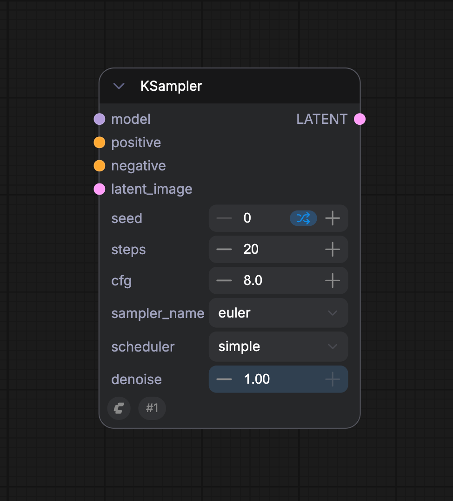

Im Node K-Sampler sehen Sie beispielsweise, dass er mehrere Eingänge und Ausgänge sowie mehrere Parametereinstellungen besitzt. Diese Parameter bestimmen die Logik der Ausführung des Nodes. Hinter jedem Node steckt gut geschriebene Python-Logik, mit der Sie die entsprechende Funktionalität erreichen, ohne selbst Code schreiben zu müssen.

<Note>
ComfyUI wird aktiv weiterentwickelt, daher können einige Details hier veraltet sein. Wenn Ihnen etwas auffällt, das sich geändert hat, können Sie gerne [mithelfen, die Dokumentation zu aktualisieren](https://github.com/Comfy-Org/docs).
</Note>

## Nodes führen Operationen aus

In der Informatik ist ein **_Node_** ein Container für Informationen, der in der Regel programmierte Anweisungen zur Ausführung einer Aufgabe enthält. Nodes existieren fast nie isoliert, sie sind fast immer mit anderen Nodes in einem vernetzten Graphen verbunden. In ComfyUI haben Nodes die visuelle Form von Kästen, die miteinander verbunden sind.

ComfyUI-Nodes sind in der Regel **_Funktionsoperatoren_**. Das bedeutet, dass sie auf Daten einwirken, um eine Funktion auszuführen. Eine Funktion ist ein Prozess, der Eingabedaten annimmt, eine Operation darauf ausführt und Ausgabedaten erzeugt. Mit anderen Worten: Nodes verrichten Arbeit und tragen zur Erledigung einer Aufgabe wie dem Generieren eines Bildes bei. Daher haben ComfyUI-Nodes fast immer mindestens einen Eingang oder Ausgang und in der Regel mehrere Eingänge und Ausgänge.

## Verschiedene Node-Zustände

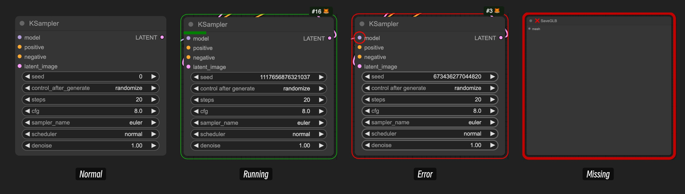

In ComfyUI haben Nodes mehrere Zustände. Hier sind einige häufige Node-Zustände:

1. **Normaler Zustand**: Der Standardzustand
2. **Ausführungszustand**: Der laufende Zustand, der normalerweise angezeigt wird, wenn ein Node ausgeführt wird, nachdem Sie den Workflow gestartet haben
3. **Fehlerzustand**: Node-Fehler, der normalerweise nach dem Ausführen des Workflows angezeigt wird, wenn es ein Problem mit der Eingabe des Nodes gibt. Er wird durch eine rote Markierung des fehlerhaften Eingabe-Nodes angezeigt. Sie müssen die problematische Eingabe korrigieren, damit der Workflow korrekt ausgeführt wird
4. **Fehlender Zustand**: Dieser Zustand tritt normalerweise nach dem Importieren von Workflows auf, wobei zwei Möglichkeiten bestehen:
    - Nativer Comfy-Core-Node fehlt: Dies geschieht normalerweise, weil ComfyUI aktualisiert wurde, Sie aber eine ältere ComfyUI-Version verwenden. Sie müssen ComfyUI aktualisieren, um dieses Problem zu beheben
    - Custom Node fehlt: Der Workflow verwendet Custom Nodes, die von Drittanbietern entwickelt wurden, aber Ihre lokale ComfyUI-Version hat diese Custom Nodes nicht installiert. Sie können den [ComfyUI Manager](/de/manager/overview) verwenden, um sie zu finden und zu installieren, oder [How to install custom nodes](/de/installation/install_custom_node) für andere Methoden befolgen

## Verbindungen zwischen Nodes

In ComfyUI werden Nodes über [Verbindungen](/de/basic-concepts/links) miteinander verbunden, sodass Daten des gleichen Typs zwischen verschiedenen Verarbeitungseinheiten fließen können, um das endgültige Ergebnis zu erzielen.

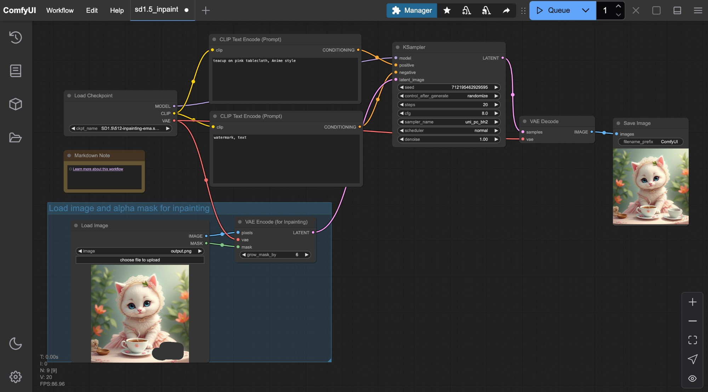

Jeder Node empfängt eine Eingabe, verarbeitet sie in seinem Modul und wandelt sie in die entsprechende Ausgabe um. Verbindungen zwischen verschiedenen Nodes müssen den Anforderungen der Datentypen entsprechen. In ComfyUI unterscheiden wir die Datentypen der Nodes anhand verschiedener Farben. Im Folgenden finden Sie einige grundlegende Datentypen:

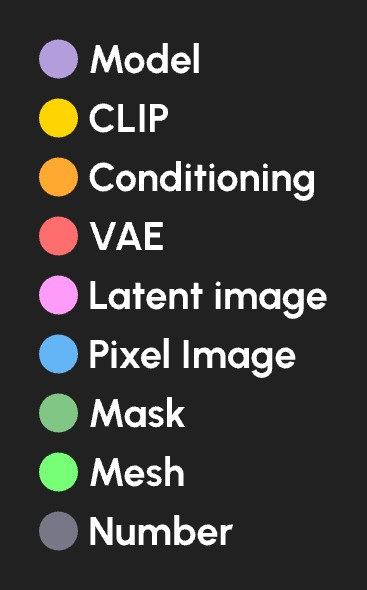

| Datentyp                           | Farbe                                                                                                              |
|------------------------------------|--------------------------------------------------------------------------------------------------------------------|
| Diffusionsmodell                   | Lavendel                                                                                                           |
| CLIP-Modell                        | Gelb                                                                                                               |
| VAE-Modell                         | Rosé                                                                                                               |
| Konditionierung                    | Orange                                                                                                             |
| Latentes Bild                      | Rosa                                                                                                               |
| Pixelbild                          | Blau                                                                                                               |
| Maskierung                         | Grün                                                                                                               |
| Zahl (Ganzzahl oder Gleitkommazahl)| Grau                                                                                                               |
| Mesh                               | Hellgrün                                                                                                           |

Da sich ComfyUI weiterentwickelt, werden wir möglicherweise weitere Datentypen ergänzen, um den Anforderungen weiterer Szenarien gerecht zu werden.

### Nodes verbinden und trennen

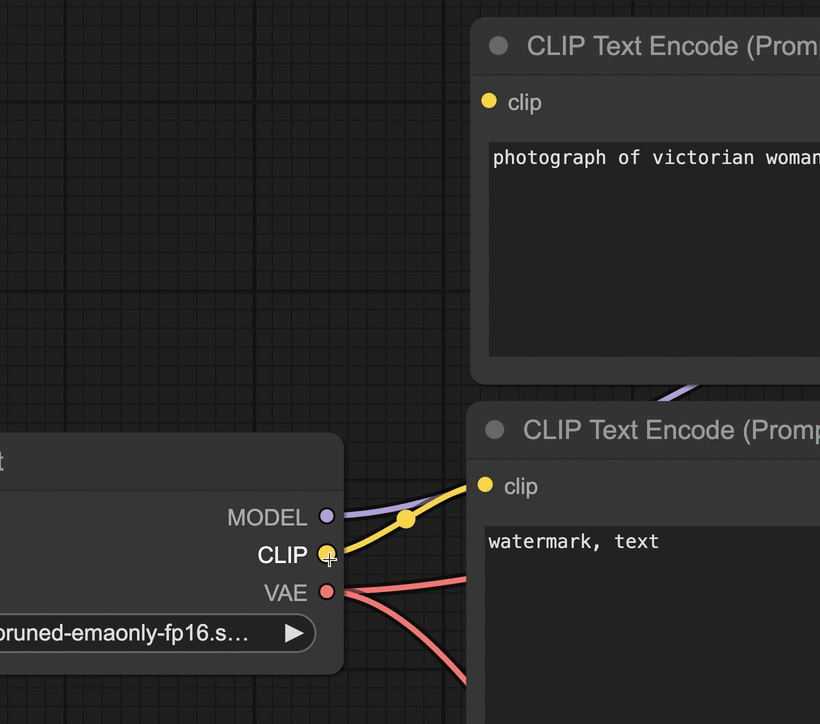

**Verbinden**: Ziehen Sie vom Ausgabepunkt eines Nodes zum Eingang gleicher Farbe eines anderen Nodes, um beide zu verbinden
**Trennen**: Klicken Sie auf den Eingangsendpunkt und ziehen Sie mit der linken Maustaste, um die Verbindung zu trennen, oder brechen Sie die Verbindung über das Menü in der Mitte der Verbindung ab

## Erscheinungsbild der Nodes

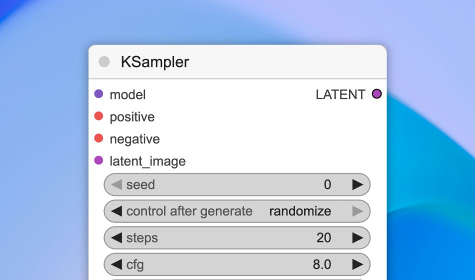

Wir bieten Ihnen verschiedene Stil-Einstellungen, mit denen Sie das Erscheinungsbild der Nodes anpassen können:
- Stile ändern
- Doppelklicken Sie auf den Titel des Nodes, um den Namen des Nodes zu ändern
- Ändern Sie die Größe des Nodes, indem Sie an einer beliebigen Ecke ziehen

<video
  controls
  className="w-full aspect-video"
  src="/images/concepts/node/node_appearance.mp4"
></video>

### Node-Badges

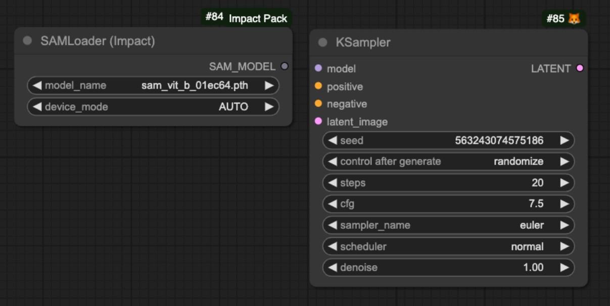

Wir bieten mehrere Anzeigefunktionen für Node-Badges, zum Beispiel:
- Node-ID
- Node-Quelle

Derzeit verwenden **Comfy Core Nodes** zur Anzeige ein Fuchs-Symbol, während Custom Nodes ihre Namen verwenden. So erkennen Sie schnell, aus welchem Node-Paket ein Node stammt.

Die entsprechende Anzeige können Sie im Menü festlegen:

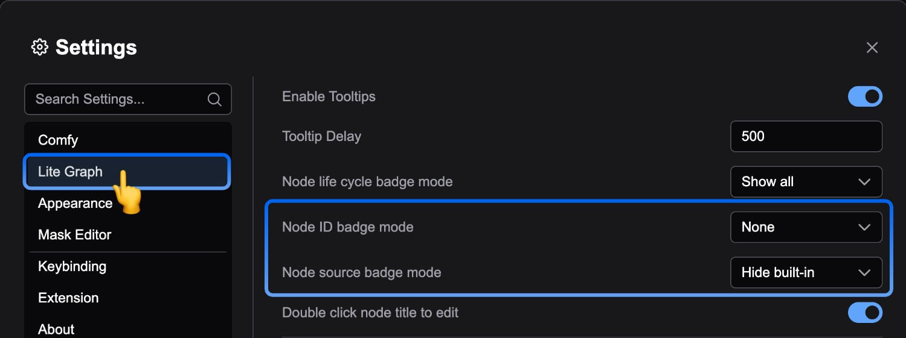

## Kontextmenüs für Nodes

Kontextmenüs für Nodes lassen sich hauptsächlich in zwei Typen unterteilen:
- Kontextmenü für den Node selbst
- Kontextmenü für Eingänge/Ausgänge

### Kontextmenü des Nodes

Mit einem Rechtsklick auf einen Node öffnen Sie das zugehörige Kontextmenü:
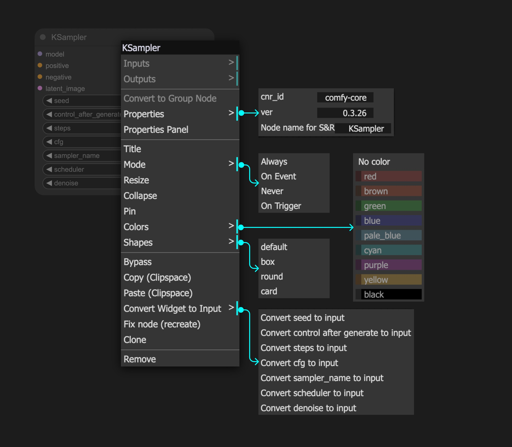

Im Kontextmenü per Rechtsklick auf den Node können Sie:
- den Farbstil des Nodes anpassen
- den Titel ändern
- den Node klonen, kopieren oder löschen
- den Modus des Nodes festlegen

In diesem Menü sind neben den Einstellungen zum Erscheinungsbild die folgenden Operationen wichtig:

- **Mode**: Legt den Modus des Nodes fest: Always, Never, Bypass

#### Modus
Bei den Modi fällt Ihnen vielleicht auf, dass wir derzeit vier Modi anbieten: Always, Never, On Event und On Trigger. Tatsächlich wirksam sind aber nur **Always** und **Never**. **On Event** und **On Trigger** sind derzeit wirkungslos, da wir diese Funktion noch nicht vollständig implementiert haben. Zusätzlich können Sie **Bypass** als einen Modus verstehen. Im Folgenden werden die verfügbaren Modi erläutert:

- **Always**: Der Standardmodus eines Nodes. Der Node wird immer ausgeführt, wenn er zum ersten Mal läuft oder wenn sich einer seiner Eingänge seit der letzten Ausführung geändert hat
- **Never**: Der Node wird unter keinen Umständen ausgeführt, als wäre er gelöscht worden. Nachfolgende Nodes können keine Daten von ihm lesen oder empfangen
- **Bypass**: Der Node wird unter keinen Umständen ausgeführt, aber nachfolgende Nodes können trotzdem versuchen, Daten zu erhalten, die nicht von diesem Node verarbeitet wurden

Im Folgenden ein Vergleich der Modi `Never` und `Bypass`:

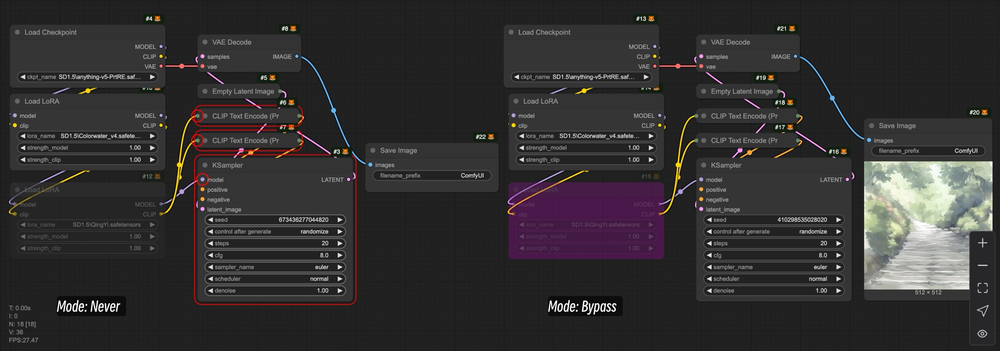

In diesem Vergleichsbeispiel sehen Sie, dass beide Workflows zwei LoRA-Modelle gleichzeitig anwenden. Der Unterschied besteht darin, dass ein `Load LoRA`-Node auf den Modus `Never` und der andere auf den Modus `Bypass` gesetzt ist.
- Der auf den Modus `Never` gesetzte Node führt bei den nachfolgenden Nodes zu Fehlern, weil diese keine Eingangsdaten erhalten
- Der auf den Modus `Bypass` gesetzte Node erlaubt es den nachfolgenden Nodes weiterhin, unverarbeitete Daten zu erhalten. Sie laden also die Ausgangsdaten des ersten `Load LoRA`-Nodes, sodass der nachfolgende Workflow normal weiterlaufen kann

#### Auflösung der Bildvorschau

In [Nodes 2.0](/de/interface/nodes-2) zeigt ein Node mit einem einzigen Bild-Ausgang Bilder, die größer als 1024 px sind, als herunterskalierte Kopie in der Vorschau an. Wählen Sie im Kontextmenü des Nodes **Volle Auflösung anzeigen**, um das Original zu laden, und **Herunterskalierte Vorschau anzeigen**, um zurückzukehren. Der Umschalter erscheint nur, solange **Große Bildvorschauen verkleinern** in den LiteGraph-Einstellungen aktiviert ist (die Standardeinstellung); Nodes mit mehreren Bildausgängen haben keinen Umschalter und folgen dieser Einstellung. Erfordert ComfyUI-Frontend 1.61.3 oder neuer.

### Kontextmenü für Eingänge/Ausgänge

Dieses Kontextmenü bezieht sich hauptsächlich auf den Datentyp des jeweiligen Eingangs bzw. Ausgangs:

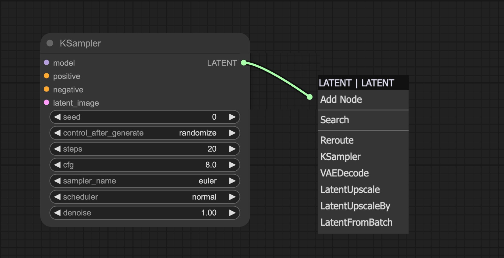

Wenn beim Ziehen an einem Eingang oder Ausgang eines Nodes eine Verbindung erscheint, Sie diese aber noch nicht mit einem Eingang oder Ausgang eines anderen Nodes verbunden haben, öffnet sich beim Loslassen der Maustaste ein Kontextmenü für diesen Eingang bzw. Ausgang, mit dem Sie schnell passende Nodes hinzufügen können.
Die Anzahl der Node-Vorschläge können Sie in den Einstellungen anpassen:

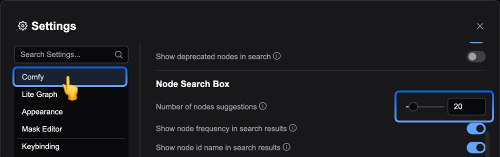

## Node Selection Toolbox

<video
  controls
  className="w-full aspect-video"
  src="/images/concepts/node/selection_toolbox.mp4"
></video>

Die **Node Selection Toolbox** ist ein schwebendes Werkzeug, das schnelle Operationen für Nodes bereitstellt. Wenn Sie einen Node auswählen, schwebt sie über dem ausgewählten Node. Über diese Toolbox können Sie:
- die Farbe des Nodes ändern
- den Node schnell in den Bypass-Modus versetzen (wird zur Laufzeit nicht ausgeführt)
- den Node sperren
- den Node löschen

Natürlich finden Sie diese Funktionen auch im Rechtsklickmenü des jeweiligen Nodes. Die Node Selection Toolbox bietet lediglich eine Schnellzugriffsoption. Wenn Sie diese Funktion deaktivieren möchten, können Sie sie in den Einstellungen ausschalten.

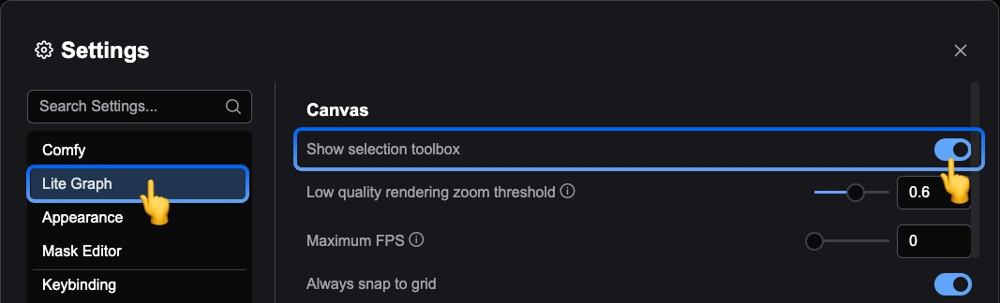

## Subgraphs

Sie können eine Auswahl von Nodes zu einem einzigen wiederverwendbaren Subgraph-Node reduzieren, um komplexe Graphen übersichtlich zu halten und dieselbe Struktur in mehreren Workflows wiederzuverwenden.

<Card title="Subgraph" icon="share-nodes" href="/interface/features/subgraph">
  Erfahren Sie, wie Sie Subgraph-Blueprints erstellen, bearbeiten, verschachteln und in der Node-Bibliothek veröffentlichen.
</Card>

## Custom Nodes

ComfyUI enthält viele **Comfy Core**-Nodes in der Basisinstallation. Die Community pflegt außerdem einen großen Katalog an [**Custom Nodes**](https://registry.comfy.org) für spezialisierte Workflows.

Eine vollständige Übersicht zum Installieren von Custom Nodes (mit **ComfyUI Manager**, Git clone, ZIP-Download, Abhängigkeiten und Sicherheitshinweisen) finden Sie unter [Custom Nodes installieren](/de/installation/install_custom_node).

### ComfyUI Manager

Verwenden Sie **ComfyUI Manager** für die tägliche Arbeit mit Custom Nodes: Pakete aus der Registry suchen und installieren, aktualisieren oder deaktivieren, fehlende Nodes aus importierten Workflows erkennen und Modelle sowie Snapshots zusammen mit Erweiterungen verwalten. Desktop-Builds werden mit aktiviertem Manager ausgeliefert; bei portable und manuellen Installationen müssen Sie ihn möglicherweise erst aktivieren.

<Card title="ComfyUI Manager" icon="puzzle-piece" href="/de/manager/overview">
  Überblick, Aktivieren des Managers und Workflows zur Node-Installation
</Card>
