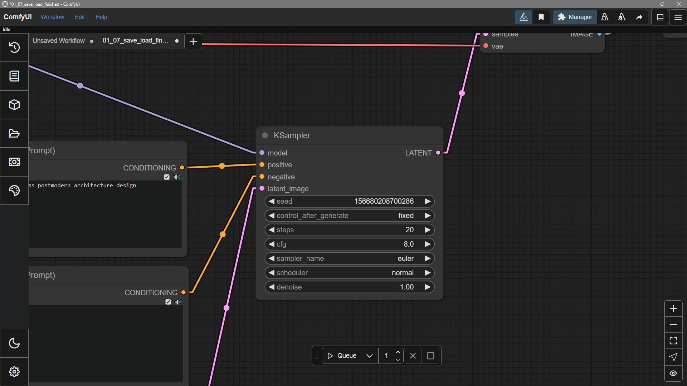

## Nodes sind Container für Eigenschaften

Nodes haben in der Regel **_Eigenschaften_**. Node-Eigenschaften, auch als **_Parameter_** oder **_Attribute_** bekannt, sind Variablen, die geändert werden können. Einige Eigenschaften kann der Benutzer manuell anpassen, und zwar über ein Dateneingabefeld, das als **_Widget_** bezeichnet wird. Andere Eigenschaften können automatisch von anderen Nodes gesteuert werden, die mit dem **_Eingang_** der Eigenschaft oder dem Port verbunden sind. In der Regel lässt sich eine Eigenschaft von Widget zu Eingabe und umgekehrt umwandeln, sodass Benutzer Eigenschaftswerte manuell oder automatisch steuern können.

Eigenschaften können viele Formen annehmen und die unterschiedlichsten Arten von Informationen enthalten. Zum Beispiel hat ein Node **Load Checkpoint** eine einzige Eigenschaft: den Dateipfad zur Checkpoint-Datei des generativen Modells. Ein Node **KSampler** hat mehrere Eigenschaften wie die Anzahl der Sampling-**steps**, die **CFG**-Skalierung, **sampler\_name** usw.

## Datentypen

Informationen können in vielen verschiedenen Formen auftreten, die als **_Datentypen_** bezeichnet werden. Zum Beispiel wird alphanumerischer Text als **_String_** bezeichnet, eine ganze Zahl als **_Integer_** und eine Zahl mit Dezimalpunkt als **_Gleitkommazahl_** (**_floating point_**) oder **_Float_**. ComfyUI werden ständig neue Datentypen hinzugefügt.

ComfyUI ist in der Skriptsprache Python geschrieben, die sehr nachsichtig mit Datentypen umgeht. Im Gegensatz dazu ist die Umgebung von ComfyUI sehr **_streng typisiert_**. Das bedeutet, dass verschiedene Datentypen nicht vermischt werden können. Zum Beispiel können wir keinen Bildausgang mit einem Integer-Eingang verbinden. Das ist ein großer Vorteil für Benutzer: Es führt sie zu einem korrekten Aufbau des Workflows und verhindert Programmfehler.