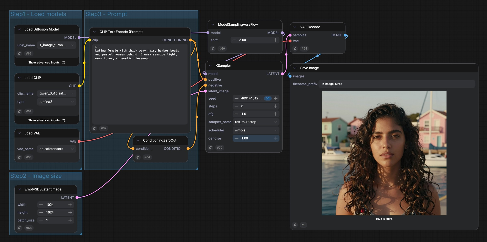
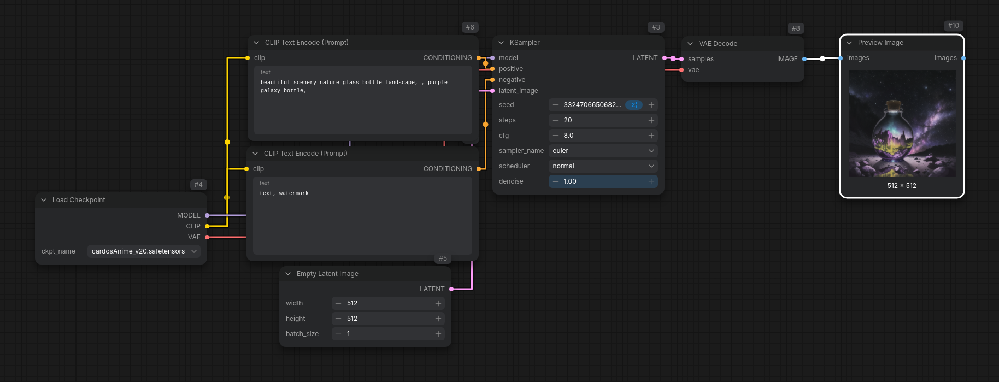

## Was ist ein Workflow?

Ein Workflow ist eine Reihe von Schritten, die ComfyUI mitteilt, wie etwas erstellt werden soll.

Sie können sich einen Workflow wie ein Rezept vorstellen:

- Das Rezept ist der Workflow.
- Jede Anweisung im Rezept ist ein Node.
- Zu den Zutaten gehören Prompts, Bilder und Modelle.
- Das Ergebnis ist das generierte Bild, Video, Audio oder eine andere Ausgabe.

Ein einfacher Bild-Workflow könnte zum Beispiel:

1. Ein Modell laden.
2. Einen Text-Prompt lesen.
3. Ein Bild generieren.
4. Das Bild speichern.

ComfyUI zeigt diese Schritte als Boxen auf einem Canvas an.

## Nodes sind die Schritte

Ein Node erledigt eine bestimmte Aufgabe. Manche Nodes laden Dateien, manche verändern Daten und andere generieren oder speichern das Ergebnis.

Zum Beispiel:

- Ein Node **Load Checkpoint** lädt ein KI-Modell.
- Ein Node **CLIP Text Encode** wandelt Ihren Prompt in Anweisungen für das Modell um.
- Ein Node **KSampler** generiert ein Bild aus dem Modell und diesen Anweisungen.
- Ein Node **Save Image** speichert das Ergebnis auf Ihrem Computer.

Sie können Nodes auf unterschiedliche Weise kombinieren, um verschiedene Workflows zu erstellen. Sie müssen keinen Code schreiben, um sie zu verwenden.

Mehr über Nodes erfahren Sie unter [Nodes](/de/basic-concepts/nodes).

## Verbindungen übergeben Daten zwischen Nodes

Nodes arbeiten zusammen, indem sie Daten von einem Node an einen anderen weitergeben. Eine Verbindung verbindet eine Ausgabe eines Nodes mit einer Eingabe eines anderen Nodes.

Ein Modell, das von einem Node des Typs **Load Checkpoint** geladen wird, kann beispielsweise an einen Node des Typs **KSampler** übergeben werden. Textanweisungen, die von einem Node zur Textkodierung erstellt werden, können ebenfalls an den Sampler übergeben werden.

Es können nur kompatible Datentypen verbunden werden. Beispielsweise kann eine Bildausgabe nicht direkt mit einer Eingabe verbunden werden, die eine Zahl erwartet.

Mehr über Verbindungen erfahren Sie unter [Verbindungen](/de/basic-concepts/links).

## Eigenschaften steuern jeden Schritt

Nodes enthalten Eigenschaften. Eigenschaften sind die Einstellungen, die steuern, wie ein Node funktioniert.

Ein Sampler-Node kann beispielsweise Eigenschaften für Folgendes haben:

- Die Anzahl der Schritte
- Die Guidance-Skala
- Die Sampling-Methode
- Die Bildgröße

Eine Eigenschaft legen Sie in der Regel direkt am Node fest. Einige Eigenschaften können ihre Werte auch von einem anderen Node erhalten.

Mehr zu Eigenschaften erfahren Sie unter [Properties](/de/basic-concepts/properties).

## Einen Workflow ausführen

Wenn Sie einen Workflow ausführen, führt ComfyUI die erforderlichen Nodes aus und leitet Daten über die Verbindungen weiter. Der Workflow läuft so lange, bis er seine endgültige Ausgabe erzeugt.

Wenn ein Node fehlt, einen Fehler aufweist oder die benötigten Daten nicht erhält, kann ComfyUI den Workflow nicht abschließen. Der Node wird markiert, damit Sie das Problem finden und beheben können.

## Mit einer Vorlage starten

Öffnen Sie zunächst eine integrierte Workflow-Vorlage über **Workflow** → **Browse Workflow Templates**. Vorlagen bieten vollständige Beispiele, die Sie ausführen und bearbeiten können.

Vorlagen verwenden Core-Nodes, die in ComfyUI enthalten sind. Außerdem fordern sie Sie dazu auf, alle erforderlichen Modelle herunterzuladen.

Die Community hat viele Custom Nodes erstellt, die zusätzliche Funktionen bieten. Mehr erfahren Sie unter [Custom Nodes](/de/basic-concepts/custom-nodes).

## Workflows speichern und teilen

Sie können einen Workflow als JSON-Datei speichern und unabhängig von den generierten Medien teilen.

Wenn Sie eine Ausgabe mit einem integrierten Speicher-Node speichern, kann ComfyUI den Workflow auch in der Ausgabedatei ablegen. Anschließend können Sie die Datei zurück auf den Canvas ziehen, um den Workflow wiederherzustellen.

Um den Graphen selbst als Bild zu teilen, öffnen Sie das Menü des Workflow-Tabs und wählen Sie **Export (Workflow Image)**. ComfyUI speichert ein PNG des Canvas mit eingebettetem Workflow, sodass die Datei in jedem Bildbetrachter geöffnet werden kann und sich weiterhin als Workflow zurück auf den Canvas laden lässt. Erfordert ComfyUI-Frontend 1.61.4 oder höher. Große Graphen benötigen einige Sekunden zum Rendern.

Einzelheiten zu den eingebetteten Daten, unterstützten Dateiformaten und zum programmatischen Zugriff finden Sie unter [Workflow-Metadaten](/de/development/api-development/workflow-metadata).

## Ein wenig Hintergrund

Technisch gesehen ist ein Workflow ein Node-Graph. Die Nodes sind die Punkte im Graphen, und die Verbindungen zeigen, wie Daten zwischen ihnen fließen.

Man nennt das auch visuelle Programmierung, weil Sie ein Programm erstellen, indem Sie visuelle Bausteine anordnen und verbinden, anstatt Code zu schreiben.
