import CloudFeature from "/snippets/de/cloud-feature.mdx"

<CloudFeature/>

## Überblick

Mit Comfy Cloud können Sie Modelle direkt von Civitai und Hugging Face importieren. Dieses Feature steht Nutzern mit einem **Creator**-Abonnement oder höher zur Verfügung.

## Anforderungen

- **Abonnement**: Creator-Tarif oder höher
- **Unterstützte Quellen**: Civitai und Hugging Face

## Modelle importieren

### 1. Importfunktion aufrufen
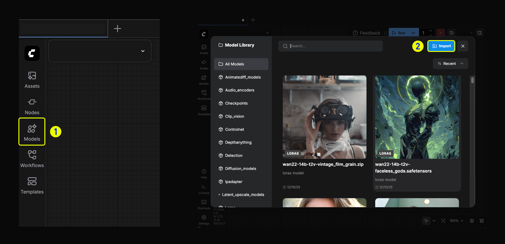
1. Klicken Sie in der linken Seitenleiste auf die Schaltfläche **Models**, um die Modellbibliothek zu öffnen.
2. Klicken Sie im Dialog der Modellbibliothek auf die Schaltfläche **Import**.

### 2. Link einfügen
1. Fügen Sie den Modell-Link ein, den Sie von Hugging Face oder Civitai erhalten haben.
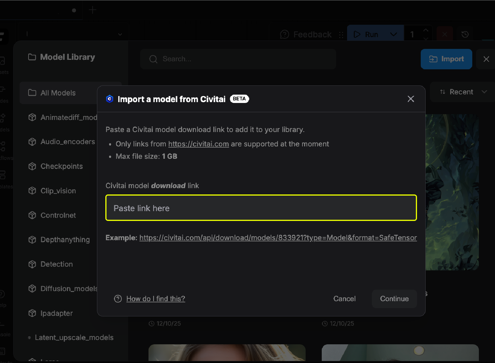

2. Wenn der Link gültig ist, sehen Sie eine Bestätigungsanzeige und können auf die Schaltfläche `Continue` klicken, um fortzufahren.
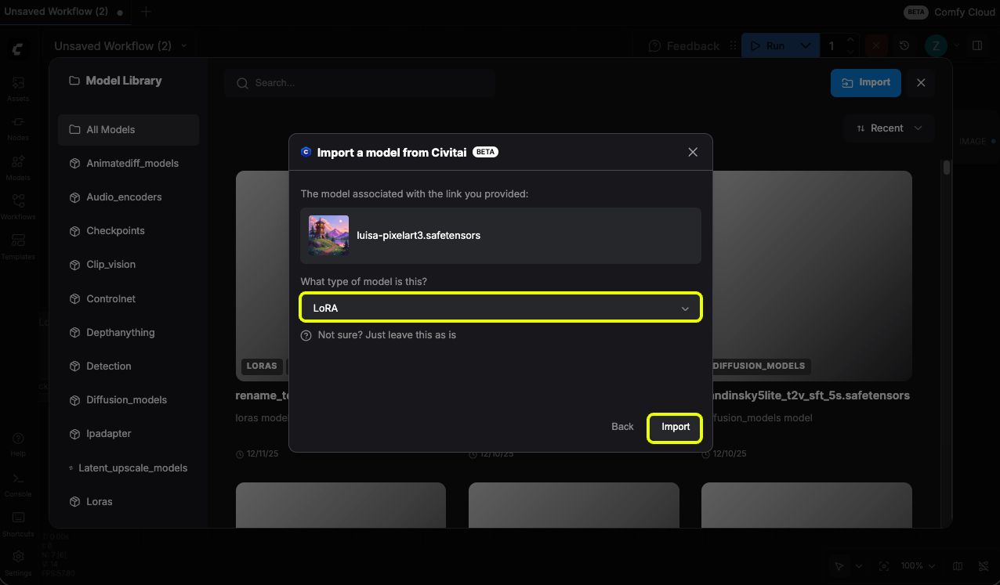

3. Wählen Sie den Modelltyp und den Zielordner aus.
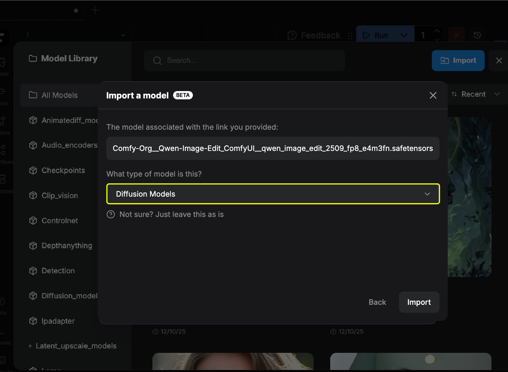

4. Warten Sie, bis das Modell heruntergeladen wurde.
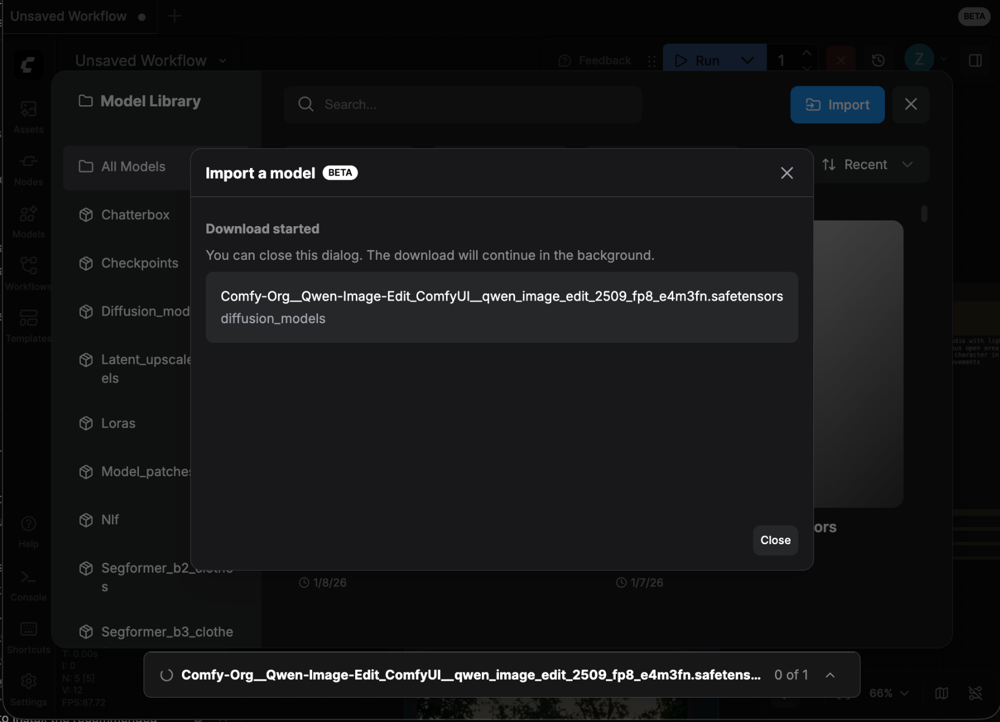

5. Nachdem das Modell heruntergeladen wurde, finden Sie es in Ihrer Modellbibliothek.

## So zeigen Sie importierte Modelle an

Wählen Sie in der Modellbibliothek im Dropdown-Filter „Meine Modelle“ aus, um die von Ihnen importierten Modelle herauszufiltern.

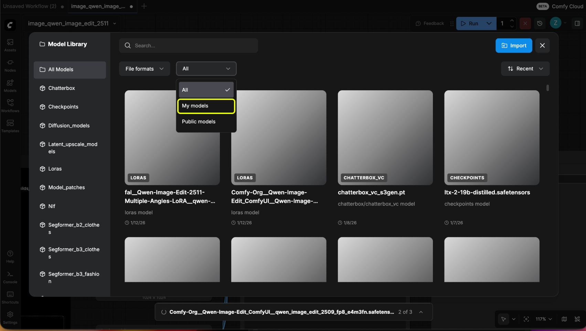

## So erhalten Sie Links zum Importieren von Modellen

### 1. Link von Civitai abrufen

1. Öffnen Sie [Civitai](https://civitai.com/) und suchen Sie das Modell, das Sie importieren möchten.
2. Klicken Sie mit der rechten Maustaste auf die Download-Schaltfläche und wählen Sie „Linkadresse kopieren“, um den Download-Link des Modells zu erhalten.

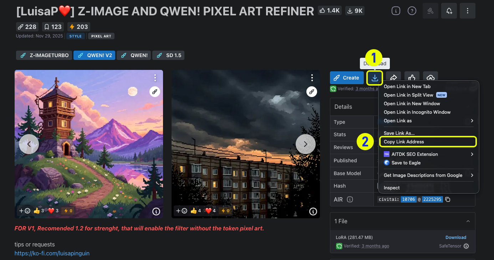

### 2. Link von Hugging Face abrufen

1. Öffnen Sie [Hugging Face](https://huggingface.co/) und suchen Sie das Modell-Repository, das Sie importieren möchten.
2. Navigieren Sie zur Seite mit den Modelldateien. Das unterstützte Format ist ".safetensors". Klicken Sie auf den jeweiligen Modellnamen, um dessen Detailseite zu öffnen.

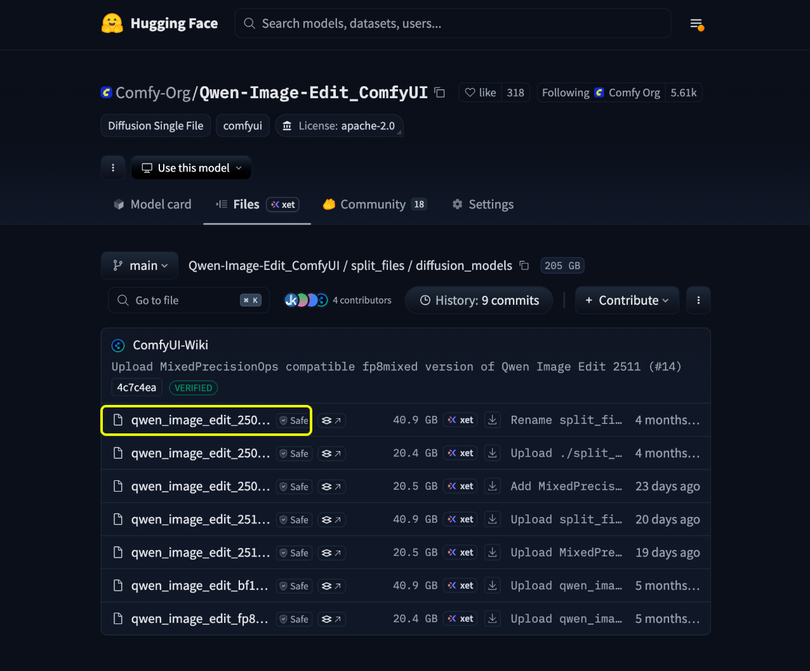

3. Klicken Sie auf der Detailseite auf die Schaltfläche `Copy Download Link`, um den Download-Link des Modells zu erhalten.

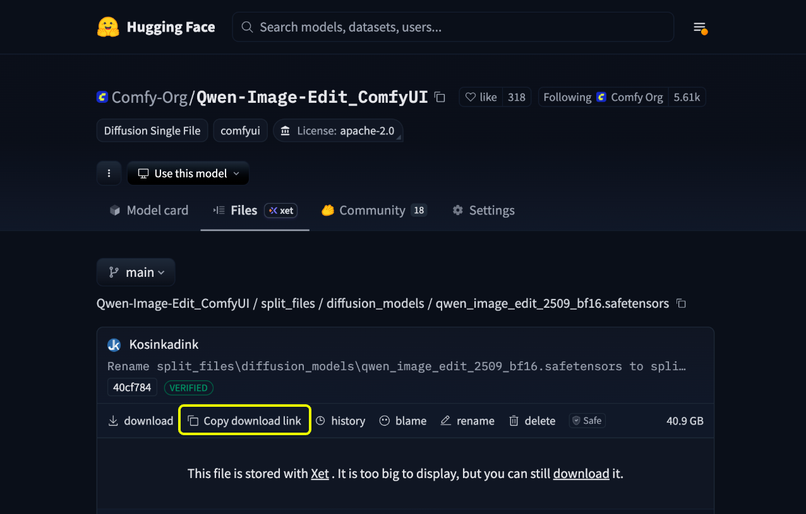

## Private Modelle importieren

Wenn Sie private Modelle von Hugging Face oder Civitai importieren möchten, müssen Sie zuerst Ihre API-Schlüssel konfigurieren.

### 1. API-Schlüssel generieren

Zuerst müssen Sie API-Schlüssel auf den jeweiligen Plattformen generieren:

<Tabs>
  <Tab title="Civitai">
    1. Melden Sie sich bei Civitai an und besuchen Sie [https://civitai.com/user/account](https://civitai.com/user/account).
    2. Generieren Sie Ihren API-Schlüssel in den Kontoeinstellungen.

    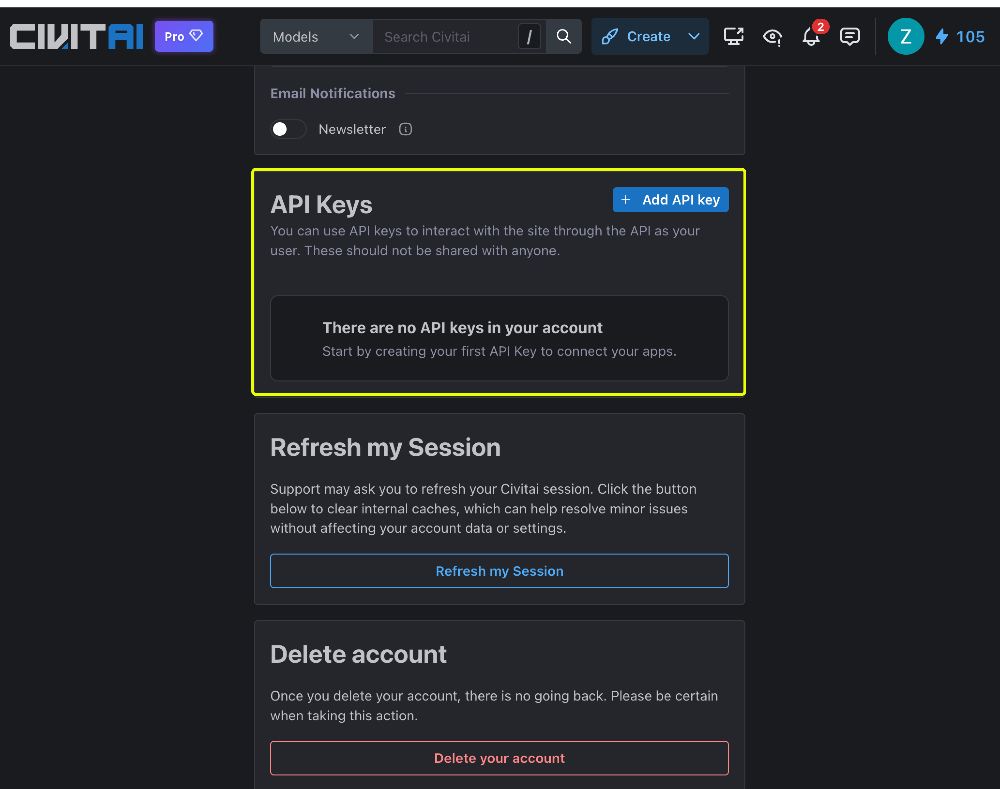
  </Tab>
  <Tab title="Hugging Face">
    1. Besuchen Sie [https://huggingface.co/settings/tokens](https://huggingface.co/settings/tokens).
    2. Generieren Sie Ihr API-Token.

    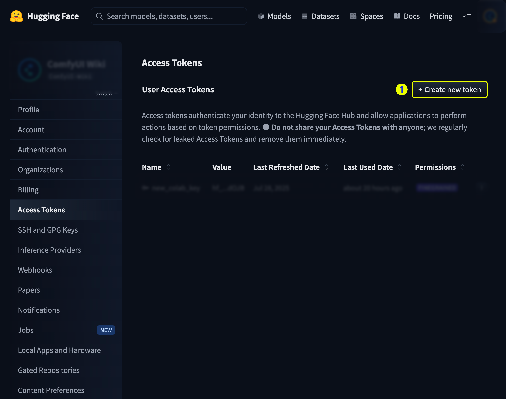

    3. Stellen Sie sicher, dass Ihr Token Lesezugriff auf die Repositories hat, die die privaten Modelle enthalten, die Sie importieren möchten.

    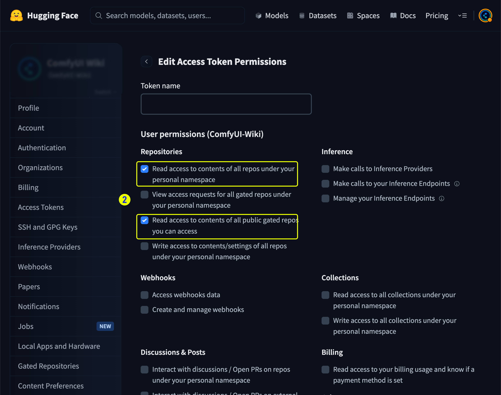
  </Tab>
</Tabs>

### 2. API-Schlüssel speichern

1. Rufen Sie die [Comfy Cloud-Einstellungen](https://cloud.comfy.org) auf und navigieren Sie zum Bereich **Secrets**.

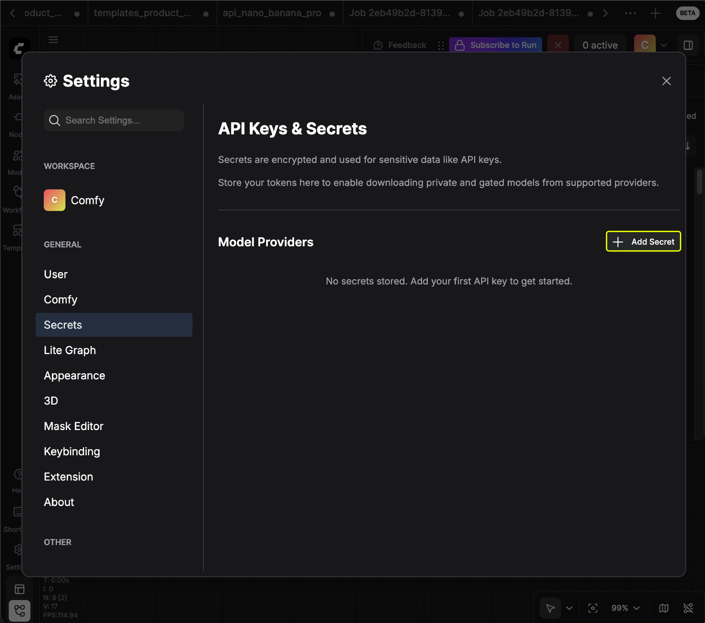

2. Klicken Sie, um Ihre API-Schlüssel hinzuzufügen (Sie können den Schlüssel beliebig benennen):

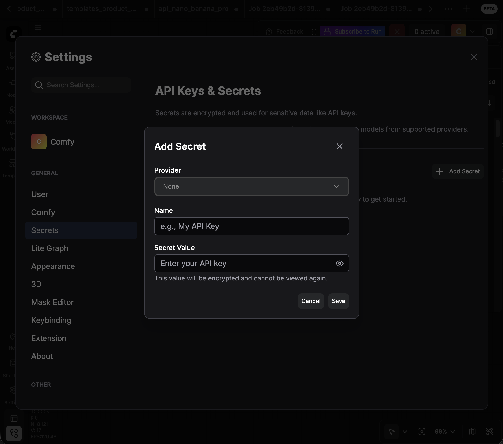

3. Stellen Sie sicher, dass Ihre API-Schlüssel Zugriffsberechtigungen für die privaten Modelle haben, die Sie importieren möchten.

### 3. Privates Modell importieren

Sobald Ihre API-Schlüssel konfiguriert sind, können Sie private Modelle mit demselben Verfahren wie öffentliche Modelle importieren:

1. Rufen Sie den Modell-Link von Hugging Face oder Civitai ab.
2. Fügen Sie den Link in das Import-Dialogfenster ein.
3. Das System verwendet automatisch Ihre gespeicherten API-Schlüssel, um auf das private Modell zuzugreifen.

<Note>
Stellen Sie sicher, dass Ihr API-Schlüssel über die erforderlichen Berechtigungen verfügt, um auf das jeweilige private Modell zuzugreifen, das Sie importieren möchten.
</Note>

## FAQ

<AccordionGroup>
  <Accordion title="Gibt es Einschränkungen für die Modelle, die ich hochladen kann?">
    Ja. Es werden nur **safetensors**-Dateien unterstützt. Es gibt praktisch keine Dateigrößenbeschränkung (bis zu 100GB).
  </Accordion>

  <Accordion title="Sind die Modelle, die ich hochlade, privat oder für alle sichtbar?">
    Modelle, die Sie importieren, sind **privat für Sie**. Nur Sie können die Modelle in Ihrer Bibliothek sehen.
  </Accordion>

  <Accordion title="Kann ich meine eigenen benutzerdefinierten Modelle von meiner lokalen Festplatte hochladen?">
    Derzeit müssen Sie das Modell zuerst in ein **öffentliches Repository auf Hugging Face oder Civitai** hochladen und dann von diesen Plattformen importieren.
  </Accordion>

  <Accordion title="Kann ich aufgeteilte Modelldateien hochladen?">
    Nein. Sie müssen aufgeteilte Modelldateien vor dem Import zu einer Datei kombinieren.
  </Accordion>

  <Accordion title="Ist diese Funktion in meinem aktuellen Cloud-Abonnement enthalten?">
    Diese Funktion ist nur in den Tarifen **Creator** und **Pro** verfügbar.
  </Accordion>

  <Accordion title="Ist diese Funktion in den Desktop- oder portablen Versionen von ComfyUI verfügbar?">
    Nein. Diese Funktion ist **nur in Comfy Cloud verfügbar**.
  </Accordion>

  <Accordion title="Kann ich ein von mir hochgeladenes Modell löschen?">
    Ja. Sie können importierte Modelle löschen. Beachten Sie, dass Modelle, die vom internen Comfy-Team hochgeladen wurden, nicht gelöscht werden können.
  </Accordion>

  <Accordion title="Welche Modelltypen kann ich importieren (BYOM)?">
    Die folgenden Beispiele sind nicht abschließend. BYOM unterstützt jeden Modellordner, den Comfy Cloud beim Import im **Importtyp-Auswahlfeld** auflistet. Diese Liste stammt aus den von Comfy Cloud unterstützten ComfyUI-Modellordnern und ist die maßgebliche Quelle.

    Praktisch gesehen: Wenn ComfyUI eine Datei als Modellgewicht behandelt (Checkpoint, LoRA, VAE, ControlNet, Embedding, Upscaler, IP-Adapter, SAM, Audio-Encoder und Ähnliches), können Sie sie importieren, sofern der Ordner in dieser Auswahl erscheint.

    Häufige Beispiele:

    - **Checkpoints und UNets**: `checkpoints`, `diffusion_models`
    - **LoRAs und Adapter**: `loras`, `animatediff_motion_lora`, `cogvideox_loras` und ähnliche Adapterordner
    - **VAE**: `vae`, `vae_approx`
    - **ControlNet**: `controlnet`
    - **CLIP und Text-Encoder**: `clip_vision`, `text_encoders`
    - **Embeddings / Textual Inversion**: `embeddings` (in `CLIPTextEncode`-Prompts mit `embedding:my-embedding-name` referenzieren)
    - **Upscaler**: `upscale_models`, `latent_upscale_models`
    - **Vision / Segmentierung / Entfernung**: `ipadapter`, `gligen`, `sams`, `sam3`, `rmbg`, `ultralytics_bbox`, `ultralytics_segm`
    - **Weitere Ordner in der Auswahl**: `audio_encoders`, `model_patches`, `style_models`, `photomaker`, `LLM`, `CogVideo` und mehr

    Was den Import tatsächlich einschränkt, ist nicht die Modellkategorie, sondern diese Regeln:

    - **Dateiformat**: nur `.safetensors` (auch wenn ComfyUI lokal `.ckpt`, `.pth` oder `.onnx` für diesen Ordner unterstützt)
    - **Quelle**: nur Download-Links von Civitai oder Hugging Face (kein direkter lokaler Upload)
    - **Blockierter Ordner**: `nlf`-Modelle können nicht importiert werden
  </Accordion>
</AccordionGroup>
