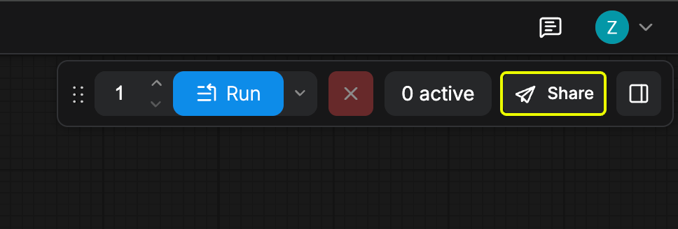
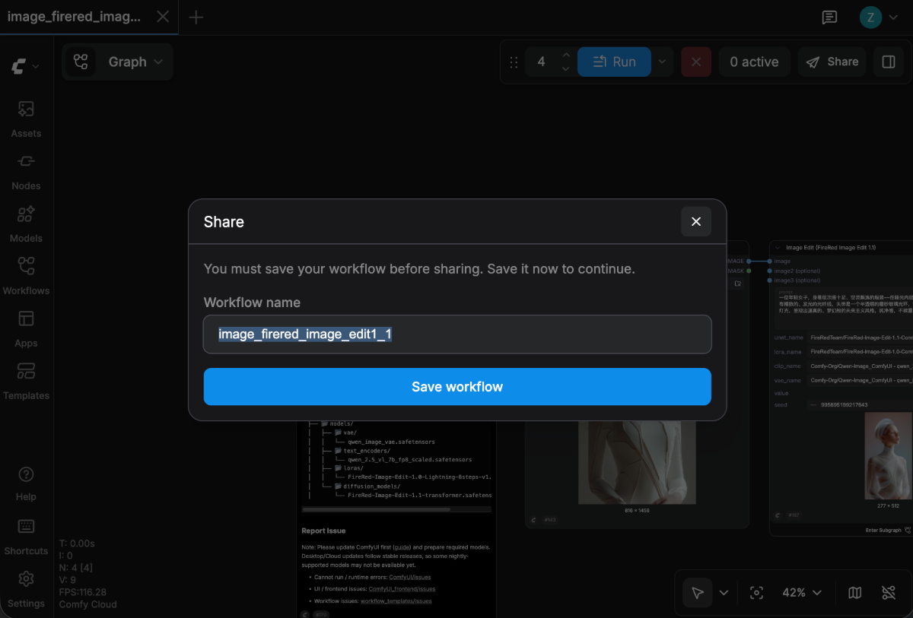
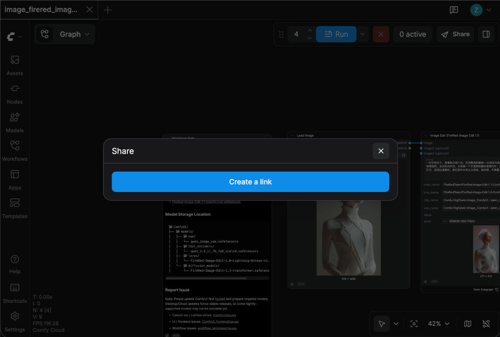
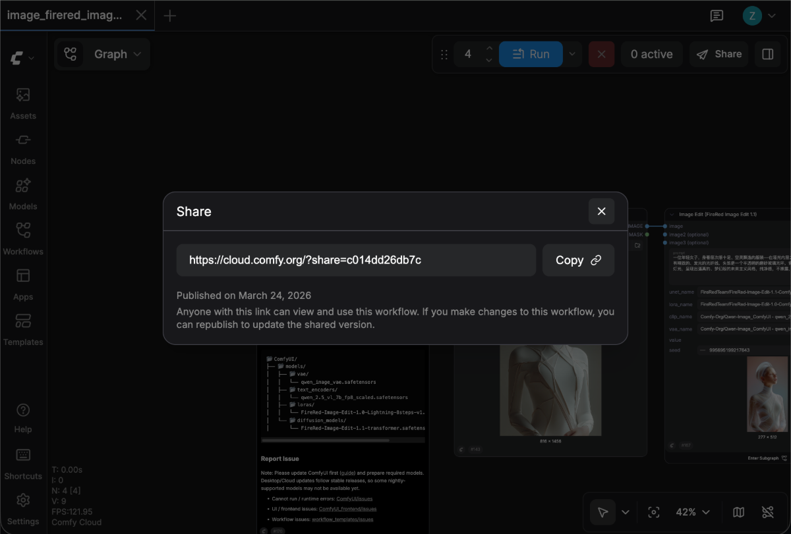
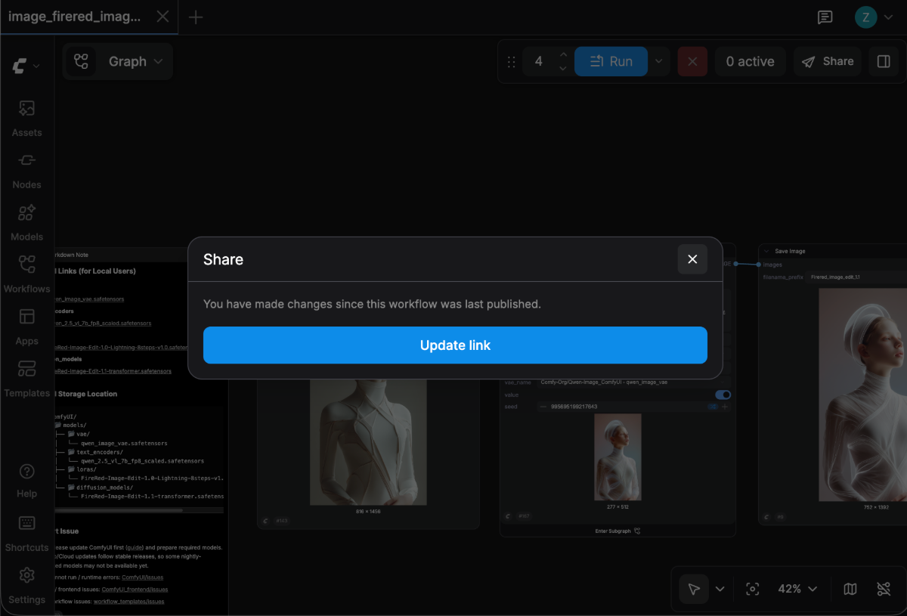

import CloudFeature from "/snippets/de/cloud-feature.mdx"

<CloudFeature/>

## Übersicht

Mit Comfy Cloud können Sie Ihre Workflows für andere freigeben, indem Sie einen teilbaren Link generieren. Empfänger können den Workflow zusammen mit allen Eingängen, Ausgängen und allen im Workflow referenzierten Assets ansehen.

<Warning>
  **Geteilte Links enthalten die Assets Ihres Workflows.** Jeder, der den Link hat, sieht nicht nur das Layout des Workflows, sondern auch die darin verwendeten Medien, etwa hochgeladene Bilder, Masken und andere mit Nodes verknüpfte Dateien. Teilen Sie keine Links für Workflows, die private oder sensible Inhalte enthalten.
</Warning>

## Workflow teilen

<Steps>
  <Step title="Workflow erstellen">
    Erstellen Sie den Workflow, den Sie teilen möchten, in Comfy Cloud und stellen Sie ihn fertig.
  </Step>
  <Step title="Auf die Schaltfläche „Share“ klicken">
    Klicken Sie oben rechts auf der Workflow-Seite auf die Schaltfläche **Share**.

    
  </Step>
  <Step title="Workflow speichern">
    Wenn Ihr Workflow noch nicht gespeichert wurde, werden Sie aufgefordert, einen Dateinamen einzugeben und den Workflow vor dem Teilen zu speichern.

    
  </Step>
  <Step title="Teilbaren Link erstellen">
    Klicken Sie nach dem Speichern auf **Create a link**, um einen teilbaren Link zu generieren. Der Link enthält den Workflow, seine Eingänge und Ausgänge sowie die im Node-Graph verwendeten Assets.

    
  </Step>
  <Step title="Link kopieren und teilen">
    Sobald der Link generiert wurde, kopieren Sie ihn und senden Sie ihn an alle, mit denen Sie den Workflow teilen möchten.

    
  </Step>
</Steps>

## Geteilten Workflow aktualisieren

Wenn Sie einen Workflow ändern, der bereits geteilt wurde:

1. Speichern Sie den aktualisierten Workflow.
2. Klicken Sie erneut auf die Schaltfläche **Share**.
3. Wählen Sie **Update**, um den vorhandenen geteilten Link mit Ihren neuesten Änderungen zu aktualisieren.

Der ursprüngliche Link zeigt automatisch den aktualisierten Inhalt des Workflows. Empfänger, die denselben Link verwenden, sehen die neueste Version.