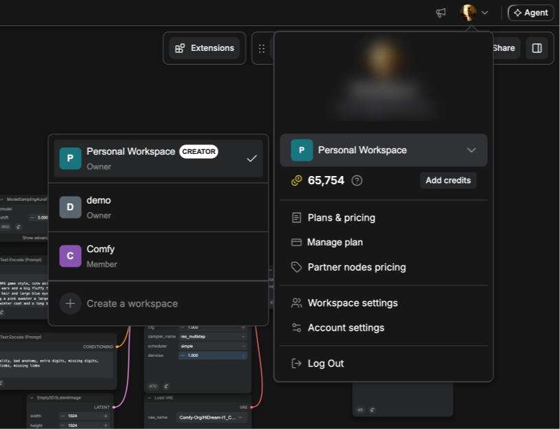
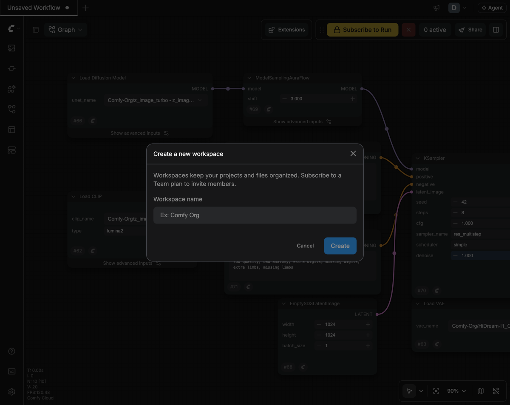
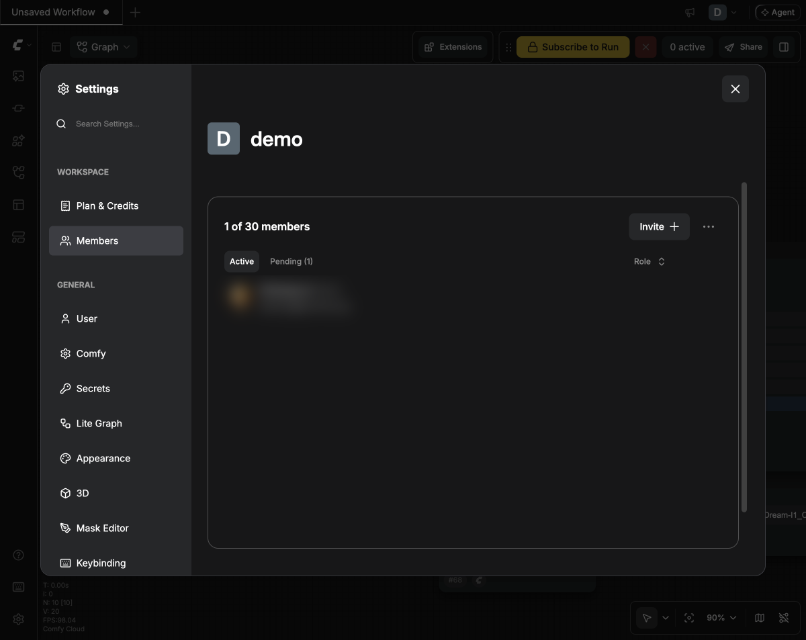
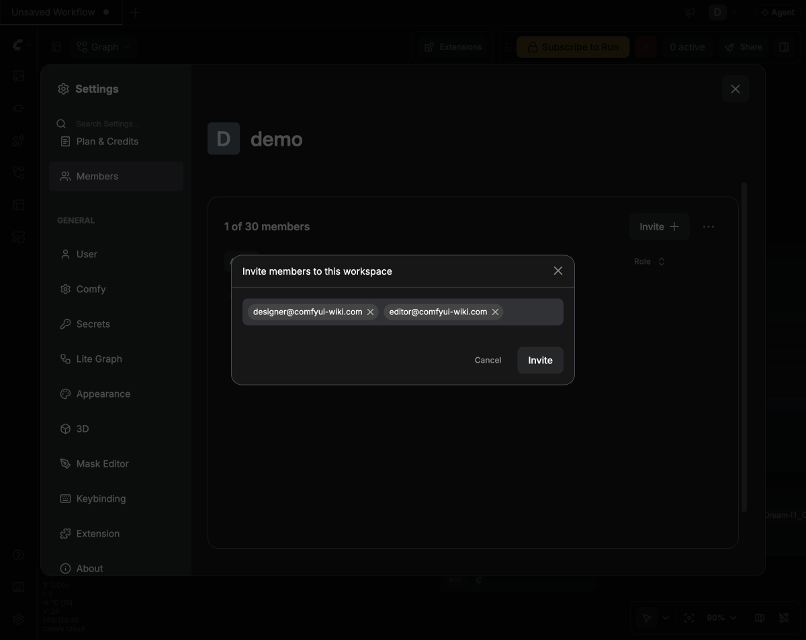
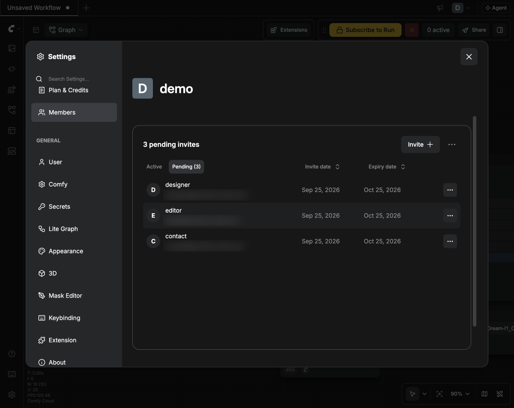
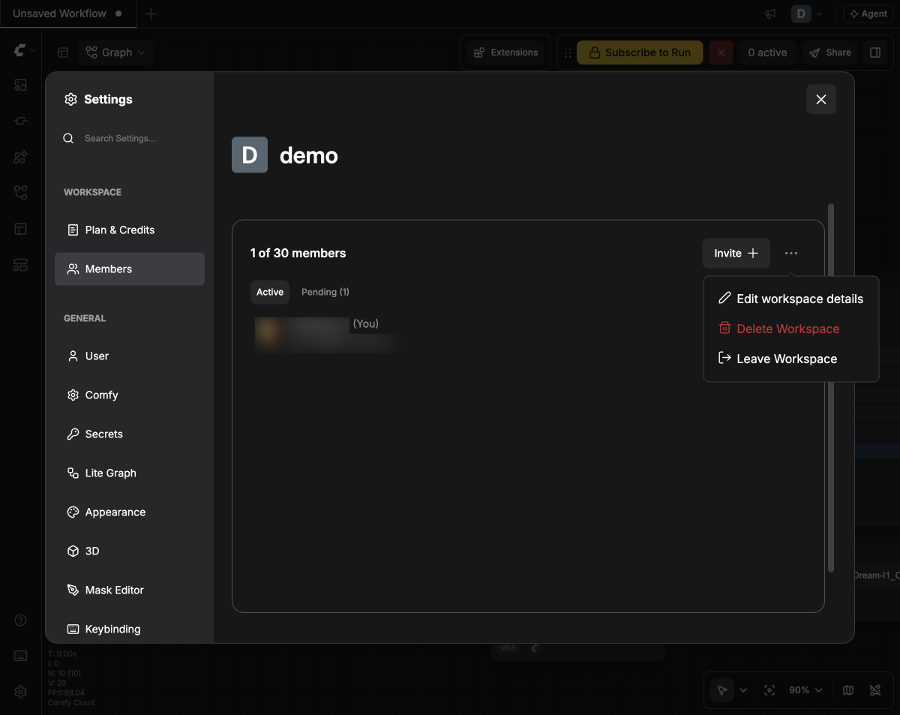
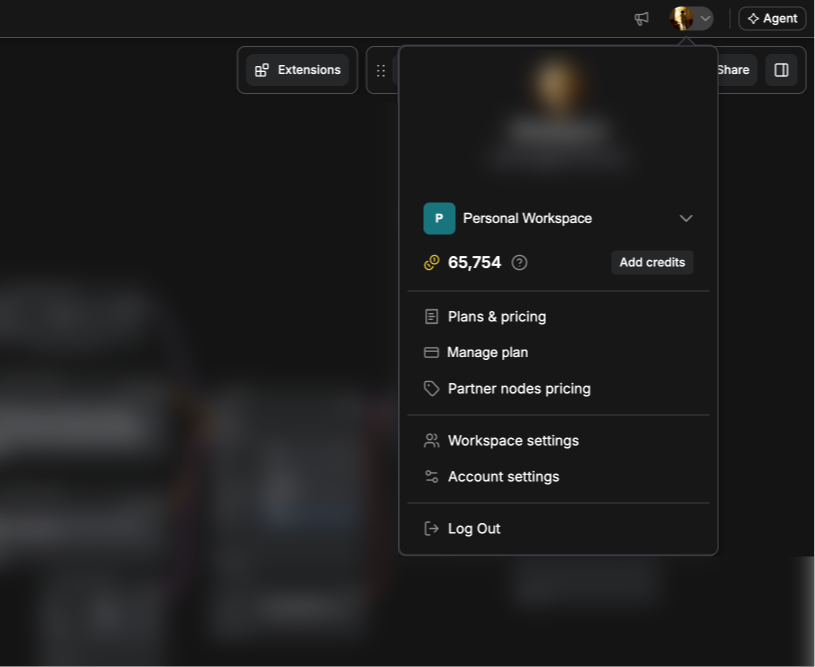

import CloudFeature from "/snippets/de/cloud-feature.mdx"

<CloudFeature/>

## Übersicht

Ein Workspace bildet die Kontogrenze für Ihre Arbeit mit Comfy Cloud. Workflows, hochgeladene Dateien, Ausgaben und Credits gehören zum Workspace und nicht zu einem einzelnen Benutzer. Wenn Sie den Workspace wechseln, ändert sich daher, welche Dateien Sie sehen und welche Credits Ihre Ausführungen verbrauchen.

Jeder Benutzer erhält einen **persönlichen** Workspace. Um mit anderen Personen zusammenzuarbeiten, erstellen Sie einen **Team**-Workspace und laden Sie sie ein.

Wenn Sie jemand zu einem Team-Workspace eingeladen hat, müssen Sie nichts erstellen: Öffnen Sie die Einladungs-E-Mail, melden Sie sich mit der Adresse an, an die sie gesendet wurde, und wechseln Sie zu diesem Workspace. Weitere Informationen finden Sie unter [Workspaces wechseln](#workspaces-wechseln).

## Persönliche und Team-Workspaces

| Typ | Was es ist |
|------|-------------|
| **Persönlich** | Wird für jeden Benutzer automatisch mit einem einzigen Seat erstellt. Nur Sie können darauf zugreifen. Er kann nicht gelöscht werden, und Sie können ihn nicht verlassen. |
| **Team** | Ein gemeinsamer Workspace, den Sie erstellen oder in den Sie eingeladen werden. Mitglieder sehen die Dateien des Workspace und teilen seine Credits. |

Das Erstellen eines Team-Workspace ist kostenlos. Um Personen einzuladen, benötigt der Workspace Seats: Ein Workspace, der nicht im Team-Tarif ist, hat einen Seat, der seinem Inhaber gehört. Team-Tarife enthalten einen Seat für jedes Mitglied.

## Was pro Workspace getrennt ist

Jeder Workspace behält seine eigenen:

- **Dateien und Ausgaben**: Uploads, generierte Bilder, Aufträge und Verlauf
- **Workflows**: die Workflow-Bibliothek, die Sie in diesem Workspace sehen
- **Tarif und Credits**: eigenes Abonnement und eigenes Credit-Guthaben
- **Personen**: Mitglieder, Rollen und ausstehende Einladungen
- **Zugriff**: Workspace-API-Schlüssel und, bei Enterprise-Workspaces, die Partnermodelle, die Mitglieder ausführen können

Beim Wechsel des Workspace wird all dies auf einmal gewechselt, und zwischen Workspaces wird nichts automatisch kopiert.

## Team-Workspace erstellen

<Steps>
  <Step title="Profilmenü öffnen">
    Klicken Sie auf Ihr Profilbild in der oberen rechten Ecke.
  </Step>
  <Step title="Workspace-Liste öffnen">
    Klicken Sie im Menü auf Ihren Workspace-Namen. Die Liste zeigt alle Workspaces, denen Sie angehören, jeweils mit Ihrer Rolle.

    
  </Step>
  <Step title="Workspace erstellen">
    Klicken Sie unten in der Liste auf **Create a workspace**.
  </Step>
  <Step title="Namen vergeben">
    Geben Sie einen Namen ein und klicken Sie auf **Create**. Namen sind 1 bis 50 Zeichen lang, müssen mit einem Buchstaben oder einer Zahl beginnen und dürfen Buchstaben, Zahlen, Leerzeichen sowie die Zeichen `- _ ' . , ( ) & +` enthalten.

    
  </Step>
</Steps>

Comfy Cloud wechselt in den neuen Workspace und lädt die Seite neu.

<Note>
  Sie können insgesamt bis zu **10 Workspaces** besitzen, einschließlich Ihres persönlichen Workspace. Es gibt kein Limit dafür, wie vielen Workspaces Sie als Mitglied beitreten können.
</Note>

Um Ihre Workspace-Liste direkt zu öffnen, hängen Sie `?create_workspace=1` an die URL von Comfy Cloud an, zum Beispiel `https://cloud.comfy.org/?create_workspace=1`. Dadurch öffnet sich der Dialog für Team-Workspaces, der Ihre Workspaces auflistet und ein Feld **New workspace** sowie eine Schaltfläche **Create workspace** enthält.

## Mitglieder einladen

Nur Workspace-Inhaber können Mitglieder einladen. Team-Tarife enthalten für jedes Mitglied einen Platz, und der Tab **Mitglieder** zeigt an, wie viele Plätze belegt sind, zum Beispiel `3 of 20 members`. Ausstehende Einladungen zählen zu diesem Limit. Ein Workspace kann derzeit bis zu 50 Mitglieder umfassen; wenn Sie mehr benötigen, [kontaktieren Sie den Support](https://support.comfy.org/).

So laden Sie Mitglieder ein:

<Steps>
  <Step title="Workspace-Einstellungen öffnen">
    Klicken Sie im Profilmenü auf **Workspace-Einstellungen**.
  </Step>
  <Step title="Bereich „Mitglieder“ öffnen">
    Wählen Sie **Mitglieder** aus.
  </Step>
  <Step title="Einladungen senden">
    Klicken Sie auf **Einladen**, geben Sie eine oder mehrere durch Kommas getrennte E-Mail-Adressen ein und klicken Sie dann im Dialog auf **Einladen**.
  </Step>
</Steps>

<Note>
  Wenn sich mit **Einladen** der Dialog nicht öffnet, hat der Workspace keinen freien Platz. Ein Workspace, der nicht auf einem Team-Tarif läuft, hat einen Platz, und ein volles Team zeigt einen Tooltip zur maximalen Mitgliederzahl. Öffnen Sie **Tarif & Credits** und upgraden Sie auf einen Team-Tarif, oder kontaktieren Sie uns bezüglich Enterprise, wenn Sie mehr Mitglieder benötigen.
</Note>

Comfy Cloud sendet jeder Person einen Link zum Beitreten per E-Mail. Die Einladung ist an die Adresse gebunden, an die sie gesendet wurde, daher muss sich der Empfänger mit genau dieser Adresse anmelden oder ein Konto erstellen. Ist er beim Öffnen des Links nicht angemeldet, wird er zunächst zur Anmeldung aufgefordert, und die Einladung wird danach angewendet.

Einladungen, die noch nicht angenommen wurden, erscheinen mit ihrem Ablaufdatum im Tab **Ausstehend** des Bereichs Mitglieder. Inhaber sehen diesen Tab; Mitglieder sehen nur die Liste der Personen, die bereits beigetreten sind. Von dort aus kann ein Inhaber:

- **Einladungslink kopieren**: den Link direkt teilen, anstatt auf die E-Mail zu warten
- **Einladung erneut senden**: die E-Mail mit einem neuen Link erneut senden
- **Einladung stornieren**: die Einladung widerrufen

Einladungen laufen 30 Tage nach dem Versenden ab.

## Rollen und Berechtigungen

| Rolle | Darf |
|------|--------|
| **Inhaber** | Mitglieder einladen und entfernen, Rollen ändern, den Workspace umbenennen oder löschen sowie den Workspace-Plan und die Credits verwalten. |
| **Mitglied** | Workflows im Workspace ausführen und die Mitgliederliste ansehen. Kann keine Mitglieder einladen, keine ausstehenden Einladungen sehen, die Workspace-Einstellungen nicht ändern und die Abrechnung nicht verwalten. |

Inhaber können die Rolle eines Mitglieds im Bereich Mitglieder ändern. Auf diese Weise können Sie ein Mitglied zum Inhaber befördern oder einen Inhaber wieder zum Mitglied zurückstufen. Ein Workspace behält immer mindestens einen Inhaber, daher kann der letzte verbleibende Inhaber weder herabgestuft noch entfernt werden. Einige Meldungen in Comfy Cloud bezeichnen den Inhaber als Workspace-Administrator; es handelt sich dabei um dieselbe Rolle.

Mitglieder können die **Workspace-Einstellungen** öffnen und den Plan sowie die Mitgliederliste des Workspace einsehen, dort aber nichts ändern. Wenn ein Inhaber ein Mitglied entfernt, verliert diese Person den Zugriff auf die Dateien und Workflows des Workspace, der Platz wird frei, und alle Workspace-API-Schlüssel, die sie erstellt hat, funktionieren nicht mehr. Mitglieder können sich nicht selbst entfernen; sie verlassen stattdessen den Workspace. Das Verlassen ist für den Ersteller des Workspace, für einen alleinigen Inhaber und für Mitglieder, deren Mitgliedschaft von einer Organisation verwaltet wird, nicht verfügbar.

## Workspace verwalten

Öffnen Sie die **Workspace-Einstellungen** über das Profilmenü. Die Gruppe **Workspace** im Einstellungsdialog enthält diese Bereiche:

- **Tarif & Credits**: der Tarif des Workspace, das Credit-Guthaben und Aufladungen. Nur der Inhaber kann diese ändern.
- **Mitglieder**: die Mitgliederliste, Rollen und ausstehende Einladungen. Ausstehende Einladungen sind für Inhaber sichtbar.
- **Partnermodelle**: wird Inhabern von Workspaces angezeigt. Das Einschränken, welche Anbietermodelle Mitglieder ausführen können, ist eine Funktion des Enterprise-Tarifs. Deaktivieren Sie **Alle Partner-Modelle zulassen**, um auszuwählen, welche Anbieter und Modelle Mitglieder ausführen können; später hinzugefügte Modelle bleiben deaktiviert, bis Sie sie aktivieren. Änderungen können bis zu 10 Minuten dauern, bis sie im gesamten Workspace wirksam werden.

Das Menü im Abschnitt „Mitglieder“ ermöglicht Inhabern:

- **Workspace-Details bearbeiten**: den Workspace umbenennen
- **Workspace löschen**: verfügbar, sobald der Workspace kein aktives Abonnement mehr hat. Siehe [Team-Workspace löschen](#team-workspace-löschen).
- **Workspace verlassen**: einen Team-Workspace verlassen. Der Eintrag ist deaktiviert, wenn Sie den Workspace erstellt haben, wenn Sie sein einziger Inhaber sind (machen Sie zuerst ein anderes Mitglied zum Inhaber) oder wenn Ihre Organisation Ihre Mitgliedschaft verwaltet.

Mitglieder sehen dieses Menü ebenfalls, aber nur den Eintrag **Workspace verlassen**.

### Team-Workspace löschen

Nur der Inhaber eines Team-Workspace kann ihn löschen, und der Workspace darf kein aktives Abonnement haben. Das Löschen eines Workspace ist endgültig: ungenutzte Credits und ungespeicherte Assets gehen verloren, und der Workspace kann nicht wiederhergestellt werden. Ihr Persönlicher Workspace kann nicht gelöscht werden, und Enterprise-Workspaces werden von unserem Vertriebsteam verwaltet.

<Steps>
  <Step title="Plan kündigen">
    Öffnen Sie in den **Workspace-Einstellungen** → **Tarif & Credits** das Drei-Punkte-Menü und wählen Sie **Plan kündigen**. Wenn der Workspace kein Abonnement hat, überspringen Sie diesen Schritt.
  </Step>
  <Step title="Workspace löschen">
    Öffnen Sie in den **Workspace-Einstellungen** → **Mitglieder** das Drei-Punkte-Menü, wählen Sie **Workspace löschen** und bestätigen Sie im Dialog.
  </Step>
</Steps>

## Workspaces wechseln

1. Öffnen Sie das Profilmenü.
2. Klicken Sie auf Ihren Workspace-Namen, um die Workspace-Liste zu öffnen.
3. Wählen Sie den Workspace aus, in dem Sie arbeiten möchten.

Comfy Cloud lädt die Seite für den ausgewählten Workspace neu und merkt sich diesen bei Ihrer nächsten Anmeldung.

| URL-Parameter | Aktion |
|------|--------|
| `?create_workspace=1` | Öffnet Ihre Workspace-Liste mit einem Feld **Neuer Arbeitsbereich** und einer Schaltfläche **Arbeitsbereich erstellen** |
| `?invite=TOKEN` | Nimmt eine Workspace-Einladung an |

## So werden Workspaces abgerechnet

Tarife und Credits gehören zum Workspace, nicht zu einzelnen Konten.

**Persönliche Workspaces** nutzen Ihren eigenen Tarif, und Sie sind die einzige Person, die die Credits des Workspaces verbraucht.

**Team-Arbeitsbereiche** verwenden ein Credit-Abonnement, das der Inhaber einrichtet:

- Der Inhaber wählt die monatliche Credit-Menge des Workspaces in **Plan auswählen** (**Für Teams**) mit dem Credit-Slider. Der Preis richtet sich nach der gewählten Menge, und eine größere Bindung senkt den effektiven Satz. Jede Abrechnungsperiode füllt den Pool mit dieser Menge wieder auf.
- Jährliche Bindungen kosten weniger als monatliche, und der Workspace erhält die Credits für das ganze Jahr im Voraus.
- Mitglieder werden nicht einzeln abgerechnet, und das Hinzufügen oder Entfernen von Mitgliedern ändert den Preis nicht. Der Tarif umfasst die Plätze des Workspaces. Wenn Sie mehr Mitglieder benötigen, als der Tarif umfasst, kontaktieren Sie uns bezüglich Enterprise.
- Jedes Mitglied nutzt denselben Credit-Pool.
- Abonnement-Credits werden vor aufgeladenen Credits verbraucht, und aufgeladene Credits bleiben 12 Monate gültig.
- Die Umstellung des Workspaces auf einen persönlichen Tarif entfernt sofort alle anderen Mitglieder; verschieben Sie daher alle gemeinsam genutzten Arbeiten, bevor Sie wechseln.

Siehe [Comfy Cloud-Preise](https://www.comfy.org/cloud/pricing) für aktuelle Preise und Rabatte, [Comfy Cloud abonnieren](/de/support/subscription/subscribing), um einen Team-Tarif einzurichten, und [Ihren Comfy Cloud-Tarif ändern](/de/support/subscription/changing-plan) für Tarifänderungen.

## FAQ

<AccordionGroup>
  <Accordion title="Kann ich Mitglied in mehr als einem Team-Workspace sein?">
    Ja. Sie können insgesamt bis zu 10 Workspaces besitzen, einschließlich Ihres Persönlichen Workspace, und Sie können Mitglied in so vielen Workspaces sein, wie Sie eingeladen werden.
  </Accordion>

  <Accordion title="Benötige ich ein eigenes Abonnement, um einem Team-Workspace beizutreten?">
    Nein. Mitglieder werden nicht einzeln abgerechnet: Ausführungen im Workspace verwenden die Credits des Workspaces, die der Workspace-Inhaber verwaltet.
  </Accordion>

  <Accordion title="Was bleibt erhalten, wenn ich meinen Workspace auf einen Team-Tarif upgrade?">
    Alles bleibt erhalten. Das Upgrade gilt für den Workspace selbst, daher bleiben seine Workflows, Modelle, der Ausführungsverlauf und aufgeladene Credits erhalten. Die Ausnahme sind ungenutzte Plan-Guthaben des Monats, die am Ende des aktuellen Abrechnungszeitraums verfallen, da der Workspace auf ein neues Credit-Kontingent umgestellt wird. Aufgeladene Credits bleiben erhalten.
  </Accordion>

  <Accordion title="Wie übergeben Mitglieder Arbeiten aneinander?">
    Ein Team-Tarif bündelt einen gemeinsamen Credit-Pool, eine Rechnung und einen gemeinsamen Satz von Inhabern. Das Teilen von Workflows und Assets innerhalb eines Workspaces befindet sich noch in Entwicklung. Bis es verfügbar ist, übergeben Sie Arbeit, indem Sie den Workflow-Link teilen, den Workflow als JSON exportieren oder ein von Comfy generiertes Asset auf den Canvas des anderen Mitglieds ziehen.
  </Accordion>

  <Accordion title="Die Einladungs-E-Mail ist nie angekommen. Was nun?">
    Bitten Sie den Workspace-Inhaber, **Resend invite** zu verwenden oder Ihnen über die Registerkarte **Pending** im Bereich Mitglieder mit **Copy invite link** einen Einladungslink zu senden. Einladungen verfallen 30 Tage nach dem Versand, daher muss eine ältere Einladung möglicherweise erneut gesendet werden.
  </Accordion>

  <Accordion title="Kann ich meinen Persönlichen Workspace löschen?">
    Nein. Ihr Persönlicher Workspace ist dauerhaft und dient als Ihr Standard-Workspace.
  </Accordion>

  <Accordion title="Kann ich jemanden in meinen Persönlichen Workspace einladen?">
    Nein. Persönliche Workspaces haben einen einzigen Sitz und keine Mitgliederverwaltung.
  </Accordion>

  <Accordion title="Was passiert, wenn ich einen Team-Workspace verlasse?">
    Der Workspace verschwindet aus Ihrer Workspace-Liste und Sie verlieren den Zugriff auf seine Dateien und Workflows. Alle Workspace-API-Schlüssel, die Sie dafür erstellt haben, funktionieren nicht mehr. Ihr Persönlicher Workspace und dessen Inhalte sind nicht betroffen.
  </Accordion>

  <Accordion title="Was passiert, wenn im Workspace keine Credits mehr verfügbar sind?">
    Mitglieder können keine Workflows ausführen, bis der Inhaber Credits hinzufügt. Dasselbe gilt, wenn das Abonnement des Workspaces inaktiv ist oder eine Zahlung fehlschlägt: Bitten Sie den Workspace-Inhaber, den Tarif oder die Zahlungsmethode zu korrigieren.
  </Accordion>

  <Accordion title="Warum ist Delete Workspace nicht verfügbar?">
    Für den Workspace ist noch ein aktives Abonnement vorhanden. Kündigen Sie es zuerst mit **Cancel plan** unter **Plan & Credits** und löschen Sie dann den Workspace. **Delete Workspace** wird verfügbar, sobald der Tarif gekündigt ist, sodass Sie nicht auf das Ende des Abrechnungszeitraums warten müssen. Persönliche Workspaces können überhaupt nicht gelöscht werden, und Enterprise-Workspaces werden über unser Vertriebsteam beendet.
  </Accordion>

  <Accordion title="Kann ein gelöschter Workspace wiederhergestellt werden?">
    Nein. Das Löschen eines Workspaces ist endgültig.
  </Accordion>
</AccordionGroup>
