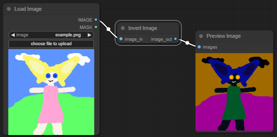

Mit Custom Nodes können Sie neue Funktionen implementieren und sie mit der gesamten Community teilen.

Ein Custom Node ist wie jeder Comfy-Node: Er nimmt Eingaben entgegen, verarbeitet sie und erzeugt eine Ausgabe. Während einige Custom Nodes hochkomplexe Aufgaben ausführen, erledigen viele nur eine einzige Sache. Hier ist ein Beispiel für einen einfachen Node, der ein Bild entgegennimmt und es invertiert.

Beispiele für Custom Nodes:
- [cookiecutter-comfy-extension](https://github.com/Comfy-Org/cookiecutter-comfy-extension)
- [ComfyUI-React-Extension-Template](https://github.com/Comfy-Org/ComfyUI-React-Extension-Template)
- [ComfyUI_frontend_vue_basic](https://github.com/jtydhr88/ComfyUI_frontend_vue_basic)

Wenn Sie Claude Code für die Entwicklung verwenden, vermitteln die [ComfyUI Custom Node Skills](https://github.com/jtydhr88/comfyui-custom-node-skills) Claude umfassendes Wissen über das ComfyUI-Node-System, einschließlich der V3- und V1-APIs. Installieren Sie sie aus dem Claude Code Marketplace oder fügen Sie die Repository-URL hinzu, um 9 Skills zu erhalten, die Node-Grundlagen, Eingänge, Ausgänge, Datentypen, erweiterte Muster, Frontend-Erweiterungen und Paketierung abdecken.

## Client-Server-Modell

Comfy läuft in einem Client-Server-Modell. Der Server, geschrieben in Python, übernimmt die eigentliche Arbeit: Datenverarbeitung, Modelle, Bilddiffusion usw. Der Client, geschrieben in JavaScript, ist für die Benutzeroberfläche zuständig.

Comfy kann auch im API-Modus verwendet werden, in dem ein Workflow von einem Nicht-Comfy-Client (etwa einer anderen UI oder einem Kommandozeilenskript) an den Server gesendet wird.

Custom Nodes lassen sich in eine von vier Kategorien einordnen:

### Nur serverseitig

Die Mehrheit der Custom Nodes läuft ausschließlich serverseitig, indem eine Python-Klasse definiert wird, die die Eingabe- und Ausgabetypen festlegt und eine Funktion bereitstellt, die aufgerufen werden kann, um Eingaben zu verarbeiten und eine Ausgabe zu erzeugen.

### Nur clientseitig

Einige wenige Custom Nodes bieten eine Änderung an der Client-UI, fügen aber keine Kernfunktionalität hinzu. Trotz des Namens fügen sie dem System möglicherweise nicht einmal neue Nodes hinzu.

### Unabhängiger Client und Server

Custom Nodes können zusätzliche Serverfunktionen und zusätzliche (zugehörige) UI-Funktionen bereitstellen (etwa ein neues Widget für einen neuen Datentyp). In den meisten Fällen kann die Kommunikation zwischen Client und Server durch die Datenflusssteuerung von Comfy übernommen werden.

### Verbundener Client und Server

In einer kleinen Anzahl von Fällen müssen die UI-Funktionen und der Server direkt miteinander interagieren.

<Warning>
  Jeder Node, der eine Client-Server-Kommunikation erfordert, ist nicht mit der Verwendung über die API kompatibel.
</Warning>

## Nächste Schritte

<CardGroup cols={2}>
  <Card title="Erste Schritte" icon="play" href="/de/custom-nodes/walkthrough">
    Erstellen und registrieren Sie Schritt für Schritt einen funktionierenden Custom Node.
  </Card>
  <Card title="Python (Backend)" icon="python" href="/de/custom-nodes/backend/server_overview">
    Der Vertrag der Node-Klasse: Eigenschaften, Eingänge, Rückgabetypen.
  </Card>
  <Card title="JavaScript (UI)" icon="js" href="/de/custom-nodes/js/javascript_overview">
    Erweitern Sie das ComfyUI-Frontend aus Ihrem Node-Paket heraus.
  </Card>
  <Card title="Paketieren & Veröffentlichen" icon="box" href="/de/registry/publishing">
    Veröffentlichen Sie Ihren Node in der Comfy Registry.
  </Card>
</CardGroup>
