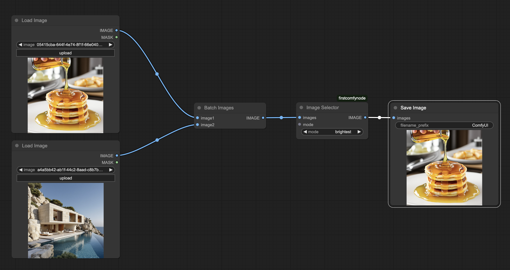

Diese Seite führt Sie Schritt für Schritt durch den Prozess der Erstellung eines Custom Node.

Unser Beispiel nimmt einen Batch von Bildern entgegen und gibt eines der Bilder zurück. Zunächst gibt der Node das Bild zurück, das durchschnittlich die hellste Farbe aufweist; anschließend erweitern wir ihn um eine Reihe von Auswahlkriterien und fügen schließlich noch etwas clientseitigen Code hinzu.

Diese Seite setzt nur sehr geringe Kenntnisse in Python oder JavaScript voraus.

Wenn Sie diesen Walkthrough abgeschlossen haben, können Sie sich eingehender mit dem [Backend-Code](/custom-nodes/backend/server_overview) und dem [Frontend-Code](/custom-nodes/js/javascript_overview) befassen.

## Einen einfachen Node schreiben

### Voraussetzungen

- Eine funktionierende ComfyUI-[Installation](/de/installation/manual_install). Für die Entwicklung empfehlen wir, ComfyUI manuell zu installieren.
- Eine funktionierende comfy-cli-[Installation](/comfy-cli/getting-started).

### Einrichten

```bash
cd ComfyUI/custom_nodes
comfy node scaffold
```

Nachdem Sie ein paar Fragen beantwortet haben, ist ein neues Verzeichnis für Sie eingerichtet.

```bash
 ~  % comfy node scaffold
You've downloaded .cookiecutters/cookiecutter-comfy-extension before. Is it okay to delete and re-download it? [y/n] (y): y
  [1/9] full_name (): Comfy
  [2/9] email (you@gmail.com): me@comfy.org
  [3/9] github_username (your_github_username): comfy
  [4/9] project_name (My Custom Nodepack): FirstComfyNode
  [5/9] project_slug (firstcomfynode): 
  [6/9] project_short_description (A collection of custom nodes for ComfyUI): 
  [7/9] version (0.0.1): 
  [8/9] Select open_source_license
    1 - GNU General Public License v3
    2 - MIT license
    3 - BSD license
    4 - ISC license
    5 - Apache Software License 2.0
    6 - Not open source
    Choose from [1/2/3/4/5/6] (1): 1
  [9/9] include_web_directory_for_custom_javascript [y/n] (n): y
Initialized empty Git repository in firstcomfynode/.git/
✓ Custom node project created successfully!
```

### Den Node definieren

Fügen Sie den folgenden Code am Ende von `src/nodes.py` ein:

```Python src/nodes.py
class ImageSelector:
    CATEGORY = "example"
    @classmethod    
    def INPUT_TYPES(s):
        return { "required":  { "images": ("IMAGE",), } }
    RETURN_TYPES = ("IMAGE",)
    FUNCTION = "choose_image"
```

<Info>
  Die grundlegende Struktur eines Custom Node wird [hier](/custom-nodes/backend/server_overview) ausführlich beschrieben.
  </Info>

Ein Custom Node wird über eine Python-Klasse definiert, die diese vier Dinge enthalten muss: `CATEGORY`,
das angibt, an welcher Stelle im Menü zum Hinzufügen neuer Nodes der Custom Node zu finden ist,
`INPUT_TYPES`, eine Klassenmethode, die festlegt, welche Eingänge der Node annimmt
(Details zum zurückgegebenen Dictionary finden Sie [später](/custom-nodes/backend/server_overview#input_types)),
`RETURN_TYPES`, das definiert, welche Ausgänge der Node erzeugt, und `FUNCTION`, der Name
der Funktion, die beim Ausführen des Nodes aufgerufen wird.

<Tip>
  Beachten Sie, dass der Datentyp für Eingang und Ausgang `IMAGE` (Singular) ist, obwohl
wir einen Batch von Bildern erwarten und nur ein einzelnes Bild zurückgeben. In Comfy bedeutet `IMAGE`
Bild-Batch, und ein einzelnes Bild wird als Batch der Größe 1 behandelt.
</Tip>

### Die Hauptfunktion

Die Hauptfunktion `choose_image` empfängt benannte Argumente, wie sie in `INPUT_TYPES` definiert sind, und
gibt ein `tuple` zurück, wie es in `RETURN_TYPES` definiert ist. Da wir es mit Bildern zu tun haben, die intern
als `torch.Tensor` gespeichert werden,

```Python
import torch
```

Fügen Sie dann die Funktion zu Ihrer Klasse hinzu. Der Datentyp für ein Bild ist `torch.Tensor` mit der Form `[B,H,W,C]`,
wobei `B` die Batch-Größe und `C` die Anzahl der Kanäle ist, also 3 für RGB. Wenn wir über einen solchen
Tensor iterieren, erhalten wir eine Reihe von `B` Tensoren der Form `[H,W,C]`. Die Methode `.flatten()` macht
daraus einen eindimensionalen Tensor der Länge `H*W*C`, `torch.mean()` berechnet den Mittelwert, und `.item()`
wandelt einen Tensor mit einem einzelnen Wert in einen Python-Float um.

```Python
def choose_image(self, images):
    brightness = list(torch.mean(image.flatten()).item() for image in images)
    brightest = brightness.index(max(brightness))
    result = images[brightest].unsqueeze(0)
    return (result,)
```

Hinweise zu den letzten beiden Zeilen:

- `images[brightest]` gibt einen Tensor der Form `[H,W,C]` zurück. Mit `unsqueeze` wird eine Dimension (der Länge 1) an, in diesem Fall, Dimension null eingefügt, sodass wir
`[B,H,W,C]` mit `B=1` erhalten: ein einzelnes Bild.
- In `return (result,)` ist das abschließende Komma unverzichtbar, damit Sie ein Tupel zurückgeben.

### Den Node registrieren

Damit Comfy den neuen Node erkennt, muss er auf Paketebene verfügbar sein. Ändern Sie die Variable `NODE_CLASS_MAPPINGS` am Ende von `src/nodes.py`. Sie müssen ComfyUI neustarten, um Änderungen zu sehen.

```Python src/nodes.py

NODE_CLASS_MAPPINGS = {
    "Example" : Example,
    "Image Selector" : ImageSelector,
}

# Optional können Sie den Node im Dictionary `NODE_DISPLAY_NAME_MAPPINGS` umbenennen.
NODE_DISPLAY_NAME_MAPPINGS = {
    "Example": "Example Node",
    "Image Selector": "Image Selector",
}
```

<Info>
  Eine ausführliche Erklärung, wie ComfyUI Custom Nodes findet und lädt, finden Sie in der [Dokumentation zum Node-Lebenszyklus](/de/custom-nodes/backend/lifecycle).
</Info>

## Add some options

That node is maybe a bit boring, so we might add some options; a widget that allows you to 
choose the brightest image, or the reddest, bluest, or greenest. Edit your `INPUT_TYPES` to look like:

```Python
@classmethod    
def INPUT_TYPES(s):
    return { "required":  { "images": ("IMAGE",), 
                            "mode": (["brightest", "reddest", "greenest", "bluest"],)} }
```

Then update the main function. We'll use a fairly naive definition of 'reddest' as being the average
`R` value of the pixels divided by the average of all three colors. So:

```Python
def choose_image(self, images, mode):
    batch_size = images.shape[0]
    brightness = list(torch.mean(image.flatten()).item() for image in images)
    if (mode=="brightest"):
        scores = brightness
    else:
        channel = 0 if mode=="reddest" else (1 if mode=="greenest" else 2)
        absolute = list(torch.mean(image[:,:,channel].flatten()).item() for image in images)
        scores = list( absolute[i]/(brightness[i]+1e-8) for i in range(batch_size) )
    best = scores.index(max(scores))
    result = images[best].unsqueeze(0)
    return (result,)
```

## Die UI anpassen

Vielleicht hätten wir gerne ein wenig visuelles Feedback, also senden wir eine kleine Textnachricht, die angezeigt werden soll.

### Eine Nachricht vom Server senden

Dazu müssen zwei Zeilen zum Python-Code hinzugefügt werden:

```Python
from server import PromptServer
```

und am Ende der Methode `choose_image` fügen Sie eine Zeile hinzu, die eine Nachricht an das Frontend sendet (`send_sync` erwartet einen Nachrichtentyp, der eindeutig sein sollte, und ein Dictionary):

```Python
PromptServer.instance.send_sync("example.imageselector.textmessage", {"message":f"Picked image {best+1}"})
return (result,)
```

### Eine Client-Erweiterung schreiben

Um etwas Javascript zum Client hinzuzufügen, erstellen Sie ein Unterverzeichnis `web/js` in Ihrem Custom-Node-Verzeichnis und ändern Sie das Ende von `__init__.py`, um ComfyUI über das Exportieren von `WEB_DIRECTORY` davon zu informieren:

```Python
WEB_DIRECTORY = "./web/js"
__all__ = ['NODE_CLASS_MAPPINGS', 'WEB_DIRECTORY']
```

Die Client-Erweiterung wird als `.js`-Datei im Unterverzeichnis `web/js` gespeichert. Erstellen Sie daher `image_selector/web/js/imageSelector.js` mit dem unten stehenden Code. (Weitere Informationen finden Sie unter [client side coding](/custom-nodes/js/javascript_overview)).

```Javascript
import { app } from "../../scripts/app.js";
app.registerExtension({
	name: "example.imageselector",
    async setup() {
        function messageHandler(event) { alert(event.detail.message); }
        app.api.addEventListener("example.imageselector.textmessage", messageHandler);
    },
})
```

Wir haben lediglich eine Erweiterung registriert und in der Methode `setup()` einen Listener für den Nachrichtentyp hinzugefügt, den wir senden. Dieser liest das Dictionary, das wir gesendet haben (es ist in `event.detail` gespeichert).

Stoppen Sie den Comfy-Server, starten Sie ihn erneut, laden Sie die Webseite neu und führen Sie Ihren Workflow aus.

### Das vollständige Beispiel

Das vollständige Beispiel finden Sie [hier](https://gist.github.com/robinjhuang/fbf54b7715091c7b478724fc4dffbd03). Sie können den Beispiel-Workflow als [JSON-Datei](https://github.com/Comfy-Org/docs/blob/main/public/workflow.json) herunterladen oder ihn unten ansehen:

<div align="center">
  
</div>
