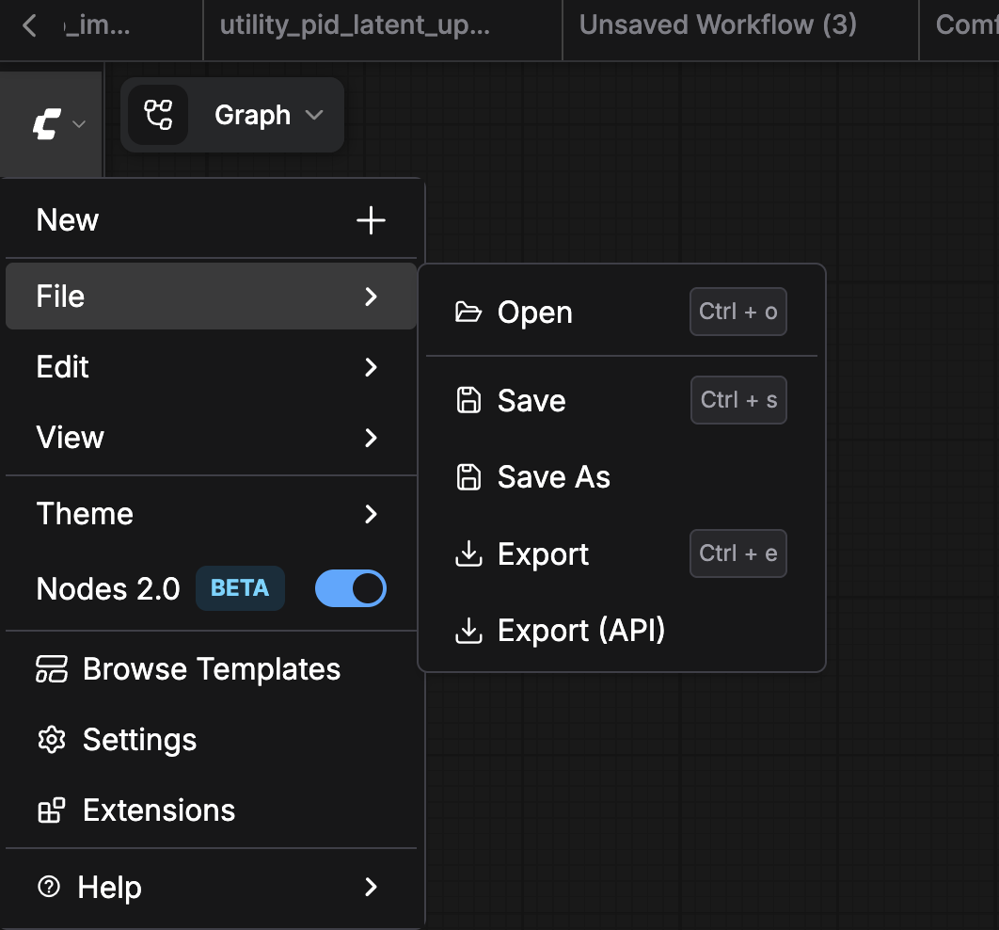

ComfyUI-Workflows sind JSON-Objekte, die einen Graphen aus Nodes beschreiben. Wenn Sie ComfyUI programmatisch aufrufen, egal ob über die Cloud API oder mit einem eigenen Server, muss der Workflow im **API-Format** übermittelt werden. Das ist eine spezielle JSON-Struktur, die sich vom regulären Speicherformat unterscheidet, das im Browser verwendet wird.

Diese Seite erläutert die Unterschiede und zeigt, wie Sie Ihre Workflows korrekt exportieren.

---

## Speicherformat vs. API-Format

Das ComfyUI-Frontend kann Workflows in zwei Formaten speichern:

| | Speicherformat | API-Format |
|---|---|---|
| **Dateimenü** | `File → Save` oder `Ctrl+S` | `File → Export Workflow (API)` |
| **Dateiendung** | `.json` | `.json` |
| **Node-Schlüssel** | Node-Titel oder Beschriftungen | Numerische Node-IDs |
| **Widget-Werte** | Enthalten | Enthalten |
| **Positions-/Layoutdaten** | Enthalten (x, y, Breite) | **Ausgeschlossen** |
| **Farben/Gruppen** | Enthalten | **Ausgeschlossen** |
| **Nutzung** | Erneutes Öffnen im Frontend | Übermittlung über die API |
| **Im UI ladbar** | Ja | Ja, aber ohne Layout |

Der entscheidende Unterschied: **Das API-Format lässt UI-Metadaten weg** (Positionen, Farben, Gruppen, Node-Größen), die nur für die visuelle Bearbeitung im Frontend benötigt werden. Dadurch bleibt das JSON für die programmatische Nutzung kleiner und übersichtlicher.

---

## Workflow exportieren

Öffnen Sie Ihren Workflow im ComfyUI-Frontend und navigieren Sie zu `File → Export Workflow (API)`:

<Frame caption="Einen Workflow im API-Format aus dem ComfyUI-Frontend exportieren">
  
</Frame>

Dadurch wird eine `.json`-Datei heruntergeladen, die nur die API-relevanten Daten enthält:

```json
{
  "3": {
    "inputs": {
      "seed": 156680208700286,
      "steps": 20,
      "cfg": 8,
      "sampler_name": "euler",
      "scheduler": "normal",
      "denoise": 1,
      "model": [
        "4",
        0
      ],
      "positive": [
        "6",
        0
      ],
      "negative": [
        "7",
        0
      ],
      "latent_image": [
        "5",
        0
      ]
    },
    "class_type": "KSampler",
    "_meta": {
      "title": "KSampler"
    }
  },
  "4": {
    "inputs": {
      "ckpt_name": "v1-5-pruned-emaonly-fp16.safetensors"
    },
    "class_type": "CheckpointLoaderSimple",
    "_meta": {
      "title": "Load Checkpoint"
    }
  },
  "5": {
    "inputs": {
      "width": 512,
      "height": 512,
      "batch_size": 1
    },
    "class_type": "EmptyLatentImage",
    "_meta": {
      "title": "Empty Latent Image"
    }
  },
  "6": {
    "inputs": {
      "text": "beautiful scenery nature glass bottle landscape, , purple galaxy bottle,",
      "clip": [
        "4",
        1
      ]
    },
    "class_type": "CLIPTextEncode",
    "_meta": {
      "title": "CLIP Text Encode (Prompt)"
    }
  },
  "7": {
    "inputs": {
      "text": "text, watermark",
      "clip": [
        "4",
        1
      ]
    },
    "class_type": "CLIPTextEncode",
    "_meta": {
      "title": "CLIP Text Encode (Prompt)"
    }
  },
  "8": {
    "inputs": {
      "samples": [
        "3",
        0
      ],
      "vae": [
        "4",
        2
      ]
    },
    "class_type": "VAEDecode",
    "_meta": {
      "title": "VAE Decode"
    }
  },
  "9": {
    "inputs": {
      "filename_prefix": "ComfyUI",
      "images": [
        "8",
        0
      ]
    },
    "class_type": "SaveImage",
    "_meta": {
      "title": "Save Image"
    }
  }
}
```

---

## Zwischen Formaten konvertieren

Wenn Sie einen Workflow im Speicherformat haben und ihn im API-Format benötigen, ist dies die einfachste Methode:

1. Öffnen Sie die `.json`-Datei über `File → Load` in der Frontend-Oberfläche.
2. Exportieren Sie sie über `File → Export Workflow (API)`.

---

## Verwandte Seiten

- [Workflows ausführen](/de/development/run-workflows/overview): vergleichen Sie die API- und Bereitstellungsoptionen
- [Cloud API Überblick](/development/cloud/overview): senden Sie Workflows im API-Format an Comfy Cloud ab
- [API-Beispiele](/de/development/comfyui-server/api-examples): sehen Sie Workflows im API-Format in Aktion
- [API-Schlüssel erhalten](/de/development/api-development/getting-an-api-key): erforderlich für Cloud API und Partner-Nodes
