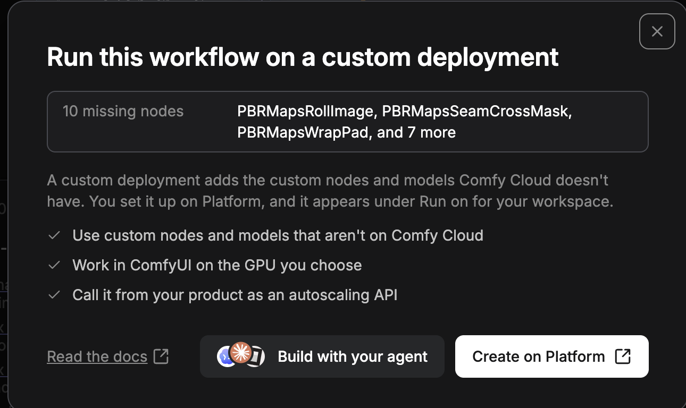
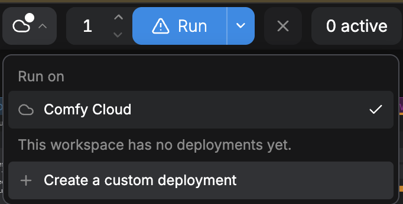
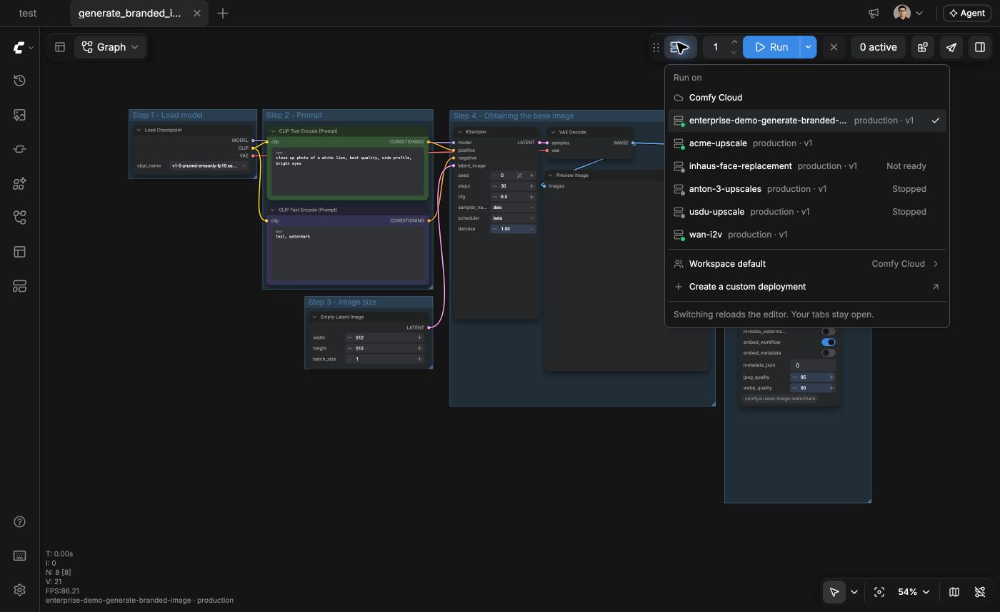
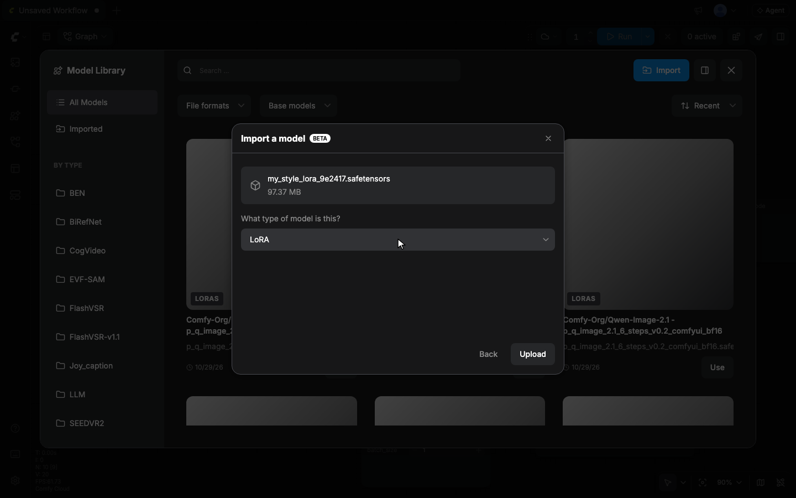
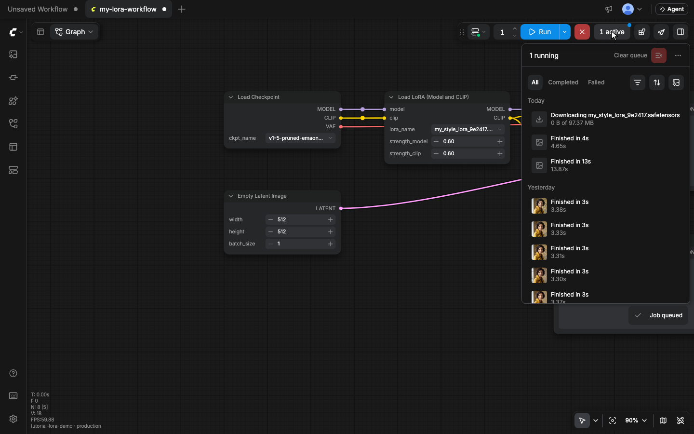
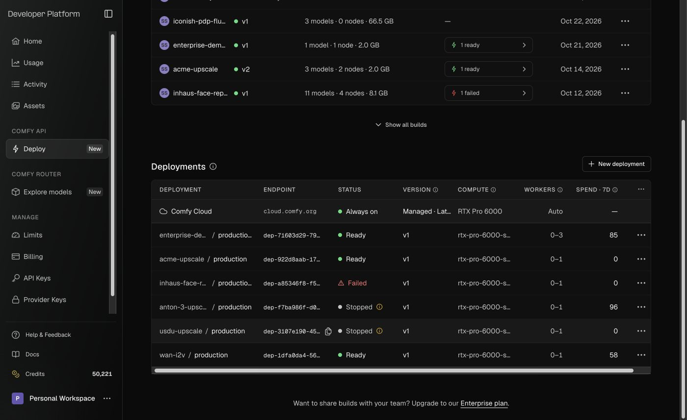

Ein Build bündelt Ihre Custom Nodes, privaten Custom Nodes, LoRAs und andere Modelle sowie Python-Abhängigkeiten, damit Ihre Workflows auf Comfy Cloud ausgeführt werden können. Sie starten den Build im Editor von Comfy Cloud, erstellen und deployen ihn auf der Developer Platform und führen dann Ihren Workflow im Editor darauf aus.

Ein Deployment Ihres Builds stellt Ihnen außerdem GPU-Worker bereit, die ausschließlich Ihre Workflows bedienen, auch wenn Comfy Cloud bereits jeden darin enthaltenen Node unterstützt.

<Note>
  Um Ihre eigene LoRA oder ein anderes Modell mit Nodes zu verwenden, die Comfy Cloud bereits unterstützt, benötigen Sie keinen Build. Laden Sie das Modell stattdessen in Ihre **Modellbibliothek** hoch. Siehe [Eigene LoRA oder ein eigenes Modell hinzufügen](#add-your-own-lora-or-model).
</Note>

### Voraussetzungen

Bevor Sie einen Build erstellen, stellen Sie sicher, dass Folgendes vorhanden ist:

- **Ein gespeicherter Workflow auf Comfy Cloud**
- **Ein aktives Abonnement oder ein Guthaben an Comfy Credits über null**

<Warning>
  Das Erstellen und Behalten eines Builds kostet nichts. Ein Deployment verursacht GPU-Zeitkosten, solange eine GPU dafür aktiv ist. Es verursacht außerdem Speicherkosten, solange das Deployment existiert, auch wenn es gestoppt ist oder keine GPU aktiv ist. Der Deployment-Dialog zeigt die geschätzten Kosten an, bevor Sie bestätigen. Um keine Kosten mehr zu verursachen, löschen Sie das Deployment. Siehe [Ihr Deployment stoppen oder löschen](#stop-or-delete-your-deployment).
</Warning>

## Build aus Ihrem Workflow erstellen

Wenn Ihr Workflow Custom Nodes verwendet, die Comfy Cloud nicht unterstützt, zeigt Comfy Cloud beim Öffnen einen Dialog an. Der Dialog listet die fehlenden Custom-Node-Pakete (Gruppen von Custom Nodes) und Modelle wie LoRAs auf. Um den Workflow auszuführen, erstellen Sie einen Build damit. Wenn Sie Ihren gespeicherten Workflow auswählen, findet die Developer Platform dessen Custom Nodes und Modelle und wählt sie für Sie aus.

<Steps>
  <Step title="Developer Platform öffnen">
    Klicken Sie im Dialog auf **Auf der Platform erstellen**. Die Developer Platform öffnet sich in einem neuen Tab auf ihrer Seite **Deploy**.

    

    <Tip>
      Um einen Build ohne den Dialog zu erstellen, klicken Sie auf das Cloud-Menü links von **Run**. Standardmäßig ist es auf **Comfy Cloud** eingestellt.

      - Wenn Ihr Workspace noch keine Deployments hat, wählen Sie **Benutzerdefiniertes Deployment erstellen** und klicken Sie dann auf **Auf der Platform erstellen**.
      - Wenn bereits Deployments vorhanden sind, wählen Sie **Deployments verwalten**.

      
    </Tip>
  </Step>
  <Step title="Neuen Build starten">
    Klicken Sie auf der Seite **Deploy** auf **New build**. Wenn Sie noch keine Builds haben, klicken Sie stattdessen auf **Start from scratch**.
  </Step>
  <Step title="Workflow auswählen">
    1. Klicken Sie auf **Pick from Comfy Cloud**.
    2. Wählen Sie Ihren Workflow aus und klicken Sie dann auf **Add 1 workflow**.

    Sie können auch die `.json`-Datei des Workflows oder ein damit erstelltes `.png`-Bild auf den Ablagebereich ziehen.

    

    Der Schritt ist erfolgreich, wenn der Name Ihres Workflows mit einem Häkchen unter dem Ablagebereich erscheint und die Liste **Suggested defaults** die **Custom nodes** des Builds anzeigt.
  </Step>
  <Step title="Mit den vorgeschlagenen Standardwerten erstellen">
    Klicken Sie auf **Build with defaults…**. Der Dialog **Choose build targets** öffnet sich.

    Wenn **Build with defaults…** nicht verfügbar ist, erklärt eine Zeile unter der Schaltfläche, warum. Wenn dort _Add the missing models and custom nodes on their steps first._ steht, ergänzen Sie das Fehlende:

    1. Klicken Sie auf **Customise build**.
    2. Klicken Sie auf **Next**, bis ein Schritt die fehlenden Custom Nodes oder Modelle auflistet.
    3. Klicken Sie bei jedem davon auf **Use suggestion** oder **Upload**.
  </Step>
</Steps>

Um zu ändern, was in den Build einfließt, klicken Sie stattdessen auf **Customise build** und gehen die Schritte durch. Zwei Schritte entscheiden darüber, was der Build enthält:

- **Welche Custom Nodes benötigt der Build?**
  - Wählen Sie die Custom Nodes aus.
- **Welche Modelle werden im Build mitgeliefert?**
  - Wählen Sie aus, welche Modelle der Build enthält. Ein Modell, das der Build nicht enthält, wird heruntergeladen, wenn ein Job es zum ersten Mal verwendet.

### Build veröffentlichen

Durch das Veröffentlichen wird Ihr Build zu einer nummerierten Version wie `v1`, die Sie jetzt und später deployen können. Das Veröffentlichen ist kostenlos.

1. Behalten Sie im Dialog **Choose build targets** die Option **Serverless build** ausgewählt. Das ist das Ziel, das auf Comfy Cloud läuft.
2. Klicken Sie auf **Publish**.

Die Seite Ihres Builds öffnet sich mit der neuen Version. Die Zeile **Serverless build** zeigt den Fortschritt des Builds. Das Erstellen dauert normalerweise 10 bis 15 Minuten, und Sie können die Seite verlassen und später zurückkehren. Wenn der Build fertig ist, zeigt die Zeile **Serverless build** eine Schaltfläche **Deploy**.

So kehren Sie später zu der Version zurück:

1. Klicken Sie in der Seitenleiste der **Developer Platform** auf **Deploy**.
2. Klicken Sie im Bereich **Builds** auf Ihren Build.
3. Klicken Sie unter **Versions** auf die neueste Version.

<AccordionGroup>
  <Accordion title="Was, wenn der Build fehlschlägt?">
    Bei manchen Custom Nodes schlägt der Build fehl. In diesem Fall zeigt die Zeile **Serverless build** auf der Seite Ihres Builds **Build failed** an.

    1. Öffnen Sie **Logs** in der Zeile, um zu lesen, was fehlgeschlagen ist.
    2. Klicken Sie auf **Edit build** und ändern Sie den Build, indem Sie zum Beispiel den Custom Node entfernen, der fehlgeschlagen ist.
    3. Veröffentlichen Sie den Build erneut.

    Die Schaltfläche **Debug with your agent** in der Zeile öffnet einen Prompt, der den Fehler beschreibt. Kopieren Sie ihn in einen Coding-Agent, um den Build zu reparieren.
  </Accordion>
</AccordionGroup>

### Workflow bereitstellen und ausführen {#deploy-and-run-your-workflow}

Ein Deployment ist Ihr Build, das auf den Cloud-GPUs von Comfy Cloud läuft. Stellen Sie das Build bereit und wechseln Sie dann im Comfy Cloud Editor zum Deployment, um Ihren Workflow auszuführen.

1. Klicken Sie in der Zeile **Serverless build** auf **Deploy**. Daraufhin wird das Dialogfeld **Deploy v1 of** _Name Ihres Builds_ geöffnet.
2. Wählen Sie eine GPU aus. Bei jeder GPU werden der VRAM (GPU-Speicher) und der Preis pro Stunde angezeigt.
3. Wenn das Dialogfeld **Ready for the Cloud editor** anzeigt, lassen Sie diese Option ausgewählt. Sie ist standardmäßig aktiviert.
4. Belassen Sie die übrigen Einstellungen bei ihren Standardwerten. Mit **Always-warm workers** auf `0` schaltet das Deployment seine GPUs ab, wenn keine Aufträge eingehen. Standardmäßig hält **Keep worker up after a job** eine GPU nach der letzten Aufgabe noch 3 Minuten lang aktiv, und diese Leerlaufzeit wird zum GPU-Preis abgerechnet.
5. Prüfen Sie den Bereich **Estimated cost**. Er zeigt die GPU-Zeit pro Stunde und den Modellspeicher pro Monat.
6. Klicken Sie auf **Create deployment**. Die Seite des Deployments wird geöffnet. Warten Sie, bis der Status unter dem Namen des Deployments **Bereit** lautet.
7. Klicken Sie im Comfy Cloud Editor auf das Cloud-Menü links neben **Run**. Wählen Sie unter **Run on** Ihr Deployment aus. Der Editor wird neu geladen, und Ihre Tabs bleiben geöffnet.

    

8. Öffnen Sie Ihren Workflow und klicken Sie dann auf **Run**. Ihre erste Aufgabe kann warten, während das Deployment eine GPU startet.

Dieser Browser führt Ihre Workflows weiterhin auf dem Deployment aus, bis Sie ein anderes auswählen. Um zurückzuwechseln, wählen Sie im selben Menü **Comfy Cloud** aus. Wenn ein Workflow ungespeicherte Änderungen enthält, wird das Dialogfeld **Ihre Workflows vor dem Wechseln speichern?** geöffnet. Klicken Sie auf **Speichern und wechseln** oder auf **Ohne Speichern wechseln**.

## Eigenes LoRA oder Modell hinzufügen {#add-your-own-lora-or-model}

Die **Modellbibliothek** enthält die Modelle, die Ihr Workspace hochlädt. Ein Modell, das Sie hochladen, läuft auf Comfy Cloud und in Ihren Deployments.

Bevor Sie ein Modell hochladen, stellen Sie sicher, dass Sie diese Anforderungen erfüllen:

- **Ein aktiver Pro-, Creator-, Team- oder Enterprise-Plan**: Ihr Workspace benötigt einen, um ein Modell hochzuladen.
- **Eine `.safetensors`-Datei mit höchstens 2 GB**: Größere Basismodelle wie SDXL oder Flux legen Sie im Build ab.

<Warning>
  Einige Deployments, die erstellt wurden, bevor Bibliotheksmodelle verfügbar waren, können diese nicht laden. Um Bibliotheksmodelle zu nutzen, erstellen Sie ein neues Deployment. Bei einem älteren Deployment kann ein Job mit folgender Meldung fehlschlagen: `Library model "<file name>" is unavailable on this deployment. Retry the job. If it still fails, contact support with the job ID.`
</Warning>

### Modell hochladen

Sie können im Comfy Cloud Editor oder auf der Developer Platform hochladen. Wählen Sie den Tab für den Ort, an dem Sie gerade arbeiten.

<Tabs>
  <Tab title="Cloud-Editor">
    1. Stellen Sie im Cloud-Menü links von **Run** sicher, dass unter **Run on** **Comfy Cloud** ausgewählt ist. Bei einem Deployment hat die **Modellbibliothek** keine Schaltfläche **Importieren**.
    2. Klicken Sie in der **Linken Seitenleiste** auf **Modellbibliothek** und dann auf **Importieren**.
    3. Klicken Sie auf **Datei auswählen**, oder ziehen Sie eine `.safetensors`-Datei in den Dialog.
    4. Behalten Sie unter **What type of model is this?** **LoRA** für ein LoRA bei, oder wählen Sie den Typ, der zur Datei passt.
    5. Klicken Sie auf **Upload**. Wenn der Dialog _Model successfully imported._ anzeigt, klicken Sie auf **Fertigstellen**.

    

    So importieren Sie stattdessen ein Modell über einen Link von Civitai oder Hugging Face:

    1. Fügen Sie im Dialog **Importieren** den Link des Modells in **Link hier einfügen** ein.
    2. Klicken Sie auf **Fortfahren**.
    3. Wählen Sie unter **What type of model is this?** den Modelltyp aus.
    4. Klicken Sie auf **Importieren**.

    Ein Link-Import in einem anderen Format, etwa `.ckpt`, wird in die **Modellbibliothek** importiert, läuft aber nicht auf einem Deployment.
  </Tab>
  <Tab title="Developer Platform">
    1. Klicken Sie im Schritt **Which models ship inside the build?** eines Builds auf **Upload Models**.
    2. Wählen Sie **Workspace library**.
    3. Ziehen Sie eine `.safetensors`-Datei auf die Ablagefläche, oder klicken Sie auf die Fläche, um zu durchsuchen.
    4. Behalten Sie unter **Model type** **LoRA** für ein LoRA bei, oder wählen Sie den Typ, der zur Datei passt.
    5. Klicken Sie auf **Upload**.

    
  </Tab>
</Tabs>

### Modell im Workflow verwenden

Sobald das Modell hochgeladen ist, können Sie es auf Comfy Cloud oder in Ihrem Deployment verwenden.

1. Wählen Sie im Cloud-Menü links von **Run** aus, wo ausgeführt werden soll: **Comfy Cloud** oder Ihr Deployment.
2. Fügen Sie einen Node `Load LoRA (Model and CLIP)` hinzu, oder öffnen Sie einen Workflow, der einen enthält.
3. Wählen Sie in der Liste `lora_name` des Nodes Ihre Datei aus.
4. Klicken Sie auf **Run**.

<Tip>
  In einem Deployment lädt der erste Lauf das Modell herunter, und die Zeile des Jobs in der Warteschlange zeigt `Downloading <file name>`. Spätere Jobs auf derselben laufenden GPU überspringen den Download. Eine GPU, die das Deployment später startet, lädt das Modell erneut herunter. Um den Download zu überspringen, fügen Sie das Modell dem Build hinzu.
</Tip>

Beachten Sie diese Regeln, damit ein Job Ihr Modell findet:

- **Wählen Sie den passenden Typ.** Ein Loader-Node listet nur Modelle seines Typs auf. Ein Node `Load LoRA (Model and CLIP)` listet Modelle auf, die als LoRA hochgeladen wurden.
- **Verwenden Sie einen neuen Dateinamen.** Wenn Ihr Build bereits ein Modell mit demselben Namen enthält, verwendet ein Job in Ihrem Deployment die Datei aus dem Build und nicht Ihren Upload.
- **Achten Sie auf das Basismodell.** Ein LoRA muss zum Basismodell passen, das Ihr Workflow lädt.
- **Verwenden Sie einen Loader-Node, den Comfy Cloud hat.** Wenn der Loader-Node aus einem Custom Node stammt, den Comfy Cloud nicht hat, fügen Sie das Modell dem Build hinzu.

### Bibliotheksmodell ändern oder löschen

Wenn unter **Run on** ein Deployment ausgewählt ist, listet die **Modellbibliothek** nur die Modelle des Builds auf. Um ein von Ihnen hochgeladenes Modell zu ändern oder zu löschen, [wechseln Sie zuerst zurück zu Comfy Cloud](#deploy-and-run-your-workflow) und klicken Sie dann in der **Linken Seitenleiste** auf **Modellbibliothek**.

So ändern Sie den Modelltyp:

1. Fahren Sie mit der Maus über die Karte des Modells und klicken Sie dann auf **Modellinformationen**.
2. Wählen Sie einen neuen **Modelltyp**.

<Warning>
  Beim Löschen eines Modells wird es dauerhaft aus der **Modellbibliothek** entfernt. Ein Job, der die Datei noch verwendet, schlägt am Loader-Node mit einem Fehler `Value not in list` fehl.
</Warning>

So löschen Sie das Modell:

1. Fahren Sie mit der Maus über die Karte des Modells, klicken Sie auf **More** und dann auf **Löschen**.
2. Klicken Sie in **Delete this model?** auf **Löschen**.

## Bereitstellung stoppen oder löschen {#stop-or-delete-your-deployment}

Eine Bereitstellung verursacht Speicherkosten, bis Sie sie löschen, auch wenn sie gestoppt ist. Stoppen Sie eine Bereitstellung, um sie für später zu behalten, ohne Aufträge auszuführen. Löschen Sie sie, um keine Kosten mehr dafür zu zahlen.

So öffnen Sie die Seite der Bereitstellung:

1. Klicken Sie in der **Seitenleiste der Developer Platform** auf **Deploy**.
2. Klicken Sie im Abschnitt **Deployments** auf den Namen der Bereitstellung.

So stoppen Sie die Bereitstellung:

1. Klicken Sie auf **Stop**.
2. Klicken Sie im Dialog **Stop deployment** auf **Stop**.

Der Status lautet **Wird beendet** und dann **Gestoppt**.

So führen Sie die Bereitstellung erneut aus:

- Klicken Sie auf **Start**.

<Warning>
  Beim Löschen werden die Bereitstellung und ihr Verlauf dauerhaft entfernt. Ihr Build und seine Versionen bleiben erhalten, sodass Sie später erneut bereitstellen können.
</Warning>

So löschen Sie die Bereitstellung:

1. Klicken Sie bei einer gestoppten Bereitstellung auf **Delete**. Öffnen Sie bei einer laufenden Bereitstellung das Menü **More actions** und wählen Sie dann **Delete**.
2. Klicken Sie im Dialog **Delete deployment** auf **Delete**.

Wenn Sie den Editor das nächste Mal in diesem Browser öffnen, führt der Editor Ihre Workflows auf Comfy Cloud aus.

## Nächste Schritte

<CardGroup cols={2}>
  <Card title="Bibliotheksmodelle in API-Anfragen" icon="code" href="/development/serverless/overview#use-workspace-library-models-in-api-requests">
    Laden Sie ein Modell über ein Terminal hoch und wählen Sie es pro Anfrage mit `lora_name` aus.
  </Card>
  <Card title="Comfy API Quickstart" icon="cloud-arrow-up" href="/development/serverless/quickstart">
    Rufen Sie Ihr Deployment aus Ihrem eigenen Code als autoskalierenden Endpunkt auf.
  </Card>
  <Card title="Nutzung und Limits" icon="gauge" href="/de/development/deploy/cloud-usage">
    Erfahren Sie, wie Comfy Cloud Credits und Limits für gleichzeitige Aufgaben funktionieren.
  </Card>
  <Card title="Workflow-API-Format" icon="file-code" href="/de/development/api-development/workflow-api-format">
    Exportieren Sie einen Workflow in dem Format, das API-Anfragen senden.
  </Card>
</CardGroup>
