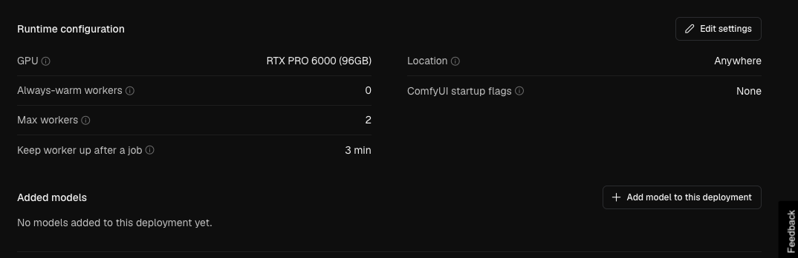
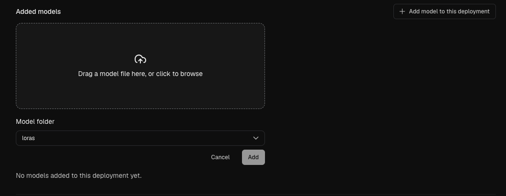
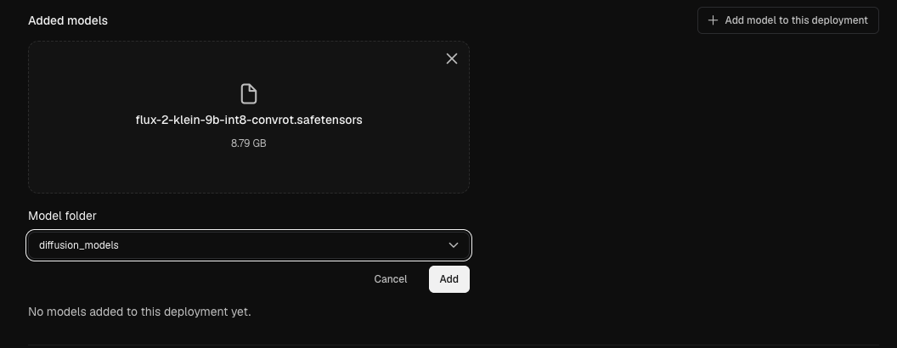
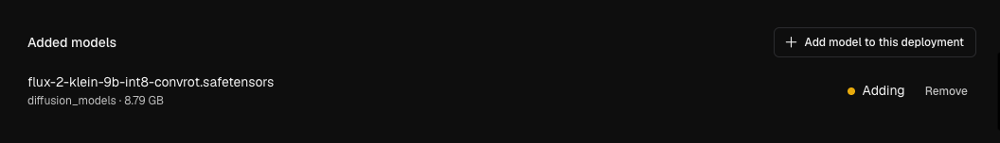
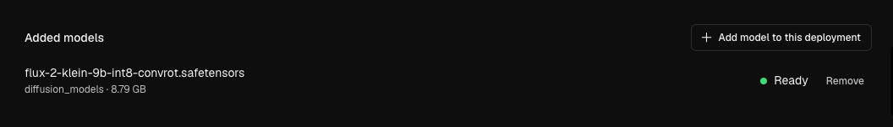

Nachdem Sie Ihren Build in Comfy Cloud bereitgestellt haben, können Sie neue Versionen des Builds veröffentlichen, die GPU und die Worker des Deployments ändern und das Deployment über seine eigene URL aus Ihrer Anwendung aufrufen. Ein Deployment kostet GPU-Zeit, solange seine Worker laufen, und Speicher, bis Sie es löschen. Sie verwalten es auch nach dem Erstellen weiter. Diese Seite zeigt, wie Sie einen Build aus anderen Quellen starten, Versionen veröffentlichen, GPU und Worker auswählen, das Deployment aufrufen, ein Modell hinzufügen, es überwachen und es stoppen oder löschen.

Informationen zum Erstellen Ihres ersten Builds und Deployments finden Sie unter [Benutzerdefinierte Builds](/de/development/deploy/cloud-custom-builds).

<Note>
  Wenn Comfy Cloud bereits jeden Node in Ihrem Workflow unterstützt, können Sie den Workflow ohne Build oder Deployment in Comfy Cloud ausführen. Siehe [Auf Comfy Cloud bereitstellen](/de/development/deploy/cloud).
</Note>

## Bevor Sie beginnen

Jede Aufgabe auf dieser Seite funktioniert an zwei Orten: auf der Developer Platform unter [platform.comfy.org](https://platform.comfy.org) in Ihrem Browser und mit comfy-cli in einem Terminal. Stellen Sie sicher, dass Folgendes vorhanden ist:

- **Ein Workspace mit Comfy Credits oder einem aktiven Plan**: Das Erstellen oder Starten eines Deployments setzt eines von beiden voraus.
- **Für die comfy-cli-Tabs: comfy-cli ist bei Ihrem Comfy-Konto angemeldet**: Führen Sie `comfy cloud login` aus.

<Tip>
  Um ein Build und Deployment mit comfy-cli statt im Browser zu erstellen, führen Sie die folgenden Befehle in Ihrem `ComfyUI`-Installationsordner aus:

  ```bash
  comfy build init
  comfy build push --release --target linux/nvidia
  comfy deploy up
  ```

  `comfy build init` schreibt die Build-Datei `comfy-build.yaml` in den Ordner. Spätere `comfy build`-Befehle lesen sie, führen Sie sie daher im selben Ordner aus.
</Tip>

## Einen Build aus Comfy Desktop, einer Workflow-Datei oder ComfyUI starten

Wenn Sie noch keinen Build haben, können Sie einen aus etwas starten, das Sie bereits haben. [Benutzerdefinierte Builds](/de/development/deploy/cloud-custom-builds) zeigt den wichtigsten Ablauf im Browser, ausgehend von einem Workflow, der in Comfy Cloud gespeichert ist. Wählen Sie den Tab für den Ausgangspunkt.

<Tabs>
  <Tab title="Comfy Desktop-Snapshot">
    Ein Comfy Desktop-Snapshot übernimmt die ComfyUI-Version, die Custom Nodes und die Python-Pakete einer Instanz in einen Build. Er enthält keine Modelle, daher fügen Sie diese in den späteren Schritten des Builds hinzu.

    1. Klicken Sie in Comfy Desktop auf **Verwalten** bei Ihrer Instanz und dann auf den Tab **Snapshots**.
    2. Wenn der aktuelle Zustand der Instanz nicht aufgeführt ist, klicken Sie auf **Create Snapshot**.
    3. Klicken Sie bei dem gewünschten Snapshot auf **Exportieren**.

       

    4. Klicken Sie in der Developer Platform in der **Seitenleiste der Developer Platform** auf **Deploy** und dann auf **New build**. Wenn Sie noch keine Builds haben, klicken Sie stattdessen auf **Start from scratch**.
    5. Ziehen Sie im Schritt **Start with a workflow or snapshot?** die exportierte `.json`-Datei auf die Ablagefläche oder klicken Sie auf die Fläche, um sie zu durchsuchen.

    Ein weiterer Snapshot, den Sie ablegen, ersetzt den aktuellen. Fahren Sie mit [Mit den vorgeschlagenen Standardwerten bauen](/de/development/deploy/cloud-custom-builds#build-aus-ihrem-workflow-erstellen) in Benutzerdefinierte Builds fort.
  </Tab>
  <Tab title="Workflow-Datei">
    1. Klicken Sie in der Developer Platform in der **Seitenleiste der Developer Platform** auf **Deploy** und dann auf **New build**. Wenn Sie noch keine Builds haben, klicken Sie stattdessen auf **Start from scratch**.
    2. Ziehen Sie im Schritt **Start with a workflow or snapshot?** die `.json`-Datei des Workflows oder ein damit erstelltes `.png`-Bild auf die Ablagefläche. Sie können auch auf die Fläche klicken, um sie zu durchsuchen.

    

    Die Developer Platform liest die Modelle und Custom Nodes, die der Workflow verwendet. Jeder Workflow, den Sie ablegen, kommt zu den vorherigen hinzu. Fahren Sie mit [Mit den vorgeschlagenen Standardwerten bauen](/de/development/deploy/cloud-custom-builds#build-aus-ihrem-workflow-erstellen) in Benutzerdefinierte Builds fort.
  </Tab>
  <Tab title="ComfyUI">
    In ComfyUI zählt der Eintrag **In Comfy API bereitstellen** die Anforderungen des geöffneten Workflows und öffnet dann die Developer Platform.

    1. Klicken Sie in der **oberen Leiste** mit der rechten Maustaste auf den Tab des Workflows. Sie können auch auf die Schaltfläche **Workflow-Aktionen** klicken.

       

    2. Wählen Sie **In Comfy API bereitstellen**. Die Karte **In Comfy API bereitstellen** öffnet sich und zählt die Node-Pakete, Modelle und Node-Klassen, die der Workflow verwendet.

       

    3. Klicken Sie auf **Auf der Plattform bereitstellen**. Die Developer Platform öffnet sich in einem neuen Tab.

    Um den Build aus diesem Workflow zu starten, wählen Sie im selben Menü **Exportieren**, um den Workflow als `.json`-Datei zu speichern, und folgen Sie dann dem Tab **Workflow-Datei**.
  </Tab>
</Tabs>

## Ihr Deployment finden {#find-your-deployment}

Ab hier setzt die Seite voraus, dass Sie einen Build mit mindestens einem Deployment haben. Jede spätere Aufgabe beginnt beim Deployment, daher sollten Sie es zuerst finden. Das Lesen eines Deployments kostet nichts. Wählen Sie den Tab für den Ort, an dem Sie arbeiten.

<Tabs>
  <Tab title="Developer Platform">
    1. Klicken Sie in der **Seitenleiste der Developer Platform** auf **Deploy**.
    2. Klicken Sie im Bereich **Deployments** auf den Namen des Deployments.

    Die Seite des Deployments wird geöffnet. Unter seinem Namen zeigt sie den Status an, etwa **Bereit** oder **Gestoppt**, sowie die Version, die es ausführt, etwa `v2`. Der Tab **Overview** zeigt seine **Runtime configuration**.
  </Tab>
  <Tab title="comfy-cli">
    Listen Sie alle Deployments in Ihrem Workspace auf:

    ```bash
    comfy deploy ls --workspace
    ```

    Jede Zeile zeigt den Namen eines Deployments, seine ID, seinen Status und die Version, die es ausführt. Spätere Befehle wählen ein Deployment mit `--deployment` gefolgt von seiner ID aus. Ein reiner Name wie `production` funktioniert nur, wenn Sie den Befehl im Ordner des Builds ausführen. Verwenden Sie andernorts die ID oder `<build>/<name>`.
  </Tab>
</Tabs>

## Eine Version Ihres Builds veröffentlichen {#release-a-version-of-your-build}

Eine veröffentlichte Version eines Builds ändert sich nie. Um einen Custom Node hinzuzufügen, veröffentlichen Sie eine Version und verschieben anschließend das Deployment auf diese. Um einem Deployment ein Modell oder LoRA ohne neue Version hinzuzufügen, siehe [Ein Modell zu einem laufenden Deployment hinzufügen](#add-a-model-to-a-running-deployment). Die Developer Platform nennt eine Version `v1`, `v2` und so weiter. comfy-cli nennt sie ein Release.

<Warning>
  Das Verschieben eines Deployments auf eine andere Version oder das Zurückrollen kostet GPU-Zeit, während die alte und die neue Version beide laufen. Auf der Developer Platform zeigt der Dialog **Change version** die Menge an.
</Warning>

<Tabs>
  <Tab title="Developer Platform">
    So veröffentlichen Sie eine Version:

    1. Klicken Sie in der **Seitenleiste der Developer Platform** auf **Deploy**.
    2. Klicken Sie im Abschnitt **Builds** auf Ihren Build.
    3. Klicken Sie auf **New version** und nehmen Sie Ihre Änderungen in den Schritten vor.
    4. Klicken Sie im letzten Schritt auf **Save changes**. Die Seite des Builds zeigt **Changed since v**_N_, wobei _N_ die neueste Version ist.
    5. Klicken Sie auf **Publish**. Behalten Sie im Dialog **Choose build targets** die Option **Serverless build** ausgewählt und klicken Sie dann auf **Publish**.

    Der Build dauert normalerweise 10 bis 15 Minuten. Wenn der Build fehlschlägt, siehe [Fehlgeschlagenen Build oder fehlgeschlagenes Deployment beheben](#fix-a-failing-build-or-deployment).

    So verschieben Sie das Deployment auf die Version:

    1. Öffnen Sie die Seite des Deployments. Wenn eine neuere Version bereit ist, zeigt die Seite unter dem Namen des Deployments **v**_N_ **available** an.
    2. Klicken Sie auf **Change version**.
    3. Wählen Sie die Version aus und klicken Sie dann auf **Update to v**_N_.

    Das Deployment liefert weiterhin die Version aus, die es ausführt, bis die neue bereit ist, und seine URL bleibt gleich. Wenn die Aktualisierung abgeschlossen ist, steht unter dem Namen des Deployments **v**_N_.

    So kehren Sie zu einer früheren Version zurück:

    1. Klicken Sie auf der Seite des Deployments auf die Registerkarte **History**.
    2. Klicken Sie in der Zeile der Version auf **Roll back to this version**.
  </Tab>
  <Tab title="comfy-cli">
    Führen Sie diese Befehle im Ordner des Builds aus.

    1. Nachdem Sie die ComfyUI-Installation geändert haben, lesen Sie sie erneut in die Build-Datei ein:

       ```bash
       comfy build update --yes
       ```

    2. Vergleichen Sie die Build-Datei mit der Installation und mit dem Build auf Comfy Cloud:

       ```bash
       comfy build status
       ```

    3. Pushen Sie die Build-Datei und erstellen Sie ein Release für das Ziel `linux/nvidia`, das Ziel, auf dem ein Deployment läuft:

       ```bash
       comfy build push --release --target linux/nvidia
       ```

    4. Verfolgen Sie das Build-Protokoll des Releases, bis der Build abgeschlossen ist:

       ```bash
       comfy build release logs --target linux/nvidia --follow
       ```

    5. Verschieben Sie das Deployment auf das neueste Release:

       ```bash
       comfy deploy up --deployment <deployment>
       ```

    `comfy deploy up` verfolgt das Deployment, bis der Wechsel vollzogen ist. Bis dahin liefert das Deployment weiterhin sein aktuelles Release aus.

    So kehren Sie zu einem früheren Release zurück:

    - Um zum Release vor dem aktuellen zurückzukehren, führen Sie aus:

      ```bash
      comfy deploy rollback --deployment <deployment>
      ```

    - Um zu einem bestimmten Release zurückzukehren, fügen Sie `--to` hinzu, zum Beispiel `--to v5`.
  </Tab>
</Tabs>

Jede Version jedes Builds wird auf das Limit an Build-Versionen Ihres Workspaces angerechnet. Wenn Sie es erreichen, löschen Sie eine Version, die Sie nicht mehr benötigen. Siehe [Aufräumen](#clean-up).

## GPU oder Region ändern {#change-the-gpu-or-region}

Die GPU entscheidet, wie viel VRAM ein Workflow erhält und was jeder Worker pro Stunde kostet. Die Region entscheidet, wo das Deployment läuft, und die GPUs, die Sie auswählen können, hängen von ihr ab.

<Warning>
  Bei einem laufenden Deployment startet eine Änderung der GPU oder Region eine Kopie des Deployments auf der neuen GPU. Die alte Kopie bedient weiterhin Anfragen und verursacht GPU-Zeitkosten, bis Comfy Cloud das Deployment auf die neue Kopie verschiebt. Bei einem gestoppten Deployment wird die Änderung beim nächsten Start wirksam.
</Warning>

<Tabs>
  <Tab title="Developer Platform">
    Sie wählen die **Location** beim Erstellen eines Deployments: **Anywhere** oder **United States**. Die Developer Platform kann die Location eines bestehenden Deployments nicht ändern. Um an einem anderen Standort zu laufen, deployen Sie den Build erneut über seine Seite.

    So ändern Sie die GPU:

    1. Klicken Sie auf der Seite des Deployments auf **Edit settings**.
    2. Wählen Sie in **Edit deployment** eine GPU aus. Jede GPU zeigt ihren VRAM und ihren Preis pro Stunde.
    3. Klicken Sie auf **Save changes**.
  </Tab>
  <Tab title="comfy-cli">
    1. Listen Sie die Regionen und die GPUs auf, die jede anbietet:

       ```bash
       comfy deploy refs compute
       ```

       Die Tabelle zeigt jede Region, jede GPU-Klasse, ihren VRAM und ihre Verfügbarkeit. Um eine einzelne Region aufzulisten, fügen Sie `--region <region>` hinzu.

    2. Legen Sie die GPU-Klasse, die Region oder beides fest:

       ```bash
       comfy deploy scale --deployment <deployment> --gpu <gpu-class> --region <region>
       ```

    Wenn der Befehl abgelehnt wird, weil das Deployment läuft, führen Sie zuerst `comfy deploy stop --deployment <deployment>` aus, führen Sie `scale` erneut aus und führen Sie dann `comfy deploy start --deployment <deployment>` aus. Die neue GPU oder Region wird beim Start des Deployments angewendet.
  </Tab>
</Tabs>

## Worker skalieren

Jeder Worker ist eine GPU, die Ihre Aufträge ausführt. Sie legen zwei Zahlen fest:

- **Always-warm workers**: Worker, die weiterlaufen, damit Aufträge nicht auf den Start einer GPU warten. Bei `0` schaltet das Deployment seine GPUs ab, wenn keine Aufträge eingehen.
- **Max workers**: die maximale Anzahl an Workern, die das Deployment gleichzeitig ausführt, wenn Aufträge eingehen. Anfragen darüber hinaus warten in der Warteschlange des Deployments, bis ein Worker frei ist.

<Warning>
  **Always-warm workers** verursachen GPU-Zeit-Kosten, solange sie laufen, auch ohne Aufträge.
</Warning>

<Tabs>
  <Tab title="Developer Platform">
    1. Klicken Sie auf der Seite des Deployments auf **Edit settings**.
    2. Legen Sie **Always-warm workers** und **Max workers** fest.
    3. Klicken Sie auf **Save changes**.

    Die **Runtime configuration** zeigt die von Ihnen gespeicherten Werte.
  </Tab>
  <Tab title="comfy-cli">
    Legen Sie beide Grenzen zusammen fest. `--min` akzeptiert `0` bis `20` und `--max` akzeptiert `1` bis `20`:

    ```bash
    comfy deploy scale --deployment <deployment> --min 0 --max 3
    ```

    Der Befehl gibt `Scaled deployment <id> to min=0, max=3` aus.
  </Tab>
</Tabs>

Ihr Plan legt fest, wie viele Worker ein Deployment maximal ausführen kann. Um das zu sehen, öffnen Sie [**Limits**](https://platform.comfy.org/settings/limits) auf der Developer Platform und prüfen Sie **Max workers per deployment**.

## Deployment stoppen und starten {#stop-and-start-a-deployment}

Stoppen Sie ein Deployment, um es mit seiner URL und seinen Modellen zu behalten, ohne Aufträge auszuführen. Starten Sie es wieder, wenn Sie es benötigen.

<Warning>
  Ein gestopptes Deployment verursacht weiterhin Speicherkosten. Die Speicherabrechnung endet, wenn Sie das letzte Deployment des Builds in dieser Region löschen. Siehe [Bereinigen](#clean-up).
</Warning>

<Tabs>
  <Tab title="Developer Platform">
    Um das Deployment im Browser zu stoppen und zu starten, lesen Sie [Deployment stoppen oder löschen](/de/development/deploy/cloud-custom-builds#stop-or-delete-your-deployment).

    Um ein gestopptes Deployment auf einer anderen Version zu starten:

    1. Klicken Sie auf den Pfeil neben **Start** und wählen Sie dann **Start on v**_N_ aus.
    2. Klicken Sie im Dialog auf **Start on v**_N_.
  </Tab>
  <Tab title="comfy-cli">
    Um das Deployment zu stoppen:

    ```bash
    comfy deploy stop --deployment <deployment>
    ```

    Um es wieder zu starten:

    ```bash
    comfy deploy start --deployment <deployment>
    ```

    Jeder Befehl gibt aus, dass der Dienst ihn akzeptiert hat. Um das Deployment zu verfolgen, bis es einen stabilen Zustand erreicht, lesen Sie [Deployment überwachen](#monitor-a-deployment).
  </Tab>
</Tabs>

## Bereitstellung aus Ihrer Anwendung aufrufen {#call-your-deployment-from-your-application}

Ihre Anwendung sendet Workflows im API-Format mit dem [Comfy API v2](/api-reference/v2/overview) und einem Workspace-API-Schlüssel an die URL der Bereitstellung. Prüfen Sie vor dem Senden einer Aufgabe, ob der Status der Bereitstellung **Bereit** lautet. Eine Aufgabe auf einer Bereitstellung mit `0` dauerhaft warmgehaltenen Workern kann einige Minuten warten, während eine GPU startet.

<Tabs>
  <Tab title="Developer Platform">
    1. Suchen Sie auf der Seite der Bereitstellung im Tab **Overview** nach **Run via API**.
    2. Kopieren Sie die **Deployment URL**.
    3. Klicken Sie auf **Create API key** und kopieren Sie den Schlüssel.
    4. Kopieren Sie das Python-, JavaScript- oder cURL-Snippet.
    5. Führen Sie das Snippet aus, wobei sich der Schlüssel in der Umgebungsvariable `COMFY_API_KEY` befindet.

    Um die Bereitstellung direkt auf der Seite zu testen, verwenden Sie **Quick test**. Dabei wird ein kleiner Workflow ohne Modelle auf der Bereitstellung ausgeführt.

    <Warning>
      Ein **Quick test** verbraucht GPU-Zeit auf der Bereitstellung.
    </Warning>

    1. Öffnen Sie **Test this deployment**.
    2. Wählen Sie **Quick test**.
    3. Klicken Sie auf **Run**.

    Wenn der Test abgeschlossen ist, steht dort **Finished in**, gefolgt von der benötigten Zeit.
  </Tab>
  <Tab title="comfy-cli">
    Senden Sie einen Workflow im API-Format und warten Sie auf dessen Ausgänge:

    ```bash
    comfy deploy run --deployment <deployment> --workflow workflow_api.json
    ```

    Der Befehl wartet auf die Aufgabe und lädt deren Ausgänge in den Ordner `outputs` herunter. Um sie an einem anderen Ort zu speichern, ergänzen Sie `--output-dir <folder>`.
  </Tab>
</Tabs>

Verwenden Sie in Ihrem eigenen Code die [Comfy SDKs](/de/development/api-development/sdks). Setzen Sie `COMFY_BASE_URL` auf die **Deployment URL**. Siehe [Eine Basis-URL wählen](/de/development/api-development/sdks#choosing-a-base-url).

## Modell zu einer laufenden Bereitstellung hinzufügen {#add-a-model-to-a-running-deployment}

Sie können ein Modell oder eine LoRA zu einer Bereitstellung hinzufügen, ohne eine neue Version des Builds zu veröffentlichen. Die Datei landet im selben Speicher wie die Modelle des Builds, sodass jeder Worker sie ohne Download von der Festplatte liest. Die Bereitstellung behält ihre URL. Der Build und Ihre anderen Bereitstellungen ändern sich nicht.

<Warning>
  Ein hinzugefügtes Modell zählt zum Modellspeicher der Bereitstellung, der so abgerechnet wird, wie [Abrechnung von Bereitstellungen](/de/development/deploy/cloud-usage#deployment-billing) beschreibt. Jedes Hinzufügen ersetzt außerdem die laufenden Worker der Bereitstellung durch neue, die die Datei enthalten, und die neuen Worker werden wie üblich nach GPU-Zeit abgerechnet.
</Warning>

### Bevor Sie beginnen

Stellen Sie sicher, dass Folgendes vorhanden ist:

- **Eine Bereitstellung mit dem Status Bereit oder Gestoppt**: Während sie startet, stoppt oder aktualisiert wird, wird ein Hinzufügen abgelehnt.
- **Die Modelldatei auf Ihrem Computer**: ein Dateiname aus Buchstaben, Ziffern, `.`, `_` und `-`, wie unter [Regeln und Fehler](#rules-and-errors) beschrieben.

### Datei hinzufügen

<Tabs><Tab title="Developer Platform">
    1. Öffnen Sie die Seite des Deployments, wie unter [Deployment finden](#find-your-deployment) beschrieben.
    2. Klicken Sie im Tab **Overview** unter **Added models** auf **Add model to this deployment**.

       

    3. Ziehen Sie die Modelldatei in das Rechteck, oder klicken Sie auf das Rechteck und wählen Sie die Datei aus.

       

    4. Wählen Sie unter **Model folder** den Ordner aus, in den die Datei gehört, etwa `loras` oder `diffusion_models`. Das Rechteck zeigt Namen und Größe der Datei.
    5. Klicken Sie auf **Add**.

       

    Die Datei erscheint unter **Added models** mit ihrem Ordner, ihrer Größe und ihrem Status. Solange das Deployment die Datei ablegt, steht dort **Adding**:

    

    Sobald Aufträge die Datei verwenden können, steht dort **Ready**:

    
  </Tab><Tab title="comfy-cli">
    1. Prüfen Sie, ob comfy-cli Version 1.29.0 oder später ist:

       ```bash
       comfy --version
       ```

    2. Ermitteln Sie die ID des Deployments, wie [Ihr Deployment finden](#find-your-deployment) zeigt:

       ```bash
       comfy deploy ls --workspace
       ```

    3. Laden Sie die Datei hoch und fügen Sie sie dem Deployment hinzu. Geben Sie den Modellordner mit `--type` an, etwa `loras` oder `diffusion_models`:

       ```bash
       comfy deploy models add <deployment> my_style.safetensors --type loras
       ```

       `<deployment>` ist die ID des Deployments oder `<build>/<name>`. Ein reiner Name funktioniert nur im Ordner des Builds. Der Befehl lädt die Datei hoch und wartet, bis das Deployment sie verwenden kann. Wenn Sie zurückkehren möchten, sobald das Hinzufügen gesendet wurde, fügen Sie `--no-wait` hinzu.

    4. Prüfen Sie, ob die Datei bereit meldet:

       ```bash
       comfy deploy models ls <deployment>
       ```

       Jede Zeile zeigt Ordner, Name, Größe und Status einer hinzugefügten Datei.
  </Tab>
</Tabs>

Solange die Datei `adding` meldet, kopiert das Deployment sie auf seinen Speicher, startet neue Worker, die sie enthalten, und stoppt die alten. Bereits laufende Aufträge werden auf den alten Workern fertiggestellt. In unseren Tests meldete eine 130 MB große LoRA zwischen 40 Sekunden und etwa 3 Minuten nach dem Hinzufügen bereit. Auf einem gestoppten Deployment meldet die Datei bereit, sobald ihr Upload abgeschlossen ist, und beim nächsten Start wird sie abgelegt.

Eine Datei, die `failed` meldet, wurde nicht hinzugefügt. Entfernen Sie sie und fügen Sie sie dann erneut hinzu.

<Accordion title="Die Datei mit der Deployment-API hinzufügen">
  Um eine Datei aus Ihrem eigenen Code hinzuzufügen, verwenden Sie die Deployment-API mit einem Workspace-API-Schlüssel. Sie benötigen:

  - **Die ID des Deployments**: Sie ist der erste Teil der **Deployment URL**, etwa `dep-2bf42665-0a61-4702-962f-0774c6391e96` in `https://dep-2bf42665-0a61-4702-962f-0774c6391e96.run.comfy.app`.
  - **Einen Workspace-API-Schlüssel**: siehe [API-Schlüssel erhalten](/de/development/api-development/getting-an-api-key). Die folgenden Befehle lesen ihn aus der Umgebungsvariable `COMFY_API_KEY` und senden ihn im Header `X-API-Key`.

  Bevor Sie hochladen, listen Sie die Modelle des Deployments auf, wie der letzte Schritt zeigt, und prüfen Sie, ob `addEnabled` `true` meldet. Wo `false` steht, antwortet ein Hinzufügen mit `404`.

  <Steps>
    <Step title="Einen Upload-Link anfordern">
      Senden Sie den Dateinamen, die Größe und den SHA-256-Hash der Datei. `kind` ist immer `model`:

      ```bash
      FILE=my_style.safetensors
      SIZE=$(wc -c < "$FILE" | tr -d ' ')
      SHA256=$(shasum -a 256 "$FILE" | cut -d ' ' -f 1)

      curl -sS https://platformapi.comfy.org/builder/v1/blobs \
        -H "X-API-Key: $COMFY_API_KEY" \
        -H "Content-Type: application/json" \
        -d "{\"kind\": \"model\", \"filename\": \"$FILE\", \"sizeBytes\": $SIZE, \"sha256\": \"$SHA256\"}"
      ```

      Die Antwort enthält die `blobId` des Uploads, eine `uploadUrl` und `expiresAt`, den Zeitpunkt, an dem der Link nicht mehr funktioniert:

      ```json
      {
        "blobId": "b1f0c2d4-...",
        "deduplicated": false,
        "uploadUrl": "https://storage.googleapis.com/...",
        "expiresAt": "2026-11-23T20:15:00Z"
      }
      ```
    </Step>
    <Step title="Die Datei hochladen">
      Senden Sie die Datei per PUT vor `expiresAt` an `uploadUrl`. Der Link akzeptiert nur einen Body der Größe, die Sie angegeben haben, und benötigt den Header `x-goog-if-generation-match: 0`:

      ```bash
      curl -sS -X PUT "<uploadUrl>" \
        -H "x-goog-if-generation-match: 0" \
        --upload-file "$FILE"
      ```
    </Step>
    <Step title="Den Upload zum Deployment hinzufügen">
      Senden Sie die `blobId` und den Modellordner, in den die Datei gehört, etwa `loras` oder `checkpoints`:

      ```bash
      curl -sS https://platformapi.comfy.org/deploy/v1/deployments/<deployment-id>/models \
        -H "X-API-Key: $COMFY_API_KEY" \
        -H "Content-Type: application/json" \
        -d '{"blobId": "<blobId>", "type": "loras"}'
      ```

      Die Antwort ist `202` mit dem Eintrag des Deployments für die Datei, der `adding` meldet:

      ```json
      {
        "id": "655fa851-...",
        "type": "loras",
        "filename": "my_style.safetensors",
        "status": "adding",
        "sizeBytes": 134621556
      }
      ```

      Um der Datei im Ordner einen anderen Namen zu geben, fügen Sie `"filename"` zur Anfrage hinzu. Ohne ihn behält die Datei den Namen, mit dem Sie sie hochgeladen haben.
    </Step>
    <Step title="Warten, bis die Datei bereit meldet">
      Listen Sie die Modelle des Deployments auf:

      ```bash
      curl -sS https://platformapi.comfy.org/deploy/v1/deployments/<deployment-id>/models \
        -H "X-API-Key: $COMFY_API_KEY"
      ```

      ```json
      {
        "addEnabled": true,
        "models": [
          { "id": "655fa851-...", "type": "loras", "filename": "my_style.safetensors", "status": "ready", "sizeBytes": 134621556 }
        ]
      }
      ```
    </Step>
  </Steps>

  Wenn Sie keine Antwort auf ein Hinzufügen erhalten, senden Sie dasselbe Hinzufügen erneut. Solange die Datei `adding` meldet, liefern derselbe Upload, derselbe Ordner und derselbe Name denselben Eintrag.

  **Eine große Datei in Teilen hochladen.** Bei einer großen Datei fordern Sie den Upload in Teilen an, damit ein abgelaufener Link oder eine unterbrochene Verbindung nicht die gesamte Datei neu startet. Fügen Sie `"parts": true` zur Upload-Anfrage hinzu. Die Antwort enthält dann eine `parts`-Liste statt einer einzelnen `uploadUrl`. Eine Datei wird in höchstens 32 Teile von mindestens je 64 MiB aufgeteilt und kann bis zu 128 GiB groß sein.

  1. Senden Sie die Bytes jedes Teils, von `offsetBytes` für `sizeBytes` Bytes der Datei, per PUT an die `uploadUrl` dieses Teils, mit demselben Header `x-goog-if-generation-match: 0`.
  2. Wenn Links ablaufen, bevor alle Teile eingetroffen sind, senden Sie `POST https://platformapi.comfy.org/builder/v1/blobs/<blobId>/parts`, um neue Links für die noch nicht gespeicherten Teile zu erhalten.
  3. Wenn alle Teile eingetroffen sind, senden Sie `POST https://platformapi.comfy.org/builder/v1/blobs/<blobId>/complete`. Der Aufruf fügt die Teile zu einer Datei zusammen.

  Mit Teilen können Sie den Upload zum Deployment hinzufügen, bevor die Teile eintreffen. Das Deployment kopiert jedes Teil, sobald es ankommt, sodass die Datei nach dem Ende des Uploads früher `ready` meldet.
</Accordion>

### Das hinzugefügte Modell verwenden

Benennen Sie die Datei in Ihrem Workflow so, wie Sie ein Modell im Build benennen würden. Legen Sie für eine LoRA die Eingabe `lora_name` des Loaders auf den Dateinamen fest, wie [lora_name im Workflow festlegen](#use-workspace-library-models-in-api-requests) zeigt, und senden Sie die Aufgabe an das Deployment.

Eine Aufgabe, die eine Datei nennt, die noch hinzugefügt wird, wird abgelehnt, bevor sie einen Worker erreicht. Die API antwortet mit `422`:

```json
{
  "error": {
    "code": "model_not_ready",
    "message": "my_style.safetensors is still being added to this deployment. Try again when it shows Ready."
  }
}
```

Eine Aufgabe, die eine fehlgeschlagene Datei nennt, wird mit dem Code `model_failed` und der Meldung `my_style.safetensors was not added to this deployment. Remove it and add it again.` abgelehnt. Ein Lauf aus dem Comfy Cloud-Editor wird mit demselben Satz abgelehnt.

<Tip>
  Senden Sie Aufgaben, die die Datei verwenden, erst, nachdem sie als bereit angezeigt wird. Ein Loader-Node aus einem Custom Node-Paket wird nur gegen den Stand geprüft, den das Deployment einige Sekunden zuvor aufgelistet hat. Daher kann eine direkt nach dem Hinzufügen gesendete Aufgabe einen Worker erreichen, auf dem die Datei fehlt, und mit einem `Value not in list`-Fehler fehlschlagen.
</Tip>

Wählen Sie im Comfy Cloud-Editor das Deployment unter **Run on** aus, und laden Sie dann die Seite neu oder drücken Sie `R`, sobald die Datei als bereit angezeigt wird. Der Editor aktualisiert die Modelle des Deployments nicht von selbst. Die Datei erscheint dann in der Liste ihres Loader-Nodes, etwa in der Liste `lora_name` eines Nodes `Load LoRA (Model and CLIP)`, sowie in der **Modellbibliothek** in der **linken Seitenleiste**.

Das Deployment behält seine hinzugefügten Modelle, wenn es auf eine andere Version wechselt, ein Rollback durchführt, stoppt und startet. Wenn eine Version, auf die Sie wechseln, eine eigene Datei mit demselben Ordner und Namen hat, verwendet das Deployment die Datei der Version.

### Ein hinzugefügtes Modell entfernen

<Warning>
  Beim Entfernen eines Modells wird die Datei aus dem Speicher der Bereitstellung gelöscht. Aufträge, die es benennen, schlagen fehl. Ein bereits laufender Auftrag wird möglicherweise noch abgeschlossen. Ein Worker, der die Datei bereits geladen hat, kann sie noch einige Minuten weiterverwenden, und ein laufender Worker kann das gespeicherte Ergebnis eines Auftrags zurückgeben, der mit einem bereits von ihm ausgeführten Auftrag identisch ist.
</Warning>

<Tabs>
  <Tab title="Developer Platform">
    1. Öffnen Sie die Seite der Bereitstellung.
    2. Klicken Sie unter **Added models** in der Zeile der Datei auf **Remove**.
  </Tab>
  <Tab title="comfy-cli">
    Geben Sie die Datei als `<folder>/<name>` an, also den Ordner und den Namen, die `comfy deploy models ls` anzeigt:

    ```bash
    comfy deploy models rm <deployment> loras/my_style.safetensors
    ```

    Der Befehl fragt nach, bevor er die Datei entfernt. Um die Frage zu überspringen, fügen Sie `--yes` hinzu.

    Sie können anstelle von `<folder>/<name>` auch die ID der Datei angeben. `comfy deploy models ls` gibt keine IDs aus. Um sie anzuzeigen, führen Sie `comfy --json deploy models ls <deployment>` aus.
  </Tab>
</Tabs>

Für die Datei wird „removing“ angezeigt, und sie verlässt die Liste, sobald das Entfernen abgeschlossen ist, auch dann, wenn die Datei nicht gelöscht werden konnte. Wenn die von der Bereitstellung ausgeführte Version eine eigene Datei mit demselben Ordner und Namen hat, wird nur der Eintrag entfernt, und die Datei der Version bleibt erhalten.

### Regeln und Fehler {#rules-and-errors}

Beim Hinzufügen gelten diese Regeln:

- **Der Dateiname** darf nur Buchstaben, Ziffern, `.`, `_` und `-` enthalten und muss mit einem Buchstaben oder einer Ziffer beginnen.
- **Der Ordner** (`type`) ist ein Modellordner wie `loras`, `checkpoints` oder `vae` oder ein anderer Ordner innerhalb von `models`. Er darf nicht `custom_nodes` oder `configs` sein, auch nicht eine andere Groß-/Kleinschreibung eines bekannten Ordners wie `LoRAs`.
- **Eine Datei pro Ordner und Name**: Ein Name, den die Version des Builds oder das Deployment in diesem Ordner bereits hat, wird abgelehnt.
- **Die Modelleinstellung des Builds gilt**: Ein Build, der auf **Choose which models** eingestellt ist, lehnt jedes hinzugefügte Modell ab, und ein Build, der einen Dateinamen blockiert, lehnt diesen Namen ab.

Jede Ablehnung fügt nichts hinzu und antwortet mit einem `error`-Code und einer `message`, die Sie anzeigen können:

```json
{
  "error": "MODEL_NAME_TAKEN",
  "message": "This deployment already has loras/my_style.safetensors. Remove it first, or add the file under another name."
}
```

| Status | `error` | Wann |
|--------|---------|------|
| `400` | `INVALID_REQUEST` | `blobId` fehlt, `type` ist kein Modellordner oder der Dateiname verstößt gegen die obige Regel. |
| `404` | `UPLOAD_NOT_FOUND` | Der Upload gehört nicht zu diesem Workspace, ist kein Modell oder die zugehörige Datei ist noch nicht vorhanden. Laden Sie die Datei hoch, bevor Sie sie hinzufügen, es sei denn, Sie laden sie in Teilen hoch. |
| `404` | `NOT_FOUND` | Das Deployment oder der Eintrag, den Sie entfernen möchten, ist in diesem Workspace nicht vorhanden. |
| `409` | `DEPLOYMENT_BUSY` | Das Deployment wird gestartet, beendet oder aktualisiert. Fügen Sie das Modell hinzu oder entfernen Sie es, sobald der Status Bereit oder Gestoppt lautet. |
| `409` | `MODEL_POLICY` | Die Modelleinstellung des Builds erlaubt die Datei nicht. |
| `409` | `MODEL_NAME_TAKEN` | Die Version des Builds oder das Deployment enthält bereits eine Datei in diesem Ordner mit diesem Namen. |
| `409` | `MODEL_STORAGE_EXCEEDED` | Die Modelle des Builds und die hinzugefügten Modelle würden mehr Speicher benötigen, als das Deployment haben kann. |
| `409` | `MODEL_LIST_TOO_LARGE` | Das Deployment hat zu viele Modelle, um ein weiteres hinzuzufügen. Die Meldung gibt an, ob Sie ein hinzugefügtes Modell entfernen oder eine Version mit weniger Modellen verwenden sollen. |
| `409` | `VOLUME_SHARED` | Das Deployment teilt seinen Speicher mit einem anderen Deployment, daher können ihm keine Modelle hinzugefügt werden. |
| `503` | `SERVICE_UNAVAILABLE` | Der Dienst konnte das Hinzufügen nicht rechtzeitig prüfen. Senden Sie denselben Hinzufügeauftrag erneut. |

## Modelle aus der Workspace-Bibliothek in API-Anfragen verwenden {#use-workspace-library-models-in-api-requests}

Ein Deployment verwendet `.safetensors`-Modelle aus Ihrer Workspace-Bibliothek, auch wenn sein Release sie nicht enthält. Um eine LoRA pro Anfrage auszuwählen, laden Sie sie einmal in die Bibliothek hoch und geben Sie sie dann in jedem Workflow an, den Sie senden.

<Steps>
  <Step title="LoRA in Ihre Workspace-Bibliothek hochladen">
    Wie Sie ein Modell im Comfy Cloud-Editor oder auf der Developer Platform hochladen, erfahren Sie unter [Eigene LoRA oder eigenes Modell hinzufügen](/de/development/deploy/cloud-custom-builds#add-your-own-lora-or-model). Auf dieser Seite sind außerdem der Plan und die Dateigröße aufgeführt, die für einen Upload erforderlich sind.

    Um von einem Terminal aus hochzuladen, legen Sie den Modelltyp mit `--type` fest:

    ```bash
    comfy assets library upload my_style.safetensors --type loras
    ```

    Wenn das Hochladen abgeschlossen ist, gibt der Befehl `Added my_style.safetensors to loras` aus.
  </Step>
  <Step title="lora_name im Workflow festlegen">
    Legen Sie im [Workflow im API-Format](/de/development/api-development/workflow-api-format) die Eingabe `lora_name` des Loaders auf den Dateinamen in der Bibliothek fest, einschließlich `.safetensors`:

    ```json
    "10": {
      "class_type": "LoraLoader",
      "inputs": {
        "lora_name": "my_style.safetensors",
        "strength_model": 1.0,
        "strength_clip": 1.0,
        "model": ["4", 0],
        "clip": ["4", 1]
      }
    }
    ```
  </Step>
  <Step title="Anfrage senden">
    Senden Sie den Workflow wie in [Ihr Deployment aus Ihrer Anwendung aufrufen](#call-your-deployment-from-your-application) beschrieben.
  </Step>
</Steps>

Um eine andere LoRA zu verwenden, ändern Sie `lora_name` in der nächsten Anfrage auf einen anderen Dateinamen aus der Bibliothek. Sie benötigen keinen neuen Build, kein neues Release und kein erneutes Deployment.

- Ein Workflow kann bis zu 100 Modelle aus der Bibliothek angeben. Ein Loader, der ein 101. Bibliotheksmodell angibt, schlägt fehl, als wäre die Datei nicht in der Bibliothek vorhanden.
- Achten Sie darauf, dass Dateinamen in den Ordnern, die ein Loader liest, eindeutig sind. Wenn die Bibliothek denselben Dateinamen in zwei dieser Ordner enthält, lädt eine über die API gesendete Aufgabe keine der beiden Dateien.

## Bereitstellung überwachen {#monitor-a-deployment}

Prüfen Sie den Status einer Bereitstellung beim Start, nach Änderungen und wenn Aufträge fehlschlagen.

<Tabs>
  <Tab title="Developer Platform">
    Auf der Seite der Bereitstellung:

    - Der Status unter dem Namen der Bereitstellung lautet **In Warteschlange**, **Provisioning** oder **Wird gestartet**, während die Bereitstellung hochfährt, und **Bereit**, wenn sie Aufträge bedient.
    - Während die Bereitstellung hochfährt, zeigt **Deployment progress** jeden Schritt, etwa **Copying models**. Die Bereitstellung startet auf der Seite von Comfy weiter, Sie können die Seite also schließen und später zurückkehren.
    - Der Tab **Boot log** zeigt, was ComfyUI beim Start der Bereitstellung ausgegeben hat.
    - Der Tab **History** listet die Versionen auf, die die Bereitstellung ausgeführt hat, und wodurch sie geändert wurde.

    Auf der Seite **Deploy** zeigt der Abschnitt **Deployments** die GPU-Credits jeder Bereitstellung der letzten sieben Tage unter **Spend · 7d**. Der Modellspeicher ist nicht enthalten.
  </Tab>
  <Tab title="comfy-cli">
    Verfolgen Sie im Ordner des Builds die Bereitstellung, bis sie einen stabilen Zustand erreicht:

    ```bash
    comfy deploy status --deployment <deployment> --watch
    ```

    Der Befehl meldet den Status, etwa `Deployment <name>: ready`, ob ein neueres Release wartet und wie viele Aufträge in der Warteschlange stehen. Für mehr Details:

    ```bash
    comfy deploy logs --deployment <deployment>      # was ComfyUI beim Start ausgegeben hat
    comfy deploy events --deployment <deployment>    # die Statusänderungen, in der Reihenfolge
    comfy deploy history --deployment <deployment>   # die Releases, die sie ausgeführt hat
    ```
  </Tab>
</Tabs>

## Bereinigen {#clean-up}

Wenn Sie die letzte Bereitstellung eines Builds in einer Region löschen, entfallen dessen Speicherkosten, und wenn Sie eine Version löschen, wird ein Platz innerhalb Ihres Limits an Build-Versionen frei. Sie können einen Build oder eine Version nicht löschen, solange eine Bereitstellung sie verwendet, daher löschen Sie zuerst die Bereitstellung.

<Warning>
  Das Löschen einer Bereitstellung, einer Version oder eines Builds ist endgültig. Wenn Sie eine Bereitstellung löschen, wird deren URL entfernt, sodass Apps, die sie aufrufen, nicht mehr funktionieren. Der Build und seine Versionen bleiben erhalten, sodass Sie erneut bereitstellen können. Eine Bereitstellung, die Sie später erstellen, erhält eine neue URL, da die URL aus der ID der Bereitstellung stammt. Um die URL zu behalten, [stoppen Sie stattdessen die Bereitstellung](#stop-and-start-a-deployment).
</Warning>

<Tabs>
  <Tab title="Developer Platform">
    Wie Sie eine Bereitstellung löschen, erfahren Sie unter [Bereitstellung stoppen oder löschen](/de/development/deploy/cloud-custom-builds#stop-or-delete-your-deployment).

    Um eine Version zu löschen:

    1. Öffnen Sie die Seite des Builds.
    2. Öffnen Sie in der Zeile der Version **Version actions** und wählen Sie anschließend **Delete version**.
    3. Klicken Sie auf **Delete**.

    Um den Build zu löschen:

    1. Klicken Sie auf der Seite des Builds auf **Delete**.
    2. Klicken Sie im Dialog **Delete build** auf **Delete**.
  </Tab>
  <Tab title="comfy-cli">
    Um eine Bereitstellung zu löschen:

    ```bash
    comfy deploy delete --deployment <deployment>
    ```

    Um eine Version zu löschen:

    ```bash
    comfy build release delete <release-id>
    ```

    Um den Build zu löschen:

    ```bash
    comfy build delete --id <build-id>
    ```

    Jeder Befehl verlangt eine Bestätigung. Um die Releases eines Builds und deren IDs aufzulisten, führen Sie `comfy build release ls --id <build-id>` aus. Um Ihre Builds aufzulisten, führen Sie `comfy build ls` aus.
  </Tab>
</Tabs>

## Fehlgeschlagene Builds oder Deployments beheben {#fix-a-failing-build-or-deployment}

Wenn ein Build oder ein Deployment fehlschlägt, nennen die Protokolle die Ursache. Beheben Sie die Ursache, und veröffentlichen Sie dann erneut oder starten Sie erneut.

<AccordionGroup>
  <Accordion title="Der Build ist fehlgeschlagen">
    Befolgen Sie auf der Developer Platform [Was ist zu tun, wenn der Build fehlschlägt?](/de/development/deploy/cloud-custom-builds#build-veröffentlichen) unter Custom Builds.

    Mit comfy-cli lesen Sie den Status des Release und sein Build-Protokoll im Ordner des Builds:

    ```bash
    comfy build release show
    comfy build release logs --target linux/nvidia
    ```

    Ändern Sie die ComfyUI-Installation, etwa indem Sie den Custom Node entfernen, der fehlgeschlagen ist, und [veröffentlichen Sie dann erneut](#release-a-version-of-your-build).
  </Accordion>

  <Accordion title="Der Deployment-Status lautet Fehlgeschlagen">
    Die Seite des Deployments zeigt den Fehler mit **Dieses Deployment wurde nicht gestartet. Beheben Sie die im Fehler genannte Ursache, und starten Sie es dann erneut.** an. Klicken Sie auf **Kopieren**, um den Fehler zu kopieren. Der Tab **Boot log** zeigt, was ComfyUI ausgegeben hat.

    Mit comfy-cli gibt `comfy deploy status` den Grund aus. Informationen zum Protokoll und zu Statusänderungen finden Sie unter [Ein Deployment überwachen](#monitor-a-deployment).

    Beheben Sie die im Fehler genannte Ursache, und starten Sie das Deployment dann erneut.
  </Accordion>

  <Accordion title="Das Deployment braucht lange zum Starten">
    Befolgen Sie die Schritte unter **Deployment progress** auf der Seite des Deployments, oder führen Sie `comfy deploy status --deployment <deployment> --watch` aus. Der Schritt **Copying models** dauert länger, je mehr Modelle die Version enthält. Wenn Sie auf der Developer Platform ein Deployment erstellen, zeigt **Estimated time** im Deploy-Dialog an, wie lange der Start des Deployments dauert.

    Wenn die von Ihnen gewählte GPU keine Kapazität hat, [ändern Sie die GPU oder die Region](#change-the-gpu-or-region). Mit comfy-cli zeigt `comfy deploy refs compute` die Verfügbarkeit jeder GPU.
  </Accordion>

  <Accordion title="Der Status lautet Gestoppt: Keine Credits mehr">
    Das Deployment wird gestoppt, wenn Ihrem Workspace die Credits ausgehen. Fügen Sie Credits hinzu, und starten Sie das Deployment dann erneut.
  </Accordion>

  <Accordion title="Der Status lautet Stopp fehlgeschlagen">
    Die Stopp-Anfrage ist fehlgeschlagen, daher wird das Deployment möglicherweise weiterhin abgerechnet. Klicken Sie erneut auf **Stopp**, oder führen Sie `comfy deploy stop --deployment <deployment>` erneut aus.
  </Accordion>

  <Accordion title="Ein Update einer Version ist fehlgeschlagen">
    Die Seite des Deployments zeigt **Update auf v**_N_ **fehlgeschlagen.** an, und das Deployment stellt weiterhin die Version bereit, die es zuvor ausgeführt hat. Klicken Sie auf **Erneut versuchen**, oder beheben Sie die Version und veröffentlichen Sie sie erneut.
  </Accordion>
</AccordionGroup>

## FAQ

Wie Deployments abgerechnet werden, erfahren Sie unter [Deployment-Abrechnung](/de/development/deploy/cloud-usage#abrechnung-für-deployments) in Nutzung und Limits.

<AccordionGroup>
  <Accordion title="Kann ein Build aus mehreren Workflows stammen?">
    Ja. Wenn Sie auf der Developer Platform einen Build erstellen, können Sie einen oder mehrere Workflows hochladen, um deren Modelle und Custom Nodes vorauszuwählen. Binden Sie die Abhängigkeiten aller Workflows ein, die Sie ausführen möchten, und senden Sie dann jeden Workflow im API-Format an das Deployment.

    Jedes Deployment verwendet eine GPU-Klasse. Um Workflows auf verschiedenen GPU-Klassen auszuführen, erstellen Sie separate Deployments desselben Builds.
  </Accordion>
</AccordionGroup>

## Nächste Schritte

Sobald Ihre Bereitstellung läuft, können Sie diese Seiten verwenden, um Workflows aus Ihrem eigenen Code an sie zu senden.

<CardGroup cols={2}>
  <Card title="Comfy SDKs" icon="code" href="/de/development/api-development/sdks">
    Workflows aus einer Python- oder TypeScript-App absenden und Eingänge, Fortschritt und Ausgänge verwalten.
  </Card>
  <Card title="Comfy API v2" icon="cloud" href="/api-reference/v2/overview">
    Die HTTP-API aus jeder Sprache aufrufen und ihre Anfrage- und Antwortformate prüfen.
  </Card>
  <Card title="Workflow-API-Format" icon="file-code" href="/de/development/api-development/workflow-api-format">
    Ein Workflow-JSON für eine API-Anfrage vorbereiten oder eine Fehlerbehebung an seinen Eingängen und Ausgängen durchführen.
  </Card>
  <Card title="Loslegen mit comfy-cli" icon="terminal" href="/de/comfy-cli/getting-started">
    comfy-cli installieren und sich mit `comfy cloud login` bei Comfy Cloud anmelden.
  </Card>
</CardGroup>
