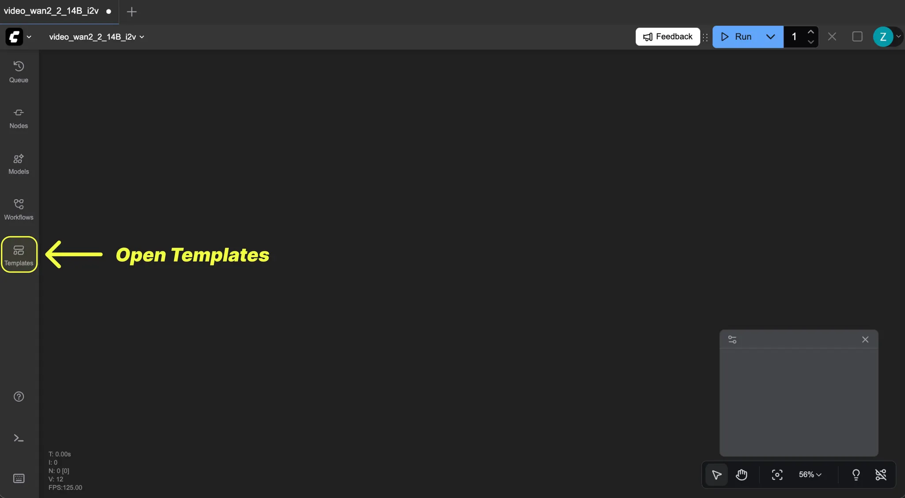
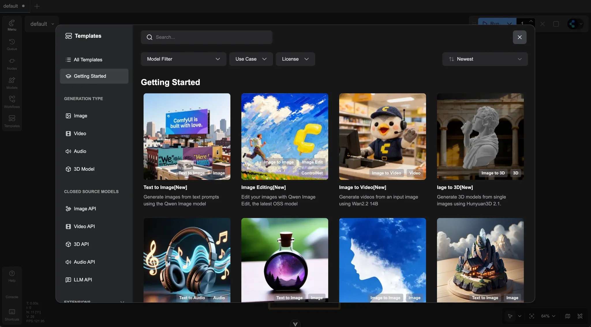
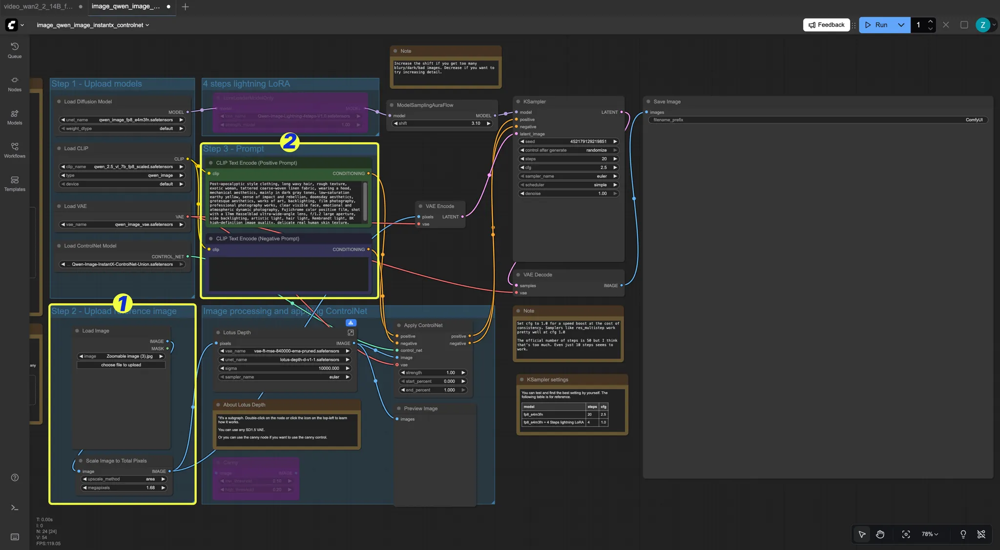
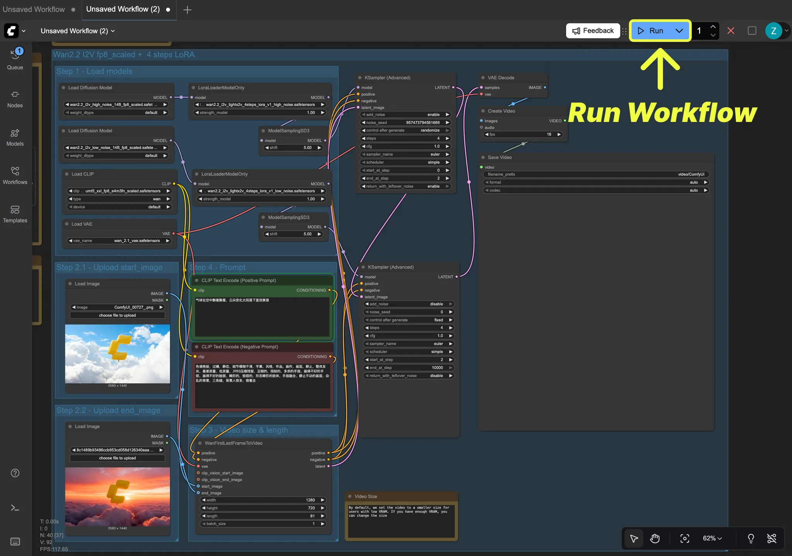
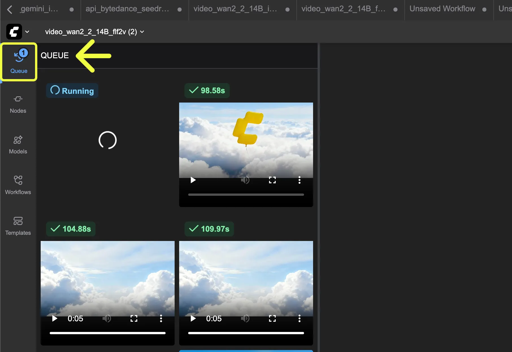
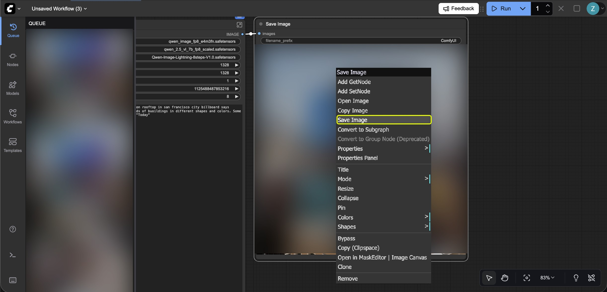
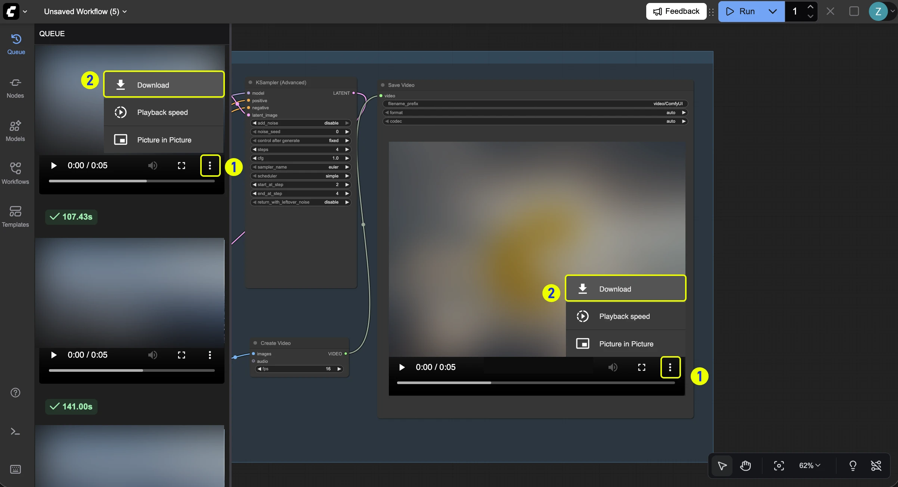
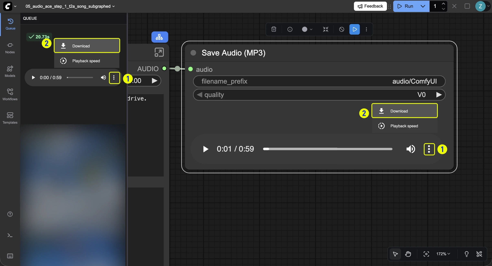
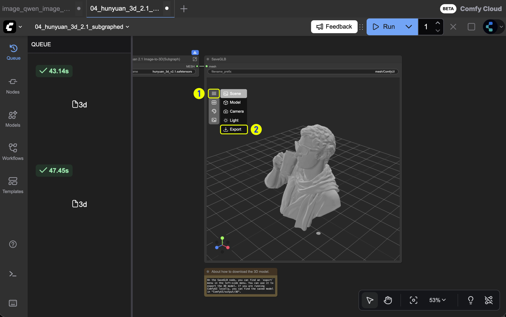
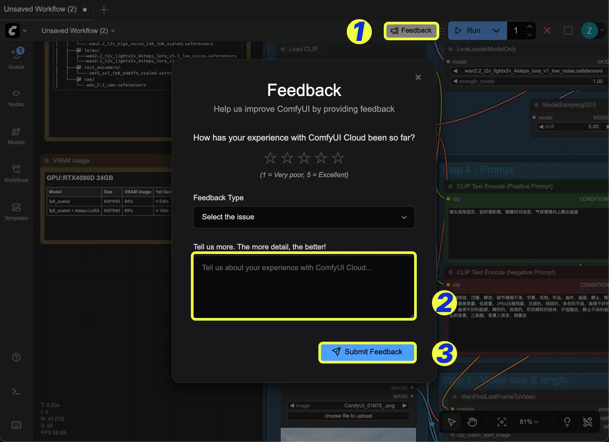

<Card title="Auf Comfy Cloud zugreifen" icon="cloud" href="https://comfy.org/cloud">
  Klicken Sie hier, um direkt auf ComfyUI Cloud zuzugreifen
</Card>

## Was ist Comfy Cloud?

ComfyUI Cloud ist die Cloud-Version von ComfyUI mit denselben Funktionen wie die lokale Version. Alles ist vorinstalliert und sofort einsatzbereit.

### Wichtige Funktionen

<CardGroup cols={2}>
  <Card title="Keine Einrichtung nötig" icon="bolt">
    Keine Installation erforderlich. Alle Modelle und Custom Nodes sind vorinstalliert und sofort einsatzbereit
  </Card>
  
  <Card title="Leistungsstarke GPUs" icon="microchip">
    Führen Sie Workflows schnell auf unseren leistungsstarken Server-GPUs aus, ohne eigene Hardware zu benötigen
  </Card>
  
  <Card title="Immer aktuell" icon="arrows-rotate">
    Bleibt automatisch auf dem neuesten Stand der ComfyUI-Releases und -Funktionen
  </Card>
  
  <Card title="Überall verfügbar" icon="globe">
    Nutzen Sie ComfyUI von jedem Gerät mit Internetverbindung - keine lokale Installation nötig
  </Card>
  
  <Card title="Zusammenarbeit im Team" icon="users" href="/de/cloud/workspace">
    Erstellen Sie Team-Arbeitsbereiche, um mit Ihren Teammitgliedern zusammenzuarbeiten. Teilen Sie Abonnements, Credits und Workflows.
  </Card>
</CardGroup>

## Cloud vs. lokal

ComfyUI bietet sowohl eine offizielle Cloud-Version, [Comfy Cloud](https://comfy.org/cloud), als auch eine selbst gehostete Open-Source-Version. Wenn Sie über eine leistungsstarke GPU verfügen, ist der lokale Betrieb von ComfyUI eine gute Option. Die Cloud-Version hingegen ist ein Online-Dienst, der sofort einsatzbereit ist: URL öffnen, keine Installation und keine Einrichtung erforderlich.

| Kategorie | Comfy Cloud | Selbst gehostet (lokales ComfyUI) |
|----------|-------------|------------------------------|
| **Kosten** | Kostenloser Tarif und kostenpflichtige Abonnement-Pläne | Kostenlos |
| **GPU** | Leistungsstarke Blackwell RTX 6000 Pro | Sie bringen Ihre eigene GPU mit |
| **Technisches Wissen** | Keine technischen Kenntnisse erforderlich. | Desktop- und Portable-Versionen bieten Ihnen einen einfachen Einstieg, bei der Installation von Custom Nodes und lokalen Installationsproblemen müssen Sie jedoch selbst Fehlerbehebung betreiben. |
| **Custom Nodes** | Verwenden Sie vorinstallierte Custom Nodes und machen Sie sich keine Gedanken über Kompatibilitätsprobleme. | Installieren Sie beliebige Custom Nodes, Sie müssen diese aber selbst verwalten. |
| **Modelle** | Verwenden Sie vorinstallierte Modelle. Importieren Sie Modelle von Civitai und Hugging Face. | Verwenden Sie beliebige Modelle, Sie müssen sie jedoch zuerst herunterladen. |
| **Wichtige Unterschiede** | Einfache Einarbeitung Ihres Teams mit [Workspaces](/de/cloud/workspace) | Funktioniert offline und ist unbegrenzt anpassbar |
| **Loslegen** | [Run ComfyUI Cloud](https://comfy.org/cloud) | [ComfyUI lokal installieren](/de/installation/system_requirements) |

### Custom Nodes auf Comfy Cloud

Comfy Cloud führt einen festen Satz von Custom Nodes aus, die Comfy pflegt. Sie können dort keine eigenen Node-Packs installieren. Ein Workflow, der von einem Pack abhängt, das Cloud nicht enthält, läuft daher nicht unverändert.

Comfy Cloud kennzeichnet die Nodes, die nicht ausgeführt werden können, an zwei Stellen: Sie werden auf dem Canvas markiert, und der Tab Errors der [rechten Seitenleiste](/interface/right-side-panel) listet sie unter **Unsupported Node Packs** auf. Diese Nodes werden automatisch gemeldet, damit die Packs für die Cloud-Unterstützung priorisiert werden können.

Um den Workflow auszuführen, ersetzen Sie diese Nodes durch unterstützte Nodes oder öffnen Sie ihn in einer lokalen ComfyUI-Installation.

## Preise und Abonnement

<Card title="Preise ansehen" icon="tag" href="https://www.comfy.org/cloud/pricing">
  Preise und Abonnementoptionen für Comfy Cloud ansehen
</Card>

### Grenzen für die Parallelität

Die Comfy Cloud UI unterstützt nicht das Ausführen von mehr als einem Workflow gleichzeitig. Jede Person kann im Editor jeweils einen Workflow ausführen; weitere Workflows warten in der Warteschlange und werden nacheinander ausgeführt.

Mehrere Aufträge parallel auszuführen wird nur unterstützt, wenn Sie Workflows über die API absenden, was ein kostenpflichtiges Abonnement erfordert. Details finden Sie unter [Grenzen für die Parallelität](/de/development/deploy/cloud-usage#parallelitätslimits) in der Entwicklerdokumentation.

Bei den Tarifen Team und Enterprise gilt die Parallelität pro Mitglied: Alle im Workspace haben ihre eigene Parallelität, sodass die laufenden Workflows eines Mitglieds nie die eines anderen blockieren.

### Grenzen für Laufzeit und Warteschlange

Jeder Cloud-Workflow hat eine maximale Laufzeit, und eine Aufgabe, die diese überschreitet, wird automatisch abgebrochen:

| Tarif | Maximale Laufzeit |
| :--- | :--- |
| Standard | 30 Minuten |
| Creator | 30 Minuten |
| Pro | 1 Stunde |

Bis zu 100 Workflows können gleichzeitig in der Warteschlange warten. Unter [Grenzen für Laufzeit und Warteschlange](/de/development/deploy/cloud-usage#limits-für-laufzeit-und-warteschlange) erfahren Sie, wie sich die Warteschlange verhält, wenn sie voll ist.

## Firewall-Allowlist für Comfy Cloud

Erlauben Sie ausgehenden HTTPS- und WebSocket-Datenverkehr über TCP 443 zu:

- **App:** `cloud.comfy.org`, `api.comfy.org`, `cdn.comfy.org`
- **Uploads und Ausgänge:** `comfy-hub-assets.comfy.org`, `storage.googleapis.com`
- **Anmeldung:** `dreamboothy.firebaseapp.com`, `identitytoolkit.googleapis.com`, `securetoken.googleapis.com`, `apis.google.com`, `challenges.cloudflare.com`
- **Weitere Funktionen:** `registry.comfy.org`, `*.algolia.net`, `media.comfy.org`

## ComfyUI Cloud verwenden

Die Verwendung von ComfyUI Cloud ist im Wesentlichen dieselbe wie die Verwendung Ihres lokalen ComfyUI. Wenn Sie ComfyUI zum ersten Mal verwenden, finden Sie hier einige kurze Tipps für den Einstieg:

<Steps>
  <Step title="Vorlage auswählen">
    Klicken Sie auf das Vorlagen-Symbol in der linken Seitenleiste, um die verfügbaren Workflows zu durchsuchen.
    
  </Step>
  
  <Step title="Workflow auswählen, den Sie ausführen möchten">
    Klicken Sie auf die Vorlage, die Sie ausführen möchten.
    
  </Step>
  
  <Step title="Eingänge der Vorlage aktualisieren">
    1. Da in der Cloud-Version alle Modelle vorinstalliert sind, können alle Vorlagen direkt nach dem Laden ausgeführt werden.
    2. Wenn Sie Änderungen vornehmen möchten, müssen Sie nur Bildeingänge oder Text-Prompts angeben. Prüfen Sie den Node `Load Image` oder den Node `CLIP Text Encode`.
    
  </Step>
  
  <Step title="Führen Sie Ihren Workflow aus">
    Wenn alles korrekt ist, klicken Sie auf das Symbol „Run“ oder verwenden Sie die Tastenkombination „Ctrl + Enter“, um den Workflow auszuführen.
    
  </Step>

  <Step title="Ausgabe ansehen">
    Nach dem Klick auf Run beginnt unser Dienst damit, eine Maschine für Ihren Workflow zuzuweisen. Den Ausführungsstatus des jeweiligen Workflows können Sie im Queue-Panel prüfen.
    
  </Step>

  <Step title="Inhalte lokal speichern">
    Nach Abschluss der Workflow-Ausführung können Sie die generierten Inhalte lokal speichern. Je nach Asset-Typ gehen Sie beim Speichern so vor:
    
    <Tabs>
      <Tab title="Bilder speichern">
        Klicken Sie im Queue-Panel oder am Node zum Speichern von Bildern mit der rechten Maustaste auf das generierte Bild und wählen Sie „Save image“, um das Bild lokal zu speichern.
        
        
      </Tab>
      
      <Tab title="Videos speichern">
        Im Queue-Panel oder am Node zum Speichern von Videos:
        1. Klicken Sie auf die drei Punkte der Player-Komponente des Browsers, um das Menü zu öffnen
        2. Wählen Sie „Download“, um das Video lokal zu speichern.
        
        
      </Tab>
      
      <Tab title="Audio speichern">
        Im Queue-Panel oder am Node zum Speichern von Audio:
        1. Klicken Sie auf die drei Punkte der Player-Komponente des Browsers, um das Menü zu öffnen
        2. Wählen Sie „Download“, um die Audiodatei lokal zu speichern.
        
        
      </Tab>
      
      <Tab title="3D-Assets speichern">
        Wählen Sie im Menü des 3D-Browser-Nodes die Option „Exportieren“, wählen Sie das gewünschte Format, und die 3D-Datei wird lokal gespeichert.
        
        
      </Tab>
    </Tabs>
  </Step>
</Steps>

## Feedback

Wenn Sie Anmerkungen oder Vorschläge haben oder auf Probleme stoßen, klicken Sie einfach auf das Symbol „Feedback“. Damit wird Ihr Feedback direkt an uns gesendet.

### Comfy Cloud stoppen oder beenden

Für Cloud-Sitzungen werden Ihnen nur Kosten berechnet, solange die GPU aktiv läuft. Wenn Sie den Browser-Tab schließen, wird die Sitzung automatisch beendet. Sie können sie jederzeit schließen, genau wie einen normalen Browser-Tab.

## Häufig gestellte Fragen

<Card title="Häufig gestellte Fragen anzeigen" icon="circle-question" href="https://comfy.org/cloud">
  Sehen Sie sich häufig gestellte Fragen und Antworten zu Comfy Cloud an, einschließlich Preisen, Funktionen, Einschränkungen und mehr
</Card>

## Nächste Schritte

<CardGroup cols={2}>
  <Card title="Cloud API" icon="code" href="/development/cloud/overview">
    Workflows programmatisch über die Cloud API ausführen
  </Card>
  
  <Card title="Tutorials" icon="book" href="/de/tutorials/basic/text-to-image">
    Entdecken Sie Tutorials, um ComfyUI-Workflows kennenzulernen
  </Card>
  
  <Card title="Support" icon="life-ring" href="https://discord.com/invite/comfyorg">
    Treten Sie unserer Discord-Community bei, um Hilfe zu erhalten
  </Card>
</CardGroup>
