In diesem Tutorial erstellen Sie einen Text-zu-Bild-Workflow auf einem leeren **Canvas** und führen ihn aus. Sie geben eine Beschreibung eines Bildes ein, und ComfyUI erzeugt daraus mit dem Modell Stable Diffusion 1.5 ein Bild mit 512 × 512 Pixeln. Sie fügen jeden Node selbst hinzu und verbinden ihn. Jeder Schritt erklärt, was der Node tut und woran Sie erkennen, dass der Schritt abgeschlossen ist.

Dieses Tutorial verwendet ComfyUI auf Ihrem eigenen Computer: Comfy Desktop, ComfyUI Portable oder eine manuelle Installation. Installieren Sie ComfyUI und öffnen Sie es, bevor Sie beginnen.

<Tip>
  Um ComfyUI in Ihrem Browser zu verwenden, ohne etwas installieren zu müssen, [öffnen Sie die Text-zu-Bild-Vorlage Z-Image-Turbo in Comfy Cloud](https://cloud.comfy.org/?template=image_z_image_turbo&utm_source=docs&utm_medium=referral&utm_campaign=first_generation).
</Tip>

## Die Bestandteile eines Workflows kennenlernen

Ein Workflow ist eine Reihe von Nodes, die durch Verbindungen zusammengehalten werden. Jeder Node erfüllt eine Aufgabe:

- **Eingänge** sind die Punkte auf der linken Seite eines Nodes. Sie empfangen Daten von anderen Nodes.
- **Ausgänge** sind die Punkte auf der rechten Seite eines Nodes. Sie senden Daten an andere Nodes.
- **Widgets** sind die Einstellungen innerhalb eines Nodes, etwa ein Textfeld, eine Zahl oder eine Liste.
- **Verbindungen** sind die Linien, die Daten von einem Ausgang zu einem Eingang desselben Typs übertragen, etwa vom `CLIP`-Ausgang zu einem `clip`-Eingang.

Der Workflow in diesem Tutorial hat sieben Nodes von sechs Typen. Die letzte Spalte zeigt, wo jeder Node im Menü **Node hinzufügen** zu finden ist, was [Node hinzufügen](#node-hinzufügen) erklärt.

| Node | Was er tut | Pfad in **Node hinzufügen** |
| --- | --- | --- |
| `Load Checkpoint` | Lädt die Modelldatei. Seine Ausgänge sind das Modell (`MODEL`), der Textencoder (`CLIP`) und der Bilddecoder (`VAE`). | **model** > **loaders** |
| `CLIP Text Encode (Prompt)` | Wandelt Ihren Text-Prompt in Daten um, die das Modell steuern. Sie fügen zwei hinzu: einen für das, was Sie möchten, und einen für das, was Sie nicht möchten. | **model** > **conditioning** |
| `Empty Latent Image` | Erzeugt das leere Ausgangsbild und legt dessen Breite und Höhe fest. | **model** > **latent** |
| `KSampler` | Nutzt das Modell und beide Prompts, um das leere Ausgangsbild Schritt für Schritt in Ihr Bild zu verwandeln. | **model** > **sampling** |
| `VAE Decode` | Wandelt das Ergebnis von `KSampler` in ein normales Bild um. | **model** > **latent** |
| `Save Image` | Zeigt das Bild an und speichert es im Ausgabeordner. | **image** |

## Modell herunterladen

Der Node `Load Checkpoint` benötigt eine Modelldatei. Dieses Tutorial verwendet `v1-5-pruned-emaonly-fp16.safetensors`.

- Laden Sie [`v1-5-pruned-emaonly-fp16.safetensors`](https://huggingface.co/Comfy-Org/stable-diffusion-v1-5-archive/blob/main/v1-5-pruned-emaonly-fp16.safetensors) von Hugging Face herunter.

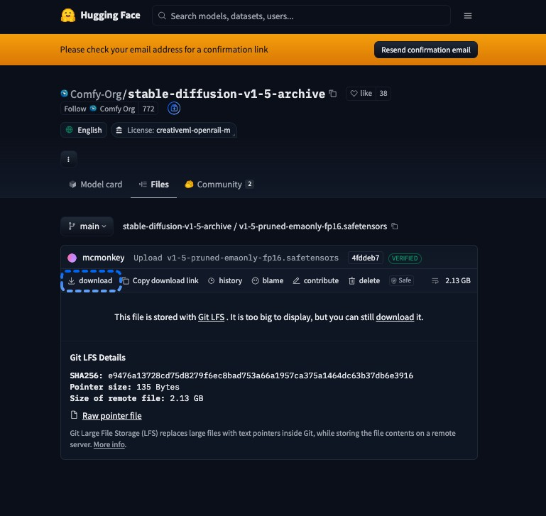

## Das Modell in den Ordner `checkpoints` verschieben

ComfyUI listet einen Checkpoint nur auf, wenn sich die Datei in einem Ordner `checkpoints` befindet, den ComfyUI liest. Verschieben Sie die heruntergeladene Datei in den Ordner Ihrer Installation.

<Tabs>
  <Tab title="Comfy Desktop">
    Standardmäßig liest jede Instanz von Comfy Desktop die gemeinsamen Modellordner. Comfy Desktop speichert Modell-Downloads im gemeinsamen Modellordner mit der Kennzeichnung **Downloads**.

    1. Klicken Sie in der **Titelleiste** von Comfy Desktop auf **Menu** und wählen Sie dann **Desktop Settings**.
    2. Wählen Sie den Tab **Storage**.
    3. Klicken Sie unter **Shared Models** auf den Ordnerpfad mit der Kennzeichnung **Downloads**. Der Ordner wird in Ihrem Dateimanager geöffnet.
    4. Verschieben Sie `v1-5-pruned-emaonly-fp16.safetensors` in den darin enthaltenen Ordner `checkpoints`. Wenn kein Ordner `checkpoints` vorhanden ist, erstellen Sie einen.
  </Tab>
  <Tab title="ComfyUI Portable">
    - Verschieben Sie `v1-5-pruned-emaonly-fp16.safetensors` in `ComfyUI_windows_portable\ComfyUI\models\checkpoints`.

    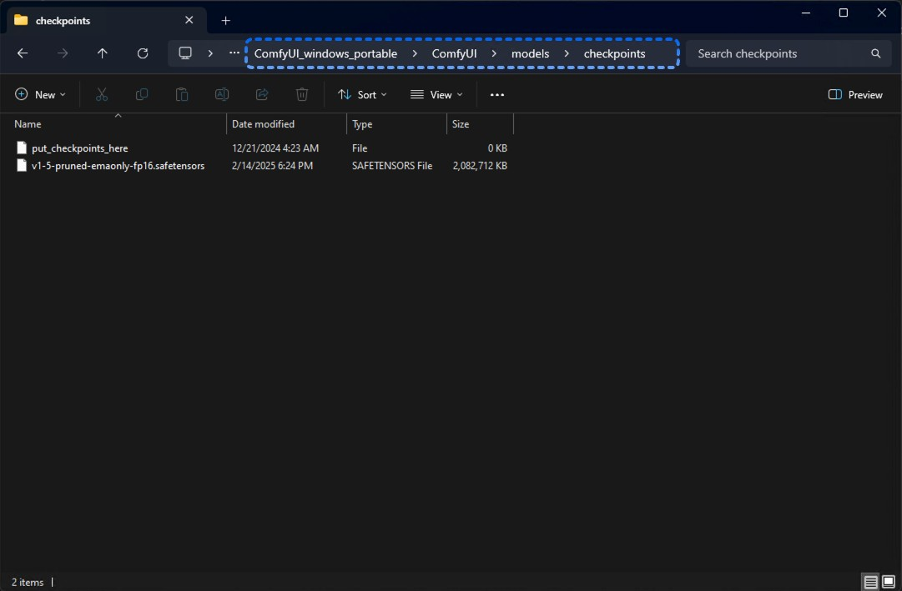
  </Tab>
  <Tab title="Manuelle Installation">
    1. Öffnen Sie den Ordner, in dem Sie ComfyUI installiert haben, also den Ordner, der `main.py` enthält.
    2. Verschieben Sie `v1-5-pruned-emaonly-fp16.safetensors` in dessen Ordner `models/checkpoints`.
  </Tab>
</Tabs>

Wenn ComfyUI bereits geöffnet ist, drücken Sie `R`, damit die Modellordner erneut eingelesen werden.

## Leeren Workflow öffnen

Der **Canvas** ist der große Bereich, in dem Sie Nodes platzieren. Wenn dort bereits ein Workflow angezeigt wird, öffnen Sie einen leeren:

1. Klicken Sie oben in der **Linken Seitenleiste** auf das ComfyUI-Logo (**Menü**).
2. Wählen Sie **New**.

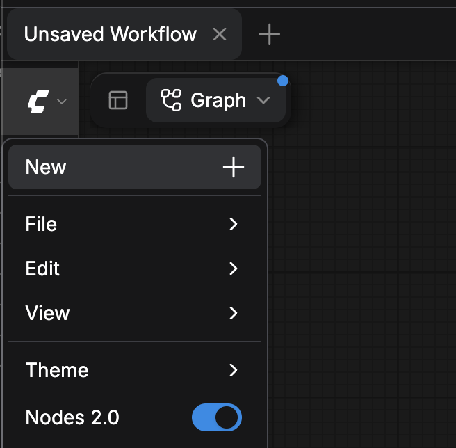

Der **Canvas** ist jetzt leer.

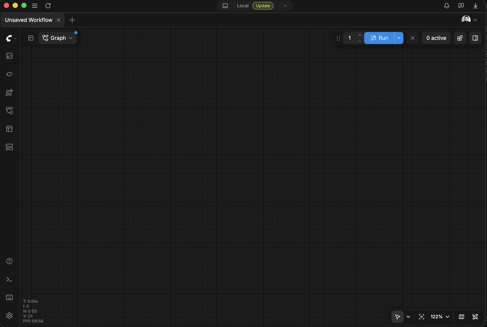

<Tip>
  In der **Oberen Leiste** öffnet auch die Plus-Schaltfläche (**+**) neben Ihren geöffneten Workflow-Tabs einen neuen leeren Workflow.

  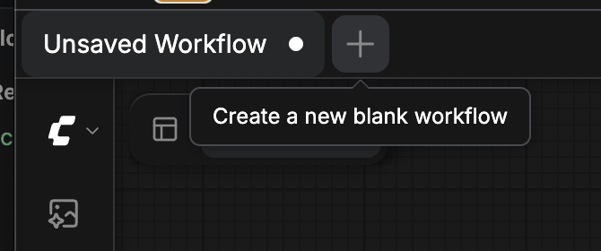
</Tip>

## Node hinzufügen

Es gibt drei Möglichkeiten, einen Node hinzuzufügen. In späteren Schritten wird die jeweils zu verwendende Methode genannt.

### Menü „Node hinzufügen“ verwenden

1. Klicken Sie mit der rechten Maustaste auf eine leere Stelle im **Canvas**. Ein Menü öffnet sich.
2. Wählen Sie **Node hinzufügen** und dann die einzelnen Kategorien im Menüpfad **Node hinzufügen** des Nodes aus. Die [Node-Tabelle](#die-bestandteile-eines-workflows-kennenlernen) listet den Pfad für jeden Node in diesem Tutorial auf.
3. Wählen Sie den Node aus. Er erscheint an der Stelle, an der Sie mit der rechten Maustaste geklickt haben.

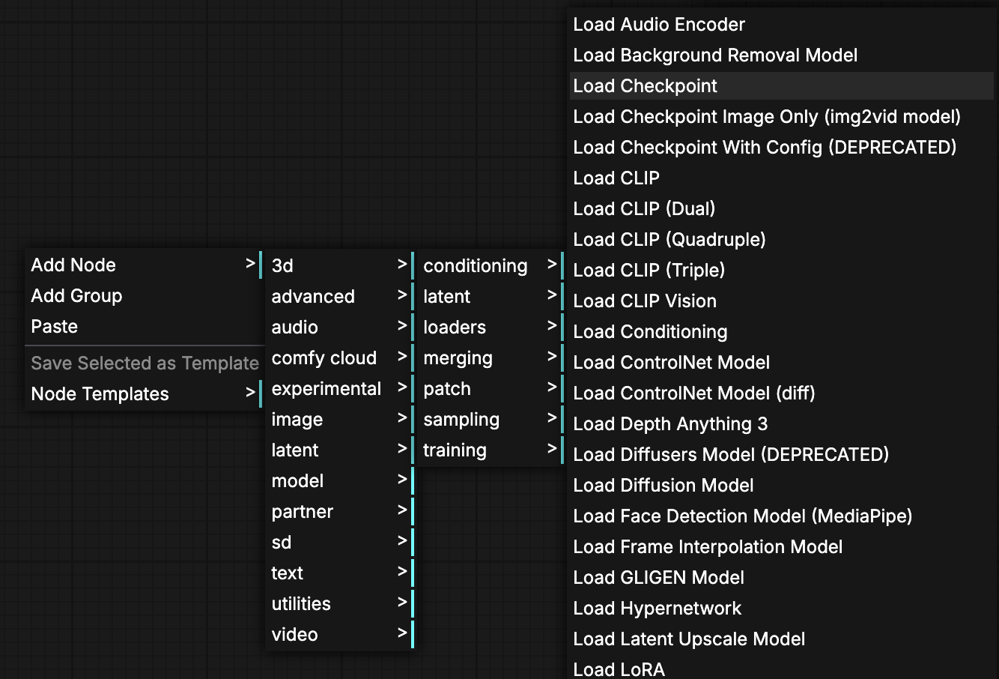

### Node-Bibliothek durchsuchen

1. Drücken Sie `N`, oder klicken Sie in der **linken Seitenleiste** auf **Nodes**. Die **Node-Bibliothek** öffnet sich.
2. Wenn die **Node-Bibliothek** mehr als einen Tab anzeigt, wählen Sie **Alle Nodes** aus.
3. Geben Sie den Node-Namen in das Suchfeld **Nodes durchsuchen...** ein.
4. Klicken Sie in den Ergebnissen auf den Node und anschließend im **Canvas** auf die Stelle, an der er erscheinen soll. Der Node erscheint dort.

### Eine Verbindung auf einen leeren Canvas ziehen

Das Ziehen einer Verbindung auf einen leeren Canvas fügt einen Node hinzu und verbindet ihn in einem Schritt.

1. Ziehen Sie von einem Ausgangsanschluss an einem Node, den Sie bereits platziert haben.
2. Lassen Sie die Maustaste über einer leeren Stelle im **Canvas** los. Das Node-Suchfeld öffnet sich dort standardmäßig.
3. Geben Sie den Node-Namen ein und wählen Sie dann den Node aus. ComfyUI fügt den Node hinzu und verbindet ihn mit dem Ausgang, von dem Sie gezogen haben.

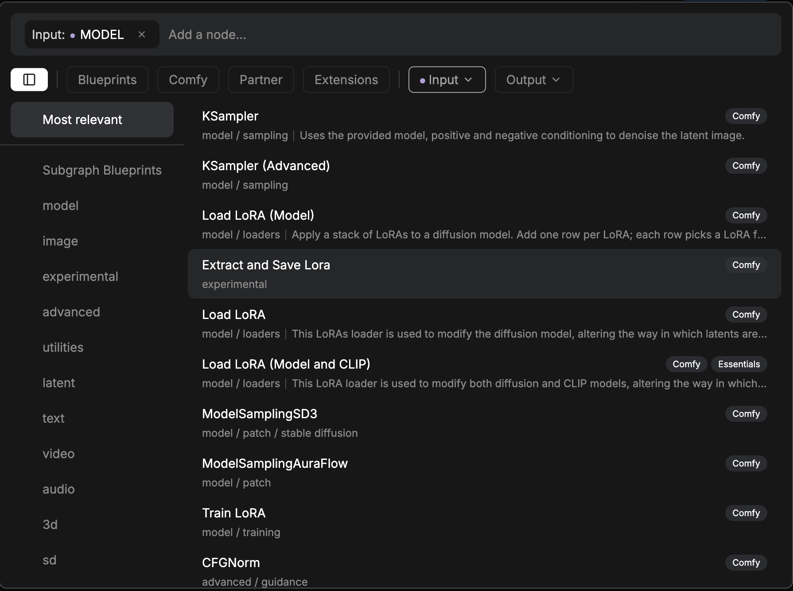

Um statt des Suchfelds ein Menü zu öffnen, halten Sie `Shift` beim Loslassen gedrückt.

## Zwei Nodes verbinden

Eine Verbindung überträgt Daten von einem Ausgang eines Nodes zu einem Eingang eines anderen Nodes.

1. Ziehen Sie von einem Ausgangspunkt an einem Node.
2. Lassen Sie über einem Eingangspunkt an einem anderen Node los. Zwischen den beiden Punkten erscheint eine Verbindung.

Diese Regeln gelten für jede Verbindung:

- Ein Ausgang kann mehrere Eingänge speisen.
- Ein Eingang nimmt eine Verbindung auf. Eine neue Verbindung zu einem Eingang ersetzt seine alte Verbindung.
- Eine Verbindung verbindet einen Ausgang und einen Eingang desselben Typs. ComfyUI zeichnet keine Verbindung zwischen unterschiedlichen Typen.

## Node `Load Checkpoint` hinzufügen

Der Node `Load Checkpoint` lädt die Modelldatei.

1. Fügen Sie über das Menü [**Add Node**](#menü-node-hinzufügen-verwenden) einen Node `Load Checkpoint` hinzu: **model** > **loaders** > `Load Checkpoint`.
2. Klicken Sie im Node auf das Widget `ckpt_name` und wählen Sie dann `v1-5-pruned-emaonly-fp16.safetensors` aus.

Der Node zeigt auf seiner rechten Seite drei Ausgänge: `MODEL`, `CLIP` und `VAE`.

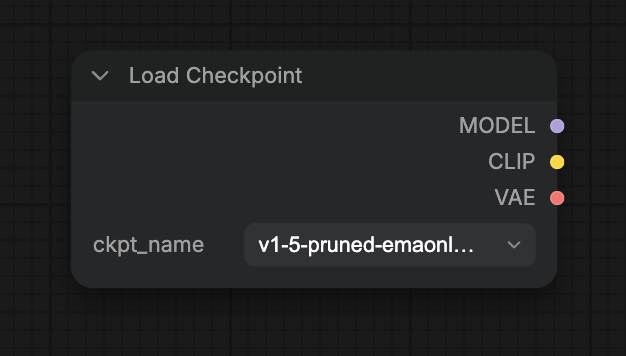

Wenn die Liste `ckpt_name` die Datei nicht anzeigt, lesen Sie [Das Modell ist nicht in der Checkpoint-Liste](#das-modell-ist-nicht-in-der-checkpoint-liste).

## Den `KSampler`-Node hinzufügen

Der `KSampler`-Node führt die Generierung aus. Er benötigt vier Verbindungen: das Modell, beide Prompts und das leere Startbild.

1. Fügen Sie einen `KSampler`-Node über die [**Node-Bibliothek**](#node-bibliothek-durchsuchen) hinzu: Suchen Sie nach `KSampler`.
2. [Verbinden](#zwei-nodes-verbinden) Sie den `MODEL`-Ausgang von `Load Checkpoint` mit dem `model`-Eingang von `KSampler`.

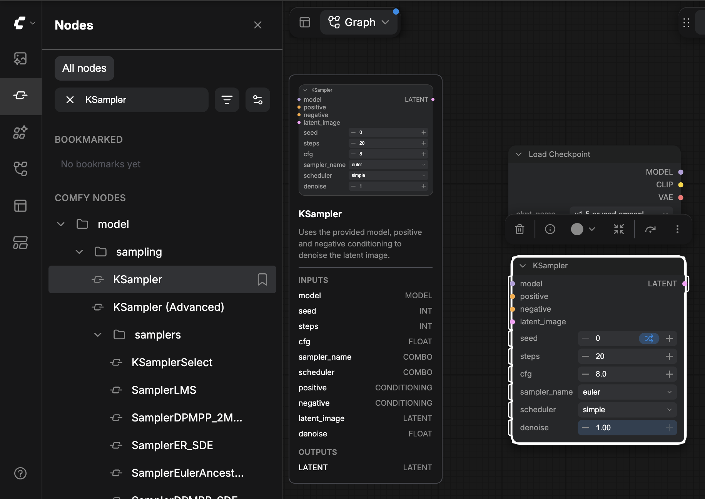

Die anderen drei Verbindungen ziehen Sie in den nächsten beiden Abschnitten.

Belassen Sie die Widgets des `KSampler` bei ihren Standardwerten. Zum Beispiel ist `steps` `20` und `cfg` `8.0`.

## Prompt-Nodes hinzufügen

Prompts beschreiben das Bild. Der positive Prompt beschreibt, was Sie sehen möchten. Der negative Prompt beschreibt, was Sie nicht sehen möchten.

1. Fügen Sie einen `CLIP Text Encode (Prompt)`-Node über das Menü [**Node hinzufügen**](#menü-node-hinzufügen-verwenden) (**Modell** > **Konditionierung**) oder die [**Node-Bibliothek**](#node-bibliothek-durchsuchen) hinzu.
2. Klicken Sie in das Textfeld und geben Sie Ihren positiven Prompt ein, zum Beispiel `beautiful scenery nature glass bottle landscape, purple galaxy bottle`.
3. Klicken Sie mit der rechten Maustaste auf den Node und wählen Sie **Duplizieren**. Ein zweiter `CLIP Text Encode (Prompt)`-Node wird angezeigt.
4. Klicken Sie in das Textfeld des zweiten Nodes und geben Sie Ihren negativen Prompt ein, zum Beispiel `text, watermark`.

[Verbinden](#zwei-nodes-verbinden) Sie die Prompts:

1. Verbinden Sie den `CLIP`-Ausgang an `Load Checkpoint` mit der Eingabe `clip` an jedem `CLIP Text Encode (Prompt)`-Node. Beide Prompt-Nodes nutzen denselben `CLIP`-Ausgang.
2. Verbinden Sie den `CONDITIONING`-Ausgang des positiven Prompt-Nodes mit der Eingabe `positive` an `KSampler`.
3. Verbinden Sie den `CONDITIONING`-Ausgang des negativen Prompt-Nodes mit der Eingabe `negative` an `KSampler`.

## Bildgröße festlegen

Der Node `Empty Latent Image` legt die Bildgröße fest. Seine Werte `width` und `height` starten bei `1024`. Dieser Workflow verwendet `512`, die Größe aus dem Beispiel-Workflow unter [Workflow aus einem Bild laden](#workflow-aus-einem-bild-laden).

1. Fügen Sie mit dem [**Add Node**-Menü](#menü-node-hinzufügen-verwenden) einen Node `Empty Latent Image` hinzu: **model** > **latent** > `Empty Latent Image`.
2. Setzen Sie `width` auf `512`.
3. Setzen Sie `height` auf `512`.
4. Belassen Sie `batch_size` bei `1`.
5. [Verbinden](#zwei-nodes-verbinden) Sie dessen `LATENT`-Ausgang mit dem Eingang `latent_image` am `KSampler`.

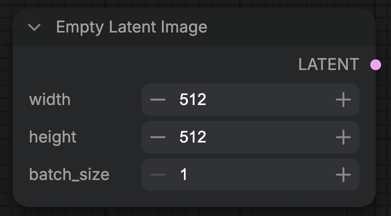

Alle vier Eingänge des `KSampler` haben jetzt Verbindungen.

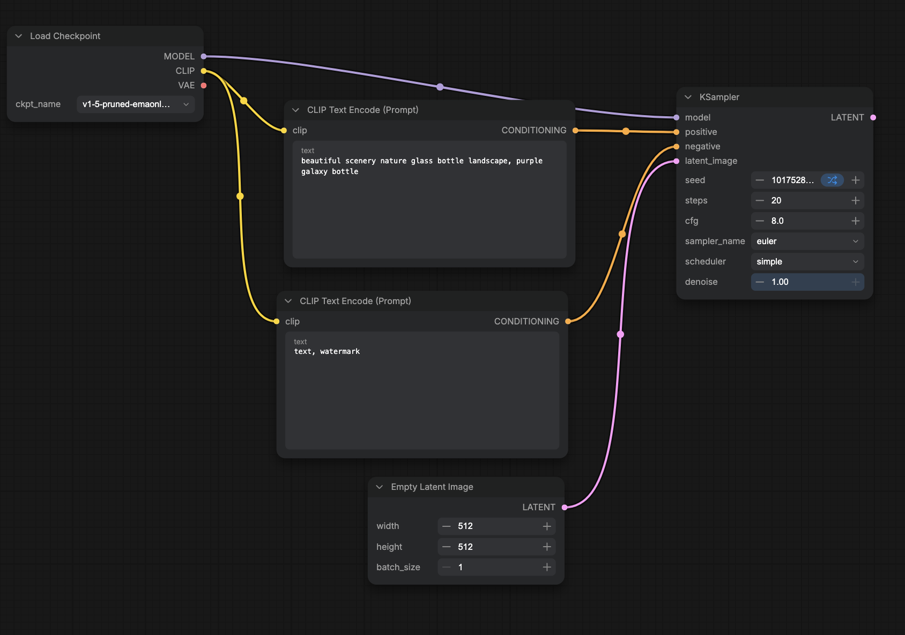

## Bild dekodieren und speichern

`KSampler` gibt ein Latent aus, kein Bild. `VAE Decode` wandelt es in ein Bild um, und `Save Image` speichert es.

1. Fügen Sie mit der [**Node-Bibliothek**](#node-bibliothek-durchsuchen) einen Node `VAE Decode` hinzu: Suchen Sie nach `VAE Decode`.
2. [Verbinden](#zwei-nodes-verbinden) Sie den `LATENT`-Ausgang von `KSampler` mit dem `samples`-Eingang von `VAE Decode`.
3. Verbinden Sie den `VAE`-Ausgang von `Load Checkpoint` mit dem `vae`-Eingang von `VAE Decode`.
4. Fügen Sie einen Node `Save Image` hinzu, indem Sie [eine Verbindung auf einen leeren Canvas ziehen](#eine-verbindung-auf-einen-leeren-canvas-ziehen): Ziehen Sie vom `IMAGE`-Ausgang an `VAE Decode`, lassen Sie über einem leeren **Canvas** los und wählen Sie `Save Image` aus. Sein `images`-Eingang ist mit `IMAGE` verknüpft.

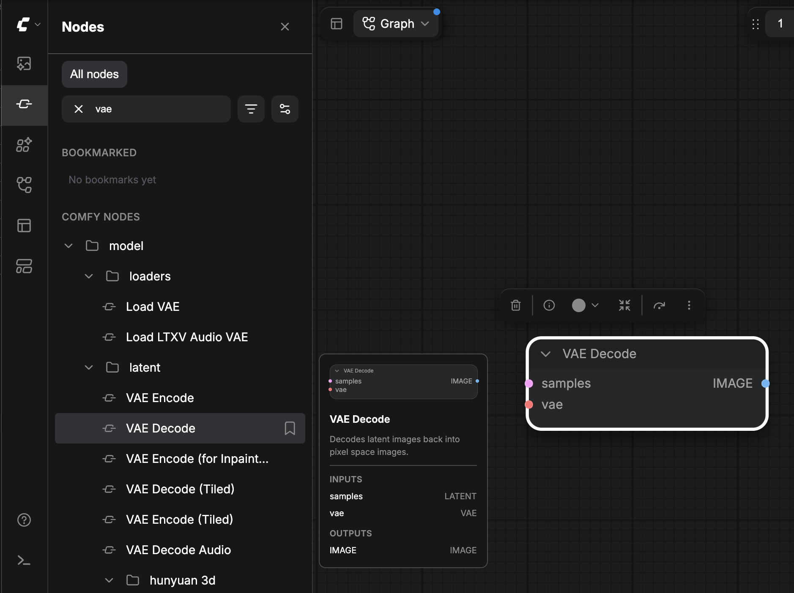

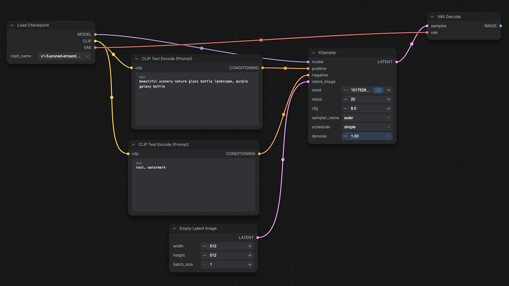

Ihr Workflow hat sieben Nodes und neun Verbindungen.

<Tip>
  Wenn kein Node ausgewählt ist, drücken Sie `.`, um den gesamten Workflow auf dem Bildschirm einzupassen.
</Tip>

## Workflow ausführen

Wenn Sie den Workflow ausführen, wird er in die Warteschlange gestellt und ComfyUI generiert das Bild.

- Klicken Sie auf **Run**, oder drücken Sie `Ctrl+Enter` (`Cmd+Enter` unter macOS).

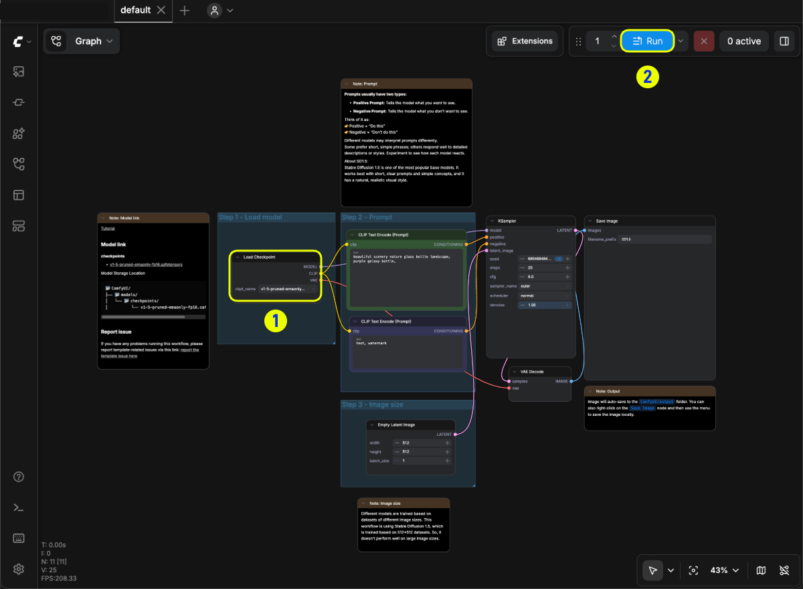

Wenn ComfyUI **Erforderliche Eingabe fehlt** anzeigt, lesen Sie [Erforderliche Eingabe fehlt](#erforderliche-eingabe-fehlt).

## Generiertes Bild finden

Wenn die Ausführung abgeschlossen ist, erscheint das Bild im Node `Save Image`. So öffnen Sie es über die **linke Seitenleiste**:

- Klicken Sie auf **Assets** und wählen Sie dann den Tab **Generated** aus.

`Save Image` schreibt das Bild außerdem als PNG-Datei mit dem Namen `ComfyUI_00001_.png` in den Ausgabeordner. Die Nummer wird bei jedem neuen Bild erhöht. In ComfyUI Portable und bei manuellen Installationen ist der Ausgabeordner `ComfyUI/output`.

## Workflow aus einem Bild laden

Standardmäßig enthält jede PNG-Datei, die `Save Image` schreibt, den Workflow, mit dem sie erstellt wurde. Laden Sie das Beispielbild unten, um dessen Workflow mit dem zu vergleichen, den Sie erstellt haben.

1. Speichern Sie dieses Bild auf Ihrem Computer:

   

2. Ziehen Sie die PNG-Datei auf den **Canvas**. Sie können auch auf das ComfyUI-Logo (**Menu**) in der **linken Seitenleiste** klicken, **File** > **Open** auswählen und die Datei auswählen.

Der Workflow aus dem Bild wird geöffnet. Wenn stattdessen ein `Load Image` Node erscheint, enthält die abgelegte Datei keinen gespeicherten Workflow.

## Fehlendes Modell beheben

Wenn Sie einen Workflow laden, dessen Modelldatei sich nicht in Ihren Modellordnern befindet, zeigt ComfyUI einen Hinweis an, der das fehlende Modell nennt, etwa `v1-5-pruned-emaonly-fp16.safetensors is missing`.

1. Klicken Sie auf **View details**. Das **Right side panel** wird auf dem Tab **Issues** geöffnet und listet die Datei unter **Missing Models** auf. Der Ordner, in den die Datei gehört, etwa `checkpoints`, erscheint unter dem Dateinamen.
2. Wenn die Zeile eine Schaltfläche **Download** enthält, klicken Sie darauf.
   - **Comfy Desktop**: Comfy Desktop lädt die Datei in den Ordner `checkpoints` Ihres Modellordners **Downloads** herunter.
   - **ComfyUI Portable und manuelle Installationen**: Ihr Browser lädt die Datei herunter. Verschieben Sie sie in den Ordner `checkpoints`, wie unter [Modell in den Checkpoints-Ordner legen](#das-modell-in-den-ordner-checkpoints-verschieben) beschrieben.
3. Wenn die Zeile keine Schaltfläche **Download** hat, besorgen Sie sich die Datei selbst:
   1. Klicken Sie auf das Link-Symbol neben dem Dateinamen. Das Link-Symbol kopiert den Download-Link (**Copy URL**) oder den Dateinamen, wenn der Workflow keinen Link enthält (**Copy model name**).
   2. Laden Sie die Datei herunter. Befolgen Sie für das Modell dieses Tutorials [Modell herunterladen](#modell-herunterladen).
   3. Verschieben Sie die Datei in den Ordner, der unter dem Dateinamen genannt wird, etwa `checkpoints`.
4. Klicken Sie auf **Refresh** (den kreisförmigen Pfeil) in der Kopfzeile von **Missing Models** oder drücken Sie `R`, damit ComfyUI die Modellordner erneut prüft.

Eine Zeile für ein fehlendes Modell hat keine Schaltfläche **Download**, wenn eine der folgenden Bedingungen zutrifft:

- Der Workflow enthält keinen Download-Link für das Modell. Das Beispielbild unter [Workflow aus einem Bild laden](#workflow-aus-einem-bild-laden) gehört zu diesen Workflows.
- Der Download-Link ist kein Link zu Hugging Face oder Civitai.
- Der Dateiname endet nicht auf `.safetensors`, `.sft`, `.ckpt`, `.pth` oder `.pt`.
- Der Workflow gibt nicht an, in welchen Modellordner die Datei gehört.

<Note>
  Comfy Cloud zeigt für ein fehlendes Modell niemals **Download** an. Stattdessen wird **Import** angezeigt, sodass Sie das Modell in Comfy Cloud importieren können. Modelle, die von Nodes verwendet werden, die importierte Modelle nicht unterstützen, werden unter **Import Not Supported** aufgeführt.
</Note>

## Fehlerbehebung

Verwenden Sie diese Einträge, wenn ein Lauf fehlschlägt oder die Modelldatei nicht geladen wird.

### Erforderliche Eingabe fehlt

Eine Eingabe hat keine Verbindung. Die Meldung nennt den Node und die Eingabe, zum Beispiel `KSampler is missing a required input: latent_image`. [Verbinden](#zwei-nodes-verbinden) Sie die in der Meldung genannte Eingabe und führen Sie den Workflow erneut aus.

### Das Modell ist nicht in der Checkpoint-Liste

Die Datei liegt nicht in einem `checkpoints`-Ordner, den ComfyUI liest. Verschieben Sie sie dorthin, wie unter [Das Modell in den checkpoints-Ordner legen](#das-modell-in-den-ordner-checkpoints-verschieben) beschrieben, und drücken Sie dann `R`.
