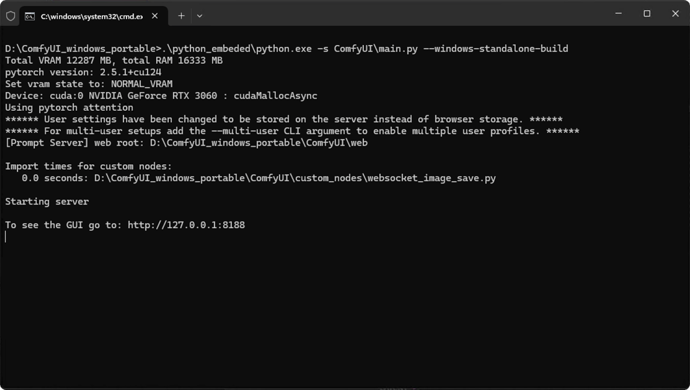

import FirstGeneration from "/snippets/de/install/first-generation.mdx"
import AddExternalModels from "/snippets/de/install/add-external-models.mdx"

**ComfyUI Portable** ist eine eigenständig gepackte, vollständige ComfyUI-Version für Windows, in die ein eigenständiges **Python (python_embeded)** integriert ist, das für den Betrieb von ComfyUI erforderlich ist. Sie müssen sie nur entpacken, um sie zu verwenden.

Dieser Abschnitt der Anleitung führt Sie durch die Installation von ComfyUI Portable.

## ComfyUI Portable herunterladen

<Note>
  Wählen Sie das Download-Paket, das zu Ihrem GPU-Typ passt. ComfyUI Portable bietet separate Pakete für unterschiedliche GPU-Hardware.
</Note>

<Tabs>
  <Tab title="Nvidia GPU">
    ### Standard-Portable für Nvidia GPUs

    <CardGroup cols={3}>
      <Card title="Nvidia GPU (CUDA 13.0, Python 3.13)" icon="download" href="https://github.com/Comfy-Org/ComfyUI/releases/latest/download/ComfyUI_windows_portable_nvidia.7z">
       Für moderne Nvidia GPUs (RTX-Serie)
      </Card>
      <Card title="Nvidia GPU (CUDA 12.6, Python 3.12)" icon="download" href="https://github.com/Comfy-Org/ComfyUI/releases/latest/download/ComfyUI_windows_portable_nvidia_cu126.7z">
       Für Nvidia-GPUs der 10er-Serie und ältere GPUs
      </Card>
      <Card title="Nvidia GPU unter Windows ARM64 (Python 3.14)" icon="download" href="https://github.com/Comfy-Org/ComfyUI/releases/latest/download/ComfyUI_windows_portable_nvidia_arm64.7z">
       Für Windows-ARM-Geräte mit einer Nvidia GPU
      </Card>
    </CardGroup>

    Laden Sie die Datei herunter und entpacken Sie sie mit [7-ZIP](https://7-zip.org/). Die Ordnerstruktur nach dem Entpacken:

    ```
    ComfyUI_windows_portable
    ├── 📂ComfyUI                   // ComfyUI-Hauptprogramm
    ├── 📂python_embeded            // Unabhängige Python-Umgebung
    ├── 📂update                    // Batch-Skripte zum Aktualisieren der Portable-Version
    ├── 📂advanced                  // Zusätzliche Starter: run_cpu.bat (nur CPU), run_nvidia_gpu_fast_fp16_accumulation.bat, run_nvidia_gpu_disable_api_nodes.bat
    ├── README_VERY_IMPORTANT.txt   // Nutzungsanweisungen für ComfyUI Portable auf Englisch
    └── run_nvidia_gpu.bat          // Doppelklicken, um ComfyUI zu starten (Nvidia GPU)
    ```

    Doppelklicken Sie auf `run_nvidia_gpu.bat`, um ComfyUI zu starten.
  </Tab>

  <Tab title="AMD GPU">
    ### Portable für AMD-GPUs

    <Card title="AMD GPU" icon="download" href="https://github.com/Comfy-Org/ComfyUI/releases/latest/download/ComfyUI_windows_portable_amd.7z">
      Herunterladen für AMD-GPUs (ROCm)
    </Card>

    Laden Sie die Datei herunter und entpacken Sie sie mit [7-ZIP](https://7-zip.org/). Die Ordnerstruktur nach dem Entpacken:

    ```
    ComfyUI_windows_portable_amd
    ├── 📂ComfyUI                   // ComfyUI-Hauptprogramm
    ├── 📂python_embeded            // Unabhängige Python-Umgebung
    ├── 📂update                    // Batch-Skripte zum Aktualisieren der Portable-Version
    ├── README_VERY_IMPORTANT.txt   // Nutzungsanweisungen für ComfyUI Portable auf Englisch
    ├── run_amd_gpu_enable_dynamic_vram.bat // Start mit aktiviertem dynamischem VRAM
    └── run_amd_gpu.bat             // Doppelklicken, um ComfyUI zu starten (AMD GPU)
    ```

    Doppelklicken Sie auf `run_amd_gpu.bat`, um ComfyUI zu starten.
  </Tab>

  <Tab title="Intel GPU">
    ### Portable für Intel-GPUs

    <Card title="Intel GPU" icon="download" href="https://github.com/Comfy-Org/ComfyUI/releases/latest/download/ComfyUI_windows_portable_intel.7z">
      Herunterladen für Intel-GPUs
    </Card>

    Laden Sie die Datei herunter und entpacken Sie sie mit [7-ZIP](https://7-zip.org/). Die Ordnerstruktur nach dem Entpacken:

    ```
    ComfyUI_windows_portable_intel
    ├── 📂ComfyUI                   // ComfyUI-Hauptprogramm
    ├── 📂python_embeded            // Unabhängige Python-Umgebung
    ├── 📂update                    // Batch-Skripte zum Aktualisieren der Portable-Version
    └── run_intel_gpu.bat           // Doppelklicken, um ComfyUI zu starten (Intel GPU)
    ```

    Doppelklicken Sie auf `run_intel_gpu.bat`, um ComfyUI zu starten.
  </Tab>
</Tabs>

Nach dem Herunterladen und Entpacken wird der Befehl ausgeführt, wie im folgenden Bild zu sehen ist



Wenn Sie eine Ausgabe ähnlich wie im Bild sehen
```
To see the GUI go to: http://127.0.0.1:8188
```
An diesem Punkt ist Ihr ComfyUI-Dienst gestartet. Normalerweise öffnet ComfyUI automatisch Ihren Standardbrowser und navigiert zu `http://127.0.0.1:8188`. Wenn er sich nicht automatisch öffnet, öffnen Sie bitte Ihren Browser manuell und rufen Sie diese Adresse auf.

<Warning>
  Bitte schließen Sie während der Nutzung das entsprechende Befehlszeilenfenster nicht, da ComfyUI sonst die Ausführung stoppt.
</Warning>

<AddExternalModels/>

<FirstGeneration/>

## Zusätzliche Anweisungen für ComfyUI Portable

### 1. ComfyUI Portable upgraden

Sie können die Batch-Befehle im Ordner `update` verwenden, um Ihre ComfyUI Portable-Version zu upgraden.

```
ComfyUI_windows_portable
└─ 📂update
   ├── update.py
   ├── update_comfyui.bat                          // ComfyUI auf die neueste Commit-Version aktualisieren
   ├── update_comfyui_and_python_dependencies.bat  // Nur verwenden, wenn Sie Probleme mit Ihrer Laufzeitumgebung haben
   └── update_comfyui_stable.bat                   // ComfyUI auf die neueste stabile Version aktualisieren
```

### 2. LAN-Zugriff für ComfyUI Portable einrichten

Wenn Ihr ComfyUI in einem lokalen Netzwerk läuft und Sie möchten, dass andere Geräte auf ComfyUI zugreifen können, können Sie die entsprechende `.bat`-Datei (z. B. `run_nvidia_gpu.bat`, `run_amd_gpu.bat` oder `run_cpu.bat`; bei neuen NVIDIA-Paketen liegt sie in `advanced\`, bei älteren im Stammverzeichnis des Pakets) mit Notepad bearbeiten, um die Konfiguration vorzunehmen. Dies geschieht hauptsächlich durch Hinzufügen von `--listen`, um die Listen-Adresse festzulegen.
Unten sehen Sie ein Beispiel für den Befehl in der Datei `run_nvidia_gpu.bat` mit hinzugefügtem `--listen`-Parameter

```bat
.\python_embeded\python.exe -s ComfyUI\main.py --listen --windows-standalone-build
pause
```

Nach dem Start von ComfyUI werden Sie feststellen, dass die endgültige Laufadresse wie folgt lautet
```
Starting server

To see the GUI go to: http://0.0.0.0:8188
To see the GUI go to: http://[::]:8188
```

Sie können `WIN + R` drücken und `cmd` eingeben, um die Eingabeaufforderung zu öffnen, und dann `ipconfig` eingeben, um Ihre lokale IP-Adresse anzuzeigen. Andere Geräte können dann auf ComfyUI zugreifen, indem sie `http://your-local-IP:8188` in ihren Browser eingeben.

### 3. Zusätzliche Python-Pakete installieren

Die portable Version wird mit einer eingebetteten Python-Umgebung (`python_embeded`) ausgeliefert. Um zusätzliche Python-Pakete zu installieren (z. B. Attention-Optimierungen, Abhängigkeiten von Custom Nodes oder andere Tools), verwenden Sie das pip des eingebetteten Python über die Befehlszeile:

```bash
# Wechseln Sie zuerst in Ihren ComfyUI Portable-Ordner
cd ComfyUI_windows_portable

# Installieren Sie ein Paket mit dem eingebetteten Python
.\python_embeded\python.exe -m pip install <package-name>
```

Wenn Sie ein Paket installiert haben, das ein Startflag benötigt, fügen Sie das entsprechende Flag zu Ihrer `.bat`-Datei hinzu (z. B. `run_nvidia_gpu.bat`):

```bat
.\python_embeded\python.exe -s ComfyUI\main.py --<startup-flag> --windows-standalone-build
```

Ausführliche Hinweise zur Installation von Abhängigkeiten für Custom Nodes finden Sie in der [Anleitung zu den Abhängigkeiten von Custom Nodes](/de/basic-concepts/custom-nodes).
