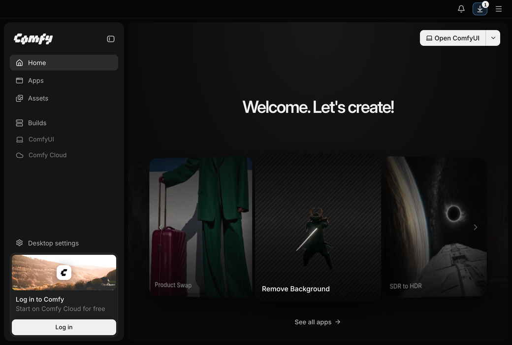
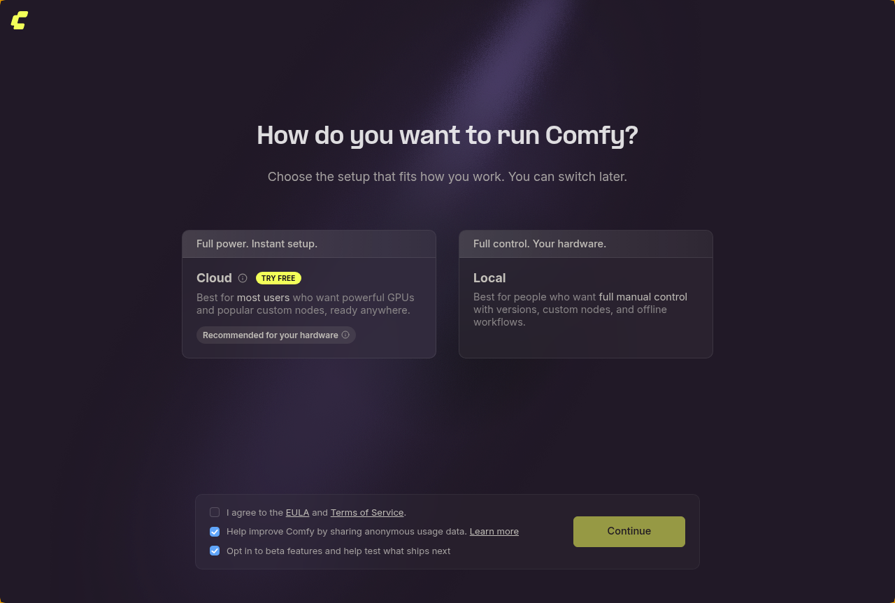
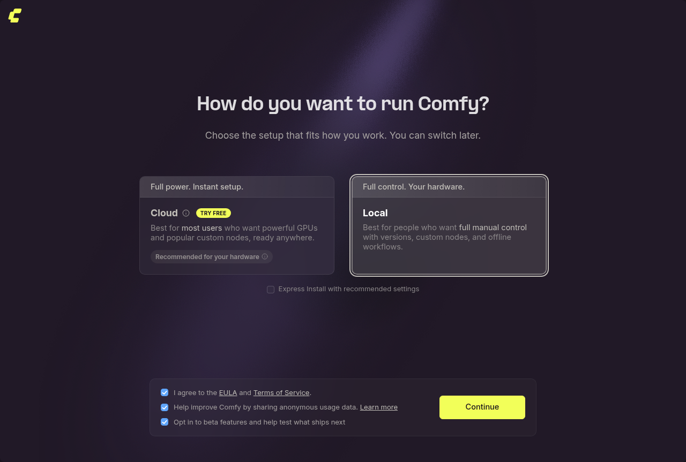

**Comfy Desktop** ist eine Desktopanwendung, mit der Sie mehrere ComfyUI-Instanzen über einen einzigen Launcher installieren, verwalten und starten können.

Einfach gesagt: **Comfy Desktop** ist die App, die **ComfyUI** verwaltet und startet, die Node-basierte Engine für generative KI. Sie installieren ComfyUI nicht separat. Comfy Desktop übernimmt für Sie die Installation, die Python-Umgebung und die Abhängigkeiten. Jede ComfyUI-Instanz läuft unabhängig mit ihrer eigenen Version, eigenen Custom Nodes und eigenen Einstellungen.

Comfy Desktop läuft auf **Windows 10+**, **macOS 13+ (Apple Silicon)** und **Linux** (offizielle `.deb`- und AppImage-Pakete). Jede eigenständige Installation benötigt mindestens **4.85 GB** Speicherplatz und **8 GB RAM (16 GB empfohlen)**. Vollständige Details finden Sie auf den plattformspezifischen Seiten.

## Loslegen

Wählen Sie Ihre Plattform aus, um zu beginnen:

<CardGroup cols={3}>
  <Card title="Windows" icon="windows" href="/de/installation/desktop/windows">
    Schritt-für-Schritt-Anleitung zur Installation unter Windows 10 oder später.
  </Card>

  <Card title="macOS" icon="app-store" href="/de/installation/desktop/macos">
    Schritt-für-Schritt-Anleitung zur Installation unter macOS 13+ (Apple Silicon).
  </Card>

  <Card title="Linux" icon="linux" href="/de/installation/desktop/linux">
    Installieren Sie das offizielle `.deb`-Paket oder AppImage oder bauen Sie es aus dem Quellcode.
  </Card>
</CardGroup>

## Erster Start

Beim ersten Öffnen von Comfy Desktop fragt ein bildschirmfüllendes Setup **How do you want to run Comfy?** und erfasst die nötigen Entscheidungen, bevor irgendetwas installiert wird. Das Fenster bleibt in diesem Setup, bis Sie es abschließen: Wenn Sie die App mittendrin schließen, erscheint beim nächsten Start derselbe Bildschirm.

### Cloud oder Local

Zwei Karten decken die beiden Möglichkeiten ab, ComfyUI auszuführen:

- **Cloud** führt ComfyUI auf Cloud-GPUs von Comfy Cloud aus. Auf Ihrem Rechner wird nichts installiert, und es gibt nichts herunterzuladen. Die Karte trägt eine **TRY FREE**-Plakette, solange kostenlose Cloud-Läufe verfügbar sind.
- **Local** installiert ComfyUI auf diesem Rechner. Sie steuern die ComfyUI-Version, die Custom Nodes und die Startargumente, und es läuft offline.

Wenn Comfy Desktop erkennt, dass die GPU dieses Rechners für die meisten Workflows nicht leistungsfähig genug ist, trägt die Cloud-Karte ein Badge **Recommended for your hardware**, und keine der Karten ist vorausgewählt, sodass die Wahl bewusst erfolgt und nicht auf einer Voreinstellung beruht. **Continue** bleibt deaktiviert, bis eine Karte ausgewählt ist.

### Bedingungen und Datenweitergabe

Unter den Karten stehen drei Kontrollkästchen:

- **I agree to the EULA and Terms of Service**: erforderlich. Die beiden Links darin öffnen die EULA und die Terms of Service; die Datenschutzerklärung öffnet sich über **Learn more** in der Zeile zur Datenweitergabe darunter. **Continue** fährt nicht fort, solange dieses Kästchen nicht angehakt ist, und zwar bei jedem Durchlauf des Setups.
- **Help improve Comfy by sharing anonymous usage data**: optional und standardmäßig angehakt. Comfy Desktop sendet anonyme Nutzungsdaten und erfasst niemals Workflow-Inhalte, Prompts, generierte Medien oder persönliche Informationen. Sie können dies später in den [Desktop-Einstellungen](/de/installation/desktop/usage/settings) ändern.
- **Opt in to beta features and help test what ships next**: optional und standardmäßig angehakt sowie nur verfügbar, solange die Datenweitergabe aktiv ist. Das Deaktivieren der Datenweitergabe leert auch dieses Kästchen.

### Express-Installation

Wenn **Local** ausgewählt ist, erscheint ein Kontrollkästchen **Express Install with recommended settings**. Es ist standardmäßig nicht angehakt, sodass der Installationsassistent die ComfyUI-Version, den Installationsort und die Startoptionen anzeigt, bevor etwas auf die Festplatte geschrieben wird. Haken Sie es an, um diesen Schritt zu überspringen und eine Standalone-Instanz mit den empfohlenen Einstellungen zu installieren. Comfy Desktop nennt dann unter dem Kontrollkästchen die erkannte Hardware, sodass Sie es abwählen können, wenn die erkannte GPU nicht die gewünschte ist.

### Bestehende Installation migrieren

Wenn Comfy Desktop eine Legacy-Desktop-Installation auf dem Rechner findet, erscheint neben Express Install ein Kontrollkästchen **Migrate existing instance**, das standardmäßig angehakt ist. Lassen Sie es angehakt, um Ihre Workflows, Modelle und Einstellungen beim Fortfahren zu übernehmen; welche Daten übertragen werden, lesen Sie unter [Migrate from Legacy Desktop](/de/installation/desktop/usage/migrate). Deaktivieren Sie es, um stattdessen eine frische Instanz zu installieren. Sind beide Kontrollkästchen deaktiviert, fragt Comfy Desktop vor dem Start der Installation noch einmal nach: Wählen Sie **Migrate**, um die Legacy-Desktop-Installation zu übernehmen, oder **Start Fresh**, um eine saubere Instanz zu installieren und die bestehenden Projekte unverändert zu lassen.

### Chinesische Mirrors

Wenn die App auf Chinesisch läuft, fügt das Setup nach **Continue** eine weitere Frage hinzu: **Enable Chinese Mirrors?** Wählen Sie **Enable Mirrors**, um Git-Repositories von `gitcode.com` zu klonen und PyPI-Pakete von den Mirrors von Aliyun und Tencent statt von `github.com` und `pypi.org` zu beziehen, was in Festlandchina schneller ist. Wählen Sie **Not now**, um die Standardeinstellungen beizubehalten. Beide Antworten werden in der Einstellung **Use Chinese Mirrors (Git & PyPI)** gespeichert, sodass Sie sie später ändern können.

### Nach dem Setup

**Continue** speichert Ihre Auswahl und zeigt einen kurzen Schritt **Preparing your install…** an.

- **Cloud**: Comfy Desktop schließt das Setup und startet Comfy Cloud.
- **Local**: Der Installationsassistent wird ausgeführt, sofern Express Install nicht aktiv ist, die Installation zeigt ihren Fortschritt an, und die fertige Instanz erscheint im Dashboard.

Wenn Comfy Desktop bereits über eine Standalone-, getrackte oder Remote-Installation verfügt, überspringt es die Wahl zwischen Cloud und Local und führt Sie nach dem Akzeptieren der Bedingungen direkt zum Dashboard. Die Zustimmung ist bei jedem Durchlauf des Setups erforderlich.

Das Setup übernimmt den gesamten Bildschirm: Die Titelleiste ist gesperrt, solange es geöffnet ist, und sobald Sie den Zustimmungsschritt verlassen, ist das App-Menü (☰) auf einen einzigen Eintrag **Skip Onboarding** reduziert, der das Setup schließt und Sie zum Dashboard bringt, ohne etwas zu installieren.

## Nutzungsanleitung

Nach der Installation erfahren Sie hier, wie Sie Comfy Desktop verwenden:

<CardGroup cols={1}>
  <Card title="Nutzungsanleitung für Comfy Desktop" icon="book-open" href="/de/installation/desktop/usage/overview">
    Überblick über das Dashboard, Instanzverwaltung, Einstellungen, Snapshots und mehr.
  </Card>
</CardGroup>

## Von Legacy Desktop migrieren

Wenn Sie noch die ältere Version von Legacy Desktop verwenden (Desktop-App mit Einzelinstallation), können Sie Ihre Custom Nodes, Workflows und Modelle in das neue Comfy Desktop migrieren. Ihre vorhandenen Daten bleiben erhalten. Eine manuelle Migration ist nicht erforderlich.

<CardGroup cols={1}>
  <Card title="Migrationsanleitung" icon="arrow-right" href="/de/installation/desktop/usage/migrate">
    Schritt-für-Schritt-Anleitung zur Migration von Legacy Desktop zu Comfy Desktop.
  </Card>
</CardGroup>

## Open Source

Der Quellcode von Comfy Desktop ist auf [GitHub](https://github.com/Comfy-Org/Comfy-Desktop) verfügbar. Er ist unter einer Dual-Lizenz verfügbar: AGPL-3.0-or-later oder eine kommerzielle Lizenz von Comfy Org.
