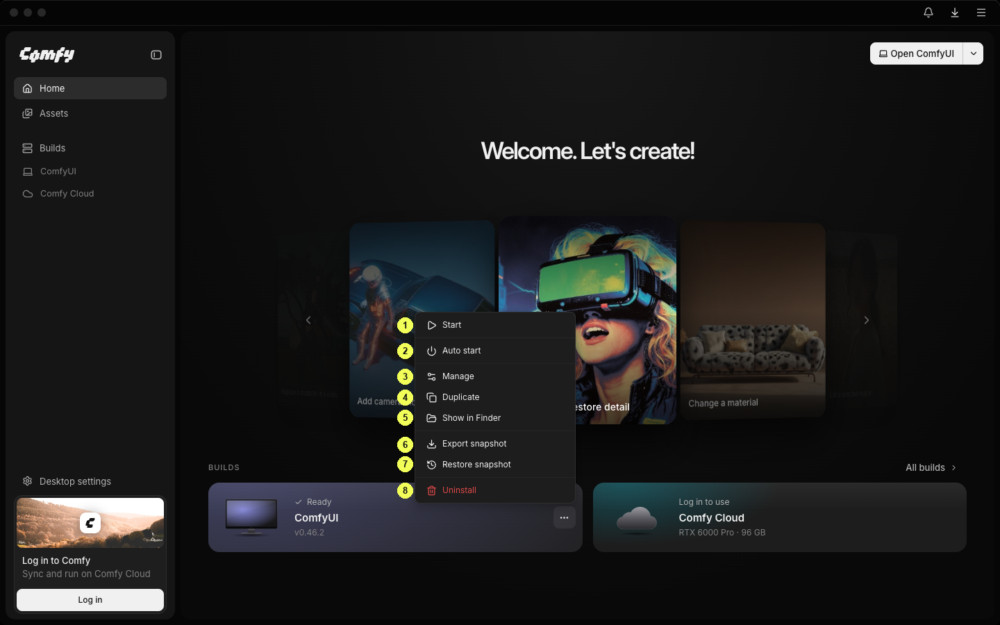
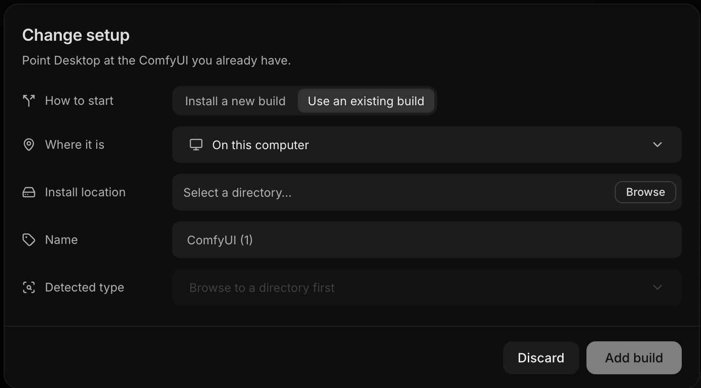

In Comfy Desktop können Sie ComfyUI auf diesem Computer, auf Comfy Cloud oder auf einem ComfyUI-Server auf einem anderen Rechner ausführen. Jede dieser Optionen ist ein Build. Comfy Desktop listet Comfy Cloud für Sie auf, und Sie installieren, fügen hinzu oder verbinden jeden anderen Build, bevor Sie ihn öffnen. Auf dieser Seite richten Sie einen Build ein, führen ihn aus, aktualisieren und konfigurieren ihn über seine Build-Seite und entfernen ihn, wenn Sie ihn nicht mehr benötigen.

## Arten von Comfy-Builds

Der Ort, an dem ein Build läuft, entscheidet darüber, was Sie mit ihm tun können. Die Seite **Builds** gruppiert Builds danach, wo sie laufen:

| Wo er läuft | Was er ist | Wie Sie ihn erhalten |
| --- | --- | --- |
| **Dieser Computer** | Auf diesem Computer installiertes ComfyUI. Sein Typ ist **Standalone**, **Git clone**, **Portable**, **Legacy Desktop** oder **Build** (ein Developer Platform Build aus dem Workspace Ihres Teams). | [Einen neuen Build installieren](#install-a-new-build) oder [ein bereits vorhandenes ComfyUI hinzufügen](#add-a-comfyui-you-already-have). |
| **Cloud** | Comfy Cloud. Es läuft auf GPUs in der Cloud und erfordert ein Comfy-Konto. | Comfy Desktop listet es für Sie als **Comfy Cloud** auf. |
| **Remote** | Ein ComfyUI-Server, der auf einem anderen Rechner läuft und über seine URL erreichbar ist. | [Mit einem ComfyUI-Server verbinden](#connect-to-a-comfyui-server). |

<Note>
  Comfy Cloud zeigt **Log in to use** an, bis Sie sich [anmelden](/de/installation/desktop/overview#anmelden-und-comfy-cloud-öffnen). Das Schnellaktionsmenü enthält kein **Stopp**, **Automatisch starten** oder **Deinstallieren**, und der Name bleibt **Comfy Cloud**.
</Note>

## Ihre Builds finden

Die Seite **Builds** listet jeden Build in Ihrem Workspace auf. Um sie zu öffnen, klicken Sie in der **Seitenleiste** auf **Builds**.

Oben auf der Seite:

- **New build**: startet einen neuen Build. Klicken Sie auf den Pfeil daneben (**More build options**), um **Add existing build** und **Load snapshot** zu erreichen.
- **Where it runs**: filtert die Liste. **All** und **This computer** sind immer vorhanden. **Cloud** und **Remote** erscheinen, sobald Sie einen Build dieser Art haben.
- **Sort**: ordnet Builds nach **Last used** oder **Name**. Builds, die gerade installiert werden, bleiben oben.
- **Search builds**: findet einen Build über seinen Namen. Wenn nichts übereinstimmt, klicken Sie auf **Clear filters**.

Jeder Build ist eine Kachel. Eine Kachel zeigt den Status des Builds, etwa **Running**, **Starting…**, **Auto start** oder **Error**. Halten Sie den Zeiger über eine Kachel, um zu sehen, was ein Klick bewirkt: **Click to start**, **Click to open** oder **Click to view logs**.

Wenn Sie keine Builds haben, zeigt die Seite **No builds yet** und **Install ComfyUI on this computer, or run it on Comfy Cloud.**

Die **Seitenleiste** listet außerdem jeden Build unter **Builds** auf:

- Ein Spinner und ein Prozentwert bedeuten, dass der Build gerade installiert wird.
- Ein grüner Punkt bedeutet, dass der Build läuft.
- Ein roter Punkt bedeutet, dass der Build abgestürzt ist oder nicht gestartet wurde. Halten Sie den Zeiger über den Build, um den Grund zu lesen.
- Klicken Sie auf einen Build, um seine [Build-Seite](#manage-builds) zu öffnen.
- Klicken Sie mit der rechten Maustaste auf einen Build, um sein [Schnellaktionsmenü](#quick-actions-from-the-build-list) zu öffnen.

Informationen zu **Home** und dem Rest der **Seitenleiste** finden Sie unter [In Comfy Desktop zurechtfinden](/de/installation/desktop/usage/overview).

### Schnellaktionen aus der Build-Liste

Klicken Sie mit der rechten Maustaste auf einen Build in der **Seitenleiste** oder auf seine Kachel auf der Seite **Builds** bzw. seine Karte auf **Home**, um ein kurzes Menü mit Aktionen zu öffnen. Bei einer Kachel oder Karte können Sie auch den Zeiger darüber halten, bis rechts die Schaltfläche **⋯** erscheint, und dann darauf klicken.

Das Menü zeigt nur die Aktionen, die gerade für den Build gelten:

- **Start** oder **View logs**, **Restart** und **Stop**, während der Build läuft. Während er installiert oder startet: **View logs** und **Cancel**. Nach einem Absturz: **View error**.
- **Auto start** oder **Turn off auto start**. Siehe [Build beim Öffnen von Comfy Desktop starten](#start-a-build-when-comfy-desktop-opens).
- **Manage**, das die [Build-Seite](#manage-builds) öffnet.
- **Update**, wenn eine Aktualisierung verfügbar ist, und **Migrate to Standalone**, wenn der Build in einen Standalone-Build verschoben werden kann. Siehe [Später migrieren](/de/installation/desktop/usage/migrate#später-migrieren).
- **Duplicate** sowie **Show in Finder**, **Show in Explorer** oder **Show in folder**.
- **Export snapshot** und **Restore snapshot**. Siehe [Snapshots](#save-and-restore-snapshots).
- **Upload build**, wenn Sie in einem Workspace angemeldet sind. Siehe [Team-Builds](/de/installation/desktop/usage/workspaces-and-builds).
- **Uninstall**. Siehe [Build entfernen](#remove-a-build).

**Auto start**, **Restart**, **View logs** und **Upload build** gibt es nur in diesem Menü. Alles andere finden Sie auch auf der Build-Seite. Wenn ein Eintrag ausgegraut ist, halten Sie den Zeiger darüber, um den Grund zu lesen, etwa **Stop the running build first.**

## Einen neuen Build installieren

Ein neuer Build ist ComfyUI, das Comfy Desktop für Sie installiert: eine offizielle Version als **Standalone**-Build oder ein Developer Platform Build aus dem Workspace Ihres Teams. Der Dialog **New build** wählt die Einstellungen für diesen Computer. Die Installation lädt ComfyUI herunter und richtet die Python-Umgebung ein; prüfen Sie deshalb die Zusammenfassung, bevor Sie auf **Install** klicken.

<Steps>
  <Step title="Dialog „New build“ öffnen">
    Öffnen Sie den Dialog auf eine der folgenden Arten:

    - Halten Sie in der **Seitenleiste** den Zeiger über **Builds**, und klicken Sie dann auf die Plus-Schaltfläche (**+**) (**New build**).
    - Klicken Sie auf der Seite **Builds** auf **New build**.
    - Klicken Sie auf **Home** auf die Kachel **New build**, wenn **Home** sie anzeigt.

    Der Dialog **New build** öffnet sich mit dem Leitsatz **Set up a fresh ComfyUI install.**
  </Step>
  <Step title="Zusammenfassung prüfen">
    Wenn Sie angemeldet sind und Ihr Workspace Builds enthält, öffnet sich der Dialog auf **Your team's builds**. Die Zeile **Release** listet sie auf, mit dem Platzhalter **Select a build**. Um stattdessen eine offizielle Version zu installieren, setzen Sie im nächsten Schritt **Source** auf **Official release**.

    Bei einer offiziellen Version zeigt der Dialog, was installiert wird:

    

    - **Name**: der Name, den der Build in der **Seitenleiste** und auf der Seite **Builds** erhält. Das Feld zeigt einen vorgeschlagenen Namen. Lassen Sie es leer, um diesen Namen zu verwenden, oder geben Sie einen eigenen ein.
    - **Detected**: der Computer oder die GPU, die Comfy Desktop gefunden hat, mit dem Speicher in GB. Klicken Sie daneben auf **Change**, um das Setup zu ändern.
    - **Release**: **Stable** für getestete Versionen oder **Latest on GitHub**.
    - **Hardware**: der GPU-Typ, für den der Build gedacht ist, etwa **NVIDIA**, **AMD**, **Intel Arc (XPU)**, **Apple Silicon (MPS)** oder **CPU**. Der Hinweis dazu lautet:
      - **Detected**: der GPU-Typ entspricht der GPU, die Comfy Desktop gefunden hat.
      - **No GPU acceleration**: der Build ist für **CPU** gedacht.
      - **Not supported**: dieser Computer unterstützt den ausgewählten GPU-Typ nicht.
    - **Version**: die ComfyUI-Version, die installiert wird, mit ihrer Release-Angabe, etwa **Stable**.
    - **Location**: der Ordner, in den der Build installiert wird, mit dem freien Speicherplatz auf diesem Laufwerk und dem Platz, den die Installation benötigt. Klicken Sie auf **Browse**, um einen anderen Ordner zu wählen.

    Wenn der Hinweis bei **Hardware** **Detected** lautet und **Location** freien Speicherplatz ohne Warnung darunter anzeigt, passt das Setup zu diesem Computer.

  </Step>
  <Step title="Setup ändern (optional)">
    Klicken Sie auf **Change**, um **Change setup** zu öffnen. Dort steht **Everything here is already set to what fits this computer.**

    

    - **How to start**: behalten Sie **Install a new build** bei.
    - **Source**: **Official release** installiert ComfyUI. **Your team's builds** installiert einen Developer Platform Build aus Ihrem Workspace. Siehe [Team builds](/de/installation/desktop/usage/workspaces-and-builds).
    - **Release**: **Stable** installiert getestete Versionen. Wählen Sie die Version in der Liste neben **Stable**. **Latest on GitHub** installiert die neuesten Commits aus der master-Verzweigung.
    - **Location**: der Installationsordner. Wählen Sie einen Ordner, der nicht im Comfy Desktop-Ordner, in OneDrive, in einem gemeinsam genutzten Modelle-, Eingabe- oder Ausgabeordner oder in einem anderen Build liegt. Klicken Sie auf **Browse**, um einen anderen Ordner zu wählen.
    - **Hardware**: der GPU-Typ, für den der Build gedacht ist. Jede Option nennt ihre ComfyUI-Version, Python-Version und Download-Größe.

    Klicken Sie auf **Save changes**, um zur Zusammenfassung zurückzukehren, oder auf **Discard**, um Ihre Änderungen zu verwerfen.

  </Step>
  <Step title="Auf Install klicken">
    Klicken Sie auf **Install**. Bevor die Installation startet, kann Comfy Desktop Sie aufhalten:

    - Unter **Location** wird ein Problem angezeigt und **Install** bleibt ausgegraut, wenn der Ordner keinen Build aufnehmen kann. Klicken Sie auf **Browse** und wählen Sie einen anderen Ordner.
    - **Low disk space** erscheint, wenn auf dem Laufwerk weniger freier Speicherplatz verfügbar ist, als die Installation benötigt, oder weniger als 1 GB. Klicken Sie auf **Continue anyway**, um zu installieren, oder schließen Sie den Dialog und wählen Sie einen anderen Ordner.
    - **Update NVIDIA driver** erscheint bei einem **NVIDIA**-Build, wenn Ihr Treiber älter als Version 580 ist. Der Dialog zeigt Ihre Treiberversion und das empfohlene Minimum. Klicken Sie auf **Continue anyway**, um mit Ihrem aktuellen Treiber zu installieren, oder aktualisieren Sie zuerst den Treiber.
  </Step>
  <Step title="Installation verfolgen">
    Comfy Desktop kehrt zu **Home** zurück, und die Installation läuft im Hintergrund. Der Build zeigt **Installing ComfyUI** und den Prozentwert auf **Home** und auf der Seite **Builds** sowie einen Spinner und den Prozentwert in der **Seitenleiste**.

    Um die einzelnen Schritte zu sehen, klicken Sie auf die Kachel des Builds oder wählen Sie **View logs** im [Menü für Schnellaktionen](#quick-actions-from-the-build-list). Der Dialog **Installing ComfyUI** listet die Schritte auf:

    1. **Download**
    2. **Extract**
    3. **Set up environment**
    4. **Get the latest ComfyUI** oder **Get ComfyUI** und die von Ihnen gewählte Version

    Klicken Sie im Dialog auf **View logs**, um die Ausgabe der Installation zu sehen.

    So stoppen Sie die Installation:

    1. Wählen Sie im Menü für Schnellaktionen **Cancel**.
    2. Klicken Sie auf **Cancel install**.

    Die Installation wird beendet, und Comfy Desktop löscht die heruntergeladenen Dateien.
  </Step>
</Steps>

Wenn die Installation abgeschlossen ist, verschwindet der Spinner in der **Seitenleiste**, und der Build zeigt sein Laptop-Symbol. Zu **Auto start** siehe [Start a build when Comfy Desktop opens](#start-a-build-when-comfy-desktop-opens). Wenn die Installation fehlschlägt, siehe [Fix a build that fails](#fix-a-build-that-fails).

## Add a ComfyUI you already have

If you set up ComfyUI yourself, from a Git clone or a portable download, you can add it to Comfy Desktop. Comfy Desktop runs it from its folder and doesn't move or copy its files.

1. On the **Builds** page, click the arrow next to **New build** (**More build options**), and then select **Add existing build**. You can also open **New build**, click **Change**, set **How to start** to **Use an existing build**, and set **Where it is** to **On this computer**. The sheet reads **Point Desktop at the ComfyUI you already have.**

   

2. Next to **Install location**, click **Browse**, and then select the ComfyUI folder.
3. Check **Detected type**. It reads **Standalone**, **Portable**, **Git clone**, or **Legacy Desktop**. If it reads **Legacy Desktop**, stop and close the dialog: adding it here keeps Comfy Desktop from migrating it. Follow [Migrate from Legacy Desktop](/installation/desktop/usage/migrate) instead. If it reads **No known install detected**, select the folder that holds ComfyUI itself, not a folder above it.
4. In **Name**, keep the suggested name, or type your own.
5. For a **Git clone**, check **Version**, **Repository**, and **Branch**. **Virtual environment** shows the `.venv`, `venv`, `.env`, or `env` folder Comfy Desktop found. Click **Browse** next to it to choose another one.
6. Click **Add build**.

The build appears in the **sidebar** and on the **Builds** page. If another build has the name you typed, **Name** reads **A build named "…" already exists. Please choose a different name.**

To create a build from a snapshot file, select **Load snapshot** in **More build options**. See [Create a build from a snapshot file](#create-a-build-from-a-snapshot-file).

## Mit einem ComfyUI-Server verbinden

Ein Remote-Build öffnet einen ComfyUI-Server, der auf einem anderen Rechner läuft, zum Beispiel auf einem GPU-Server in Ihrem Netzwerk. Sie benötigen die URL des Servers.

1. Öffnen Sie den Dialog **New build** wie unter [Neuen Build installieren](#install-a-new-build) beschrieben und klicken Sie dann auf **Change**.
2. Setzen Sie **How to start** auf **Use an existing build**.
3. Setzen Sie **Where it is** auf **On a server**.

   

4. Behalten Sie unter **Name** den vorgeschlagenen Namen bei, oder geben Sie einen eigenen ein.
5. Geben Sie unter **ComfyUI URL** die Adresse des Servers ein. Das Feld zeigt `http://localhost:8188` als Beispiel.
6. Klicken Sie auf **Connect**.

Der Build erscheint in der **Seitenleiste** und auf der Seite **Builds**, und der Filter **Where it runs** erhält **Remote**. Wenn die Adresse keine URL ist, zeigt der Dialog **Enter a valid URL (e.g. http://localhost:8188).** an. Informationen zum späteren Ändern der Adresse finden Sie unter [URL eines Remote-Builds ändern](#change-a-remote-builds-url).

## Einen Build starten, stoppen und neu starten

Wie Sie einen Build starten und ComfyUI öffnen, lesen Sie unter [ComfyUI öffnen](/de/installation/desktop/overview#comfyui-öffnen). Ein Comfy Cloud Build wird über **Open Cloud** auf seiner Seite geöffnet, ein Remote-Build über **Open remote**.

### Mehrere Builds ausführen

Wenn Sie auf diesem Computer einen Build starten, während ein anderer bereits läuft oder gerade gestartet wird, öffnet Comfy Desktop **A build is already running**. Unter **Will be stopped** listet es die Builds auf, die dafür beendet würden.

<Warning>
  **Close and start** beendet die aufgelisteten Builds und verwirft dabei alle ungespeicherten Änderungen darin. Speichern Sie Ihre Workflows vorher.
</Warning>

- **Close and start**: beendet die aufgelisteten Builds und startet anschließend den von Ihnen ausgewählten.
- **Run all**: startet den Build und lässt die anderen weiterlaufen.

Schließen Sie den Dialog, um den Start abzubrechen. Wenn dieser Dialog nicht mehr erscheinen soll, öffnen Sie die **Desktop-Einstellungen** über die **Seitenleiste** und deaktivieren Sie unter **Preferences** die Option **Warn before running multiple builds**.

### Stoppen oder neustarten

Stoppen Sie einen Build, bevor Sie ihn deinstallieren. Starten Sie ihn neu, um Änderungen an seinen Start-Argumenten anzuwenden.

<Warning>
  Beim Stoppen oder Neustarten eines Builds gehen ungespeicherte Änderungen in ComfyUI verloren. Speichern Sie Ihren Workflow vorher.
</Warning>

So stoppen Sie einen laufenden Build:

1. Klicken Sie auf der [Build-Seite](#manage-builds) auf **More** (**⋯**) und wählen Sie dann **Stop**. Sie können **Stop** auch in den [Schnellaktionen](#quick-actions-from-the-build-list) auswählen.
2. Klicken Sie in **Stop ComfyUI** auf **Stop**.

ComfyUI wird beendet und sein Fenster schließt sich.

So starten Sie einen laufenden Build neu:

1. Wählen Sie in den [Schnellaktionen](#quick-actions-from-the-build-list) **Restart**.
2. Klicken Sie in **Restart ComfyUI** auf **Restart**.

Die Kachel zeigt **Starting…** und danach **Running**. Beim Neustarten erscheint nie **A build is already running**.

## Build starten, wenn Comfy Desktop geöffnet wird

**Auto start** startet bei jedem Öffnen von Comfy Desktop einen Build. Es kann immer nur ein Build gleichzeitig **Auto start** haben.

- Wählen Sie im [Schnellaktionsmenü](#quick-actions-from-the-build-list) eines Builds auf diesem Computer oder eines Remote-Builds **Auto start** aus.

Auf der Kachel des Builds steht **Auto start**. Wenn ein anderer Build **Auto start** hatte, verliert dieser Build die Option. Um sie zu deaktivieren, wählen Sie im selben Menü **Turn off auto start** aus.

Wenn Sie Ihren ersten Build auf diesem Computer installieren und kein anderer Build **Auto start** hat, erhält der neue Build **Auto start**. Wenn dieser Build beim ersten Mal nicht startet, deaktiviert Comfy Desktop **Auto start** für ihn.

## Builds verwalten

Jeder Build hat eine eigene Seite. Hier verwalten Sie einen einzelnen Build: Sie starten ihn, aktualisieren ComfyUI, wechseln PyTorch, wählen seine Ordner, legen Startargumente fest und benennen ihn um, kopieren ihn oder entfernen ihn. Sie öffnen die Seite auf eine der folgenden Arten:

- Klicken Sie in der **Seitenleiste** unter **Builds** auf den Build.
- Wählen Sie in den [Schnellaktionen](#quick-actions-from-the-build-list) **Verwalten**.

Der Kopfbereich zeigt Ihnen, um welchen Build es sich handelt und ob er läuft. Von links nach rechts:

- **Name**: Klicken Sie darauf oder auf das Stiftsymbol (**Edit build name**), um den Build umzubenennen. Geben Sie den neuen Namen ein und drücken Sie `Enter`, oder drücken Sie `Esc`, um den alten Namen zu behalten. Sie können Standalone-, Portable-, git- und Remote-Builds umbenennen, aber keine Comfy Cloud- oder Legacy Desktop-Builds. Jeder Build benötigt einen Namen, den kein anderer Build verwendet.
- **Status-Chip**: **Läuft**, **Wird gestartet…** oder **Wird beendet…**, oder eine Fehlerbezeichnung, wenn der Build abgestürzt ist oder nicht gestartet wurde. Klicken Sie auf eine Fehlerbezeichnung, um den Fehler zu sehen.
- **Meta-Zeile**: wo der Build läuft (**This computer**, **Cloud** oder **Remote**), sein Typ und seine Version, durch Punkte getrennt.
- **Primäre Schaltfläche**: **Starten**, wenn ein lokaler Build gestoppt ist, **Öffnen**, während er läuft, **Open Cloud** für Comfy Cloud und **Open remote** für einen Remote-Build.
- **Mehr** (**⋯**): Aktionen für den gesamten Build. Siehe [Das Menü „Mehr“ verwenden](#use-the-more-menu).

Unter dem Kopfbereich enthält jeder Tab eine Art von Einstellung. Ein Tab wird nur angezeigt, wenn der Build Einstellungen dafür hat:

| Build | Tabs |
| --- | --- |
| Standalone | **Übersicht**, **Ordner**, **Startargumente**, **Snapshots**, **Terminal** |
| Remote | **Übersicht**, **Startargumente** |
| Comfy Cloud | **Übersicht**, **Speicher** |

Andere lokale Builds, etwa Portable- und git-Builds, zeigen die Tabs, für die sie Einstellungen haben, plus **Terminal**. Jeder Tab hat einen eigenen Abschnitt auf dieser Seite:

| Tab | Was Sie dort tun | Abschnitt |
| --- | --- | --- |
| **Übersicht** | Sehen, was der Build ausführt, ComfyUI aktualisieren, den Update-Kanal wechseln, PyTorch wechseln, die URL eines Remote-Builds ändern | [ComfyUI aktualisieren](#update-comfyui) |
| **Ordner** | Modell-, Eingabe- und Ausgabeordner auswählen | [Ordner des Builds auswählen](#choose-which-folders-the-build-uses) |
| **Startargumente** | Flags, ComfyUI Manager-Richtlinie, Fenster, Port und Umgebungsvariablen festlegen | [Startargumente festlegen](#set-startup-arguments) |
| **Snapshots** | Die Einrichtung des Builds speichern und wiederherstellen | [Snapshots speichern und wiederherstellen](#save-and-restore-snapshots) |
| **Terminal** | Befehle in der Python-Umgebung des Builds ausführen | [Befehle im Terminal ausführen](#run-commands-in-the-terminal) |
| **Speicher** (Comfy Cloud) | Browser-Cache und Downloads von Ausgaben | [Ausgabeoptionen festlegen](#set-output-options-for-remote-and-comfy-cloud-builds) |

### Das Menü „Mehr“ verwenden

Die Schaltfläche **Mehr** (**⋯**) neben **Starten** oder **Öffnen** enthält Aktionen für den gesamten Build. Bei einem Standalone-Build listet sie:

- **Stopp**, während der Build läuft.
- **Umbenennen**, wodurch der Name im Kopfbereich ausgewählt wird.
- **Duplizieren**. Siehe [Einen Build duplizieren](#duplicate-a-build).
- **Im Finder zeigen**, **Im Explorer anzeigen** oder **Im Ordner anzeigen**, benannt nach Ihrem Betriebssystem.
- **Snapshot exportieren**. Siehe [Snapshots](#save-and-restore-snapshots).
- **Entfernen** und **Deinstallieren**. Siehe [Einen Build entfernen](#remove-a-build).

Bei einem Remote-Build listet sie **Umbenennen** und **Entfernen**, plus **Stopp**, während er läuft. Bei einem Comfy Cloud-Build ist die Schaltfläche **Mehr** ausgegraut.### ComfyUI aktualisieren

Die Registerkarte **Overview** zeigt, was der Build ausführt, und wo Sie ihn aktualisieren. Bei einem Standalone-Build sehen Sie eine **ComfyUI**-Karte und eine Reihe von Kacheln:

- **PyTorch**: die installierte PyTorch-Version, die Zielhardware und ein Menü **Change**. Siehe [PyTorch ändern](#change-pytorch).
- **On disk**: der Speicherplatz, den der Build belegt, darunter `{size} free`.
- **Python**: die Python-Version und der Build-Typ.
- Eine Detailkachel: die **Location** des Builds mit Schaltflächen zum Öffnen des Ordners und zum **Copy path**, und der Port, solange der Build läuft. Ein Build, der aus einem anderen kopiert wurde, zeigt zusätzlich seine Herkunft, etwa **Copied from**.

Bei anderen Builds listet **Overview** die Angaben zum Build in Gruppen auf: **Build details**, **Running details** (solange der Build läuft), **Location & storage** (nur bei lokalen Builds) und **Lineage** (bei Builds, die aus einem anderen kopiert wurden).

Ein Update bringt den Build auf die neueste ComfyUI-Version seines Kanals. Ein Punkt auf der Registerkarte **Overview** bedeutet, dass ein Update verfügbar ist. Die Zeile am unteren Rand der **ComfyUI**-Karte zeigt den Stand des Builds:

| Zeile zeigt | Bedeutung | Schaltfläche |
| --- | --- | --- |
| **{version} available**, mit **Saves a snapshot first · Checked {time}** | Auf diesem Kanal ist eine neuere Version verfügbar. | **Update** |
| **Up to date**, mit **Checked {time}** | Der Build hat die neueste Version auf diesem Kanal. | **Check for updates** |
| **Not checked yet** | Comfy Desktop hat keine Versionsinformationen für diesen Kanal. | **Check for updates** |

So aktualisieren Sie den Build:

1. Klicken Sie unter **Overview** auf **Update**. Sie können **Update** auch im [Menü für Schnellaktionen](#quick-actions-from-the-build-list) auswählen.
2. Prüfen Sie im Dialog **Update ComfyUI** die Versionen, zwischen denen der Build wechselt, und die **Release notes**, und klicken Sie dann auf **Update now**.

Während das Update läuft, ersetzt eine Fortschrittskarte die Registerkarten. Schlägt es fehl, bietet die Karte **Try again** und **Dismiss**.

Comfy Desktop speichert vor dem Update einen Snapshot. Wenn das Update einen Custom Node beschädigt, stellen Sie diesen Snapshot auf der Registerkarte **Snapshots** wieder her. Siehe [Snapshots](#save-and-restore-snapshots).

Wenn Sie eine neue Version testen möchten, ohne diesen Build zu verändern, aktualisieren Sie stattdessen eine Kopie:

1. Klicken Sie auf den Pfeil neben **Update** (**More update options**) und wählen Sie **Copy & update**.
2. Geben Sie einen Namen für die Kopie ein und klicken Sie dann auf **Copy & update**.

#### Den Update-Kanal wechseln

Der Kanal bestimmt, woher Updates stammen.

<Warning>
  Wenn Sie bei einem Build, der der stabilen Version voraus ist, **Stable** auswählen, wird der Build zurückgerollt und die neueren Commits werden entfernt.
</Warning>

Klicken Sie auf der **ComfyUI**-Karte auf den Kanalnamen, um das Dropdown-Menü **Update channel** zu öffnen, und wählen Sie dann einen Kanal:

- **Stable**: getestete Releases. Verwenden Sie ihn für die meisten Builds. Builds nutzen diesen Kanal standardmäßig.
- **Latest on GitHub**: die neuesten Commits aus dem master-Branch.

Wenn Sie einen Kanal auswählen, auf dem der Build nicht ist, zeigt die Zeile **Switch to {channel}**:

- Wenn dieser Kanal eine neuere Version hat, klicken Sie auf **Update**, um den Build auf ihn zu bringen.
- Wenn er nichts Neueres hat, klicken Sie auf **Switch channel**, um den Build zu wechseln, ohne ihn zu aktualisieren.
- Wenn Comfy Desktop keine Versionsinformationen für diesen Kanal hat, zeigt die Zeile **Select this channel and check for updates to see version info.** Klicken Sie auf **Check for updates**.

#### PyTorch ändern

Durch das Ändern von PyTorch kann der Build eine andere PyTorch-Version oder ein anderes Backend verwenden, etwa eine neuere CUDA-Version. Das Menü **Change** erscheint auf der Kachel **PyTorch**, sobald Comfy Desktop weiß, welche Versionen es für den Build installieren kann. Vergewissern Sie sich vor dem Ändern von PyTorch, dass auf dem Datenträger genug freier Speicherplatz für eine vollständige Kopie der Umgebung des Builds vorhanden ist.

<Warning>
  Wenn Sie auf eine Version ohne torchaudio wechseln, wird torchaudio entfernt, und Custom Nodes, die es benötigen, funktionieren nicht mehr. Das Menü kennzeichnet diese Versionen.
</Warning>

1. Klicken Sie unter **Overview** auf **Change** auf der Kachel **PyTorch**.
2. Halten Sie den Zeiger über die gewünschte Version.
3. Wählen Sie eine der folgenden Optionen:
   - **Change PyTorch**: ändert diesen Build. Der Dialog **Change PyTorch** zeigt die Änderung und bei einem Bundle deren Downloadgröße. Comfy Desktop sichert die aktuelle Umgebung während der Änderung und stellt sie wieder her, falls etwas fehlschlägt.
   - **Copy & change PyTorch**: nimmt die Änderung an einer Kopie dieses Builds vor und lässt das Original unverändert. Geben Sie einen Namen für die Kopie ein und klicken Sie dann auf **Copy & change PyTorch**.

Im Menü **Change** sind die Versionen nach Backend gruppiert, und die installierte Version zeigt **In use**. Nightly-Versionen stehen unter einer Überschrift, die auf **Nightly (unstable)** endet, und ältere Nightly-Versionen fallen aus dem Menü heraus.

#### Die URL eines Remote-Builds ändern

Ein Remote-Build verbindet sich über eine URL mit einem ComfyUI-Server. So richten Sie ihn auf eine andere Adresse aus:

1. Klicken Sie unter **Overview** unter **Build details** auf die **URL** oder auf das Stiftsymbol (**Edit connection URL**) daneben.
2. Geben Sie die neue Adresse ein und drücken Sie dann `Enter` oder klicken Sie an eine andere Stelle.

Wenn Sie das Schema weglassen, verwendet Comfy Desktop `http://`. Kann Comfy Desktop die Adresse nicht lesen, behält es die vorherige bei. Solange der Build verbunden ist, zeigt die Zeile **Restart to apply**, und die laufende Sitzung behält die alte Adresse, bis Sie neu starten.### Ordner für den Build auswählen

Der Tab **Folders** auf der Build-Seite legt fest, wo ein Build seine Modelle findet, wo er Eingänge einliest und wo er Ausgänge speichert. Er hat drei Bereiche: **Models**, **Input** und **Output**. Standardmäßig verwenden alle drei die gemeinsamen Ordner aus den **Desktop-Einstellungen**.

- **Models**: **Include shared directories** aktiviert oder deaktiviert die gemeinsamen Modellordner für diesen Build. Die Liste zeigt:
  - Gemeinsame Ordner, gekennzeichnet mit **Shared**.
  - Den eigenen Modellordner des Builds, gekennzeichnet mit **Build**. Der Build verwendet ihn immer.
  - Ordner, die Sie mit **Add models folder** nur für diesen Build hinzufügen.
  - Eine mit **YAML** gekennzeichnete Zeile, wenn der Build eine Datei `extra_model_paths.yaml` enthält.
- **Input**: Wenn **Use shared input** aktiviert ist, liest der Build Eingänge aus dem gemeinsamen Eingabeordner. Deaktivieren Sie die Option, um den eigenen Eingabeordner des Builds zu verwenden.
- **Output**: Wenn **Use shared output** aktiviert ist, speichert der Build Ausgänge im gemeinsamen Ausgabeordner. Deaktivieren Sie die Option, um den eigenen Ausgabeordner des Builds zu verwenden.

In der Liste **Models**:

- Der mit **Downloads** gekennzeichnete Ordner empfängt neue Modelldownloads.
- Das Menü eines Ordners enthält die Aktionen, die für ihn möglich sind, etwa **Use for model downloads**, **Change folder** oder **Remove**.
- Wählen Sie bei einem gemeinsamen Ordner **Manage shared directories in Desktop settings** aus, um die gemeinsamen Ordner zu ändern.

Ein Klick auf die Zeile **YAML** öffnet **Custom model paths**, eine schreibgeschützte Liste der Ordner, die `extra_model_paths.yaml` hinzufügt. So ändern Sie diese Ordner:

1. Klicken Sie in **Custom model paths** auf **Show extra_model_paths.yaml**, um die Datei zu finden.
2. Bearbeiten Sie die Datei und speichern Sie sie.
3. Klicken Sie auf **Refresh status**.

Nach einer Änderung zeigt der Tab **Starten Sie die Anwendung neu (oder schließen und öffnen Sie sie erneut), damit diese Änderungen wirksam werden.**

#### Ausgabeoptionen für Remote- und Comfy Cloud Builds festlegen

Der Tab **Startup arguments** eines Remote-Builds und der Tab **Storage** eines Comfy Cloud Builds enthalten diese Einstellungen:

- **Browser cache**: standardmäßig **Shared** oder **Unique to this build**.
- **Auto-download outputs**: standardmäßig aktiviert. Die Ausgänge jeder Ausführung werden auf diesen Computer heruntergeladen.
- **Use shared output directory**: wird angezeigt, solange **Auto-download outputs** aktiviert ist, und speichert die Ausgänge im gemeinsamen Ausgabeordner. Um einen Ordner für diesen Build auszuwählen, deaktivieren Sie die Option.### Startargumente festlegen

Der Tab **Startup arguments** auf der Build-Seite steuert, wie ComfyUI für diesen Build startet: seine Kommandozeilen-Flags, die Richtlinie von ComfyUI Manager, das Fenster und die Umgebung.

Jede Änderung wird beim nächsten Start des Builds übernommen. Wenn der Build läuft, während Sie ein Feld ändern, zeigt das Feld **Restart to apply** an, und die Schaltfläche in der Kopfzeile lautet **Restart to apply changes**. Klicken Sie darauf, um den Build mit den neuen Einstellungen neu zu starten.

#### Flags aus der Liste auswählen

Das Feld **Startup arguments** enthält die Kommandozeilenargumente, die an ComfyUI übergeben werden, zum Beispiel `--listen`. Sie können sie eingeben oder aus einer nach Kategorie sortierten Liste auswählen. Wenn Beta-Funktionen Argumente hinzufügen, listet eine **+N beta**-Kennzeichnung neben dem Feld sie auf. Eine Übersicht über alle Flags finden Sie in der [Startup-Flags-Referenz](/development/comfyui-server/startup-flags).

1. Klicken Sie auf das Zahnrad (**Configure arguments**) neben **Startup arguments**.
2. Aktivieren oder deaktivieren Sie Flags in den Kategorien, oder bearbeiten Sie **Raw arguments**. Beides ändert dieselben Argumente für diesen Build.
3. Klicken Sie auf **Back**, um zum Tab zurückzukehren.

#### Steuern, was ComfyUI Manager installiert

Zwei Einstellungen legen fest, welche Node-Pakete ComfyUI Manager für diesen Build installieren kann. Legen Sie zuerst **Manager security level** fest:

- **Strict**: blockiert alle Installationen, Updates und Deinstallationen von Node-Paketen. ComfyUI Manager ist schreibgeschützt.
- **Standard (recommended)**: erlaubt registrierte Node-Pakete und blockiert Installationen aus nicht registrierten Quellen, etwa beliebige Git-URLs. Dies ist die Standardeinstellung.
- **Relaxed**: wie Standard, erlaubt aber auch Installationen aus nicht registrierten Quellen, solange ComfyUI nur von diesem Computer aus erreichbar ist. `--listen` blockiert sie wieder.
- **Permissive**: erlaubt jede Risikostufe.

Legen Sie dann **Manager network mode** fest. Diese Einstellung bestimmt, wie ComfyUI Manager auf die Node-Registry zugreift.

<Warning>
  **Personal cloud** hebt die durch `--listen` ausgelöste Installationssperre auf. Wählen Sie diese Option nur auf einem Computer aus, den Sie kontrollieren.
</Warning>

- **Public (default)**: verwendet die öffentliche Registry. Mit `--listen` sind Installationen von Node-Paketen auf jeder Sicherheitsstufe blockiert.
- **Private**: verwendet eine private Node-Datenbank, die Sie selbst konfigurieren.
- **Offline**: stellt keine externen Netzwerkverbindungen her. Installationen und Updates, die Downloads erfordern, sind nicht verfügbar.
- **Personal cloud**: behandelt diesen Computer als Ihre eigene vertrauenswürdige Remote-Maschine und hebt die durch `--listen` ausgelöste Installationssperre auf. Die Sicherheitsstufe gilt weiterhin.

#### Fenster, Cache und Port festlegen

Diese Einstellungen legen fest, wie der Build geöffnet wird und was er tut, wenn sein Port belegt ist:

- **Launch mode**: **App window** (Standard) oder **Console only**.
- **Browser cache**: **Unique to this build** oder **Shared** mit anderen Builds. Ein neuer Standalone-Build startet mit **Unique to this build**.
- **If port is busy**: **Ask what to do** oder **Use next available port (asks if --port is set)**. Standalone- und Portable-Builds verwenden standardmäßig **Use next available port (asks if --port is set)**, und Git-Builds verwenden **Ask what to do**.

#### Umgebungsvariablen hinzufügen

Umgebungsvariablen übergeben ComfyUI beim Start des Builds zusätzliche Einstellungen.

<Warning>
  Comfy Desktop speichert die Werte von Umgebungsvariablen unverschlüsselt auf dem Datenträger. Fügen Sie keine API-Schlüssel, Tokens oder Passwörter hinzu.
</Warning>

- Klicken Sie unter **Environment variables** auf **Add variable** und geben Sie dann den Namen und den Wert ein.

Werte für Namen, die wie Zugangsdaten aussehen, etwa `HF_TOKEN`, bleiben ausgeblendet, bis Sie sie einblenden. Ein doppelt vergebener Name zeigt **Duplicate key** an.### Snapshots speichern und wiederherstellen

Ein Snapshot erfasst die ComfyUI-Version, die Custom Nodes und die Python-Pakete eines Builds, sodass Sie den Build wieder in den vorherigen Zustand versetzen können, nachdem ein Update oder ein Custom Node ihn beschädigt hat. Modelle, Eingänge und Ausgänge sind nicht Teil eines Snapshots. Der Tab **Snapshots** erscheint bei installierten Standalone-Builds.

#### Wann Comfy Desktop einen Snapshot speichert

Comfy Desktop speichert Snapshots für Sie und versieht jeden mit einer Kennzeichnung dafür, warum er gespeichert wurde:

| Kennzeichnung | Gespeichert, wenn |
| --- | --- |
| **Boot** | ComfyUI startet und die Einrichtung hat sich seit dem letzten Snapshot geändert; außerdem einmal nach der ersten Installation |
| **Manager** | ComfyUI Manager startet ComfyUI neu |
| **Update**, **Updated** | Vor und nach dem Aktualisieren von ComfyUI oder dem Ändern von PyTorch |
| **Restored** | Nach dem Wiederherstellen eines Snapshots |
| **Manual** | Sie klicken auf **Create snapshot** |

Comfy Desktop behält bis zu 200 **Boot**- und **Manager**-Snapshots und löscht die ältesten, sobald diese Zahl überschritten wird. Ein Snapshot mit einer Bezeichnung wird nie gelöscht.

#### Die Zeitleiste lesen

Der Tab **Snapshots** listet die Snapshots mit dem neuesten zuerst unter **Latest:** auf und zeigt an, wie lange der letzte Snapshot zurückliegt. Der neueste Snapshot wird automatisch geöffnet. Klicken Sie auf einen anderen Snapshot, um ihn zu öffnen, und klicken Sie auf **What changed in this snapshot**, um zu sehen, welche Custom Nodes und Pakete er hinzugefügt, entfernt oder geändert hat. Ein Snapshot zeigt seine Bezeichnung, wenn er eine hat, und nach einem Update die Versionsänderung, etwa **v0.42.1 → v0.46.2**.

#### Snapshot erstellen

Speichern Sie einen Snapshot, bevor Sie etwas Riskantes ausprobieren, etwa einen neuen Custom Node.

1. Klicken Sie auf **Create snapshot**.
2. Geben Sie in **Create snapshot** bei Bedarf eine Bezeichnung ein, zum Beispiel `before-experiment`. Ein Snapshot mit Bezeichnung wird nie gelöscht, um Platz zu schaffen.
3. Klicken Sie auf **Create snapshot**.

#### Snapshot wiederherstellen

1. Klicken Sie beim Snapshot auf **Restore**. Der neueste Snapshot hat kein **Restore**, weil der Build bereits damit übereinstimmt.
2. Prüfen Sie in **Restore this snapshot?**, welche Änderungen anstehen, und bestätigen Sie dann.

Comfy Desktop erstellt zuerst eine Sicherung des Builds. Wenn der Build läuft, beendet Comfy Desktop ihn, stellt den Snapshot wieder her und startet ihn erneut. Wenn der Snapshot ein anderes PyTorch verwendet hat, ändert die Wiederherstellung auch PyTorch. Ist dieses PyTorch nicht verfügbar, behält Comfy Desktop das aktuelle bei oder bricht ab, ohne etwas zu ändern.

Wenn die Wiederherstellung abgeschlossen ist, zeigt der Build **Snapshot restored** an. Wenn sie fehlschlägt, klicken Sie auf **Try again** oder **Dismiss**.

Sie können die Snapshots eines Builds auch über das [Schnellaktionen-Menü](#quick-actions-from-the-build-list) öffnen: Wählen Sie **Restore snapshot** aus.

#### Snapshots exportieren, importieren und löschen

- **Einzelnen Snapshot exportieren**: Klicken Sie beim Snapshot auf **More actions** (**⋯**) und wählen Sie dann **Export** aus. Um den neuesten Snapshot zu exportieren, ohne den Tab zu öffnen, wählen Sie **Export snapshot** im Schnellaktionen-Menü oder im [**More**-Menü](#use-the-more-menu) der Build-Seite aus.
- **Export all**: speichert alle Snapshots des Builds in einer Datei.
- **Import**: Wählen Sie eine Snapshot-Datei aus. **Import snapshot?** fordert Sie zum Bestätigen auf, und dann stellt Comfy Desktop den Build sofort mit diesem Snapshot wieder her. Wenn der Snapshot ein anderes PyTorch verwendet, warnt der Dialog mit **Snapshot uses a different PyTorch**.
- **Delete**: Klicken Sie beim Snapshot auf **More actions** (**⋯**), wählen Sie **Delete** aus und bestätigen Sie. Der Build und seine anderen Snapshots bleiben unverändert.

Comfy Desktop speichert die Snapshots eines Builds im Ordner `.launcher/snapshots` innerhalb des Build-Ordners.

#### Build aus einer Snapshot-Datei erstellen

Mit einer Snapshot-Datei können Sie einen neuen Build mit derselben ComfyUI-Version, denselben Custom Nodes und denselben Paketen einrichten, etwa einen, den ein Teammitglied exportiert hat.

1. Klicken Sie auf der Seite **Builds** auf den Pfeil neben **New build** (**More build options**) und wählen Sie dann **Load snapshot** aus. Die Seite zeigt **Load a snapshot file to install a build.**
2. Legen Sie die `.json`-Datei auf der Seite ab oder klicken Sie auf **Browse** und wählen Sie sie aus.
3. Prüfen Sie **Name**, **Release** und **Hardware**. Die Seite warnt Sie, wenn der Snapshot für andere Hardware erstellt wurde.
4. Klicken Sie auf **Create build**.

Der neue Standalone-Build wird installiert und startet, sobald die Installation abgeschlossen ist.### Befehle im Terminal ausführen

Der Tab **Terminal** auf der Build-Seite öffnet eine Shell im Ordner `ComfyUI` innerhalb des Ordners des Builds. Die Python-Umgebung des Builds ist aktiv, sodass Befehle wie `pip` für diesen Build gelten.

- Das Terminal funktioniert unabhängig davon, ob ComfyUI läuft oder gestoppt ist.
- Klicken Sie mit der rechten Maustaste auf das Terminal, um **Kopieren**, **Einfügen** oder **Alle auswählen** aufzurufen.### Build duplizieren

Ein Duplikat ist eine Kopie eines Builds, die Sie ändern können, ohne das Original zu verändern. Sie können einen **Standalone**-Build oder einen Developer Platform Build aus dem Workspace Ihres Teams duplizieren.

1. Wählen Sie im [Schnellaktionsmenü](#quick-actions-from-the-build-list) oder im Menü **More** die Option **Duplicate**.
2. Geben Sie in **Duplicate build** einen Namen für die Kopie ein.
3. Klicken Sie auf **Duplicate**.

Comfy Desktop erstellt die Kopie neben dem Original. Sobald die Kopie bereit ist, öffnet Comfy Desktop die Build-Seite der Kopie. Um einen Build zu kopieren und in einem Schritt zu ändern, verwenden Sie **Copy & update** im Abschnitt [ComfyUI aktualisieren](#update-comfyui) oder **Copy & change PyTorch** im Abschnitt [PyTorch ändern](#change-pytorch).### Ein Build entfernen

Zwei Aktionen entfernen einen Build. **Forget** behält seine Dateien auf dem Datenträger. **Uninstall** löscht sie.

**Forget** entfernt den Build aus Comfy Desktop. Sein Ordner bleibt auf Ihrem Computer, und Sie können ihn mit [**Add existing build**](#add-a-comfyui-you-already-have) erneut hinzufügen.

1. Öffnen Sie die [Build-Seite](#manage-builds) und klicken Sie dann auf **More**.
2. Wählen Sie **Forget** und bestätigen Sie anschließend im Dialog **Forget build**.

Bei einem Remote-Build entfernt **Forget** die Verbindung. Der Server wird nicht verändert. Ein **Standalone**-Build, den Comfy Desktop aus Legacy Desktop erstellt hat, hat kein **Forget**.

**Uninstall** entfernt einen Build von diesem Computer. Bei einem Remote-Build wird der Build aus Comfy Desktop entfernt, der Server bleibt unverändert.

<Warning>
  **Uninstall** löscht den Build und alle seine Dateien endgültig, und Sie können dies nicht rückgängig machen. Andere Builds sind nicht betroffen. Wenn Sie eine Deinstallation abbrechen, können Sie Dateien, die Comfy Desktop bereits entfernt hat, nicht wiederherstellen.
</Warning>

1. Stoppen Sie den Build, wenn er ausgeführt wird.
2. Wählen Sie im [Schnellaktionsmenü](#quick-actions-from-the-build-list) oder im Menü **More** die Option **Uninstall**.
3. Prüfen Sie den Ordner, den der Dialog anzeigt, und klicken Sie dann auf **Uninstall**.

Der Build zeigt **Uninstalling** und den Prozentsatz an. Wenn der Vorgang abgeschlossen ist, verschwindet der Build aus der **Seitenleiste** und von der Seite **Builds**.

So stoppen Sie die Deinstallation:

1. Wählen Sie im Schnellaktionsmenü **Cancel**.
2. Klicken Sie auf **Stop uninstalling**.

Der Build bleibt in Ihren Builds. Sie können Dateien, die Comfy Desktop bereits entfernt hat, nicht wiederherstellen. Deinstallieren Sie den Build daher erneut, um den Vorgang abzuschließen. Wenn die Deinstallation fehlschlägt, lesen Sie [Einen fehlgeschlagenen Build beheben](#fix-a-build-that-fails).

## Fehlgeschlagenen Build beheben

Wenn ein Build fehlschlägt, kennzeichnet Comfy Desktop ihn an mehreren Stellen:

- **Seitenleiste**: ein roter Punkt. Sein Tooltip lautet zum Beispiel **Crashed (exit code 1)** oder **Didn't start:** mit der Ursache.
- **Seite „Builds“**: ein Status-Chip auf der Kachel, etwa **Didn't start**, **Crashed** oder **Error**.
- **Schnellaktionsmenü**: **View error**, wodurch die Details geöffnet werden.
- **Buildseite**: ein roter Chip neben dem Namen. Klicken Sie darauf, um die Details zu öffnen.
- **Home**: Die Buildkarte zeigt **Didn't start** oder nennt ein Problem mit dem Build, etwa **Install failed** oder **Folder not found**. Ein Absturz erscheint nicht auf der Karte.

Suchen Sie unten die Meldung, die bei Ihnen erscheint.

<AccordionGroup>
  <Accordion title="ComfyUI didn't install">
    Die Installation wurde vor dem Abschluss beendet. Im Dialog **Installing ComfyUI** steht **ComfyUI didn't install**, und der fehlgeschlagene Schritt wird angezeigt. Klicken Sie im Dialog auf **View logs**, um die Ausgabe zu lesen.

    Der Build zeigt anschließend **Install failed**: **This build's installation did not finish. Uninstall it and reinstall.** [**Deinstallieren**](#remove-a-build) Sie den Build, und [installieren](#install-a-new-build) Sie ihn danach erneut.
  </Accordion>
  <Accordion title="ComfyUI didn't start">
    Der Build konnte nicht gestartet werden. Auf der Buildseite steht **ComfyUI didn't start** mit der Ursache.

    1. Klicken Sie auf der Buildseite auf **View logs**, oder wählen Sie im Schnellaktionsmenü **View error**, um zu lesen, was schiefgelaufen ist.
    2. Beheben Sie die Ursache. Klicken Sie im geöffneten Dialog auf **Try again**.
  </Accordion>
  <Accordion title="ComfyUI exited unexpectedly">
    ComfyUI wurde während des Betriebs beendet. Der Tooltip in der **Seitenleiste** zeigt **Crashed** mit dem Exit-Code oder Signal, und auf der Buildseite steht **ComfyUI exited unexpectedly**.

    - Wählen Sie im Schnellaktionsmenü **View error**, um die Meldung und die letzten von ComfyUI ausgegebenen Zeilen zu lesen.
    - Klicken Sie im ComfyUI-Fenster auf **Restart ComfyUI**, um es erneut zu starten, oder auf **Back to Home**.

    Unter Windows kann ein Absturz eine Speicherzugriffsverletzung melden. Wenn die Meldung zusätzlich angibt, dass einige Dateien des Microsoft Visual C++ Redistributable zu fehlen scheinen, reparieren oder installieren Sie das neueste Redistributable, und starten Sie den Build anschließend neu.
  </Accordion>
  <Accordion title="Folder not found or Folder access denied">
    Comfy Desktop kann auf den Ordner des Builds nicht zugreifen.

    - **Folder not found**: **Build folder not found. Reconnect the drive or restore the folder, then try again.**
    - **Folder access denied**: **Can't access the build folder. Check that you have permission to read it (or that the drive is online), then try again.**

    Wählen Sie im Schnellaktionsmenü **View error**, um die Meldung und den Ordnerpfad zu lesen.
  </Accordion>
  <Accordion title="Uninstall didn't finish">
    Auf der Buildseite steht **Uninstall didn't finish** mit der Ursache. Wenn eine Datei verwendet wird, nennt die Ursache das Programm, das sie hält, oder es wird angegeben, dass Comfy Desktop es nicht ermitteln konnte. Schließen Sie dieses Programm, und klicken Sie dann auf **Try again**. Klicken Sie auf **Dismiss**, um die Meldung zu schließen.

    Wenn eine frühere Deinstallation unterbrochen wurde, zeigt der Build **Uninstall interrupted**: **A previous uninstall of this build was interrupted. Open it to resume or retry the uninstall.** Öffnen Sie die Buildseite, und [deinstallieren](#remove-a-build) Sie den Build dann erneut.
  </Accordion>
  <Accordion title="Port already in use">
    ComfyUI lauscht auf einem Port, standardmäßig `8188`, sofern die Startargumente des Builds nicht `--port` setzen. Wenn ein anderes Programm diesen Port verwendet, entscheidet die Einstellung **If port is busy** unter [Fenster, Cache und Port festlegen](#set-the-window-cache-and-port), was passiert:

    - **Use next available port (asks if --port is set)**: die Standardeinstellung für **Standalone**- und **Portable**-Builds. Comfy Desktop startet den Build auf dem nächsten freien Port, und der Startfortschritt nennt den belegten Port und den stattdessen verwendeten Port.
    - **Ask what to do**: die Standardeinstellung für andere Build-Typen.

    Comfy Desktop öffnet **Port already in use** und nennt das Programm, das den Port hält, wenn **If port is busy** auf **Ask what to do** steht, wenn die Startargumente `--port` setzen oder wenn Comfy Desktop keinen freien Port findet.

    <Warning>
      **Stop process and retry** beendet das andere ComfyUI und verwirft dessen ungespeicherte Arbeit.
    </Warning>

    - **Use next available port**: startet diesen Build auf dem nächsten freien Port.
    - **Stop process and retry**: beendet das Programm, das den Port hält, und startet dann den Build erneut. Die Option erscheint nur, wenn dieses Programm wie ein ComfyUI aussieht.

    Schließen Sie den Dialog, um den Start abzubrechen.

    Wenn die Startargumente des Builds `--enable-assets` enthalten, prüft Comfy Desktop zusätzlich, ob der Port von einem anderen ComfyUI gehalten wird, das denselben Build ausführt. Ist das der Fall, bietet Comfy Desktop keinen anderen Port an, da beide ComfyUI-Kopien dieselbe Datenbank verwenden würden. Beenden Sie zuerst die andere Kopie, oder schließen Sie die App, die sie gestartet hat.
  </Accordion>
  <Accordion title="An earlier ComfyUI is still running">
    Eine frühere Comfy Desktop-Sitzung hat ein ComfyUI für diesen Build laufen lassen. Dieses ComfyUI hält die Datenbank des Builds, sodass ein neues ComfyUI für den Build nicht starten kann.

    <Warning>
      **Stop it and start this build** bricht die Prompts ab, an denen das frühere ComfyUI gerade arbeitet.
    </Warning>

    - **ComfyUI is still running a prompt**: Klicken Sie auf **Stop it and start this build**, um es zu beenden und seine Prompts abzubrechen, oder lassen Sie es laufen und brechen Sie diesen Start ab.
    - **Processes from an earlier ComfyUI are still running**: die Meldung listet deren Prozess-IDs auf. Klicken Sie auf **Stop them and start this build**.
    - Wenn das frühere ComfyUI nicht beendet wird, beenden Sie den Prozess selbst, und starten Sie den Build anschließend erneut.
  </Accordion>
  <Accordion title="Another ComfyUI is using this build's database">
    Ein anderes ComfyUI verwendet die Datenbank dieses Builds, daher kann ComfyUI für diesen Build nicht starten. Schließen Sie das andere ComfyUI oder die App, die es gestartet hat, und starten Sie den Build erneut. Um beide gleichzeitig laufen zu lassen, geben Sie einem von ihnen mit dem Startargument `--database-url` einen eigenen Datenbankspeicherort.
  </Accordion>
</AccordionGroup>
