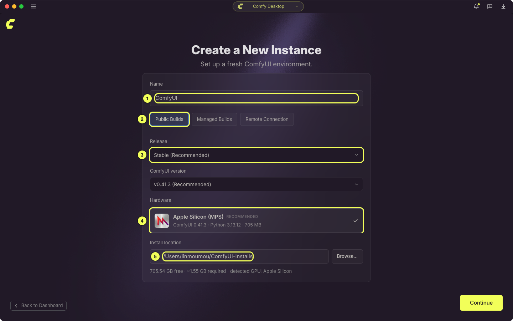
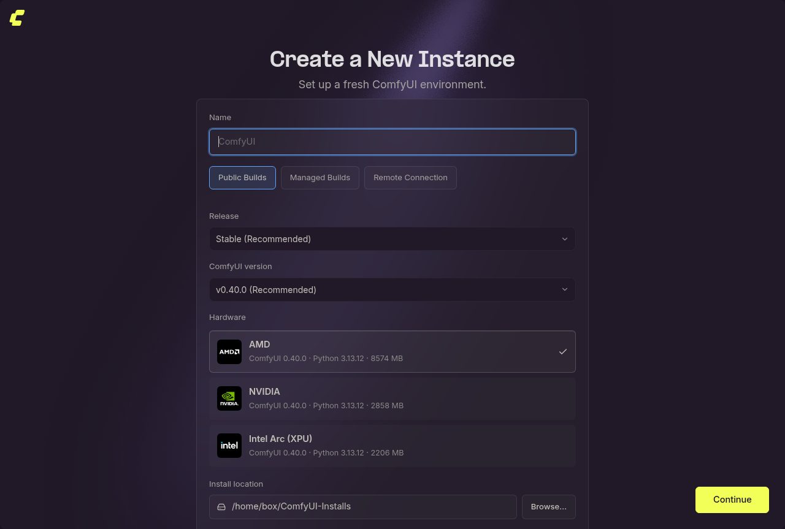
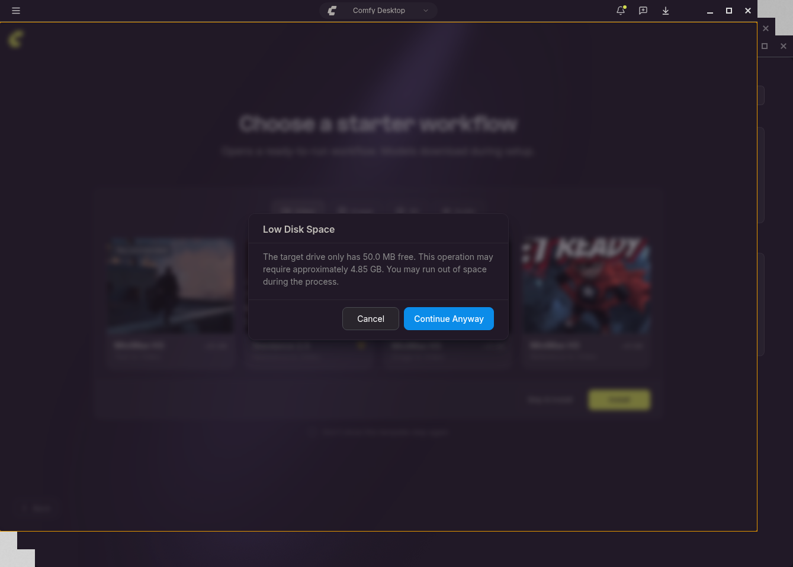
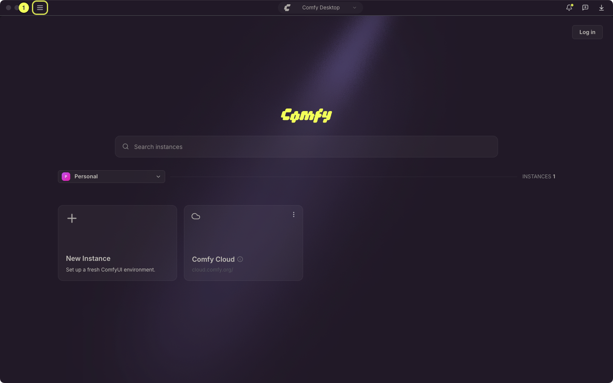
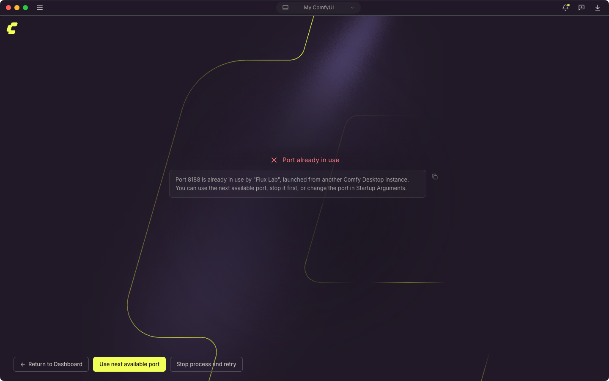
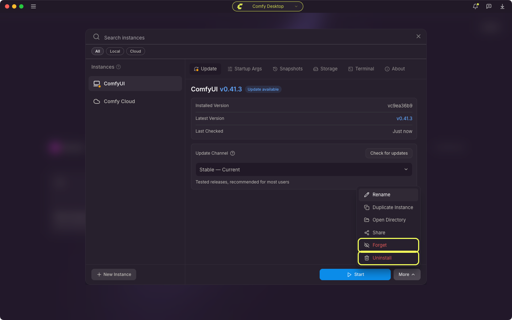

Mit Comfy Desktop können Sie mehrere ComfyUI-Instanzen in der Chooser-Ansicht verwalten.

### Instanztypen

Comfy Desktop unterstützt vier Instanztypen. Jeder Typ wird auf der zugehörigen Karte und in der Titelleiste angezeigt; **Tracked**-Instanzen verwenden dasselbe Symbol wie **Standalone**.

| Typ | Symbol | Beschreibung |
|------|------|-------------|
| **Standalone** | 💻 | Eine eigenständige ComfyUI-Instanz, die von Comfy Desktop erstellt wurde. Enthält ein mitgeliefertes Python, automatische Updates und vollständige Snapshot-Unterstützung. Dies ist die Standardeinstellung, wenn Sie auf **New Instance** klicken. |
| **Cloud** | ☁️ | Eine Comfy Cloud-Instanz. Erfordert ein Comfy Cloud-Konto. Cloud-Instanzen laufen auf den Servern von Comfy und werden separat abgerechnet. |
| **Remote** | 🌐 | Stellt eine Verbindung zu einer ComfyUI-Instanz her, die auf einem anderen Rechner in Ihrem Netzwerk läuft. Konfigurieren Sie den Remote-Host und den Port während der Einrichtung. |
| **Tracked** | 💻 | Verfolgt eine bestehende ComfyUI-Installation (Git-Clone oder portable Version). Verwendet dasselbe Symbol wie **Standalone**. Updates verwalten Sie manuell. Siehe [Eine bestehende Installation verfolgen](#bestehende-installation-einbinden). |

Die folgende Abbildung kennzeichnet die wichtigsten Aktionen, die für jede Instanzkarte verfügbar sind:

1. **New Instance**: Erstellen Sie eine völlig neue ComfyUI-Instanz. Siehe [Eine neue Instanz erstellen](#neue-instanz-erstellen). Sie können auch [eine Instanz aus einer Snapshot-Datei erstellen](/de/installation/desktop/usage/snapshots#instanz-aus-einer-snapshot-datei-erstellen).
2. **⋮-Menü**: Klicken Sie auf das Drei-Punkte-Symbol, um das Aktionsmenü für eine Instanz zu öffnen. Ein Rechtsklick auf die Karte öffnet dasselbe Menü.
3. **Manage**: Öffnen Sie das Manage-Panel, um die Instanz zu konfigurieren (Pfad, Startargumente, Modellverzeichnisse, Umgebungsvariablen). Siehe die Seite [Manage](/de/installation/desktop/usage/manage).
4. **Duplicate Instance**: Kopieren Sie eine Standalone-Installation mit ihrer eigenen Python-Umgebung und ihren eigenen Custom Nodes. Siehe [Eine Instanz duplizieren](#instanz-duplizieren).
5. **Show in Finder**, **Show in Explorer** oder **Show in Folder**: Öffnen Sie den Installationsordner in Ihrem Dateimanager. Der Name richtet sich nach Ihrem Betriebssystem.
6. **Export Snapshot**: Exportieren Sie den neuesten Snapshot der Instanz in eine Datei, die Sie weitergeben können. Siehe [Einen Snapshot teilen](/de/installation/desktop/usage/snapshots#snapshot-teilen).
7. **Restore Snapshot**: Setzen Sie die Instanz auf einen vorherigen Snapshot zurück. Siehe die Seite [Snapshots](/de/installation/desktop/usage/snapshots).
8. **Uninstall**: Löschen Sie die Instanz und alle ihre Dateien dauerhaft von der Festplatte. Siehe [Eine Instanz deinstallieren](#instanz-deinstallieren).

Das Menü listet außerdem Aktionen auf, die nur in bestimmten Zuständen erscheinen: **Stop**, während die Instanz läuft, **Update**, wenn eine neue ComfyUI-Version verfügbar ist, **Migrate to Standalone** für eine Installation, die Sie migrieren können, und **Create Build** für eine lokale Instanz, die Sie in einem Workspace veröffentlichen können. **Forget** ist nicht Teil dieses Menüs; es befindet sich im Manage-Panel, siehe [Eine Instanz deinstallieren](#instanz-deinstallieren).

## Neue Instanz erstellen

Klicken Sie in der Chooser-Ansicht auf die **+**-Karte (oben links), um eine neue ComfyUI-Instanz hinzuzufügen.

<Steps>
  <Step title="Neue Instanz erstellen">

<Tabs>
<Tab title="Windows">
    
  </Tab><Tab title="macOS">
    
  </Tab><Tab title="Linux">
    
  </Tab>
</Tabs>

1. **Name**: Der Name Ihrer Instanz. Der Standardwert ist „ComfyUI“.
2. **Public Builds**: Die empfohlene Option. Eine Standard-ComfyUI-Installation, die für Ihre erkannte Hardware gebaut ist. Wählen Sie **Managed Builds**, um stattdessen einen Build aus einem Ihrer Workspaces zu installieren (siehe [Workspaces und Builds](/de/installation/desktop/usage/workspaces-and-builds#einen-build-installieren)), oder **Remote Connection**, um sich mit einer ComfyUI-Instanz zu verbinden, die auf einem anderen Rechner läuft.
3. **Release**: Der Release-Kanal, der installiert wird. **Stable (Empfohlen)** ist vorausgewählt.
4. **Hardware**: Comfy Desktop erkennt Ihre GPU und wählt den passenden Build vor (NVIDIA, AMD, Intel Arc (XPU) oder CPU). Jede Option zeigt die ComfyUI-Version, die Python-Version und die Download-Größe.
5. **Installationsort**: Wo ComfyUI installiert wird. Unter Windows wird dringend empfohlen, eine **SSD** zu verwenden und das Stammverzeichnis von Laufwerk C: zu vermeiden. Das Feld zeigt den freien Speicherplatz auf dem Laufwerk und eine Schätzung der Installationsgröße, wenn Comfy Desktop sie kennt.

Wenn der freie Speicherplatz knapp aussieht, zeigt der Assistent einen Dialog **Wenig Speicherplatz**. Wählen Sie **Trotzdem fortfahren**, oder brechen Sie ab und wählen Sie einen anderen Pfad.

Comfy Desktop lehnt außerdem Ordner ab, in die es nicht installieren kann. Es prüft den Ordner, sobald Sie einen mit **Durchsuchen…** auswählen, erklärt das Problem unter **Installationsort** und lässt **Fortfahren** deaktiviert, bis der Ordner verwendet werden kann:

- **Innerhalb der eigenen Dateien von Comfy Desktop**: der Programmordner, seine mitgelieferten Ressourcen, sein Datenordner und unter Windows seine Updater-Caches. Diese Dateien werden beim Update der App ersetzt, eine Installation dort würde also gelöscht. Unter macOS betrifft das alles innerhalb des Comfy Desktop App-Bundles.
- **Innerhalb von OneDrive** (Windows): Die Cloud-Synchronisierung bremst eine große Python-Umgebung aus und kann Dateien während des Hochladens beschädigen.
- **Innerhalb eines gemeinsam genutzten Modell-, Eingabe- oder Ausgabeordners**: Eine Installation dort kann die Dateien beschädigen, die alle Instanzen gemeinsam nutzen. Siehe [Speicher](/de/installation/desktop/usage/settings#speicher).
- **Innerhalb des Ordners einer anderen Instanz**: Die beiden Installationen würden kollidieren und können Daten beschädigen.

Auf einem Rechner mit NVIDIA-GPU prüft der NVIDIA-Build zusätzlich die Treiberversion. Ist der erkannte Treiber älter als 580, zeigt Comfy Desktop einen Dialog **NVIDIA-Treiber aktualisieren** mit der erkannten Version und dem empfohlenen Minimum. **Trotzdem fortfahren** installiert mit dem aktuellen Treiber.

  </Step>
  <Step title="Wird installiert">

Comfy Desktop übernimmt den Rest. Der Fortschrittsbildschirm führt einen Stepper aus: Abgeschlossene Phasen erhalten ein Häkchen, die aktive Phase zeigt einen Spinner mit einer Live-Detailzeile (Prozentwert, Übertragungsgeschwindigkeit oder Dateiname), und die nächste Phase wartet darunter. Wenn die Installation abgeschlossen ist, läuft derselbe Stepper in den ersten Start über, sodass die Zeilen mit **ComfyUI wird gestartet** und den Startphasen weitergehen.

| Phase | Was sie macht |
|-------|--------------|
| **ComfyUI wird heruntergeladen** | Ruft das ComfyUI-Bundle für die von Ihnen ausgewählte Hardware ab. |
| **Installation wird entpackt** | Entpackt das Bundle in den Installationsordner. |
| **Umgebung einrichten** | Erstellt die eigene Python-Umgebung der Instanz und kopiert die vorgefertigten Pakete hinein, wodurch mehrere Gigabyte geschrieben werden. |
| **Umgebung bereinigen** | Entfernt Pakete, die die Instanz nicht benötigt, schreibt die Umgebungskonfiguration, ruft Versions-Tags ab und zeichnet den ersten Snapshot der Instanz auf. |
| **Auf neueste stabile Version aktualisieren** | Verschiebt ComfyUI in den von Ihnen gewählten Release-Kanal und installiert dessen Python-Anforderungen, was auf einem neuen Rechner eine Stunde oder länger dauern kann. |

Eine Installation, die aus einem Snapshot erstellt wurde, aktualisiert sich nicht automatisch, daher überspringt ihr Stepper die letzte Phase und zeigt stattdessen die beiden Wiederherstellungsphasen.

Wenn Sie eine Starter-Vorlage ausgewählt haben, werden deren Modelle während der oben genannten Phasen im Hintergrund heruntergeladen, die Installation wartet also nicht auf sie. Der Stepper endet dann mit **Vorlagen-Modelle werden heruntergeladen**, sobald ComfyUI gestartet ist, und diese Zeile bleibt stehen, bis die Dateien fertig sind. Wählen Sie auf diesem Bildschirm **Skip & open ComfyUI**, um die Instanz sofort zu öffnen; die Übertragung läuft in der [Download-Ablage](/de/installation/desktop/usage/downloads) weiter.

  </Step>
  <Step title="Vorlage auswählen">

Sobald die Installation abgeschlossen ist, öffnet Comfy Desktop die Vorlagenbibliothek, in der Sie eine Workflow-Vorlage zum Loslegen auswählen können.

Vorlagen, die Modelle herunterladen, benötigen genügend freien Speicherplatz für diese Dateien. Kann das Laufwerk die Modelle einer Vorlage nicht aufnehmen, blockiert der Assistent diese Auswahl. Wählen Sie eine leichtere Vorlage oder schaffen Sie Speicherplatz frei. Auf sehr kleinen Laufwerken kann der Vorlagen-Schritt ganz übersprungen werden.

  </Step>
</Steps>

## Bestehende Installation einbinden

Wenn Sie bereits eine ComfyUI-Installation haben (entweder manuell aus dem Git-Repository eingerichtet oder als portable Version heruntergeladen), können Sie sie zu Comfy Desktop hinzufügen, ohne eine neue zu erstellen.

Öffnen Sie das ☰-Menü in der Titelleiste und wählen Sie **Add Existing Instance**.

1. Die Schaltfläche **☰** oben links in der Titelleiste.
2. **Add Existing Instance**: Öffnet den Dialog, mit dem eine bestehende ComfyUI-Installation eingebunden wird.

### Ihre Installation erkennen

Klicken Sie im Dialog auf **Browse…** und wählen Sie den Installationsordner aus. Comfy Desktop prüft den Ordner und füllt den restlichen Dialog aus. Das Dropdown-Menü **Detected type** listet auf, was gefunden wurde:

- **Standalone**: Eine Comfy Desktop-Installation. Die Prüfung sucht nach einem Verzeichnis `standalone-env` und nach `ComfyUI/main.py`.
- **Portable**: Ein portabler Windows-Build. Die Prüfung sucht nach `python_embeded`, entweder im ausgewählten Ordner oder in einem Ordner direkt darin.
- **Git Clone**: Ein Klon des ComfyUI-Repositorys. Die Prüfung sucht nach einem `.git`-Verzeichnis.
- **Legacy Desktop**: Eine Installation der älteren ComfyUI Desktop-App, erkennbar an ihren Verzeichnissen `models/`, `user/` und `.venv`. Siehe [Von Legacy Desktop migrieren](/de/installation/desktop/usage/migrate).

Wenn die Prüfung nichts findet, zeigt das Dropdown-Menü **No known install detected** an. Wählen Sie den Ordner aus, der die Installation selbst enthält, nicht einen übergeordneten oder fremden Ordner.

### Erkannte Installation bestätigen

Nachdem die Prüfung abgeschlossen ist, zeigt der Dialog das Gefundene an. Prüfen Sie die Pfade, bevor Sie die Installation einbinden.

- **Install location**: Der ausgewählte Ordner. Klicken Sie auf den Pfad, um ihn zu öffnen, oder auf **Browse…**, um einen anderen auszuwählen. Bei einem portablen Build zeigen Sie auf den Ordner, der `python_embeded` enthält.
- **Name**: Wie die Instanz in der Auswahl (Chooser) aufgeführt wird. Der Dialog schlägt einen Namen vor.
- **Detected type**: Welche Art von Installation der Ordner enthält.
- **Version**, **Repository** und **Branch**: Werden für einen Git-Klon angezeigt.
- **Virtual Environment**: Wird für einen Git-Klon angezeigt, wenn Comfy Desktop eine findet, in `.venv`, `venv`, `.env` oder `env` mit einer darin enthaltenen Datei `pyvenv.cfg`. Mit **Browse…** verweisen Sie die Instanz auf eine andere Umgebung.

Klicken Sie auf **Track Install**, um die Instanz hinzuzufügen. Es werden keine Dateien verschoben oder kopiert.

### Eingebundene versus Standalone-Installation

Der entscheidende Unterschied zwischen einer **eingebundenen** Installation (Add Existing Instance) und einer **Standalone**-Installation ist, wie Updates verwaltet werden:

| Aspekt | Eingebunden (bestehend) | Standalone |
|--------|-------------------|------------|
| **Updates** | Keine automatischen Updates: Bei einem Git-Klon ziehen Sie selbst und installieren neu, ein portabler Build wird durch einen neueren ersetzt | Integrierte automatische Updates |
| **Python** | Verwendet eine vorhandene Python-Umgebung (`.venv`, `python_embeded` usw.) | Mitgeliefertes Python, automatische Verwaltung der Abhängigkeiten |
| **Isolation** | Teilt den vorhandenen Pfad und die vorhandene Umgebung | Vollständig eigenständige, isolierte Installation |
| **Snapshots** | Nicht unterstützt | Snapshot-Unterstützung verfügbar |
| **Use case** | ComfyUI ist bereits eingerichtet und angepasst | Neuinstallation von Grund auf |

> **Hinweis:** Comfy Desktop führt eine eingebundene Installation mit ihrer vorhandenen Python-Umgebung aus, installiert ComfyUI nicht neu und verwaltet auch dessen Pakete nicht. Snapshots werden nur für Standalone-Instanzen aufgenommen.

## Launching, Stopping, and Restarting an Instance

[↩ Back to overview](#overview)

### Launching an Instance

Click an instance card in the Chooser to launch it. While ComfyUI starts, the window shows the startup progress, then the ComfyUI interface once the server is ready.

### Launching While Another Instance Is Running

When you launch a local instance while another local instance is running or starting, Comfy Desktop shows an **An instance is already running** dialog that lists the instances it would stop:

- **Close & Launch**: stops the listed instances, then launches the one you picked.
- **Run All**: launches the new instance alongside the running ones.

Dismiss the dialog to cancel the launch. Restarting an instance never shows this dialog. To stop seeing it, turn off **Warn before running multiple instances** in [Desktop Settings → Preferences](/de/installation/desktop/usage/settings#preferences).

### When the Port Is Already in Use

ComfyUI listens on port 8188 unless the instance passes `--port`. Before it starts ComfyUI, Comfy Desktop checks that port, and the instance's **If Port is Busy** setting on the [Startup Args tab](/de/installation/desktop/usage/manage#startup-args-tab) decides what happens when something else already uses it:

- **Use next available port (asks if `--port` is set)**, which is the default: Comfy Desktop starts ComfyUI on the next free port and says so in the startup progress. A busy port only stops the launch when the holder is a ComfyUI of this installation, see below.
- **Ask what to do**: the launch stops on **Port already in use**, which names what holds the port, and you choose the next step.

Setting `--port` in **Startup Arguments** also makes Comfy Desktop ask, even with the default setting, because that port was requested on purpose.

The message names what holds the port:

- **Another Comfy Desktop instance**: the message names that instance.
- **A ComfyUI**: the message says it looks like a ComfyUI instance, including one you started outside Comfy Desktop.
- **Any other program**: the message names the process, and Comfy Desktop does not offer to stop it.

The actions on that screen:

- **Use next available port**: launches this instance on the next free port instead.
- **Stop process and retry**: force-stops the process that holds the port, then launches again. It appears only when the holder looks like a ComfyUI, and the confirmation warns that unsaved work in that ComfyUI is lost.
- **Return to Dashboard**: cancels the launch.

If Comfy Desktop can tell that the holder is a ComfyUI of the same installation, for example one you started by hand in a terminal, it stops instead of offering another port, because a second copy would use the same database. Stop that copy, close the app that started it, or select **Stop process and retry**, then launch again. Comfy Desktop runs this check when the launch enables the asset system: it adds `--enable-assets` for ComfyUI 0.38.0 and later, unless the instance's startup arguments pass `--disable-assets`.

#### A ComfyUI Left Behind by an Earlier Session

Before the port check, Comfy Desktop looks for a ComfyUI of the same installation that an earlier Comfy Desktop session left running. That process still holds the installation's database, so a new ComfyUI would fail to start.

- **Still working on a prompt**: the launch stops and says so. **Stop it and launch** stops that ComfyUI and cancels the prompts it is working on. Letting it keep running cancels this launch.
- **Processes that no longer answer on the port**: the message names their PIDs and offers **Stop them and launch**.
- **A process that will not exit**: the message asks you to end it manually, then launch again.

### Stopping an Instance

Select **Stop** from the instance card's ⋮ menu. The ComfyUI server stops and the window stays open with a **ComfyUI is stopped** card. Select **Relaunch ComfyUI** to start the server again, or **Return to Dashboard** to go back to the Chooser.

### Restarting After a Crash

If ComfyUI fails to start or exits unexpectedly, the window stays open with a card describing what happened:

- **ComfyUI could not start**: the instance did not start.
- **ComfyUI exited unexpectedly**: the process stopped. When Comfy Desktop can read it, the card also shows the exit code, or the signal that ended the process.

On Windows, a crash can report a memory access violation and note that some Microsoft Visual C++ Redistributable files appear to be missing. Expand the card's logs for details, then select **Restart ComfyUI** to launch again, or **Back** to return to the dashboard.

If ComfyUI stops because it cannot open the asset database it keeps inside the installation, the error it stops with explains the reason instead of only reporting an exit code:

- **Another ComfyUI is using this installation's database**: close that ComfyUI (or the app that started it), or give one of them its own database location with the `--database-url` startup argument.
- **Any other database failure**, from one locked by another program to one written by a newer version of ComfyUI or impossible to create in that folder: the message names the file and the fix, and ends with the option to start the instance without the asset system, by adding `--disable-assets` to its startup arguments.

## Instanz deinstallieren

[↩ Zurück zur Übersicht](#overview)

Wenn Sie eine Instanz entfernen möchten, entscheiden zwei Aktionen darüber, ob ihre Dateien auf der Festplatte bleiben.

1. **Forget**: Entfernt die Instanz aus der App, ohne etwas zu löschen. Der Installationsordner und alle seine Daten bleiben auf der Festplatte. Verwenden Sie diese Aktion, wenn Sie nur die Liste bereinigen möchten, die Instanz aber später möglicherweise erneut benötigen.
2. **Uninstall**: Entfernt die Installation und alle ihre Dateien dauerhaft von der Festplatte. Modelldateien in gemeinsamen Verzeichnissen sind nicht betroffen.

**Uninstall** befindet sich auch im ⋮-Menü der Instanzkarte. **Forget** ist nicht Teil dieses Menüs; Sie finden es im Manage-Panel, im **More**-Menü am unteren Rand des Panels. Eine Installation, die Comfy Desktop übernommen hat, etwa eine aus Legacy Desktop migrierte, hat keine **Forget**-Aktion.

## Instanz duplizieren

[↩ Zurück zur Übersicht](#overview)

Sie können eine vorhandene eigenständige Installation duplizieren. Öffnen Sie das ⋮-Menü der Karte und wählen Sie **Duplicate Instance** aus, oder verwenden Sie **Duplicate Instance** im Menü **More** des Bereichs Verwalten. Die Kopie erhält:

- Eine neue Python-Umgebung
- Dieselbe ComfyUI-Version
- Eine eigene Einrichtung für Custom Nodes

Geben Sie bei Aufforderung einen Namen für das Duplikat ein. Die Kopie wird neben dem Original erstellt. Cloud-, Remote- und überwachte Installationen können nicht dupliziert werden.

## Instanz bearbeiten

[↩ Zurück zur Übersicht](#overview)

Im Panel **Verwalten** für eine Instanz können Sie:

- den Installationspfad ändern
- Startargumente anpassen
- Modellverzeichnisse ändern
- Umgebungsvariablen aktualisieren
- die Instanz umbenennen, über den Namen oben im Tab **Über** oder über **Umbenennen** im Menü **Mehr**
- die Verbindungsadresse einer Remote-Verbindung im Tab **Über** ändern

Öffnen Sie das Panel **Verwalten**, indem Sie mit der rechten Maustaste auf die Instanzkarte klicken (oder **Verwalten** im Menü ⋮ auswählen).

## Fehlerzustand

Wenn bei einer Installation ein Problem auftritt, wird auf der Karte der Installation ein **Error**-Badge angezeigt. Wählen Sie das Badge aus, um die Details zu lesen: die Meldung, den Exit-Code oder das Signal, sofern Comfy Desktop eines davon bereitstellt, sowie die letzten Zeilen der Fehlerausgabe. Durch Starten oder Neustarten der Instanz wird das Badge entfernt. Wenn das Problem erneut auftritt, prüfen Sie die Protokolle unter [Speicherorte](/de/installation/desktop/usage/settings#speicherorte).
