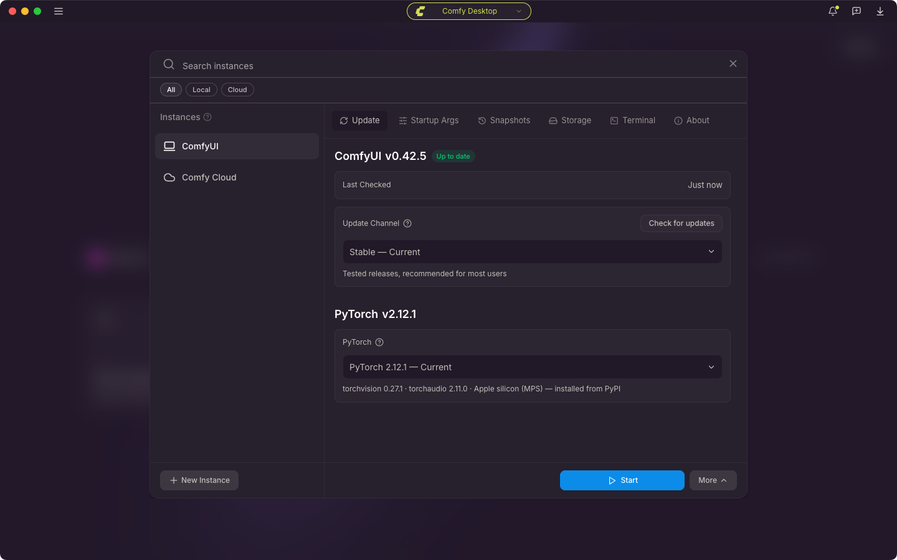
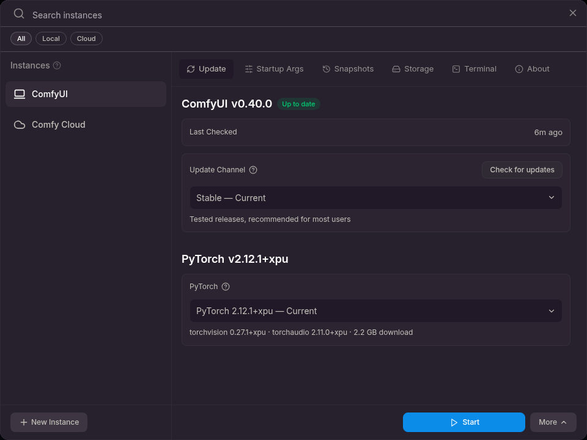
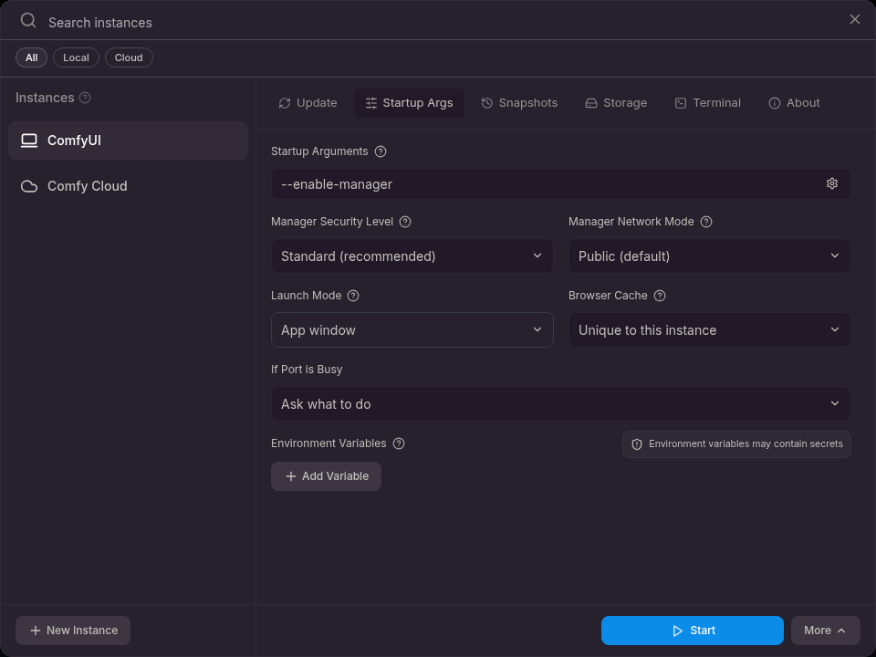
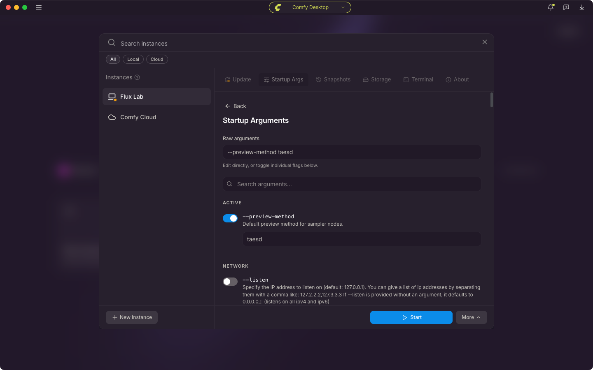
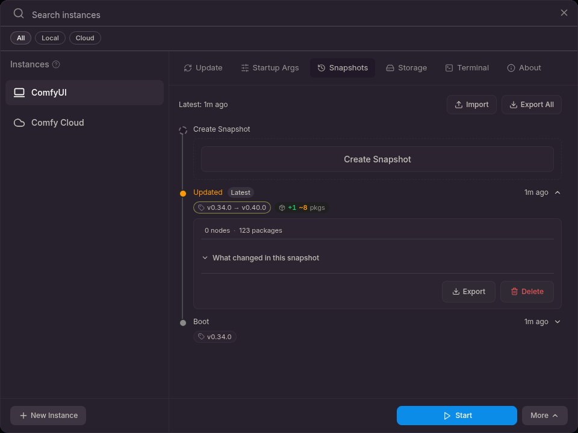
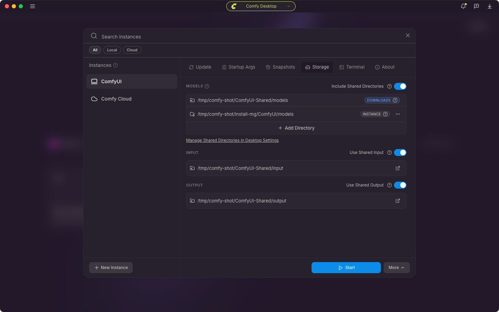
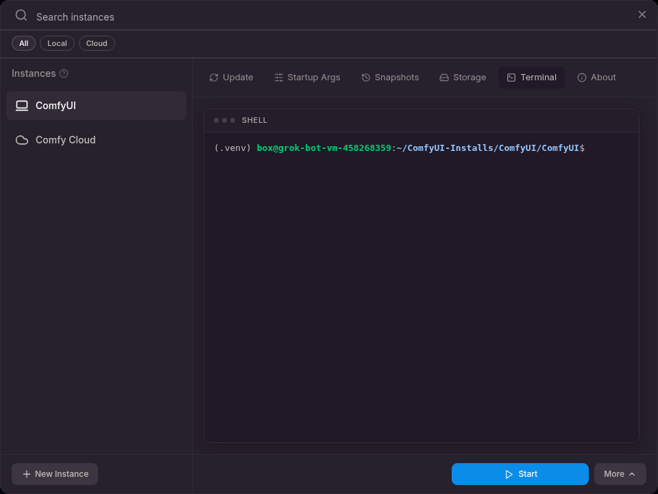
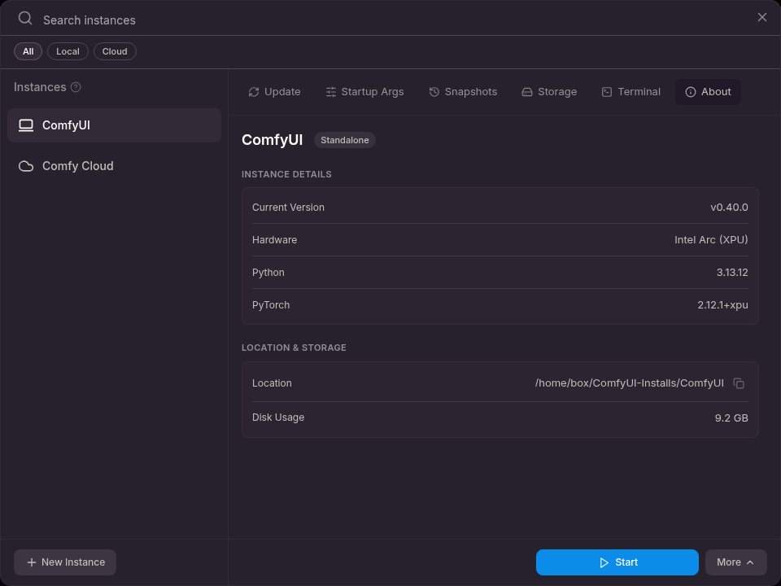
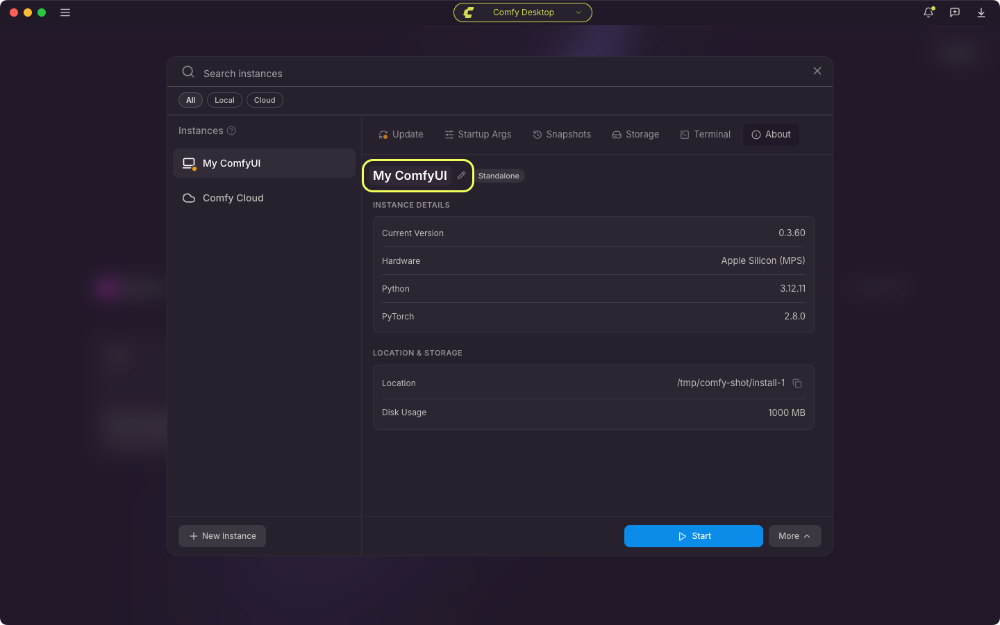
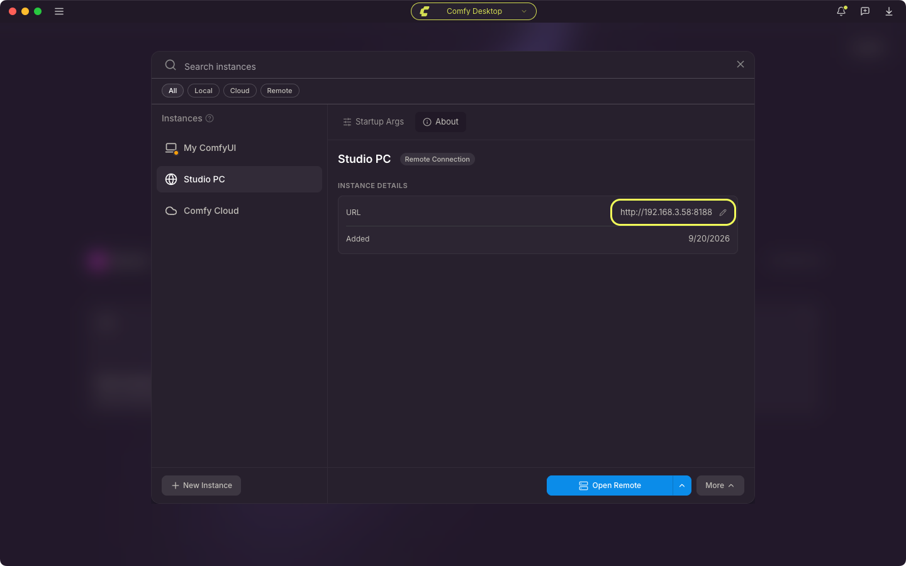

## Das Panel „Verwalten“

Der Inhalt des Panels „Verwalten“ hängt vom Instanztyp ab. Die Screenshots auf dieser Seite zeigen eine **lokale Standalone-Installation**. Cloud- und Remote-Instanzen haben weniger Tabs und Einstellungen.

Um es zu öffnen, wechseln Sie zur **Chooser**-Ansicht (dem Startbildschirm, der Ihre Instanzen auflistet), klicken Sie auf einer Instanzkarte auf das Symbol ⋮ und wählen Sie dann **Verwalten**.

Das Panel hat sechs Tabs: **Aktualisieren**, **Startup Args**, **Snapshots**, **Storage**, **Terminal** und **Über**.

### Tab „Aktualisieren“ {#update-tab}

Der Tab enthält eine Karte für ComfyUI und eine für PyTorch. Beide funktionieren gleich: Eine Überschrift zeigt, worauf Sie sich befinden, die Dropdowns wählen den Kanal oder den Torch-Stack, und die Schaltflächen unter der Karte wirken auf diese Auswahl.

#### ComfyUI

Die Überschrift ist die ComfyUI-Version, mit dem Badge **Auf dem neuesten Stand**, solange der ausgewählte Kanal nichts Neueres hat. Sobald eine neuere Version existiert, zeigt die Überschrift diese Version mit dem Badge **Update verfügbar**, und die Karte ergänzt eine Zeile **Installierte Version** und eine Zeile **Neueste Version**. **Zuletzt geprüft** zeigt, wie lange Comfy Desktop zuletzt nachgesehen hat; fahren Sie mit der Maus darüber, um die genaue Zeit zu sehen.

- **Update-Kanal**: **Stable** (getestete Releases, der Standard) oder **Latest on GitHub** (neueste Commits aus der master-Verzweigung). Das Dropdown markiert den Kanal, auf dem die Instanz ist, mit **Current**.
- **Nach Updates suchen**: erscheint, solange der ausgewählte Kanal nichts Neueres hat, und prüft sofort erneut. Comfy Desktop führt diese Prüfung auch selbstständig aus, siehe [die FAQ](/de/installation/desktop/faq#allgemeine-fragen).
- **Jetzt aktualisieren**: erscheint, solange der ausgewählte Kanal etwas Neueres hat. Die Bestätigung zeigt die Versionen, zwischen denen gewechselt wird, oder den Kanal, zu dem gewechselt wird, enthält alle Release Notes, die der Kanal veröffentlicht, und verweist auf den Tab „Snapshots“, weil Comfy Desktop vor dem Update einen Snapshot speichert. Wenn die neue Version einen Custom Node beschädigt, stellen Sie den vorherigen Zustand von dort wieder her.
- **Kopieren & Aktualisieren**: erstellt eine Kopie der Instanz, aktualisiert die Kopie und lässt das Original unangetastet. Verwenden Sie es, um eine neue Version mit dem Node-Set zu testen, das Sie bereits haben.
- **Kanal wechseln**: erscheint, wenn Sie einen Kanal auswählen, der nichts Neueres zu installieren hat, und verschiebt die Instanz auf diesen Kanal, ohne sie zu aktualisieren.

Die Auswahl von **Stable** auf einer Instanz, die dem Stable-Release voraus ist, ist ein Rollback: Die Bestätigung sagt das, und die neueren Commits werden entfernt.

#### PyTorch

Die Karte zeigt den installierten Torch-Build und listet die offiziellen Stacks, die Comfy Desktop für diese Instanz installieren kann. Wenn der Katalog mehrere Backends umfasst, wählt ein zweites Dropdown zuerst das Backend (**CUDA 13.0**, **CUDA 12.8** und so weiter, dazu **ROCm**, **Intel XPU** und **CPU**). Jede Option listet ihre torchvision- und torchaudio-Versionen und, wenn der Stack als Bundle ausgeliefert wird, ihre Downloadgröße. Sie warnt außerdem, wenn dem Stack torchaudio fehlt, weil der Wechsel es entfernt und Custom Nodes, die es benötigen, nicht mehr funktionieren.

- **PyTorch wechseln**: stellt diese Instanz auf den ausgewählten Stack um. Die Bestätigung zeigt den Download, und Comfy Desktop sichert die aktuelle Umgebung während des Wechsels und stellt sie wieder her, wenn etwas fehlschlägt.
- **Kopieren & PyTorch wechseln**: führt denselben Wechsel auf einer neuen Kopie der Instanz aus und lässt das Original unverändert.

Nightly-Builds sind als instabil markiert. Die Auswahl bietet sie etwa 45 Tage nach ihrem Wheel-Datum an, also weniger als die rund 60 Tage, nach denen PyTorch ein datiertes Nightly aus seinem Index entfernt.

### Tab „Startup Args“ {#startup-args-tab}

Konfigurieren Sie Startup-CLI-Argumente, die Manager-Richtlinie, den Startmodus, die gemeinsame Nutzung des Browsercaches, das Verhalten bei Portkonflikten und Umgebungsvariablen.

- **Startup Arguments**: Benutzerdefinierte CLI-Argumente für ComfyUI (z. B. `--listen`). Klicken Sie auf das Zahnradsymbol, um kategorisierte Flags anzuzeigen. Wenn Beta-Funktionen aktiviert sind, listet eine **+N beta**-Kennzeichnung neben dem Feld die Beta-Argumente auf, die Comfy Desktop für die laufende Sitzung hinzugefügt hat, oder diejenigen, die beim nächsten Start infrage kommen.
- **Manager Security Level**: Legt fest, welche Node-Pakete ComfyUI-Manager für diese Instanz installieren kann. Wird beim nächsten Start angewendet.
  - **Strict**: Blockiert alle Installationen, Aktualisierungen und Deinstallationen von Node-Paketen. Manager ist schreibgeschützt.
  - **Standard (recommended)**: Erlaubt registrierte Node-Pakete. Blockiert Installationen aus nicht registrierten Quellen (zum Beispiel beliebige Git-URLs).
  - **Relaxed**: Wie Standard, erlaubt aber zusätzlich Installationen aus nicht registrierten Quellen, solange ComfyUI nur von diesem Rechner aus erreichbar ist. `--listen` blockiert sie wieder.
  - **Permissive**: Erlaubt jede Risikostufe. Wenn ComfyUI über `--listen` erreichbar gemacht wird, erfordern Installationen weiterhin den Netzwerkmodus **Personal cloud**.
- **Manager Network Mode**: Wie Manager mit der Node-Registry kommuniziert.
  - **Public (default)**: Verwendet die öffentliche Registry. `--listen` blockiert Installationen von Node-Paketen auf jeder Sicherheitsstufe.
  - **Private**: Verwendet eine private Node-Datenbank, die Sie selbst konfigurieren.
  - **Offline**: Kein externes Netzwerk. Downloads sind nicht verfügbar.
  - **Personal cloud**: Behandelt diesen Rechner als vertrauenswürdigen Remote-Rechner und hebt die Installationssperre von `--listen` auf. Die gewählte Sicherheitsstufe gilt weiterhin. Verwenden Sie dies nur auf einem Rechner, den Sie kontrollieren.
- **Launch Mode**: **App window** (eingebettet) oder **Console only** (kein App-Fenster; ComfyUI läuft als Konsolenprozess).
- **Browser Cache**: **Unique to this instance** oder **Shared**.
- **If Port is Busy**: **Ask what to do** oder **Use next available port (asks if --port is set)**.
- **Environment Variables**: Fügen Sie benutzerdefinierte Umgebungsvariablen mit der Schaltfläche **+ Add Variable** hinzu. Werte für Schlüssel, die wie Anmeldedaten aussehen (zum Beispiel `HF_TOKEN`), werden maskiert, bis Sie sie einblenden, und doppelte Schlüssel werden markiert. Comfy Desktop speichert diese Werte unverschlüsselt, daher sollten echte Geheimnisse nicht in dieser Liste stehen.

#### Startup-Argumente mit der Auswahl erstellen

Klicken Sie auf das Zahnradsymbol neben **Startup Arguments**, um die Flag-Auswahl zu öffnen. Aktivieren oder deaktivieren Sie kategorisierte Flags oder bearbeiten Sie **Raw arguments**; beides aktualisiert dieselbe CLI-Zeichenfolge für diese Instanz.

Nicht erkannte Flags verbleiben im Feld; der Launcher verwirft diejenigen, die dem Schema der Installation unbekannt sind, übergibt weiterhin ausgeblendete unterstützte Flags (zum Beispiel `--feature-flag`) und übergibt Argumente ungefiltert, wenn die Schemaerkennung fehlschlägt. Änderungen werden beim nächsten Start angewendet (**Restart to apply**, während die Instanz läuft).

<CardGroup cols={1}>
  <Card title="Startup-Flags-Referenz" icon="book-open" href="/de/development/comfyui-server/startup-flags">
    Sehen Sie sich die vollständige Liste der ComfyUI-Startup-Flags an, die für Startup Arguments verfügbar sind.
  </Card>
</CardGroup>

### Tab „Snapshots“ {#snapshots-tab}

Snapshots anzeigen, importieren, exportieren und erstellen. Jeder Eintrag zeigt Versionsänderungen und Paketstatistiken.

- **Timeline**: Listet alle Snapshots chronologisch mit Versionsänderungen und Statistiken auf.
- **Latest**: Zeigt an, wann der neueste Snapshot erstellt wurde.
- **Import**: Importiert einen Snapshot aus einer Datei.
- **Export All**: Exportiert alle Snapshots als Backup.
- **Create Snapshot**: Erstellt jederzeit manuell einen neuen Snapshot.
- Jeder Snapshot-Eintrag zeigt:
  - Versionsänderung (z. B. `v0.20.1 → v0.24.1`)
  - Paketänderungen
  - Anzahl der Nodes und Pakete
  - Schaltflächen **Export** und **Delete**

<CardGroup cols={1}>
  <Card title="Umfassende Snapshot-Verwaltung" icon="camera" href="/de/installation/desktop/usage/snapshots">
    Erfahren Sie mehr über automatische Snapshots, den Vergleich und die vollständige Snapshot-Verwaltung.
  </Card>
</CardGroup>

### Speicher-Tab {#storage-tab}

Legen Sie fest, ob diese Instanz die global geteilten Ordner verwendet, und fügen Sie zusätzliche Modellverzeichnisse hinzu, die nur für diese Instanz gelten.

- **Include Shared Directories**: Schalten Sie um, ob diese Instanz die global geteilten Modellverzeichnisse aus [Desktop-Einstellungen → Speicher](/de/installation/desktop/usage/settings#storage) durchsucht.
- **Use Shared Input Folder**: Wenn aktiviert, liest diese Instanz Eingabedateien aus dem global geteilten Eingabeordner. Deaktivieren Sie die Option, um den eigenen Eingabeordner dieser Instanz zu verwenden.
- **Use Shared Output Folder**: Wenn aktiviert, schreibt diese Instanz generierte Ausgänge in den global geteilten Ausgabeordner. Deaktivieren Sie die Option, um den eigenen Ausgabeordner dieser Instanz zu verwenden.
- **Model Directories**: Zusätzliche Modellverzeichnisse nur für diese Instanz, die zusätzlich zu den geteilten Modellverzeichnissen durchsucht werden.
- **Input Directory** / **Output Directory**: Die eigenen Ordner dieser Instanz, wenn die obigen Schalter für geteilte Ordner ausgeschaltet sind.

### Terminal-Tab {#terminal-tab}

Eine interaktive Shell im Ordner dieser Instanz. Sie funktioniert unabhängig davon, ob ComfyUI läuft oder gestoppt ist.

- Verwenden Sie sie, um Startprotokolle, Fehler und Python-Ausgaben zu prüfen.
- Kopieren, Einfügen und Alles auswählen folgen den Tastenkürzeln des Betriebssystems. Ein Rechtsklick auf das Terminal führt dieselben Aktionen aus.

### Tab „Über“ {#about-tab}

Der Tab „Über“ sammelt, was Comfy Desktop über die Instanz weiß. Ein Pfad öffnet sich in Ihrem Dateimanager, wenn Sie darauf klicken, und die Kopieren-Schaltfläche daneben kopiert den Pfad.

Die Fakten sind in Gruppen zusammengefasst, und eine Gruppe erscheint nur, wenn sie etwas anzuzeigen hat:

- **Instanzdetails**: ComfyUI-Version, Hardware sowie die Versionen von Python und PyTorch. Bei einer Remote Connection enthält diese Gruppe die Verbindungs-URL und das Datum, an dem die Verbindung hinzugefügt wurde.
- **Laufzeitdetails**: der Port, auf dem ComfyUI lauscht. Er erscheint, solange die Instanz läuft.
- **Speicherort & Speicher**: der vollständige Installationspfad auf der Festplatte und wie viel Speicherplatz die Installation belegt. Nur eine lokale Installation speichert Dateien auf diesem Rechner, daher haben Cloud und Remote Connections keine solche Gruppe.
- **Herkunft**: die Instanz, von der diese kopiert wurde, und wann. Sie erscheint bei einer Instanz, die aus **Duplicate Instance** stammt, aus einer Kopie mit geänderter Version oder geändertem PyTorch, aus einer Migration von Legacy Desktop oder aus einer Übernahme an Ort und Stelle.

#### Instanz umbenennen

Klicken Sie oben im Tab „Über“ auf den Instanznamen, geben Sie den neuen Namen ein und drücken Sie dann Enter oder klicken Sie an eine andere Stelle. Beim Darüberfahren mit der Maus erscheint ein Bleistift, der den Cursor in dasselbe Feld setzt. Esc bricht die Bearbeitung ab und behält den alten Namen, und ein leerer Name oder der Name, den die Instanz bereits hat, ändert nichts.

Das **More**-Menü des Verwalten-Panels bietet dieselbe Aktion als **Rename**, die einen Dialog **Rename Instance** mit einem Feld **Name** öffnet.

Comfy Desktop lehnt einen Namen ab, den eine andere Instanz bereits verwendet, und die Meldung fordert Sie auf, einen anderen zu wählen. Ein Comfy Cloud-Eintrag behält seinen Namen und hat keinen Bleistift; lokale, Remote- und getrackte Instanzen können umbenannt werden.

#### URL einer Remote Connection ändern

Die Adresse einer Remote Connection ist die Zeile **URL** im Tab „Über“. Klicken Sie auf die URL oder auf den Bleistift daneben, geben Sie die neue Adresse ein und drücken Sie Enter oder klicken Sie an eine andere Stelle. Eine Adresse ohne Schema wird als `http://` gelesen, und ein abschließender Schrägstrich wird beim Speichern der Adresse entfernt.

Solange die Instanz verbunden ist, wird eine geänderte URL erst beim nächsten Start wirksam: Die Zeile zeigt **Restart to apply**, bis Sie die Instanz neu starten, und die laufende Sitzung behält die alte Adresse. Eine Adresse, die Comfy Desktop nicht lesen kann, wird nicht gespeichert, und die Zeile kehrt zum vorherigen Wert zurück.

## Installationsaktionen

Klicken Sie mit der rechten Maustaste auf eine Installationskarte (oder klicken Sie auf das ⋮-Symbol), um die Aktionen aufzurufen. Eine vollständige Liste aller Aktionen finden Sie auf der Seite [Instance Management](/de/installation/desktop/usage/instance-management).
