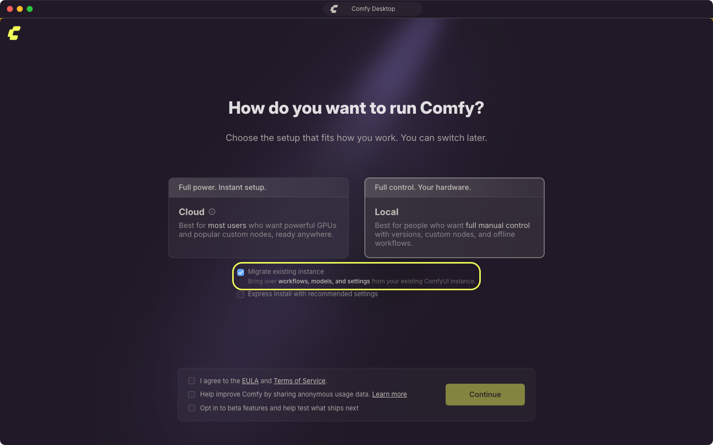
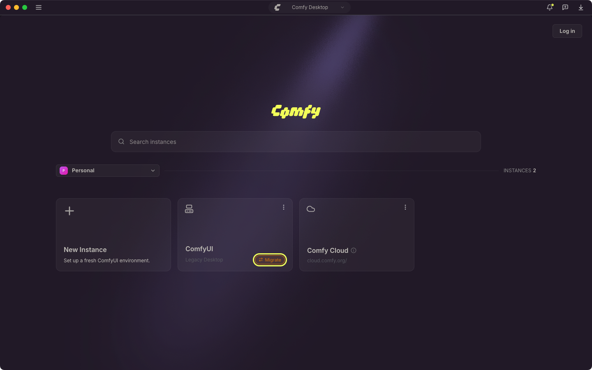
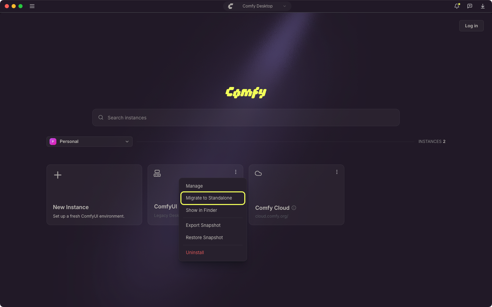
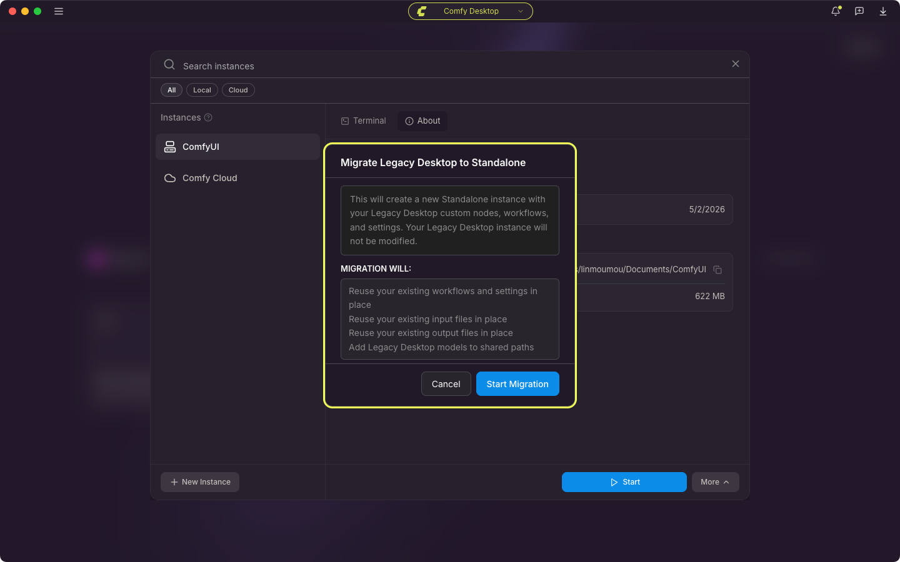

<Info>
Diese Seite behandelt die Migration von **Legacy Desktop** (der vorherigen Desktop-App mit Einzelinstallation). Wenn Sie die App zum ersten Mal verwenden, können Sie diesen Abschnitt überspringen.
</Info>

<CardGroup cols={1}>
  <Card title="Suchen Sie eine andere Installation?" icon="compass" href="/de/installation/desktop/usage/instance-management#tracking-an-existing-installation">
    Wenn Sie bereits eine ComfyUI-Installation haben (portable Version, manueller git clone usw.) und diese zu Comfy Desktop hinzufügen möchten, lesen Sie **Eine bestehende Installation verfolgen** in der Instanzverwaltung.
  </Card>
</CardGroup>

Wenn Legacy Desktop bereits installiert ist, kann Comfy Desktop diese erkennen und migrieren. Dabei wird in der Chooser-Ansicht eine neue Standalone-Installation erstellt.

## Was migriert wird

Legacy Desktop war eine App mit einer einzigen Installation. Comfy Desktop ist ein Verwalter für mehrere Installationen. Bei der Migration gilt:

- **Workflows und Einstellungen**: werden an Ort und Stelle weiterverwendet, sodass die neue Instanz dieselben Benutzerdaten behält.
- **Custom Nodes**: bleiben in Ihrem bestehenden Ordner `custom_nodes` erhalten. Die migrierte Instanz verwendet Ihren Legacy-Desktop-Datenordner als Basisverzeichnis, lädt also dieselben Nodes, und ihre Pakete verbleiben in der Python-Umgebung, die weiterverwendet wird.
- **Modelle**: Ihr bestehender Modellordner wird den gemeinsamen Modellverzeichnissen hinzugefügt, sodass jede Instanz diese Dateien dort lesen kann, wo sie bereits liegen.
- **Eingabedateien und Ausgänge**: werden an Ort und Stelle aus den bestehenden Ordnern weiterverwendet.
- **Python-Umgebung**: Ihre bestehende Umgebung wird geprüft und anschließend weiterverwendet. Comfy Desktop stellt sicher, dass torch importiert werden kann, und installiert dann die Anforderungen von ComfyUI darin, ohne Ihre PyTorch-Pakete zu ersetzen.
- **ComfyUI-Version**: Die ComfyUI-Quelle wird in ein neues verwaltetes Verzeichnis übernommen, sodass Comfy Desktop von da an die Updates verwaltet.

Die Migration verwendet Ihren Legacy-Desktop-Datenordner und die Python-Umgebung an Ort und Stelle weiter, statt sie zu kopieren. Sie erhalten also ein funktionierendes Setup statt einer zweiten Kopie. Wenn Sie eine unveränderte Kopie Ihres Legacy-Desktop-Setups benötigen, sichern Sie es vor der Migration selbst.

## Was die Migration sichert

Bevor Comfy Desktop etwas ändert, kopiert es die Einstellungsdateien von Legacy Desktop in einen datierten Ordner innerhalb des Legacy-Konfigurationsordners:

- macOS: `~/Library/Application Support/ComfyUI/legacy-backup/<timestamp>/`
- Windows: `%APPDATA%\ComfyUI\legacy-backup\<timestamp>\`

Jede Datei wird nur kopiert, wenn sie vorhanden ist:

- `config.json`: die Einstellungen der Legacy Desktop-App, einschließlich des verwendeten Datenordners.
- `comfy.settings.json`: die in Ihrem Legacy-Benutzerordner gespeicherten Einstellungen des ComfyUI-Frontends.
- `extra_models_config.yaml`: alle zusätzlichen Modellpfade, die Sie in Legacy Desktop konfiguriert haben.
- `window.json`: die gespeicherte Fenstergröße und -position.

Die Sicherung enthält ausschließlich Einstellungen. Modelle, Workflows, Custom Nodes, Eingabedateien und Ausgaben werden nicht hineinkopiert, da die migrierte Instanz sie weiterhin an ihrem jeweiligen Ort verwendet. Die Migration schreibt außerdem einen Snapshot der Legacy-Umgebung mit ihren Custom Nodes und installierten Paketen nach `.snapshots/` in Ihrem Legacy-Datenordner.

Wenn eine Datei nicht kopiert werden kann, vermerkt die Migration dies im Protokoll und setzt den Vorgang fort, sodass eine fehlgeschlagene Sicherung die Migration nicht stoppt.

## Was während der Migration geschieht

Die Migration zeigt einen eigenen Fortschrittsbildschirm an und durchläuft diese Schritte:

1. **Legacy-Status sichern**
2. **Ordnerzugriff prüfen** (nur macOS)
3. **Python-Umgebung validieren**
4. **Snapshot aufnehmen**
5. **Installationsordner zuweisen**
6. **ComfyUI-Quellcode bereitstellen**
7. **Anforderungen installieren**
8. **Einstellungen übernehmen**
9. **Installation registrieren**

Ein Schritt kann anhalten und auf eine Antwort warten:

- **Ordnerzugriff erforderlich** (macOS): macOS hat den Zugriff auf den Ordner „Legacy Desktop“ blockiert. Erteilen Sie Comfy Desktop in den Systemeinstellungen unter Datenschutz & Sicherheit den Festplattenvollzugriff und starten Sie die Migration anschließend erneut.
- **Python-Umgebung scheint beschädigt**: Die Legacy-Umgebung konnte torch nicht importieren. Wählen Sie **Trotzdem übernehmen**, um diese Umgebung zu behalten, oder **Abbrechen**, um anzuhalten.
- **ComfyUI-Quellcode nicht verfügbar**: Die ComfyUI-Quelle für die neue Instanz konnte nicht abgerufen werden. Wählen Sie **Erneut versuchen** oder **Abbrechen** und erstellen Sie stattdessen im Dashboard eine neue Instanz.

Der Bildschirm hält die Ausgabe jedes Schritts in einem Bereich **Protokolle anzeigen** fest, der sich automatisch öffnet, wenn ein Schritt fehlschlägt. Kopieren Sie den Text dort über die Schaltfläche „Kopieren“, oder lesen Sie dieselbe Ausgabe im Protokoll der Desktop-App. Eine fehlgeschlagene Installation der Anforderungen wird als Warnung gemeldet und hält die Migration nicht an.

## Was sich nach der Migration ändert

Sobald die Migration abgeschlossen ist, funktioniert Ihre neue Standalone-Installation wie jede andere Comfy Desktop-Installation:

- **Start**: Klicken Sie in der Chooser-Ansicht auf die Play-Schaltfläche der Karte der neuen Installation, um ComfyUI zu starten.
- **Port**: Der Port und die meisten anderen benutzerdefinierten Startargumente aus Ihrer Legacy-Konfiguration werden übernommen.
- **Verwalten**: Verwenden Sie das Manage-Panel, um die Installation zu aktualisieren, Snapshots zu erstellen und zu konfigurieren.
- **Updates**: Standalone-Installationen lassen sich über das Manage-Panel unabhängig aktualisieren. Anders als bei Legacy Desktop müssen Sie für jedes Update keinen neuen Build mehr herunterladen.
- **Mehrere Instanzen**: Sie können mehrere Standalone-Installationen parallel betreiben, jede mit eigener ComfyUI-Version und Konfiguration.
- **Gemeinsam genutzter Speicher**: Modelle werden standardmäßig von allen Standalone-Installationen gemeinsam genutzt. Eingabe- und Ausgabeverzeichnisse sind an den übernommenen Legacy-Workspace angeheftet, damit Ihre vorhandenen Dateien bleiben, wo sie sind.
- **Legacy Desktop**: Behalten Sie es als Fallback installiert, führen Sie es aber nicht gleichzeitig mit der migrierten Instanz aus. Beide teilen sich den Datenordner, den Port und die ComfyUI-Datenbank, daher kann immer nur eine laufen.

Wenn Sie in Legacy Desktop eine benutzerdefinierte `--database-url` festgelegt haben, wird diese bei der Migration nicht übernommen: Die migrierte Instanz öffnet stattdessen die Datenbank in Ihrem Legacy-Datenordner. Fügen Sie das ursprüngliche Argument im Tab Startup Args des Manage-Panels hinzu und starten Sie die Instanz neu, wenn Sie die andere Datenbank benötigen.

Eine migrierte Instanz aktualisiert ComfyUI nicht selbstständig. Verwenden Sie den [Tab Update](/de/installation/desktop/usage/manage#update-tab) des Manage-Panels, wenn Sie eine neuere ComfyUI-Version wünschen.

## Funktioniert mein alter Link noch?

Legacy Desktop lief standardmäßig auf Port `8000`. Die neue Installation **übernimmt den Port** aus Ihrer Legacy-Konfiguration, daher sollte `http://localhost:8000` weiterhin funktionieren. Wenn Sie benutzerdefinierte CLI-Argumente konfiguriert hatten (z. B. `--port 8188`), werden die meisten davon ebenfalls übernommen.

Wenn Sie einen URL-Shortener, ein Lesezeichen oder eine externe Integration verwenden, die die Legacy Desktop-App unter einer anderen Adresse referenziert, müssen Sie möglicherweise die Registerkarte „Startup Args“ der neuen Installation prüfen und die Angaben entsprechend aktualisieren.

## Migration Schritt für Schritt

<Steps>
<Step title="Comfy Desktop installieren">
Laden Sie Comfy Desktop von der [offiziellen Download-Seite](https://comfy.org/download) herunter und installieren Sie es.
</Step>

<Step title="Comfy Desktop starten">
Beim ersten Öffnen von Comfy Desktop erkennt das Erststart-Setup jede Legacy-Desktop-Installation auf Ihrem System. Wählen Sie **Local**, und das Setup zeigt **Migrate existing instance** an, das bereits ausgewählt ist, sodass Ihre bestehende Einrichtung übernommen wird, wenn Sie fortfahren.

</Step>

<Step title="Migration bestätigen">
Wählen Sie **Continue** und bestätigen Sie dann **Migrate to Standalone** mit **Start Migration**. Comfy Desktop wird:

1. Ihre Workflows, Einstellungen, Custom Nodes, Eingänge und Ausgänge direkt an Ort und Stelle wiederverwenden
2. Ihre Python-Umgebung wiederverwenden und den ComfyUI-Quellcode in ein neues verwaltetes Verzeichnis übernehmen, damit Updates normal funktionieren
3. Ihren Modellordner als gemeinsam genutztes Verzeichnis hinzufügen und die Anforderungen von ComfyUI in der wiederverwendeten Umgebung installieren

Nach Abschluss erscheint die Karte der neuen Standalone-Installation in der Chooser-Ansicht.
</Step>

<Step title="Überprüfen">
Starten Sie Ihre neue Installation und prüfen Sie:
- Ihre Workflows sind verfügbar
- Custom Nodes sind installiert
- Modelle sind erreichbar
- Ihr Server läuft unter der übernommenen URL (Standard: `http://localhost:8000`)
</Step>
</Steps>

## Vom Chooser migrieren

Wenn Sie die Ersteinrichtung bereits abgeschlossen haben oder die Legacy-Desktop-Installation bereits im Chooser aufgeführt ist, starten Sie die Migration über die Instanzkarte:

1. Suchen Sie die Legacy-Desktop-Instanzkarte. Sie trägt ein **Migrate**-Badge.

   

2. Klicken Sie auf das Badge oder öffnen Sie das **⋮**-Menü der Karte und wählen Sie **Migrate to Standalone**.

   

3. Prüfen Sie die Bestätigung und wählen Sie dann **Start Migration**.

   

Eine Legacy-Desktop-Installation wird direkt übernommen, sodass die angezeigte Instanz Ihre bestehende Einrichtung unter der Verwaltung von Comfy Desktop ist. Beim Migrieren einer von Comfy Desktop erfassten Git- oder Portable-Installation wird stattdessen eine neue Standalone-Instanz erstellt, und die erfasste Installation bleibt bestehen.

Auf diesen Karten hat ein ausstehendes Update Vorrang: Sie zeigen das Update-Badge statt **Migrate** an.

## Fehlerbehebung

### Legacy Desktop wird nicht automatisch erkannt

Die Quelle Legacy Desktop ist nur für die Migration gedacht und wird im Auswahldialog für neue Instanzen (New Instance) nicht aufgeführt, daher kann sie nicht manuell hinzugefügt werden. Wenn Comfy Desktop Ihre Legacy Desktop-Installation nicht erkannt hat:

1. Fügen Sie die Installation als erfasste Instanz hinzu. Siehe [**Eine vorhandene Installation erfassen**](/de/installation/desktop/usage/instance-management#bestehende-installation-einbinden).
2. Sobald sie im Chooser erscheint, migrieren Sie sie über die **Migrate**-Schaltfläche oder über **Migrate to Standalone** im **⋮**-Menü.

### Migration schlägt fehl

- **Das Protokoll lesen**: Wählen Sie im Migrationsfenster **View logs** oder öffnen Sie das Protokoll der Desktop-App (`app.log`) unter `~/Library/Logs/Comfy Desktop` auf macOS bzw. `%APPDATA%\Comfy Desktop\logs` unter Windows.
- **Die Legacy-Installation prüfen**: Die Migration liest Modelle, Workflows und Custom Nodes aus dem vorhandenen Ordner. Wurde dieser Ordner verschoben oder gelöscht, bricht die Migration ab.
- **Erneut versuchen**: Ein Netzwerkproblem kann den Schritt zum Bereitstellen der Quelle stoppen, ein zweiter Versuch kann erfolgreich sein.

### Die Migration wurde vor dem Abschluss gestoppt

Wenn Sie in einem der Prompts **Abbrechen** wählen, wird der Lauf gestoppt, ebenso bei einem Schritt, der endgültig fehlschlägt. Eine Warnung zu Anforderungen stoppt ihn nicht. Ein gestoppter Lauf fügt dem Chooser keine Instanz hinzu, starten Sie die Migration daher erneut über die **Migrate**-Schaltfläche der Karte. Ihr Legacy Desktop-Ordner wird nicht gelöscht.

### Modelle fehlen nach der Migration

Modelle werden den gemeinsam genutzten Modellverzeichnissen hinzugefügt und nicht kopiert. Wenn Modelle nicht angezeigt werden:

1. Öffnen Sie [Desktop-Einstellungen → Speicher](/de/installation/desktop/usage/settings#speicher)
2. Prüfen Sie, ob Ihr Legacy-Modellordner und alle zusätzlichen Modellpfade aus Ihrer `extra_models_config.yaml` von Legacy Desktop in den gemeinsam genutzten Verzeichnissen enthalten sind. Fehlt eines, wählen Sie **+ Add Shared Directory** und diesem Ordner aus.
3. Öffnen Sie im Verwalten-Panel der migrierten Instanz die Registerkarte **Storage** und stellen Sie sicher, dass **Include Shared Directories** aktiviert ist.
