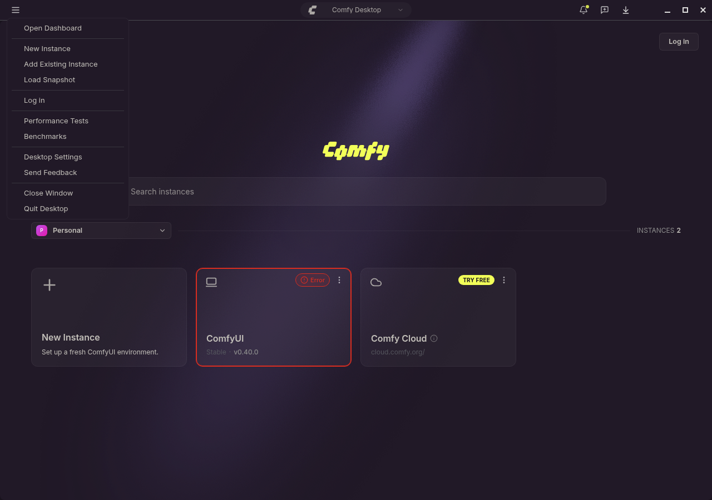

Comfy Desktop ist die offizielle Desktop-Anwendung für **ComfyUI**. Sie verwaltet alles für Sie: Sie übernimmt die Installation von ComfyUI, hält es aktuell und ermöglicht Ihnen, mehrere unabhängige Setups parallel zu betreiben.

Zum Verständnis des Zusammenhangs: **Comfy Desktop** ist die App, die **ComfyUI**-Instanzen verwaltet und startet. Sie installieren ComfyUI nicht separat: Comfy Desktop übernimmt die Installation, die Python-Umgebung und die Abhängigkeiten für jede Instanz automatisch.

### Wichtige Funktionen

- **[Verwaltung mehrerer Instanzen](/de/installation/desktop/usage/instance-management)**: Führen Sie mehrere ComfyUI-Instanzen parallel aus, jede mit eigener Version, eigenen Custom Nodes und eigener Konfiguration.
- **[Snapshots](/de/installation/desktop/usage/manage#snapshots-tab)**: Speichern und Wiederherstellen des vollständigen Zustands einer Instanz (ComfyUI-Version, Custom Nodes, Python-Pakete). So lassen sich Umgebungen einfach zurücksetzen oder reproduzieren.
- **[Gemeinsam genutzter Speicher](/de/installation/desktop/usage/settings#speicher)**: Modelle werden standardmäßig von allen Instanzen gemeinsam genutzt, wodurch Speicherplatz gespart wird. Sie können auch externe Modellordner hinzufügen.
- **Automatische Updates**: Das Steuerelement **Desktop Update** in der Titelleiste aktualisiert Comfy Desktop. Verwenden Sie im Manage-Bereich die [Registerkarte Update](/de/installation/desktop/usage/manage#update-tab), um jede ComfyUI-Instanz zu aktualisieren.
- **Cloud-Integration**: Starten Sie Comfy Cloud-Instanzen direkt über die Chooser-Ansicht oder stellen Sie eine Verbindung zu ihnen her.
- **[Bestehende Installationen erfassen](/de/installation/desktop/usage/instance-management#bestehende-installation-einbinden)**: Fügen Sie Ihre bestehenden portablen oder per Git geklonten ComfyUI-Installationen zu Comfy Desktop hinzu, um sie einheitlich zu verwalten.

Dieser Leitfaden beschreibt, wie Sie diese Funktionen nutzen.

## Dashboard Overview

Comfy Desktop window is divided into several key areas. The image below labels the main parts of the Dashboard:

### App Menu

The hamburger menu (☰) in the top-left corner opens the application menu, which holds every app-level action:

- **Open Dashboard**: opens the Dashboard in a new window. Instances that are running keep running.
- **New Instance** and **Add Existing Instance**: create a new instance, or track a ComfyUI installation you already have.
- **Load Snapshot**: create an instance from a snapshot file someone shared with you.
- **Log in**: sign in to your Comfy account. This entry only appears while you are signed out.
- **Performance Tests**: run timed workflows against an instance. See [Performance Tests and Benchmarks](/de/installation/desktop/usage/performance-tests).
- **Benchmarks**: compare saved performance test results across hardware, workflows, and instances.
- **Desktop Settings**: global settings for auto-updates, proxy/mirror, shared storage, and data locations.
- **Send Feedback**: open the feedback panel.
- **Close Window** and **Quit Desktop**: close the current window, or quit the app. Closing an instance window stops the ComfyUI instance it runs, and closing the last window quits Comfy Desktop.

Two entries appear only in context: **Reset Zoom (N%)** once the ComfyUI view is zoomed, and **Skip Onboarding** during the first-run setup. While the first-run setup is on screen, **Skip Onboarding** is the only entry in the menu.

On macOS the app also keeps a system menu bar with the standard app, Edit, and Window menus. Windows and Linux builds have no system menu bar.

<CardGroup cols={2}>
  <Card title="Settings" icon="cog" href="/de/installation/desktop/usage/settings">
    Global settings: auto-updates, proxy/mirror, shared storage, and data locations.
  </Card>
  <Card title="Performance Tests" icon="gauge" href="/de/installation/desktop/usage/performance-tests">
    Measure workflow speed on an instance, then compare runs across hardware.
  </Card>
</CardGroup>

### Instance Switcher

The center pill shows the name of your active ComfyUI instance. Click it to open the **Instance Picker**, a popover that lists every installed instance, shows their running status, and lets you switch between them or launch a new one. When a new ComfyUI version is available for that instance, the pill also carries an **Update** chip; click the chip to update the instance without opening the picker.

<CardGroup cols={1}>
  <Card title="Managing Installations" icon="sliders" href="/de/installation/desktop/usage/manage">
    Launch, update, snapshot, and configure your installations through the Manage panel.
  </Card>
</CardGroup>

### Trailing Buttons

The controls grouped on the right side of the title bar provide quick access to:

- **Desktop Update**: when a new version of Comfy Desktop is available, a pill appears here. Click to download and apply the update.
- **Reset Zoom**: a pill showing the current zoom percentage appears while the ComfyUI view is zoomed away from 100%. Click it to return to 100%.
- **What's new**: opens the announcements panel. Announcements cover new ComfyUI features and Comfy product launches, with a short video, highlights, and links out for details. The bell shows a dot while there is an announcement you have not opened, and the dot clears once you open the panel.
- **Feedback**: send feedback to the Comfy Desktop team.
- **Downloads**: opens the downloads tray. The badge shows how many downloads are running, and flags failed and unopened downloads. The tray lets you retry a failed download or cancel one that is running; select **View All Downloads** for the full list, where downloads can also be paused and resumed.

### Search

The search box lets you filter your installed instances by name, making it easy to find a specific setup when you have many.

### Chooser (Instance List)

The main area of the Dashboard, called the **Chooser**, displays all your ComfyUI instances as cards. **Click any instance card to launch or switch to that instance.**

From here you can:

- **＋ New Instance**：create a new standalone ComfyUI instance.
- **Comfy Cloud**: connect to or launch a cloud instance. The card may show a **TRY FREE** pill when free Cloud runs are available.
- **Account chip** (top-right): sign in with your Comfy account. Once signed in, the chip shows your avatar and email, and a workspace switcher appears above the grid.
- **Workspace Builds**: when signed in, ComfyUI Builds published to the selected workspace can be installed from the New Instance flow. See [Workspaces and ComfyUI Builds](/de/installation/desktop/usage/workspaces-and-builds).
- **Existing instance cards**：each card shows the instance name, status, and type. Right-click (or click the ⋮ icon) to manage, update, snapshot, or delete the instance.

<CardGroup cols={1}>
  <Card title="Instance Management" icon="layer-group" href="/de/installation/desktop/usage/instance-management">
    Create, rename, edit, and delete ComfyUI instances.
  </Card>
</CardGroup>

## Feedback und Probleme

Sie haben einen Fehler gefunden oder eine Anregung? Comfy Desktop ist Open Source. Sie können Probleme melden und geplante Funktionen hier einsehen:

- **Probleme mit Comfy Desktop**: [github.com/Comfy-Org/Comfy-Desktop/issues](https://github.com/Comfy-Org/Comfy-Desktop/issues)
- **Probleme mit der Dokumentation**: [github.com/Comfy-Org/docs/issues](https://github.com/Comfy-Org/docs/issues)

Bei allgemeinen Fragen zu ComfyUI besuchen Sie die [ComfyUI GitHub Discussions](https://github.com/Comfy-Org/ComfyUI/discussions) oder treten Sie dem [ComfyUI Discord](https://www.comfy.org/discord) bei.
