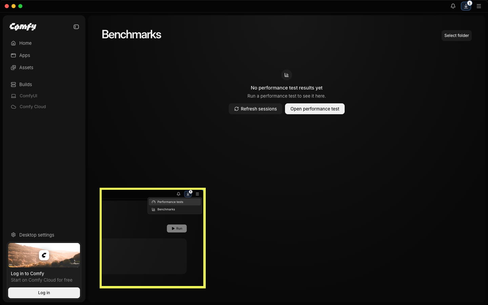

In Comfy Desktop können Sie messen, wie lange ein Workflow auf einem Ihrer Builds dauert, etwa einen Beispiel-Workflow für Videos oder Ihren eigenen Workflow für Bilder, und das Ergebnis mit Läufen auf einer anderen GPU oder einem anderen Build vergleichen. Eine Zeitmessung ist nur dann aussagekräftig, wenn nichts anderes die GPU beansprucht und Sie wissen, von welcher Hardware sie stammt. Deshalb führt ein Performance-Test den Workflow allein auf dem Build aus, wiederholt ihn und speichert jedes Ergebnis zusammen mit den Systeminformationen. Sie führen einen Test in **Performance Tests** aus, lesen dessen Ergebnisse und vergleichen gespeicherte Läufe in **Benchmarks**.

## Performance tests oder Benchmarks öffnen

Beide Seiten öffnen Sie über das **Menü** in der **Titelleiste**. Die übrigen Schaltflächen dort finden Sie unter [Titelleiste verwenden](/de/installation/desktop/usage/overview#titelleiste-verwenden).

1. Klicken Sie in **Home** am rechten Ende der **Titelleiste** auf **Menü**.
2. Wählen Sie **Performance tests** oder **Benchmarks** aus.

Die Seite öffnet sich im **Home**-Fenster neben der **Seitenleiste**. In einem Fenster, in dem ComfyUI läuft, öffnen dieselben **Menü**-Einträge die Seite in einem neuen Fenster von Comfy Desktop.



## Leistungstest durchführen

Ein Leistungstest startet den Build in einer eigenen Sitzung, führt Ihren Workflow mehrmals aus und beendet den Build, sobald er fertig ist. Sie richten ihn von links nach rechts in der Symbolleiste oben auf der Seite **Performance tests** ein: **Build**, **Workflow**, **Warm-up runs**, **Measured runs** und **Run**.

Solange Sie noch nichts ausgewählt haben, steht bei **Build** **Select a build**, bei **Workflow** **Choose a workflow** und bei **Results** **No results yet**.


### Build auswählen

Der Build, den Sie auswählen, ist derjenige, den der Test startet und misst, und sein Name wird zusammen mit den Ergebnissen gespeichert.

- Klicken Sie auf **Build** (dort steht **Select a build**, bis Sie einen auswählen) und wählen Sie anschließend einen Build aus.

Jeder Build in der Liste zeigt seinen Namen, darunter Typ und Version. Die Liste enthält die Builds im Workspace, der in der **Seitenleiste** ausgewählt ist. Um einen Build aus einem anderen Workspace zu testen, wechseln Sie zuerst den Workspace, wie unter [Ihr Workspace-Menü verwenden](/de/installation/desktop/usage/overview#workspace-menü-verwenden) beschrieben. Beim Wechseln des Workspace wird der von Ihnen ausgewählte Build verworfen.

<Note>
  Builds von Comfy Cloud werden nicht aufgeführt, da ein Test einen Build benötigt, den Comfy Desktop startet. Wenn Sie abgemeldet sind, zeigt die Liste nur installierte Builds.
</Note>### Workflow auswählen

Nachdem Sie einen Build ausgewählt haben, wählen Sie den Workflow aus, dessen Laufzeit gemessen werden soll. Verwenden Sie einen Beispiel-Workflow, der mit Comfy Desktop geliefert wird, oder importieren Sie Ihren eigenen.

#### Beispiel-Workflow verwenden

Beispiel-Workflows sind sofort einsatzbereit: Comfy Desktop lädt die Modelle herunter, die jeder einzelne benötigt.

1. Klicken Sie auf **Workflow** und wählen Sie dann **Choose an example workflow**.
2. Wählen Sie in **Choose an example workflow** die Registerkarte **Video**, **Image** oder **Audio** und anschließend eine Karte aus. Jede Karte zeigt den Namen des Workflows, seine Aufgabe und die ungefähre Größe der Modelle, die er herunterlädt. Ein Festplattensymbol anstelle einer Größe bedeutet, dass sich die Modelle bereits auf dem Datenträger befinden. Halten Sie den Zeiger darüber, um **Downloaded** und die Größe zu sehen.
3. Klicken Sie auf **Use workflow**.

Comfy Desktop lädt die Modelle herunter, die sich noch nicht auf dem Datenträger befinden. Eine Statuszeile unter der Symbolleiste zeigt **Workflow wird vorbereitet und erforderliche Modelle werden heruntergeladen…** an und stellt danach den Download mit einer Fortschrittsleiste und **Cancel download** dar. Die Downloads erscheinen außerdem im Bereich **Downloads** in der **Titelleiste**. Wie Sie sie dort verfolgen, lesen Sie unter [Downloads in Comfy Desktop](/de/installation/desktop/usage/downloads). Wenn der Download abgeschlossen ist, zeigt **Workflow** den Namen des Beispiels mit einem **Example**-Tag an.

Wenn etwas das Laden des Beispiels verhindert, erscheint eine rote Zeile unter der Symbolleiste oder im Dialog:

| Meldung | Vorgehen |
| --- | --- |
| **Installation dieses Builds fertigstellen, um Beispiel-Workflows zu verwenden.** | Wählen Sie einen installierten Build aus oder schließen Sie die Installation dieses Builds ab. |
| **Sie müssen mit dem Internet verbunden sein, um Beispiel-Workflows herunterzuladen.** | Stellen Sie eine Internetverbindung her und versuchen Sie es erneut. |
| **Benötigt ~X, nur Y frei. Geben Sie Speicherplatz frei oder wählen Sie einen leichteren Workflow.** (im Dialog, wobei **Use workflow** nicht verfügbar ist) | Geben Sie Speicherplatz auf dem Datenträger frei oder wählen Sie eine Karte mit kleineren Modellen. |
| **Es konnten nicht alle von diesem Workflow benötigten Modelle heruntergeladen werden.** | Wählen Sie das Beispiel erneut aus. Comfy Desktop entfernt ein Beispiel, dessen Download fehlschlägt. |

Ein Beispiel gehört zu dem Build, für den Sie es ausgewählt haben. Wenn Sie einen anderen Build auswählen, entfernt Comfy Desktop das Beispiel aus **Performance tests**. Seine Dateien bleiben auf dem Datenträger, wenn bereits ein Test es verwendet hat.

#### Eigenen Workflow importieren

Ein Workflow, den Sie importieren, muss im [API-Format](/development/api-development/workflow-api-format) vorliegen. Exportieren Sie ihn zuvor in diesem Format aus ComfyUI.

- Klicken Sie auf **Workflow**, wählen Sie **Import API workflow** und dann die Datei `.json` aus. Sie können die `.json`-Datei auch auf **Workflow** ziehen.

**Workflow** zeigt den Dateinamen mit einem **API**-Tag an. Wenn die Datei nicht im API-Format vorliegt, lautet die rote Zeile unter der Symbolleiste: **Die ausgewählte Datei ist kein Workflow im ComfyUI-API-Format.** Eine Datei mit dem Namen `jobs.json` oder `results.json` wird abgelehnt, da diese Namen für Ergebnisse reserviert sind.

Comfy Desktop kopiert die Datei in einen neuen Sitzungsordner (siehe [Wo Ergebnisse gespeichert werden](#where-results-are-stored)), sodass der Test die Kopie ausführt, auch wenn Sie das Original später verschieben oder bearbeiten.

#### Workflow entfernen

- Klicken Sie auf **Workflow**, wählen Sie **Delete workflow** und klicken Sie dann zur Bestätigung auf **Delete workflow**.

Dadurch wird der Workflow aus **Performance tests** entfernt. Comfy Desktop löscht seine Kopie, wenn noch kein Lauf sie verwendet hat. Ihre Originaldatei und die Ergebnisse früherer Läufe bleiben erhalten. Während ein Beispiel heruntergeladen wird, lautet derselbe Menüeintrag **Cancel download**.### Anzahl der Ausführungen festlegen

Warm-up runs laden die Modelle, bevor die Zeitmessung beginnt, damit der erste langsame Lauf die Ergebnisse nicht verfälscht.

| Einstellung | Bereich | Standard | Wirkung |
| --- | --- | --- | --- |
| **Warm-up runs** | 0 bis 5 | 1 | Werden zuerst ausgeführt, um Modelle zu laden und Caches aufzuwärmen. Sie sind nicht in den Ergebnissen enthalten. Setzen Sie den Wert auf 0, um den Warm-up zu überspringen. |
| **Measured runs** | 1 bis 100 | 5 | Läufe, die nach den Warm-up runs zeitlich gemessen werden. Die gemessenen Zeiten dieser Läufe bilden die Ergebnisse. |

Wenn Sie auf **Run** klicken, wird ein Wert außerhalb des Bereichs auf den nächstgelegenen Grenzwert geändert. Jeder Lauf erhöht jede Seed-Eingabe im Workflow um eins, damit ComfyUI kein zwischengespeichertes Ergebnis zurückgibt.### Test starten

Andere Arbeiten, die die GPU auslasten, etwa ein Spiel oder ein Videoexport, wirken sich weiterhin auf die Messwerte aus. Beenden Sie sie daher, bevor Sie einen Test ausführen.

1. Klicken Sie auf **Run**.

   Wenn **Run** nicht verfügbar ist, halten Sie den Zeiger darüber, um den Grund zu sehen: **Select a build first.**; **Choose a workflow first.**; **Wait for the workflow to be ready.** oder **Wait for the build to finish starting.**

2. Verfolgen Sie den Test in **Results**. Dort steht **Starting the build…** und dann **Run N of M** mit **warm-up run** oder **measured run X of Y** unter einer Fortschrittsanzeige. **Logs** öffnet sich, um die Ausgabe des Builds anzuzeigen.

Während der Test läuft, nimmt **Stop** den Platz von **Run** ein. Klicken Sie auf **Stop**, um den Test abzubrechen. Dort steht **Stopping…**, bis der Build stoppt.

Wenn alle Durchläufe abgeschlossen sind, beendet Comfy Desktop den Build und zeigt die Ergebnisse an. Wenn die Durchläufe 4 Stunden, nachdem Comfy Desktop sie gesendet hat, noch nicht abgeschlossen sind, wird der Test mit **Timed out waiting for performance test jobs.** beendet.### Builds stoppen, die einen Test blockieren

Ein Test läuft allein, sodass nichts anderes um die GPU und den Speicher konkurriert. Wenn auf diesem Computer ein anderer Build läuft, gerade gestartet wird oder gerade beendet wird, startet der Test nicht. Dazu gehört der Build, den Sie testen, wenn er in ComfyUI geöffnet ist, sowie ein Performance-Test auf einem anderen Build. Remote- und Comfy-Cloud-Builds laufen an anderer Stelle und blockieren einen Test nie.

**Results** zeigt dann **The performance test did not start** an und listet jeden Build auf, der den Test blockiert. Ein Performance-Test in der Liste zeigt **Performance test:** gefolgt vom Namen des Builds an.

<Warning>
  Beim Stoppen eines Builds gehen alle ungespeicherten Änderungen in seinem ComfyUI-Fenster verloren. Speichern Sie Ihre Workflows zuerst.
</Warning>

1. Klicken Sie in der Liste neben einem Build auf **Stop**.
2. Klicken Sie in **Stop ComfyUI** auf **Stop**. Die Zeile zeigt **Stopped** an.
3. Wiederholen Sie dies für jeden Build in der Liste und klicken Sie dann erneut auf **Run**.

Sie können einen Build auch auf der Seite des Builds stoppen. Weitere Informationen finden Sie unter [Stoppen oder Neustarten](/de/installation/desktop/usage/instance-management#stop-or-restart).### Ergebnisse lesen

Die Ergebnisse zeigen, wie lange der Workflow in diesem Build gedauert hat, sodass Sie ihn mit anderen Builds und GPUs vergleichen können.

- Die Kopfzeile nennt den Workflow und den Build, auf dem der Test ausgeführt wurde.
- Die große Zahl ist der Median der Läufe in Sekunden. Darunter zählt **Median run · N measured · N failed** die Läufe, die eine Dauer ergeben haben, und die fehlgeschlagenen Läufe.
- **Run duration** vergleicht **Fastest run**, **Median run**, **Average run** und **Slowest run** als Balken.
- **System information** listet **Compute device**, **VRAM**, **RAM**, **PyTorch version**, **xFormers version**, **CPU**, **CPU cores**, **Operating system** und **Architecture** auf.

Die Dauer eines Laufs ist die Zeit, die ComfyUI für die Ausführung der Aufgabe benötigt hat, vom Beginn bis zum Ende der Ausführung, nicht die Zeit, die Sie darauf gewartet haben. Fehlgeschlagene Läufe werden bei den Dauern nicht berücksichtigt.

Rechts in der Kopfzeile der Ergebnisse befinden sich zwei Schaltflächen:

- **Show in Finder** unter macOS, **Show in Explorer** unter Windows oder **Show in folder** unter Linux öffnet den Sitzungsordner.
- **Export results** fragt nach einem Ordner. Klicken Sie auf **Export here**, um die Ergebnisse als `performance-test-results-<timestamp>.png` zu speichern.

Wenn der Test fehlschlägt, zeigt **Results** **The test didn't finish** mit dem Fehler an, gefolgt von **See the logs below for details.** Erweitern Sie **Logs**, um die Ausgabe des Builds zu lesen. Ein Workflow, der einen Node oder ein Modell benötigt, das im Build nicht vorhanden ist, schlägt auf diese Weise fehl.

Die Ergebnisse bleiben auf der Seite, bis Sie den nächsten Lauf starten. Um sie später erneut anzuzeigen, öffnen Sie **Benchmarks**.

## Compare runs in Benchmarks

Benchmarks reads every saved test in the results folder and lists them in one table, so you can see how much faster one GPU, Workflow, or build is than another. Until a test finishes, it reads **No performance test results yet**. Click **Open performance test** to run one, or **Refresh sessions** after a test finishes.


### Filter and sort the runs

Narrow the table to the runs you want to compare with the toolbar:

- **Workspace**, **Build**, **Hardware**, and **Workflow**: show only the runs that match. Each reads **All** by default.
- **Compare by**: the duration the table compares, **Fastest**, **Average**, **Median**, or **Slowest**. The default is **Median**.
- **Refresh sessions** (the circular arrow): reloads the results folder after a test finishes.
- **Search runs…**: matches the session, Workflow, build, workspace, and hardware.
- **Columns**: choose what the table shows. **Measures** adds duration columns, and **Columns to display** adds columns such as **Workspace**, **Date / time**, **Runs**, and **GPU / hardware**.

By default, the table shows **Session**, **Workflow**, **Build**, **Median and range**, **Median**, and **Compared to baseline**. The two **Median** columns follow **Compare by**. Runs are sorted by the **Compare by** duration, fastest first.

- To sort by a column, click its heading. Click it again to reverse the order.
- To move a run, drag its grip at the left of the row, or focus the grip and press `Alt+Up` or `Alt+Down`.
- To move a column you added, drag its heading, or focus it and press `Alt+Left` or `Alt+Right`.

If no run matches, the page reads **Nothing matches**. Click **Clear filters** to see every run.

### Compare against a baseline

Each run is compared with one reference run. By default, that's the fastest run by the **Compare by** duration, marked **Fastest**.

The **Compared to baseline** column reads, for each other run:

- **N× faster**: the run took 1/N of the baseline's time.
- **N× slower**: the run took N times as long as the baseline.
- **Same speed**: the run is within 0.5% of the baseline.
- **Unavailable**: the run has no duration to compare.

To compare with a run of your choice:

- Hold the pointer over the row, and click the flag (**Set as baseline**). You can also click **⋯** at the end of the row and select **Set as baseline**.

The run is marked **Baseline**. To go back to the fastest run, click the flag again (**Reset baseline**). If the filters hide the baseline, a note under the table reads **Compared with session N, which the filters hide.**

### Export a comparison

Export a comparison to share it as an image.

1. Select the checkbox at the left of each run to export. A bar at the bottom shows how many runs are selected.
2. Click **Export results** in the bar.
3. Select a folder, and then click **Export here**.

Comfy Desktop saves `benchmark-comparison-<timestamp>.png` in that folder. The image includes a relative speed chart only when you've set a baseline. You can export up to 20 runs. With more selected, **Export results** is unavailable and reads **Up to 20 runs** when you hold the pointer over it. To clear the selection, click **Clear selection** (**✕**) in the bar.

### Rename or delete a session

Each test is saved as a session, named by default with the time you added its Workflow. Give a session a name you'll recognize, or delete one you no longer need.

To rename a session:

1. Click the session name in the **Session** column. A pencil icon shows when you hold the pointer over it. You can also click **⋯** at the end of the row and select **Rename session**.
2. Type the new name, and then press `Enter`. Press `Escape` to cancel.

Renaming a session renames its folder. If another session already has that name, the session isn't renamed.

To delete a session:

1. Click **⋯** at the end of the row, and then select **Delete files**.
2. Click **Delete files** to confirm.

Deleting removes every file in the session folder. You can't undo it.

### Compare results from another computer

Benchmarks reads the `results.json` file in each session folder it finds. To compare runs from another computer, copy their session folders into one folder.

1. Click **Select folder** at the top of **Benchmarks**.
2. Select the folder that holds the session folders.

## Wo Ergebnisse gespeichert werden

Die Funktion Performance Tests erstellt beim Hinzufügen eines Workflows einen Sitzungsordner, der den Zeitstempel dieses Moments im Namen trägt (`YYYYMMDDHHMMSS`):

```text
ComfyUI-Shared/
└── benchmarks/
    ├── 20260930141522/
    │   ├── my_workflow.json
    │   ├── jobs.json
    │   ├── results.json
    │   └── logs.txt
    └── 20260930163005/
        └── ...
```

| Plattform | Standardordner für Ergebnisse |
| --- | --- |
| Windows | `%LOCALAPPDATA%\Comfy-Desktop\ComfyUI-Shared\benchmarks` |
| macOS und Linux | `~/ComfyUI-Shared/benchmarks` |

Jeder Sitzungsordner enthält:

- `my_workflow.json` (der Name Ihrer Datei): die Kopie des Workflows, den der Test ausführt
- `jobs.json`: die Jobdetails, die ComfyUI für die Läufe zurückgegeben hat
- `results.json`: die Zusammenfassung, die Benchmarks liest
- `logs.txt`: die Ausgabe des Builds während des Tests

Das erneute Ausführen desselben Workflows schreibt in denselben Sitzungsordner und ersetzt die dort gespeicherten Ergebnisse. Um ein Ergebnis für den Vergleich zu behalten, wählen Sie den Workflow vor dem nächsten Test erneut aus oder importieren Sie ihn erneut. Dadurch wird ein neuer Sitzungsordner erstellt.
