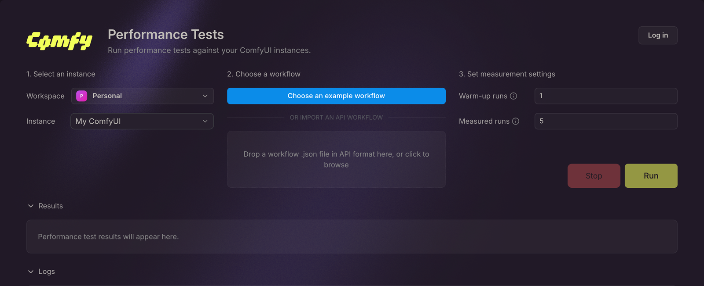
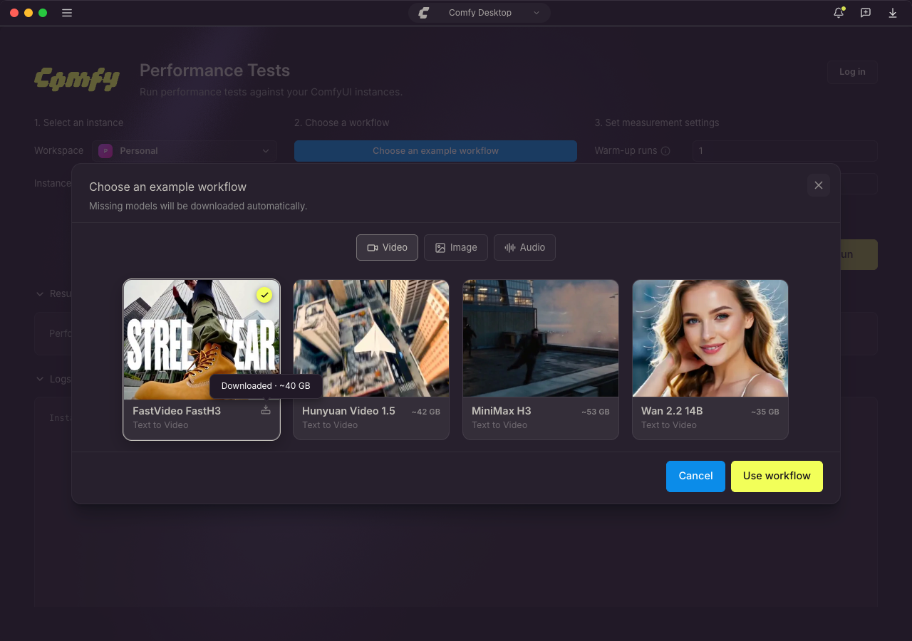
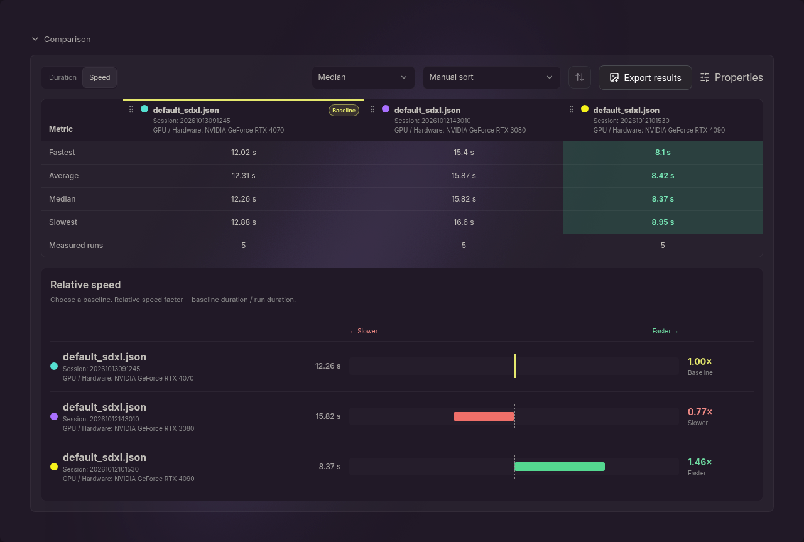

**Performance Tests** misst, wie lange die Ausführung eines ComfyUI-Workflows auf einer Ihrer Instanzen dauert. Sie wählen eine Instanz aus, laden einen Workflow, und Comfy Desktop führt ihn eine festgelegte Anzahl von Malen aus, misst die Zeit jeder gewerteten Ausführung und meldet die schnellste, langsamste, durchschnittliche und mediane Dauer zusammen mit der Hardware und Software, aus der die Werte stammen.

**Benchmarks** vergleicht diese aufgezeichneten Ergebnisse. Das Panel listet jede gespeicherte Ausführung auf, filtert sie nach Workspace, Instanz, Hardware oder Workflow und stellt ausgewählte Ausführungen mit einem relativen Geschwindigkeitsfaktor nebeneinander, sodass Sie sehen, um wie viel schneller eine GPU, ein Workflow oder eine Instanz als eine andere ist.

Beide Panels öffnen Sie über das Hamburger-Menü (☰) oben links in der Titelleiste des Dashboards, nicht über eine Seitenleiste. Klicken Sie auf die Schaltfläche ☰ (1) und wählen Sie dann **Performance Tests** (2) oder direkt darunter **Benchmarks**:


<Info>
Performance Tests führt einen echten Workflow auf einer echten Instanz aus, daher dauert ein Test ungefähr so lange wie der Workflow selbst multipliziert mit der Anzahl der Ausführungen. Workflows, die Sie importieren, müssen zuerst im [API-Format](/development/api-development/workflow-api-format) exportiert werden. Die Beispiel-Workflows, die mit Comfy Desktop ausgeliefert werden, liegen bereits in diesem Format vor.
</Info>

## Leistungstest ausführen

Das Panel besteht aus drei nummerierten Schritten, die nebeneinander angeordnet sind. In schmalen Fenstern werden sie untereinander angezeigt.



### 1. Instanz auswählen

Wählen Sie den **Workspace** und die **Instance** für den Test aus. Die Instanzliste ist auf den Workspace beschränkt. Wechseln Sie daher den Workspace, wenn Sie eine Instanz erreichen möchten, die zu einem Team gehört. Die Instanz und ihre Hardware werden zusammen mit den Ergebnissen aufgezeichnet. Das macht spätere Vergleiche aussagekräftig: Läufe auf unterschiedlichen GPUs bleiben unterscheidbar.

Wenn Sie einen Test starten, stoppt Comfy Desktop die vorherige Leistungstestsitzung dieser Instanz, falls noch eine läuft, und startet die Instanz dann in einer Konsolensitzung. Comfy Desktop startet keinen Test, solange eine andere lokale ComfyUI-Instanz läuft, sich noch im Startvorgang befindet oder beendet wird, und nennt die betroffenen Instanzen. Stoppen Sie diese, oder warten Sie, bis sie den Start- oder Beendigungsvorgang abgeschlossen haben, und führen Sie den Test dann erneut aus. Comfy Cloud und Remote-Instanzen laufen an anderer Stelle und blockieren einen Test nie. Andere Arbeiten, die die GPU auslasten, etwa ein Spiel oder ein Videoexport, beeinflussen die Messwerte weiterhin. Beenden Sie diese daher, bevor Sie einen Test ausführen.

### 2. Workflow auswählen

Sie können einen Beispiel-Workflow auswählen, der mit Comfy Desktop ausgeliefert wird, oder Ihren eigenen Workflow verwenden.

Klicken Sie auf **Choose an example workflow**, um die Auswahl zu öffnen. Die Beispiele sind in die Tabs **Video**, **Image** und **Audio** gruppiert, und jede Karte zeigt den Namen, die Aufgabe und die Downloadgröße ihrer Modelle. Wenn sich die Modelle einer Karte bereits auf der Festplatte befinden, ersetzt ein Festplattensymbol diese Größe, und der Tooltip lautet **Downloaded** zusammen mit der Größe (zum Beispiel **Downloaded · ~17 GB**). Diese Modelle werden weder erneut heruntergeladen noch auf den freien Speicherplatz angerechnet.



Wählen Sie eine Karte aus und klicken Sie auf **Use workflow**. Comfy Desktop ruft den Prompt im API-Format ab und lädt die fehlenden Modelle im Hintergrund herunter: Der Ablagebereich zeigt den Fortschritt an, **Run** bleibt deaktiviert, bis der Download abgeschlossen ist, und der Tooltip der Papierkorb-Schaltfläche wechselt zu **Cancel download**. Ein fehlgeschlagener Download entfernt den Workflow.


Die Auswahl benötigt eine installierte Instanz und eine funktionierende Verbindung und weist unter dem Ablagebereich darauf hin, wenn eines davon fehlt. Wenn die Modelle nicht in den freien Speicherplatz passen, erscheint über den Karten eine Warnung und **Use workflow** bleibt deaktiviert:


Beispiele gehören zu einer Instanz: Beim Wechsel der Instanz wird das vorbereitete Beispiel verworfen, es sei denn, ein Test hat es bereits verwendet. Das mitgelieferte Set ändert sich zwischen den Releases.

**Your own workflow** muss im [API-Format](/development/api-development/workflow-api-format) exportiert werden. Ziehen Sie die `.json`-Datei auf den Ablagebereich, oder klicken Sie auf den Bereich, um eine Datei auszuwählen.

In beiden Fällen kopiert Comfy Desktop den Workflow in den Ordner der Testsitzung, sodass der Test auch nach dem Verschieben oder Bearbeiten der Originaldatei noch läuft.

### 3. Messeinstellungen festlegen

| Einstellung | Bereich | Standard | Funktion |
|---------|-------|---------|--------------|
| **Warm-up runs** | 0 bis 5 | 1 | Läufe, die zuerst ausgeführt werden, um Modelle zu laden und Caches aufzuwärmen. Sie werden nicht in die Ergebnisse einbezogen. Setzen Sie den Wert auf 0, um die Aufwärmphase zu überspringen. |
| **Measured runs** | 1 bis 100 | 5 | Läufe, die nach den Aufwärmläufen gemessen werden. Ihre Dauern werden zur Berechnung der Ergebnisse verwendet. |

Jeder Lauf erhöht die numerischen Seed-Eingänge des Workflows um eins, sodass die Messläufe kein identisches zwischengespeichertes Ergebnis wiederholen.

Sobald die drei Schritte eingestellt sind, klicken Sie auf **Run**, um den Test zu starten. Die Schaltfläche **Stop** daneben bricht einen laufenden Test ab.

### Ergebnisse lesen

Während der Test läuft, zeigt das Panel an, wie viele Läufe abgeschlossen sind, sowie die Instanzprotokolle. Wenn alle Läufe abgeschlossen sind, wird die Instanz gestoppt, und die Ergebnisse erscheinen:

- **Fastest run**, **Slowest run**, **Average run** und **Median run**, in Sekunden
- **Measured runs** und **Failed runs**: wie viele Läufe eine Dauer ergeben haben und wie viele nicht
- **Run duration aggregates**: ein Balkendiagramm, das die vier Aggregatwerte vergleicht (schnellster, langsamster, durchschnittlicher und medianer Lauf)
- **System information**: Rechengerät, VRAM, RAM, PyTorch-Version, xFormers-Version, CPU, CPU-Kerne, Betriebssystem und Architektur

Die Dauer eines Laufs ist die Zeit, die ComfyUI mit der Ausführung des Jobs auf dem Server verbracht hat, nicht die Zeit, die Sie darauf gewartet haben. Fehlgeschlagene Läufe werden separat gezählt und bleiben in der Statistik unberücksichtigt.

Bei den Ergebnissen befinden sich zwei Schaltflächen: **Open folder** öffnet den Ordner der Testsitzung, und **Export results** speichert die Zusammenfassung und die Diagramme als PNG-Bild.

## Läufe mit Benchmarks vergleichen

Benchmarks liest die Ergebnisse, die Performance Tests gespeichert hat. Solange nicht mindestens ein Test abgeschlossen ist, gibt es daher nichts anzuzeigen.

### Läufe-Bibliothek

Die **Läufe-Bibliothek** listet jeden gespeicherten Lauf im Ergebnisordner auf, Neueste zuerst. Die Symbolleiste bietet Ihnen:

- **Ordner auswählen**: richtet das Panel auf einen anderen Ergebnisordner aus, zum Beispiel auf einen Ordner auf einem freigegebenen Laufwerk. Standard ist der Ordner, in den Performance Tests schreibt, siehe [Wo Ergebnisse gespeichert werden](#wo-ergebnisse-gespeichert-werden).
- **Sitzungen aktualisieren**: lädt den Ordner neu, nachdem ein Test an anderer Stelle abgeschlossen wurde.
- **Läufe suchen**: filtert die Liste nach Text.
- Dropdown-Filter für Workspace, Instanz, Hardware und Workflow.
- **Eigenschaften**: legt fest, welche Spalten die Bibliothek zeigt (Sitzung, Datum und Uhrzeit, Workflow, Instanz, Workspace, Anzahl der Läufe, GPU und Hardware).


### Läufe vergleichen

Wählen Sie zwei oder mehr Läufe über die Kontrollkästchen aus, oder verwenden Sie **Alle sichtbaren Läufe auswählen**. Beim Laden der Bibliothek sind die drei neuesten Läufe für Sie ausgewählt. Eine Auswahl öffnet den Abschnitt **Vergleich** unterhalb der Bibliothek.

Der Vergleich stellt eine Spalte pro ausgewähltem Lauf einer Reihe von Messzeilen gegenüber: schnellste, durchschnittliche, mediane und langsamste Dauer sowie die gemessene Anzahl der Läufe. Ein Lauf ist die **Basislinie**. Standardmäßig ist das die erste angezeigte Spalte. In der Ansicht **Geschwindigkeit** klicken Sie auf eine Spaltenüberschrift, um stattdessen diesen Lauf zur Basislinie zu machen.

### Relative Geschwindigkeit

Der Vergleich hat zwei Ansichten, **Dauer** und **Geschwindigkeit**, zwischen denen Sie in der Symbolleiste des Vergleichs wechseln. Die relative Geschwindigkeit gehört zur Ansicht **Geschwindigkeit**, und auch die Basislinie wird dort gewählt.

**Relative Geschwindigkeit** ist die Dauer der Basislinie geteilt durch die Dauer eines Laufs:

- **1.00×** bedeutet, dass der Lauf genauso schnell ist wie die Basislinie
- Ein Faktor über 1.00× bedeutet, dass der Lauf **schneller** ist als die Basislinie
- Ein Faktor unter 1.00× bedeutet, dass der Lauf **langsamer** ist als die Basislinie

Die Ansicht **Geschwindigkeit** stellt jeden Lauf auf einer logarithmischen Achse dar, mit **Langsamer** links und **Schneller** rechts, sodass ein 2x- und ein 4x-Unterschied im selben Diagramm lesbar bleiben. Die Ansicht **Dauer** zeichnet das schnellste und das langsamste Ergebnis jedes Laufs als Linie mit markiertem Durchschnitt. Läufe ohne verwertbare Dauer werden als nicht verfügbar gekennzeichnet.



### Sortieren und exportieren

- **Vergleich sortieren** ordnet die Spalten nach der Metrik, die Sie wählen (schnellste, durchschnittliche, mediane oder langsamste). Mit **Manuell sortieren** ziehen Sie Spalten in Ihre eigene Reihenfolge oder drücken Alt+Left / Alt+Right auf einer fokussierten Spalte.
- **Ergebnisse exportieren** speichert den gesamten Vergleich als PNG-Bild, der schnellste Weg, ein Ergebnis an ein Issue oder eine Chat-Nachricht anzuhängen. Ein Vergleich mit mehr als 20 Läufen kann nicht exportiert werden.

### Sitzungen verwalten

Jeder Test wird als Sitzung gespeichert. Aus der Bibliothek heraus können Sie eine Sitzung umbenennen (**Sitzung bearbeiten**) oder löschen (**Löschen**). Beim Löschen werden alle für diese Sitzung erfassten Dateien entfernt.

## Wo Ergebnisse gespeichert werden

Performance Tests erstellt beim Hinzufügen eines Workflows zum Panel einen Sitzungsordner, der nach dem Zeitstempel dieses Moments benannt ist (`YYYYMMDDHHMMSS`):

```
📂 ComfyUI-Shared/
└── 📂 benchmarks/
    ├── 📂 20260930141522/
    │   ├── my_workflow.json
    │   ├── jobs.json
    │   ├── results.json
    │   └── logs.txt
    └── 📂 20260930163005/
        └── ...
```

| Plattform | Standardordner für Ergebnisse |
|----------|------------------------|
| Windows | `%LOCALAPPDATA%\Comfy-Desktop\ComfyUI-Shared\benchmarks` |
| macOS / Linux | `~/ComfyUI-Shared/benchmarks` |

Jeder Sitzungsordner enthält:

- die Workflow-Datei, die das Panel verwendet hat
- `jobs.json`: die rohe Auftragsantwort der Instanz
- `results.json`: die Zusammenfassung, die das Benchmarks-Panel liest
- `logs.txt`: die Konsolenausgabe der Instanz aus dem Lauf

Da Benchmarks `results.json` aus jedem gefundenen Sitzungsordner liest, genügt es, Sitzungsordner in den Ordner zu kopieren, auf den Benchmarks zeigt, um Ergebnisse von einem anderen Rechner zu vergleichen.

Wird derselbe importierte Workflow erneut ausgeführt, schreibt dies in denselben Sitzungsordner und überschreibt die dort bereits gespeicherten Ergebnisse. Um ein Ergebnis für den Vergleich zu behalten, fügen Sie den Workflow vor dem nächsten Test erneut zum Panel hinzu.

## Anforderungen

- Eine eigenständige, getrackte oder Remote-Instanz, die Comfy Desktop starten kann. Der Test benötigt eine funktionierende ComfyUI-Instanz und kann daher nicht mit einer Cloud-Instanz ausgeführt werden.
- Einen Workflow, den die Instanz ausführen kann, einschließlich der benötigten Modelle und Custom Nodes. Ein Workflow, den Sie importieren, muss im API-Format vorliegen; die Beispiel-Workflows sind bereits in diesem Format, und Comfy Desktop lädt ihre Modelle herunter. Wenn die Instanz den Workflow ablehnt, wird der Test beendet und der Fehler erscheint in den Protokollen. Läufe, die die Instanz akzeptiert, die aber während der Ausführung fehlschlagen, werden als fehlgeschlagene Läufe gezählt und aus den Dauerstatistiken ausgeschlossen.
