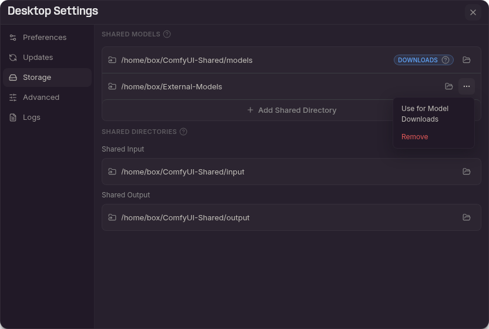

Klicken Sie auf das ☰-Menü (1) in der oberen linken Ecke und wählen Sie **Desktop-Einstellungen** (2), um das Panel für die globalen Einstellungen zu öffnen.


Das Einstellungs-Panel ist in fünf Tabs gegliedert. Klicken Sie in der Seitenleiste auf einen Tab, um die Ansicht zu wechseln.

## Einstellungen


Der Tab Einstellungen öffnet sich mit einer **Sprache**-Auswahl und fasst die übrigen Steuerelemente in drei Abschnitten zusammen.

- **Sprache**: Wählen Sie die Anzeigesprache. Verfügbar sind **English** und **简体中文**.

### App-Verhalten

- **Automatisch beim Start starten**: Legen Sie fest, welche Instanz gestartet wird, wenn Com Desktop geöffnet wird. Standard ist **None (show dashboard)**. Sie können auch **Last used instance** oder eine bestimmte Installation auswählen.
- **Vor dem Schließen eines Fensters bestätigen**: Vor dem Schließen eines Fensters, in dem eine lokale Installation läuft, wird eine Bestätigung angefordert.
- **Vor dem Ausführen mehrerer Instanzen warnen**: Eine Warnung anzeigen, bevor eine weitere lokale ComfyUI-Instanz gestartet wird, während bereits eine läuft oder gerade startet.
- **Cloud aus der Instanzauswahl ausblenden**: Die Cloud-Zeile im Dashboard ausblenden. Cloud funktioniert weiterhin, wenn Sie dies später wieder aktivieren.

### Datenschutz

- **Anonyme Nutzungstelemetrie teilen**: Anonyme Nutzungsdaten senden, um Com Desktop zu verbessern.
- **Beta-Features aktivieren**: Lassen Sie Com Desktop frühe Core-Features für Ihre Instanzen aktivieren. Der Schalter bleibt deaktiviert, bis Sie die Datenfreigabe über **Share anonymous usage telemetry** bestätigen, auch wenn die Telemetrie bereits aktiviert ist.

Beta-Features kommen als zusätzliche Startargumente und werden vor die Argumente gesetzt, die Sie selbst festgelegt haben. Ihre eigenen Argumente behalten ihre Reihenfolge und werden nie umgeschrieben, und Desktop entfernt nur ein `--`-Flag, das die installierte ComfyUI nicht auflistet. Kann Desktop diese Liste nicht lesen, startet es genau mit Ihren Argumenten und fügt keine Beta-Argumente hinzu. Wenn ein Beta-Feature für eine Instanz aktiviert wird, erscheint eine Karte mit der Überschrift **A beta feature is on** in der Titelleiste. **Got it** blendet sie aus, und **Settings** öffnet dieses Panel beim Opt-in-Schalter. Welche Argumente ein Beta-Feature hinzugefügt hat, sehen Sie im Tab Startup Args der Instanz, hinter dem Badge **+N beta** neben **Startup Arguments**.

### Community

- **Com Desktop**: Eine Karte mit einem Link zum [Comfy Desktop GitHub-Repository](https://github.com/Comfy-Org/Comfy-Desktop).

## Updates


- **Statuszeile**: Die erste Zeile des Tabs zeigt an, ob Comfy Desktop auf dem neuesten Stand ist oder ob ein Update verfügbar ist, zur Installation bereitsteht oder heruntergeladen wird. Die installierte Version steht darunter, zusammen mit dem Zeitpunkt der letzten Prüfung, sobald eine Prüfung durchgeführt wurde.
- **Nach Updates suchen**: Manuell nach einer neuen Version suchen. Wenn ein Update verfügbar ist, ändert sich die Schaltfläche in **Herunterladen** und nach Abschluss des Downloads in **Neustarten & Aktualisieren**.
- **Desktop-Updates automatisch installieren**: Updates automatisch im Hintergrund herunterladen und installieren.

## Speicher

Im Tab „Speicher“ konfigurieren Sie, wo Comfy Desktop Dateien findet und speichert. Das zentrale Konzept ist das **Teilen**: Statt dass jede Instanz ihre eigenen isolierten Modelle, Eingänge und Ausgänge besitzt, richten Sie gemeinsame Verzeichnisse ein, auf die alle Instanzen zugreifen können.


- **Shared Models**: Jedes hier aufgeführte Verzeichnis wird von jeder Instanz nach Modellen durchsucht. Neue Modelle werden in das Verzeichnis heruntergeladen, das mit dem Badge **DOWNLOADS** markiert ist.

  

  - Klicken Sie auf den Verzeichnispfad, um ihn im Dateimanager zu öffnen.
  - Das Menü **⋯** (1) erscheint bei jedem gemeinsamen Verzeichnis, außer bei dem, das bereits Downloads empfängt. Wählen Sie **Use for Model Downloads** (2), um dieses Verzeichnis als Download-Ziel festzulegen, oder **Remove**, um es aus der Liste zu entfernen. Beim Entfernen eines Verzeichnisses bleiben dessen Dateien erhalten.
  - Klicken Sie auf **+ Add Shared Directory**, um weitere Modellverzeichnisse hinzuzufügen.
- **Shared Input**: Ein gemeinsamer Pfad, in dem alle Instanzen nach Eingabedateien (Bilder, Videos usw.) suchen.
- **Shared Output**: Ein gemeinsamer Pfad, in dem alle Instanzen generierte Ausgänge speichern. Wenn Sie diesen anpassen, behalten Sie alle Ergebnisse an einem Ort.
- Klicken Sie auf das Ordner-Symbol, um einen neuen Pfad zu durchsuchen und auszuwählen. Tooltips über **?** liefern zusätzliche Details.

Überschreibungen pro Instanz (gemeinsame Verzeichnisse einbeziehen, Ein- und Ausgabe trennen, zusätzliche Modellordner) finden Sie in der jeweiligen Instanz im Storage-Tab von [Manage](/de/installation/desktop/usage/manage#storage-tab).

## Erweitert


- **Default Install Location**: Der Ort, an dem neue eigenständige Instanzen erstellt werden. Klicken Sie auf das Symbol „Ordner“, um ihn zu ändern.
- **PyPI Mirror URL**: Benutzerdefinierter pip-Mirror (z. B. `https://mirrors.aliyun.com/pypi/simple/`).
- **Use Chinese Mirrors (Git & PyPI)**: Chinesische Mirror-Server für Git und PyPI verwenden. Hilfreich in Festlandchina. Wenn die Sprache der App Chinesisch ist, befindet sich dieser Schalter stattdessen unter **App Behavior** auf der Registerkarte **Preferences**.
- **Use hardware acceleration**: Die GPU zum Rendern von Comfy Desktop verwenden. Starten Sie Comfy Desktop neu, damit die Änderungen wirksam werden.
- **Cache Directory**: Wo Comfy Desktop temporäre und zwischengespeicherte Daten ablegt. Klicken Sie auf das Symbol „Ordner“, um ihn zu ändern.

### Download-Cache

Eigenständige Installationen laden ein ComfyUI-Bundle in das **Cache Directory** herunter (die Standardpfade enden auf `download-cache`). Eine spätere Installation desselben Bundles überspringt den Download und zeigt **Using cached download** an, sodass sie deutlich schneller abgeschlossen ist.

Verwenden Sie das **Cache Directory** ausschließlich für diesen Cache: Wenn ein Download abgeschlossen ist, werden ältere Unterordner darin entfernt, sodass alles andere, was Sie dort ablegen, gelöscht werden kann. Das Löschen eines dedizierten Cache-Ordners erzwingt nur beim nächsten Installieren einen erneuten Download; Modelle, Eingänge, Ausgänge und Installationen liegen woanders.

## Protokolle

- **Diagnose**: **Log-Ordner öffnen** zeigt das Protokollverzeichnis der Desktop-App (`app.log`) an. Siehe [Wie prüfe ich die Startprotokolle von Comfy Desktop?](/de/installation/desktop/faq#wie-prüfe-ich-die-startprotokolle-von-comfy-desktop).

## Speicherorte

Comfy Desktop speichert Daten in plattformspezifischen Verzeichnissen.

<Tabs>
  <Tab title="Windows">
```
App data:     %APPDATA%\Comfy Desktop
Logs:         %APPDATA%\Comfy Desktop\logs
Installs:     %LOCALAPPDATA%\Comfy-Desktop\ComfyUI-Installs
Shared data:  %LOCALAPPDATA%\Comfy-Desktop\ComfyUI-Shared
```

Neue Installationen legen große Datenmengen (Installationen, gemeinsam genutzte Modelle, Cache) unter `%LOCALAPPDATA%\Comfy-Desktop` ab. Wenn Sie bereits vor dem Upgrade `ComfyUI-Installs` oder `ComfyUI-Shared` in Ihrem Benutzerprofil hatten, bleiben diese Ordner im Home-Verzeichnis erhalten. Wenn Sie die App auf einem anderen Laufwerk installiert haben, liegen die großen Datenmengen stattdessen in `<drive>\Comfy-Desktop\`.
  </Tab>
  <Tab title="macOS">
```
App data:     ~/Library/Application Support/Comfy Desktop
Logs:         ~/Library/Logs/Comfy Desktop
Installs:     ~/ComfyUI-Installs
Shared data:  ~/ComfyUI-Shared
```
  </Tab>
  <Tab title="Linux">
```
Config:       ~/.config/comfyui-desktop-2
Data:         ~/.local/share/comfyui-desktop-2
Cache:        ~/.cache/comfyui-desktop-2
State:        ~/.local/state/comfyui-desktop-2
Logs:         ~/.config/Comfy Desktop/logs
Installs:     ~/ComfyUI-Installs
Shared data:  ~/ComfyUI-Shared
```

Unter Linux legt Comfy Desktop seine Einstellungen, seinen Cache, seine Daten und seinen State unter `comfyui-desktop-2` ab, während Electron das App-Profil und die zugehörigen Protokolle unter dem Anzeigenamen `Comfy Desktop` ablegt. Ein Source-Checkout verwendet `comfyui-desktop-2` für beides. Dies sind die Standardpfade: `XDG_CONFIG_HOME`, `XDG_CACHE_HOME`, `XDG_DATA_HOME` und `XDG_STATE_HOME` verschieben sie, und die Protokolle folgen `XDG_CONFIG_HOME`.
  </Tab>
</Tabs>

## Tastenkürzel

| Tastenkürzel | Aktion |
|----------|--------|
| `Ctrl+R` / `Cmd+R` | Die aktuelle ComfyUI-Ansicht neu laden |
| `Ctrl`/`Cmd` + `+` / `-` / `0` | Die ComfyUI-Ansicht vergrößern, verkleinern oder auf 100% zurücksetzen |
| `Escape` | Einen Dialog oder ein Popup schließen |

Comfy Desktop bindet `Ctrl+W` / `Cmd+W` nicht, sodass ein versehentlicher Tastendruck kein Fenster mit einer laufenden Instanz schließen kann. Schließen Sie ein Fenster stattdessen über **Close Window** im ☰-Menü.

## Feedback und Probleme

Haben Sie einen Bug gefunden oder eine Anregung? Comfy Desktop ist Open Source. Sie können Probleme hier melden und geplante Funktionen einsehen:

- **Probleme mit Comfy Desktop**: [github.com/Comfy-Org/Comfy-Desktop/issues](https://github.com/Comfy-Org/Comfy-Desktop/issues)
- **Probleme mit der Dokumentation**: [github.com/Comfy-Org/docs/issues](https://github.com/Comfy-Org/docs/issues)

Bei allgemeinen Fragen zu ComfyUI besuchen Sie die [ComfyUI GitHub Discussions](https://github.com/Comfy-Org/ComfyUI/discussions) oder treten Sie dem [ComfyUI Discord](https://www.comfy.org/discord) bei.
