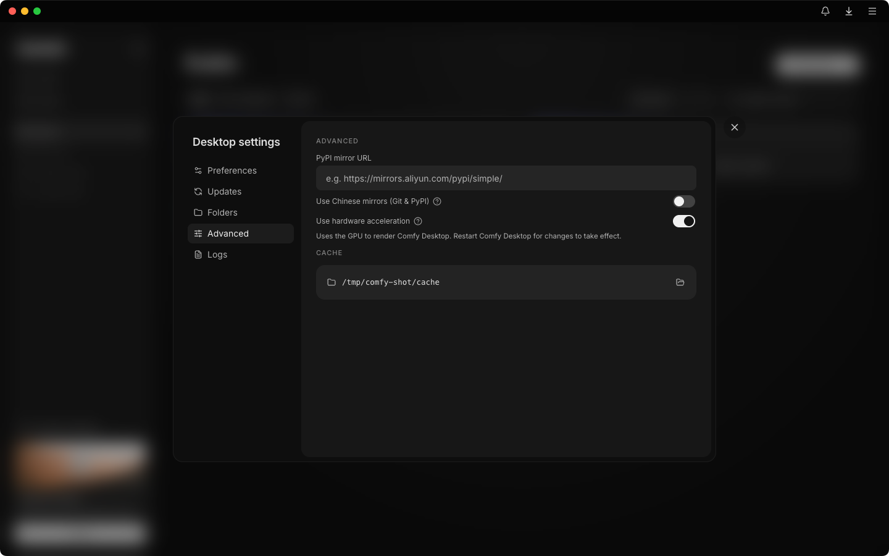

Comfy Desktop führt Ihre ComfyUI-Builds aus, und die **Desktop-Einstellungen** enthalten die Optionen, die für alle Builds gleichzeitig gelten, etwa die Ordner, die sich alle Builds für Modelle teilen, oder den Mirror, den Paket-Downloads verwenden. Einstellungen für einen einzelnen Build, wie dessen eigene Ordner oder Startargumente, finden Sie stattdessen auf der Seite dieses Builds. Über die **Desktop-Einstellungen** können Sie Comfy Desktop aktualisieren, gemeinsame Ordner und den standardmäßigen Installationsort auswählen, Mirrors und den Download-Cache festlegen, Beta-Funktionen aktivieren und das App-Log finden.

## Desktop-Einstellungen öffnen

- Klicken Sie unten in der **Seitenleiste** auf **Desktop-Einstellungen**. In einem Fenster, in dem ComfyUI läuft, können Sie außerdem das **Menü** der **Titelleiste** öffnen und **Desktop-Einstellungen** auswählen. Informationen zur **Seitenleiste** und zur **Titelleiste** finden Sie unter [In Comfy Desktop zurechtfinden](/de/installation/desktop/usage/overview#in-der-seitenleiste-zurechtfinden).

Das Fenster **Desktop-Einstellungen** enthält links fünf Tabs: **Voreinstellungen**, **Updates**, **Ordner**, **Erweitert** und **Protokolle**. Klicken Sie auf einen Tab, um ihn zu öffnen.

## Einstellungen festlegen {#preferences}

Der Tab **Preferences** legt die Sprache der App fest und wie sich Comfy Desktop verhält, wenn Sie Fenster schließen oder Builds starten.

- **Language**: die Sprache von Comfy Desktop. Wählen Sie **English** oder **简体中文**.

Unter **App behavior**:

| Einstellung | Standard | Was sie bewirkt |
| --- | --- | --- |
| **Confirm before closing a window** | Aus | Fragt nach, bevor ein Fenster geschlossen wird, wenn dadurch ComfyUI beendet oder Comfy Desktop verlassen wird. |
| **Warn before running multiple builds** | Ein | Zeigt eine Warnung an, bevor Sie einen weiteren lokalen ComfyUI-Build starten, während bereits einer läuft oder gerade startet. |
| **Hide Cloud from the build picker** | Aus | Blendet die Zeile Comfy Cloud aus **Home** aus. Comfy Cloud funktioniert weiterhin, und Sie können den Schalter jederzeit wieder ausschalten. |

Unter **Privacy**:

- **Share anonymous usage telemetry**: sendet anonyme Nutzungsdaten. Der Schalter ist an, bis Sie ihn ausschalten.
- **Opt in to beta features**: erlaubt Comfy Desktop, frühe ComfyUI-Funktionen in Ihren Builds zu aktivieren. Siehe [Beta-Funktionen aktivieren](#beta-funktionen-aktivieren).

Unter **Community** öffnet die Karte **Comfy Desktop** das [Comfy Desktop GitHub-Repository](https://github.com/Comfy-Org/Comfy-Desktop).

### Beta-Funktionen aktivieren

Wenn **Opt in to beta features** aktiviert ist, helfen Sie, ComfyUI-Funktionen vor ihrer Veröffentlichung zu testen. Ist der Schalter an, kann Comfy Desktop beim Start eines Builds auf diesem Computer eines dieser Startargumente hinzufügen: `--enable-asset-hashing`, `--disable-assets` oder `--enable-agent`. Ein Argument wird nur hinzugefügt, wenn die ComfyUI-Version des Builds es unterstützt. Wenn Sie dieses Argument oder sein Gegenteil bereits in den Startargumenten des Builds gesetzt haben, lässt Comfy Desktop Ihre Einstellung unverändert.

Wenn Sie den Schalter nie geändert haben, folgt er Ihrer Antwort auf **Help improve Comfy by sharing anonymous usage data.** in der Einrichtung. So aktivieren Sie ihn:

1. Aktivieren Sie im Tab **Preferences** den Schalter **Opt in to beta features**.
2. Wenn sich der Schalter nicht aktivieren lässt, bestätigen Sie zuerst die Datenfreigabe: Schalten Sie **Share anonymous usage telemetry** aus und dann wieder ein. Aktivieren Sie anschließend **Opt in to beta features**.

Wenn ein Build mit einer Beta-Funktion startet, zeigt ein Hinweis in seiner **Titelleiste** **A beta feature is on** oder **The {feature} beta is on** an. Klicken Sie auf **Got it**, um ihn zu schließen, oder auf **Settings**, um diesen Tab beim Beta-Schalter zu öffnen. Wenn eine Beta-Funktion für einen Build deaktiviert wird, lautet der Hinweis **A beta feature is off** oder **The {feature} beta is off**.

Um zu sehen, welche Argumente eine Beta-Funktion hinzugefügt hat, öffnen Sie den Tab [**Startup arguments**](/de/installation/desktop/usage/instance-management#set-startup-arguments) des Builds und klicken Sie auf die Schaltfläche **+N beta**. Dort werden die Argumente unter **Added for this session** oder **Eligible for next launch** aufgeführt, und **Manage beta features** öffnet diesen Tab beim Beta-Schalter.

## Comfy Desktop aktualisieren {#updates}

Comfy Desktop sucht 2 Sekunden nach dem Start und danach alle 10 Minuten nach Updates für sich selbst. Comfy Desktop bietet keinen Update-Kanal zur Auswahl. Der Update-Kanal auf der Seite eines Builds gilt für das ComfyUI in diesem Build: siehe [ComfyUI aktualisieren](/de/installation/desktop/usage/instance-management#update-comfyui).

<Note>
  Unter Linux hängt die Art der Aktualisierung von Comfy Desktop davon ab, ob Sie das `.deb`-Paket, die AppImage oder einen Source-Checkout installiert haben. Siehe [Aktualisieren unter Linux](/de/installation/desktop/overview#comfy-desktop-für-ihr-betriebssystem-installieren).
</Note>

### Updates selbst installieren lassen

**Automatically install Desktop updates** auf dem Tab **Updates** ist standardmäßig aktiviert. Findet eine Prüfung ein Update, lädt Comfy Desktop es herunter und installiert es:

- Unter macOS und Linux, wenn Sie Comfy Desktop beenden.
- Unter Windows beim nächsten Start von Comfy Desktop.

Ist der Schalter deaktiviert, wird ein Update erst installiert, wenn Sie auf **Restart & update** klicken.

### Über die Seitenleiste aktualisieren

Wenn ein Update verfügbar ist, zeigt ein Eintrag am unteren Ende der **Seitenleiste** seinen Status an:

| Eintrag lautet | Klicken Sie darauf, um |
| --- | --- |
| **Desktop update** | Den Dialog **Desktop update available** zu öffnen. Auf **Download** zu klicken. |
| **Downloading update…** | Die **Desktop-Einstellungen** auf dem Tab **Updates** zu öffnen, wo der Download-Fortschritt angezeigt wird. |
| **Desktop update ready** | Den Dialog **Desktop update ready** zu öffnen. Auf **Restart & update** zu klicken, um mit dem Update neu zu starten. |

### Selbst nach Updates suchen

1. Öffnen Sie die **Desktop-Einstellungen** und klicken Sie auf den Tab **Updates**.
2. Klicken Sie auf **Check for updates**.
3. Wenn im Tab **Update {version} available** steht, klicken Sie auf **Download**.
4. Wenn im Tab **Update {version} ready to install** steht, klicken Sie auf **Restart & update**.

Comfy Desktop startet mit dem Update neu. Das Update war erfolgreich, wenn im Tab **Updates** **Comfy Desktop is up to date** steht und **Installed** die heruntergeladene Version anzeigt.

## Gemeinsame Ordner und den Installationsort wählen {#storage}

Gemeinsame Ordner ermöglichen es jedem Build, dieselben Modelle, Eingänge und Ausgänge zu verwenden. So laden Sie ein Modell nur einmal herunter und nicht für jeden Build erneut. Auf der Registerkarte **Folders** legen Sie diese Ordner und den Ordner fest, den Comfy Desktop als Ablageort für die von Ihnen erstellten Builds vorschlägt.

Klicken Sie in jeder Ordnerzeile auf den Pfad, um den Ordner zu öffnen, oder klicken Sie auf das Ordnersymbol, um einen anderen Ordner auszuwählen.

- **Default install location**: der übergeordnete Ordner, den Comfy Desktop vorschlägt, wenn Sie einen Build erstellen. Eine Änderung verschiebt keine vorhandenen Builds.
- **Shared folders**: eine Liste mit den Ordnern **Models**, **Input** und **Output**. Jeder Build verwendet sie standardmäßig. Informationen zum Ändern dieser Einstellung für einen einzelnen Build finden Sie unter [Auswählen, welche Ordner der Build verwendet](/de/installation/desktop/usage/instance-management#choose-which-folders-the-build-uses).

So verwalten Sie die gemeinsamen Modellordner:

- **Modellordner hinzufügen**: Klicken Sie auf **Add models folder** und wählen Sie den Ordner aus.
- **Auswählen, wohin Modelle heruntergeladen werden**: Klicken Sie in einer Zeile **Models** auf **Use for downloads**. Diese Zeile trägt dann das Tag **Downloads**. Ein Build kann stattdessen einen eigenen Downloadordner auswählen. Siehe [Wo Downloads gespeichert werden](/de/installation/desktop/usage/downloads#wo-downloads-gespeichert-werden).
- **Modellordner entfernen**: Klicken Sie in der Zeile auf das Menü **⋯**, wählen Sie **Remove** und bestätigen Sie. Die Dateien bleiben auf dem Datenträger. Der mit **Downloads** markierte Ordner hat kein Menü **⋯**. Wählen Sie daher zuerst einen anderen Downloadordner aus. Die Zeilen **Input** und **Output** können nicht entfernt werden.

Standardmäßig sind die Ordner:

| Ordner | macOS und Linux | Windows |
| --- | --- | --- |
| **Default install location** | `~/ComfyUI-Installs` | `%LOCALAPPDATA%\Comfy-Desktop\ComfyUI-Installs` |
| Gemeinsame **Models**, **Input**, **Output** | `~/ComfyUI-Shared/models`, `input`, `output` | `%LOCALAPPDATA%\Comfy-Desktop\ComfyUI-Shared\models`, `input`, `output` |

<Note>
  Unter Windows: Wenn Ihr Benutzerordner bereits `ComfyUI-Installs` oder `ComfyUI-Shared` enthielt, verwendet Comfy Desktop diese weiter. Wenn Sie Comfy Desktop auf einem anderen Laufwerk als dem Systemlaufwerk installiert haben, befinden sich die Ordner stattdessen unter `<drive>:\Comfy-Desktop`.
</Note>

Unter macOS und Linux enthält die Registerkarte **Folders** außerdem **Remove Comfy Desktop data**. Damit entfernen Sie die Protokolle, Caches und temporären Dateien der App, bevor Sie Comfy Desktop deinstallieren. Siehe [Comfy Desktop unter macOS deinstallieren](/de/installation/desktop/overview#comfy-desktop-deinstallieren) oder [Restdaten unter Linux entfernen](/de/installation/desktop/overview#comfy-desktop-deinstallieren).

## Spiegel und Hardwarebeschleunigung einstellen {#advanced}

Wenn Downloads von pypi.org oder github.com bei Ihnen langsam sind, können Sie Comfy Desktop auf dem Tab **Erweitert** auf einen Spiegel umstellen.

- **PyPI mirror URL**: ein Python-Paketindex, zum Beispiel `https://mirrors.aliyun.com/pypi/simple/`. Comfy Desktop installiert Python-Pakete aus diesem Index und verwendet pypi.org als zusätzlichen Index. Standardmäßig leer.
- **Use Chinese mirrors (Git & PyPI)**: standardmäßig deaktiviert. Wenn die Option aktiviert ist, werden Git-Repositories von gitcode.com statt von github.com geklont, und Python-Pakete stammen von mirrors.aliyun.com und mirrors.cloud.tencent.com statt von pypi.org. Wenn die App-Sprache Chinesisch ist, finden Sie diesen Schalter stattdessen auf dem Tab **Preferences** unter **App behavior**. Wenn Ihre Systemsprache Chinesisch ist, fragt das Setup zusätzlich „Enable Chinese mirrors?“ ab.
- **Use hardware acceleration**: standardmäßig aktiviert. Nutzt die GPU zum Rendern von Comfy Desktop. Starten Sie Comfy Desktop neu, damit eine Änderung wirksam wird.

### Download-Cache behalten

Wenn Sie einen Standalone-Build installieren, lädt Comfy Desktop ein ComfyUI-Bundle in den Cache-Ordner herunter, der unter **Cache** auf dem Tab **Erweitert** angezeigt wird. Standardmäßig heißt dieser Ordner `download-cache`. Wenn Sie dasselbe Bundle erneut installieren, zeigt die Installation **Using cached download** an und überspringt den Download.

Comfy Desktop behält nur das neueste Bundle in diesem Ordner. Nach Abschluss eines Downloads werden die anderen Unterordner im Cache-Ordner gelöscht, speichern Sie dort daher nichts anderes. Klicken Sie auf das Ordner-Symbol, um einen anderen Ordner auszuwählen.

## App-Log finden {#logs}

Das App-Log zeichnet auf, was Comfy Desktop tut, einschließlich der Ausgabe, wenn ein Build installiert oder gestartet wird. Fügen Sie es bei, wenn Sie ein Problem im [Issue-Tracker von Comfy Desktop](https://github.com/Comfy-Org/Comfy-Desktop/issues) melden.

- Klicken Sie auf dem Tab **Logs** unter **Diagnostics** auf **Log-Ordner öffnen**.

Der Ordner enthält `app.log` für die aktuelle Sitzung. Bei jedem Start und wenn `app.log` 5 MB überschreitet, benennt Comfy Desktop die alte Datei in `app.log_<timestamp>.log` um und behält bis zu 50 davon. Wählen Sie die Datei aus der Sitzung aus, in der das Problem aufgetreten ist.
