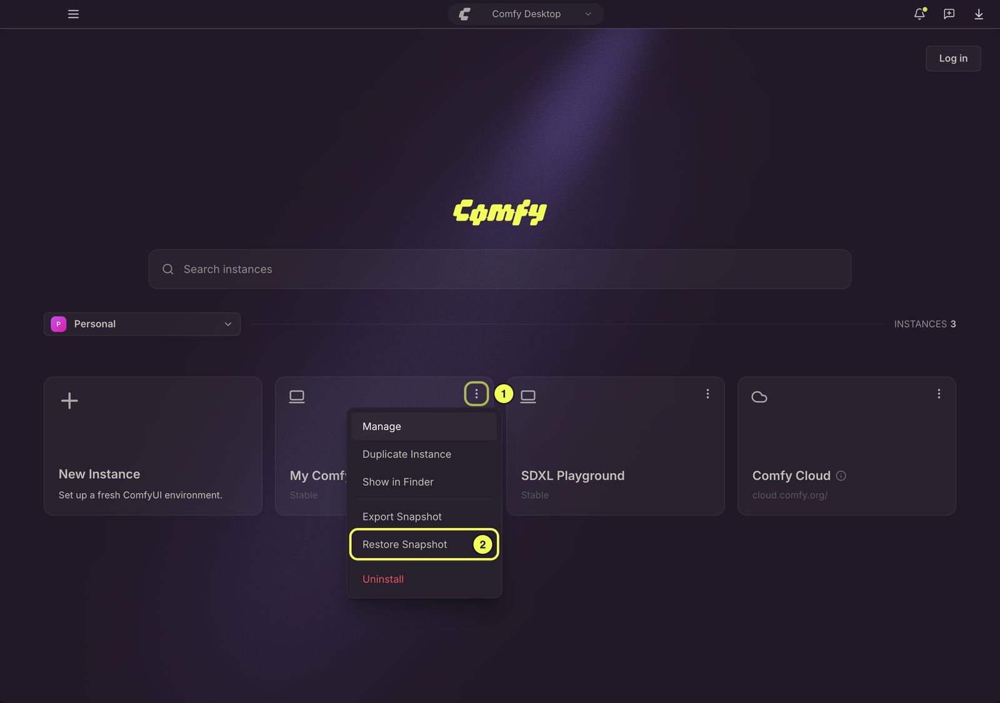
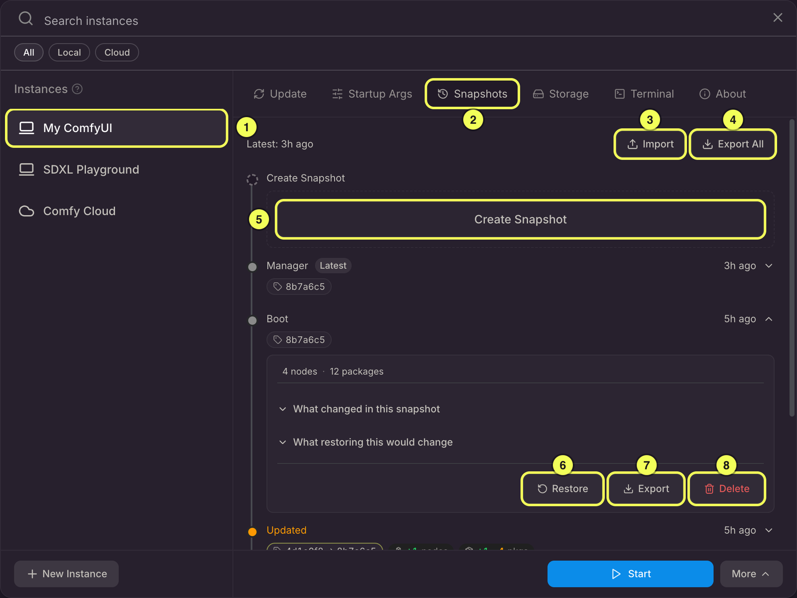
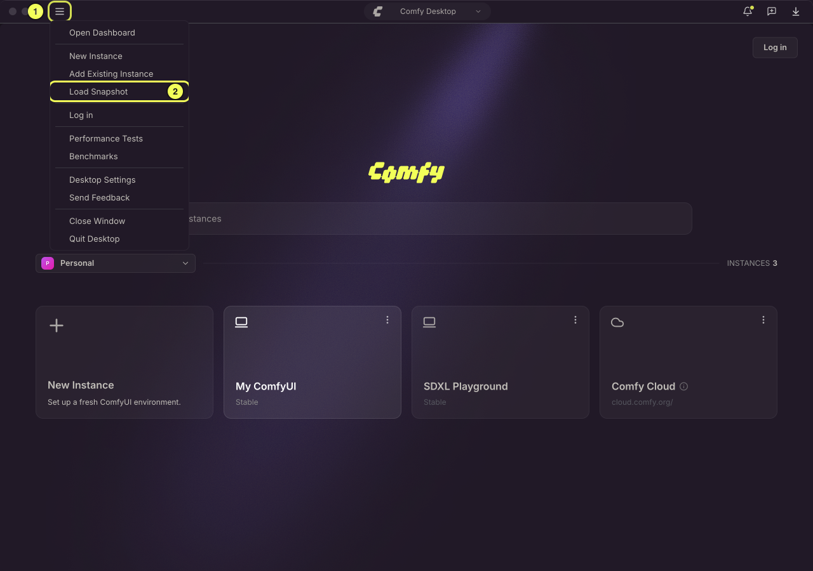
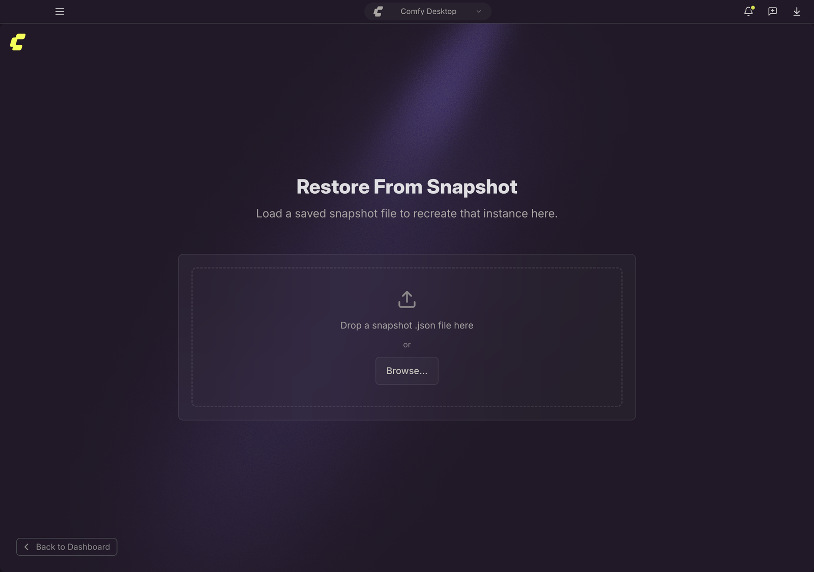
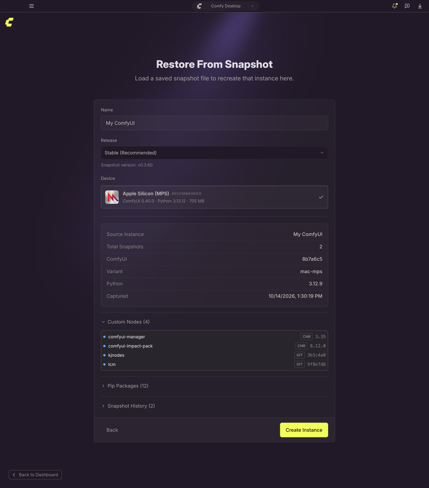

Ein Snapshot erfasst die Softwarekonfiguration einer Instanz, nicht deren Dateien:

- **ComfyUI-Version**: welcher Build von ComfyUI installiert ist
- **Custom Nodes**: jeder Custom Node mit seiner Version oder seinem Commit-Hash
- **pip-Pakete**: jedes Python-Paket in der Umgebung, aus `pip freeze`
- **Python und PyTorch**: die Python-Version und, wenn Comfy Desktop ihn ermitteln kann, der PyTorch-Stack

Snapshots dienen als Wiederherstellungspunkte: nach einem fehlerhaften Update einen Rollback durchführen, eine Installation klonen oder eine funktionierende Konfiguration mit einem Teammitglied teilen.

Comfy Desktop erstellt für eine Standalone-Instanz automatisch Snapshots: bei jedem Start und Neustart, vor und nach einem Update sowie nach einer Wiederherstellung. Sie können jederzeit auch manuell einen Snapshot erstellen.

## Was ein Snapshot nicht enthält

Ein Snapshot ist keine Sicherung Ihrer Dateien. Modelle, Workflows, generierte Ergebnisse, Eingabedateien und ComfyUI-Einstellungen werden nicht aufgezeichnet, und eine Wiederherstellung stellt sie auch nicht wieder her.

Stattdessen baut eine Wiederherstellung den Software-Stack neu auf: Sie checkt die aufgezeichnete ComfyUI-Version aus, bringt die Custom Nodes auf den aufgezeichneten Stand zurück, synchronisiert die Python- und PyTorch-Pakete und führt die Installationsskripte der Nodes aus, die sie ändert. Diese Skripte können eigene ComfyUI-Einstellungen schreiben.

Zwei Dinge sollten Sie wissen:

- **Ein gelöschtes Modell bleibt gelöscht.** Die Wiederherstellung eines älteren Snapshots bringt ein entferntes Modell nicht zurück. ComfyUI meldet es als fehlendes Modell, sobald Sie das nächste Mal einen Workflow öffnen, der es verwendet. Bietet der Dialog für fehlende Modelle für dieses Modell **Download** an, lädt Comfy Desktop es für Sie herunter (siehe [Downloads](/de/installation/desktop/usage/downloads)); andernfalls legen Sie die Datei selbst wieder im passenden Modellordner ab.
- **Snapshots liegen im Instanzordner.** Beim Deinstallieren einer Instanz wird auch ihr Snapshot-Verlauf gelöscht. **Forget** entfernt die Instanz nur aus der Liste und behält den Ordner samt Snapshots. Exportieren Sie in beiden Fällen zuerst das, was Sie behalten möchten, über **Export All** im Tab Snapshots; siehe [Share a Snapshot](#snapshot-teilen).

## Auf Snapshots zugreifen

Klicken Sie auf einer beliebigen Instanzkarte auf das **⋮-Menü** (1) und wählen Sie **Snapshot wiederherstellen** (2) aus, um die Registerkarte **Snapshots** direkt zu öffnen.

Alternativ können Sie das Panel **Verwalten** auf einer beliebigen Instanzkarte öffnen und zur Registerkarte **Snapshots** wechseln.

## Tab „Snapshots“ im Überblick

Der Tab „Snapshots“ ist Ihre zentrale Anlaufstelle für die Verwaltung aller Snapshot-Aktionen. Die Zeitleiste zeigt die Snapshots der Instanz, neueste zuerst, und versieht jeden Eintrag mit einem Tag, der angibt, wie er erstellt wurde: **Boot**, **Manager**, **Update**, **Updated**, **Restored** oder **Manual**. Wurde die Instanz in eine andere Instanz kopiert oder aus einer anderen Instanz kopiert, listet die Zeitleiste auch diese Kopie auf. Die wichtigsten Aktionen im Überblick:

1. **Selected instance**: Die Instanz, deren Snapshots in der Zeitleiste angezeigt werden.
2. **Snapshots tab**: Der aktuell aktive Tab im Manage-Panel.
3. **Import**: Importieren Sie eine Snapshot-Datei, die von einem anderen Benutzer oder einer anderen Instanz exportiert wurde.
4. **Export All**: Exportieren Sie alle Snapshots dieser Instanz als einzelne `.json`-Datei.
5. **Create Snapshot**: Erstellen Sie einen manuellen Snapshot des aktuellen Instanzzustands.
6. **Restore**: Stellen Sie die Instanz auf den Zustand eines bestimmten Snapshots zurück.
7. **Export**: Exportieren Sie einen einzelnen Snapshot aus der Zeitleiste.
8. **Delete**: Löschen Sie einen einzelnen Snapshot aus der Zeitleiste.

### Manuellen Snapshot erstellen

Klicken Sie oben in der Zeitleiste auf **Create Snapshot** (5). Optional können Sie eine Bezeichnung hinzufügen (z. B. „Before adding LCM LoRA“), um den Snapshot später zu identifizieren. Der Snapshot erfasst:

- Aktuellen ComfyUI-Git-Commit
- Jeden Custom Node mit seiner Git-Clone-URL und seinem Commit oder seiner CNR-ID und Version sowie die unter `custom_nodes/.disabled` deaktivierten Ordner. Ein von Hand kopierter Node hat keine Quelle, die eine Wiederherstellung nutzen kann, daher überspringt eine Wiederherstellung ihn, und ein einzelner `.py`-Node, der in `.disabled` verbleibt, wird überhaupt nicht aufgezeichnet
- Alle pip-Pakete aus `pip freeze`

Manuelle Snapshots zählen nicht zum Limit für automatische Snapshots und können einzeln gelöscht werden.

### Snapshot-Details anzeigen

Klicken Sie auf eine beliebige Zeile, um sie zu erweitern. Eine eingeklappte Zeile zeigt bereits an, wie der Snapshot erstellt wurde, wann er aufgenommen wurde, die ComfyUI-Version sowie Pills, die zusammenfassen, wie viele Nodes und Pakete im Vergleich zum vorherigen Snapshot hinzugefügt, entfernt oder geändert wurden. Der neueste Snapshot trägt außerdem ein **Latest**-Badge.

Die erweiterte Ansicht zeigt die Gesamtzahl der Nodes und Pakete des Snapshots, seine Bezeichnung, falls vorhanden, und zwei einklappbare Diffs:

- **What changed in this snapshot**: Vergleicht diesen Snapshot mit dem unmittelbar vorherigen. Für den ältesten Snapshot in der Zeitleiste ausgeblendet.
- **What restoring this would change**: Vergleicht diesen Snapshot mit dem aktuellen Zustand der Instanz. Für den neuesten Snapshot in der Zeitleiste ausgeblendet.

Die Schaltflächen **Restore**, **Export** und **Delete** für diesen Snapshot befinden sich ebenfalls in dieser erweiterten Ansicht. Der neueste Snapshot in der Zeitleiste hat keine Schaltfläche **Restore**.

### Aus einem Snapshot wiederherstellen

1. Suchen Sie im Tab „Snapshots“ den Snapshot, den Sie wiederherstellen möchten.
2. Klicken Sie auf **Restore**: Eine Vorschau zeigt den Diff (was sich ändern wird).
3. Prüfen Sie die Änderungen und klicken Sie im Bestätigungsdialog auf **Restore**, um den Vorgang zu starten.

Für die Wiederherstellung muss die Instanz gestoppt sein. Wenn ComfyUI beim Start der Wiederherstellung läuft, weist der Dialog darauf hin, dass die Instanz zuerst gestoppt wird. Comfy Desktop stoppt sie, wartet auf ihr Beenden, führt die Wiederherstellung aus und startet sie erneut, wenn die Wiederherstellung erfolgreich war.

Während der Wiederherstellung führt Comfy Desktop Folgendes aus:

1. **Die aufgezeichnete ComfyUI-Version auschecken** (Git-Commit)
2. **Fehlende Custom Nodes installieren**, Versionen wechseln und Nodes nach Bedarf aktivieren oder deaktivieren
3. **Die Installationsskripte der Nodes ausführen**, die Comfy Desktop installiert oder gewechselt hat, zuerst `requirements.txt` und dann `install.py`. Bei einem Node, den Comfy Desktop nur aktiviert oder deaktiviert, und bei einem Node, der deaktiviert wiederhergestellt wird, werden sie nicht ausgeführt
4. **pip-Pakete wiederherstellen**: fehlende Pakete installieren, auf die aufgezeichnete Version upgraden/downgraden und zusätzliche Pakete entfernen

Comfy Desktop stellt zuerst die Custom Nodes wieder her, da die Installation eines Nodes Python-Pakete nach sich ziehen kann, und synchronisiert danach die Python-Pakete. Vor der Synchronisierung sichert es die Pakete, die es überschreiben oder entfernen wird. Ein Abbruch oder ein Fehler bei der Paketinstallation nach diesem Punkt stellt diese Pakete wieder her und setzt ComfyUI auf den Commit zurück, auf dem es vor der Wiederherstellung war. Konnte ein Paket nicht wiederhergestellt werden, meldet die Wiederherstellung dies, statt eine saubere Rücknahme zu behaupten. Ein Abbruch während des Node-Schritts setzt den Commit zurück, lässt aber die bereits installierten Node-Ordner und alle von ihnen hinzugefügten Pakete unangetastet. Wenn die Umgebung bereits dem Snapshot entspricht, meldet die Wiederherstellung **No changes needed** und lässt die Umgebung unverändert.

Bei Custom Nodes wird nach bestem Bemühen vorgegangen. Ein Node, der sich nicht installieren oder wechseln lässt, hält den Rest der Wiederherstellung nicht auf: Die Wiederherstellung wird mit aufgelisteten Fehlern abgeschlossen, und der dabei geschriebene Zeitleisteneintrag trägt neben seinem Tag **Restored** die Bezeichnung **Restore did not complete**. Beheben oder entfernen Sie den Node und stellen Sie anschließend erneut wieder her.

Die Karte oben in der Zeitleiste meldet, wie die letzte Wiederherstellung ausgegangen ist: **Snapshot restored** oder **Restore failed**. Das Abbrechen einer Wiederherstellung schließt die Karte ohne Ergebnis. Eine erfolgreiche Wiederherstellung fügt außerdem einen neuen Eintrag mit dem Tag **Restored** hinzu, der den Zustand aufzeichnet, den die Wiederherstellung erzeugt hat.

### Snapshot in eine Instanz importieren

Verwenden Sie **Import** im Tab „Snapshots“, um eine Snapshot-Datei in den eigenen Verlauf der Instanz zu übernehmen. Es wird nur der neueste Snapshot in der Datei angewendet. Kann die Umgebung exakt reproduziert werden, wird dieser Snapshot zur Zeitleiste hinzugefügt; andernfalls speichert Comfy Desktop stattdessen einen Snapshot des resultierenden Zustands, und ältere Snapshots in der Datei werden ignoriert. Kann der PyTorch-Build des Snapshots auf diesem Rechner nicht angewendet werden, warnt Comfy Desktop Sie, bevor es den Snapshot anwendet.

### Snapshot löschen

Erweitern Sie einen beliebigen Snapshot und klicken Sie auf **Delete**, um ihn zu entfernen. Comfy Desktop behält pro Installation die neuesten 200 unbeschrifteten Boot- und Manager-Snapshots und entfernt ältere automatisch, sobald neue geschrieben werden. Diese müssen Sie also nie von Hand bereinigen. Manuell aufgenommene Snapshots sowie Snapshots vor oder nach einem Update oder nach einer Wiederherstellung werden nie automatisch entfernt. Löschen Sie sie daher selbst, sobald Sie sie nicht mehr benötigen.

## Snapshot teilen

Snapshot-Dateien sind portabel: Eine einzelne `.json`-Datei enthält die gesamte Konfiguration, sodass Sie sie einem Teammitglied weitergeben oder auf einen anderen Rechner verschieben können.

Zwei Schnellzugriffe exportieren den **neuesten** Snapshot einer Instanz, ohne dass Sie den Tab **Snapshots** öffnen müssen:

- Auf der Karte der Instanz im Dashboard öffnen Sie das **⋮**-Menü und wählen Sie **Export Snapshot**.
- In der Instanzauswahl öffnen Sie in der Fußzeile das Menü **More** und wählen Sie **Share**.

Beide öffnen einen Speichern-Dialog und schreiben eine einzelne `.json`-Datei. Wenn die Instanz noch keine Snapshots hat, teilt Comfy Desktop Ihnen mit, dass es nichts zu teilen gibt. Um einen bestimmten Snapshot oder alle Snapshots auf einmal zu exportieren, verwenden Sie **Export** und **Export All** im Tab **Snapshots**.

Ein Empfänger kann entweder eine neue Instanz aus der Datei erstellen oder sie in eine bereits vorhandene Instanz importieren.

## Instanz aus einer Snapshot-Datei erstellen

Wenn Ihnen jemand eine Snapshot-Datei zur Verfügung stellt, können Sie damit eine neue ComfyUI-Instanz mit exakt derselben Konfiguration starten.

1. Klicken Sie auf das **☰-Menü** (1) in der oberen linken Ecke der Chooser-Ansicht und wählen Sie **Load Snapshot** (2).

2. Durchsuchen Sie Ihr Dateisystem und wählen Sie die `.json`-Snapshot-Datei aus.

3. Eine Vorschau zeigt den Inhalt des Snapshots: Name der Quellinstanz, ComfyUI-Version, Custom Nodes und pip-Pakete. Prüfen Sie die Details und klicken Sie dann auf **Create Instance**, um eine neue Instanz aus dem Snapshot zu erstellen.

Dadurch wird eine völlig neue eigenständige Instanz erstellt, und die ursprüngliche Instanz bleibt unverändert. Die neue Instanz erscheint in der Chooser-Ansicht neben Ihren anderen Instanzen.
