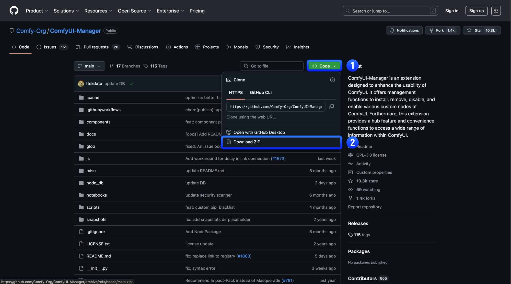

## Was sind Custom Nodes?

Custom Nodes sind Erweiterungen für ComfyUI, die neue Funktionen hinzufügen, etwa erweiterte Bildverarbeitung, Fine-Tuning von Machine-Learning-Modellen, Farbanpassungen und mehr. Diese von der Community entwickelten Nodes erweitern die Kernfunktionen von ComfyUI erheblich.

<Warning>
Bevor Sie Custom Nodes installieren, ist es wichtig, sie sorgfältig zu prüfen. Da ComfyUI ein Open-Source-Projekt ist, könnten bösartige Plugins Custom Nodes potenziell ausnutzen:
1. Installieren Sie Custom Nodes nur von vertrauenswürdigen Autoren und von solchen, die in der Community üblicherweise verwendet werden
2. Verstehen Sie die Funktionsweise des Plugins, bevor Sie es installieren, und vermeiden Sie unbekannte Quellen, um die Systemsicherheit zu gewährleisten
3. Vermeiden Sie die Installation unbekannter oder verdächtiger Plugins: Nicht verifizierte Plugins können Sicherheitsrisiken darstellen, die zu einer Kompromittierung des Systems führen können
</Warning>

Alle Installationen von Custom Nodes erfordern diese beiden Schritte:

1. Klonen Sie den Node-Code in das Verzeichnis `ComfyUI/custom_nodes`
2. Installieren Sie die erforderlichen Python-Abhängigkeiten

Dieser Leitfaden vergleicht drei Installationsansätze. **ComfyUI Manager** ist in den aktuellen ComfyUI-Versionen für die meisten Setups bereits enthalten: Beginnen Sie mit der [Übersicht über den ComfyUI Manager](/de/manager/overview), um zu erfahren, was er leistet und wie Sie ihn aktivieren. Verwenden Sie **Git clone** oder **ZIP**, wenn ein Node nicht in der Registry enthalten ist oder Sie eine bestimmte Revision benötigen.

| Methode                        | Vorteile                                                    | Nachteile                                                |
| ---------------------------- | ------------------------------------------------------------- | ----------------------------------------------------------- |
| **ComfyUI Manager** (Empfohlen) | 1. Automatische Installation<br/>2. Umgang mit Abhängigkeiten<br/>3. GUI-Oberfläche | Nodes, die nicht in der Registry registriert sind, lassen sich nicht direkt suchen |
| **Git Clone**                | Kann Nodes installieren, die nicht in der Registry registriert sind               | 1. Erfordert Git-Kenntnisse<br/>2. Manuelle Behandlung von Abhängigkeiten<br/>3. Installationsrisiken |
| **Repository-ZIP herunterladen**   | 1. Kein Git erforderlich<br/>2. Manuelle Kontrolle                      | 1. Manuelle Behandlung von Abhängigkeiten<br/>2. Keine Versionskontrolle<br/>3. Installationsrisiken |

Tipp: Prüfen Sie vor der Installation von Custom Nodes die README-Datei des Plugins, um Installationsmethoden, Nutzung und Anforderungen wie bestimmte Modelle, Versionen der Abhängigkeiten und Lösungen für häufige Probleme zu verstehen.

## Methode 1: ComfyUI Manager (empfohlen) {#method-1-comfyui-manager-recommended}

<Note>
Sie benötigen ComfyUI Manager in Ihrer Umgebung, bevor Sie diese Methode verwenden. Wenn er fehlt oder deaktiviert ist, lesen Sie die [ComfyUI Manager Übersicht](/de/manager/overview) und die [Installationsanleitung](/de/manager/install).
</Note>

ComfyUI Manager bietet zwei UI-Versionen für die Verwaltung von Custom Nodes. Wählen Sie die Anleitung, die zu Ihrer Oberfläche passt:

<Columns cols={2}>
  <Card title="Neue UI (Standard für Desktop)" icon="sparkles" href="/de/manager/pack-management">
    Die neue Oberfläche zur Node-Verwaltung, standardmäßig für Desktop-Benutzer aktiviert.
  </Card>
  <Card title="Legacy UI" icon="rectangle-history" href="/de/manager/legacy-ui">
    Die klassische Manager-Oberfläche für die Installation von Custom Nodes.
  </Card>
</Columns>

## Methode 2: Manuelle Installation mit Git

Geeignet für neue Nodes, die nicht im Manager zu finden sind, oder wenn bestimmte Versionen benötigt werden. Erfordert [Git](https://git-scm.com/), das auf Ihrem System installiert sein muss.

<Steps>
  <Step title="Repository-URL abrufen">
    Klicken Sie auf GitHub auf die Schaltfläche „Code“ und kopieren Sie den HTTPS-Link
  </Step>
  <Step title="Zum Verzeichnis custom_nodes navigieren">
 ```bash
 cd /path/to/ComfyUI/custom_nodes
 ```
  </Step>
  <Step title="Repository klonen">
 ```bash
 git clone [repository URL]
 ```
  </Step>
  <Step title="Abhängigkeiten installieren">
  Abhängigkeiten müssen in Ihrer ComfyUI-Umgebung installiert werden. Achten Sie darauf, sie nicht mit Ihrer Systemumgebung zu vermischen, um Verunreinigungen zu vermeiden.
   <Tabs>
    <Tab title="Windows Portable">
    Installieren Sie für die portable Windows-Version die Abhängigkeiten in der eingebetteten Python-Umgebung.
      ```bash
      ..\..\python_embeded\python.exe -m pip install -r [node directory]\requirements.txt
      ```
    </Tab>
    <Tab title="Manuelle Installation">
    Installieren Sie die Abhängigkeiten in Ihrer ComfyUI-Umgebung.
      ```bash
      cd [node directory]
      pip install -r requirements.txt
      ```
    </Tab>
  </Tabs>
  </Step>
  <Step title="ComfyUI neustarten und Browser aktualisieren">
    Starten Sie ComfyUI neu und aktualisieren Sie Ihren Browser. Prüfen Sie die Startprotokolle auf `import failed`-Fehler.
  </Step>
</Steps>

## Methode 3: Installation per ZIP-Download
Geeignet für Anwender, die Git oder den Manager nicht verwenden können

<Warning>
Wir empfehlen diese Installationsmethode nicht, da dabei die Versionskontrolle verloren geht
</Warning>

<Steps>
  <Step title="Auf GitHub auf `Code` → `Download ZIP` klicken">
    Klicken Sie auf der GitHub-Seite auf `Code` → `Download ZIP`
    
  </Step>
  <Step title="ZIP-Datei entpacken">
    Entpacken Sie die heruntergeladene ZIP-Datei
  </Step>
  <Step title="Den entpackten Ordner in das Verzeichnis `ComfyUI/custom_nodes/` kopieren">
    Kopieren Sie den entpackten Ordner in das Verzeichnis `ComfyUI/custom_nodes/`
  </Step>
  <Step title="Abhängigkeiten manuell installieren (wie Schritt 4 der Git-Methode)">
    Starten Sie ComfyUI neu und aktualisieren Sie den Browser
  </Step>
  <Step title="Erfolgreiche Installation überprüfen">
    Prüfen Sie nach dem Neustart im ComfyUI Manager, ob das Plugin erfolgreich installiert wurde und keine `import failed`-Fehler auftreten
  </Step>
</Steps>

## Ressourcen für Custom Nodes

In ComfyUI können Custom Nodes neben der grundlegenden Funktionalität von Node-Erweiterungen auch die folgenden zusätzlichen Ressourcen enthalten:
- [Node-Dokumentation](/de/custom-nodes/help_page): Diese Funktion unterstützt alle Custom Nodes und Basis-Nodes. Sie können damit die Node-Dokumentation anzeigen, den Zweck und die Nutzung von Nodes verstehen und Dokumentation per PR an den Autor beitragen.
- [Workflow-Vorlagen für Custom Nodes](/de/custom-nodes/workflow_templates): Workflow-Vorlagen, die Node-Autoren als Beispiel-Workflows bereitstellen und die aus den ComfyUI-Vorlagen heraus durchsucht und geladen werden können.
- [Mehrsprachige Unterstützung](/de/custom-nodes/i18n)

Wenn Sie Entwickler von Custom Nodes sind, können Sie diese Ressourcen hinzufügen, um Ihre Custom Nodes benutzerfreundlicher zu gestalten.
