Der App-Modus vereinfacht die Interaktion mit Workflows, indem Sie benutzerdefinierte Eingabe- und Ausgabeoberflächen definieren können. So lassen sich Workflows einfacher teilen und nutzen, ohne Nodes bearbeiten zu müssen.

<iframe
  className="w-full aspect-video rounded-xl"
  src="https://www.youtube.com/embed/MR6CmStFoWA"
  title="ComfyUI APP Mode Guide"
  allow="accelerometer; clipboard-write; encrypted-media; gyroscope; picture-in-picture"
  allowFullScreen
></iframe>

<Note>
Der App-Modus wird offiziell ab Version 1.41.13 des ComfyUI-Frontends unterstützt. Frühere Versionen befinden sich in einer frühen Testphase.
</Note>

## App-Modus starten

Es gibt zwei Möglichkeiten, den App-Modus zu öffnen: Klicken Sie auf das Symbol oben links (**1**) und wählen Sie **App-Modus starten** aus dem Dropdown-Menü, oder verwenden Sie das Breadcrumb-Navigationsdropdown (**2**) oben in der Oberfläche.

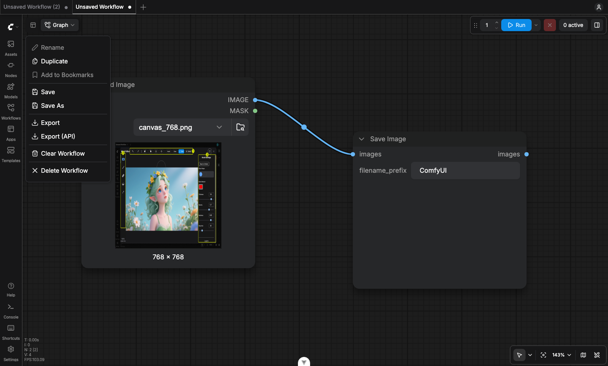

1. Klicken Sie auf das Symbol oben links (markiert mit **1**), um das Dropdown-Menü zu öffnen, und wählen Sie **App-Modus starten**.
2. Alternativ verwenden Sie das Breadcrumb-Navigationsdropdown (markiert mit **2**) oben, um den App-Modus zu öffnen.

## Workflow für den App-Modus erstellen

<iframe
  className="w-full aspect-video rounded-xl"
  src="https://www.youtube.com/embed/tqLY-vjY-3I"
  title="App-Modus-Workflows erstellen"
  allow="accelerometer; clipboard-write; encrypted-media; gyroscope; picture-in-picture"
  allowFullScreen
></iframe>

Wenn der Workflow noch nie für den App-Modus konfiguriert wurde, wird beim Wechsel in den App-Modus automatisch der App-Builder geöffnet.

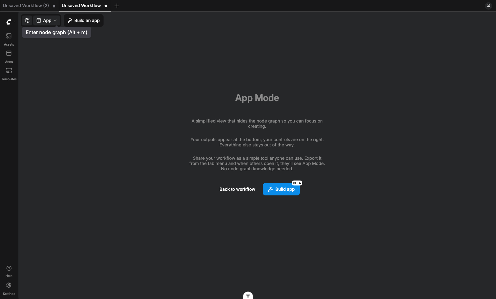

1. Wenn für den Workflow noch keine App-Modus-Konfiguration vorhanden ist, wird der App-Builder standardmäßig geöffnet.
2. Klicken Sie auf **Build app**, um den App-Builder zu öffnen und mit der Konfiguration zu beginnen.

### Schritt 1: Eingaben auswählen

Die Oberfläche des Builders zeigt oben vier geführte Schritte (markiert mit **1**, **2**, **3**, **4**). Über die untere Leiste können Sie den Builder verlassen oder zwischen den Schritten navigieren.

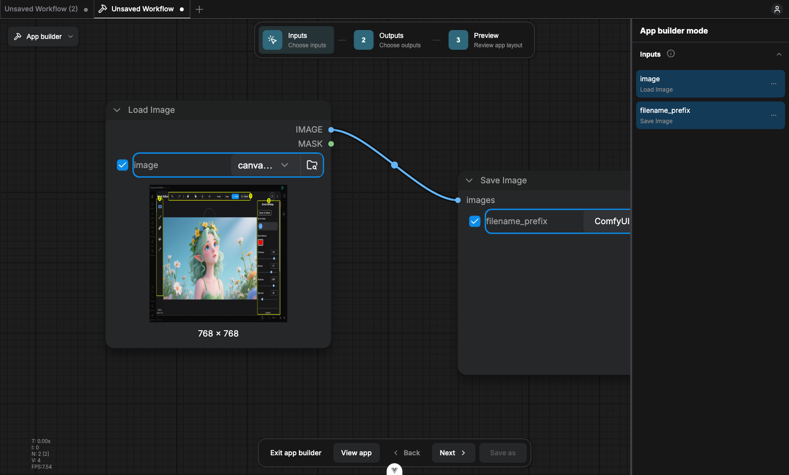

1. Die Zahlen **1 2 3 4** oben entsprechen den vier Erstellungsschritten: Eingaben auswählen, Ausgaben auswählen, Vorschau und Standardansicht festlegen.
2. Mit den Schaltflächen unten können Sie den Builder verlassen oder zwischen den Schritten wechseln.
3. Die im Canvas markierten Bereiche sind auswählbare Eingabe- und Ausgabeparameter.
4. Das rechte Panel zeigt eine Live-Vorschau der aktuellen Konfiguration.

Klicken Sie oben auf den Schritt **Inputs**. Der Canvas hebt auswählbare Eingabe-Nodes hervor. Klicken Sie auf einen Node, um ihn als Eingabeparameter auszuwählen: Zu den Optionen gehören Bild-Uploads, Texteingaben für Prompts und die Modellauswahl. Ausgewählte Parameter werden in der rechten Seitenleiste angezeigt.

### Schritt 2: Ausgaben auswählen

Klicken Sie auf den Schritt **Outputs**. Wählen Sie die Ausgabe-Nodes aus, die in der App angezeigt werden sollen, etwa einen Preview-Node oder einen Save Image-Node.

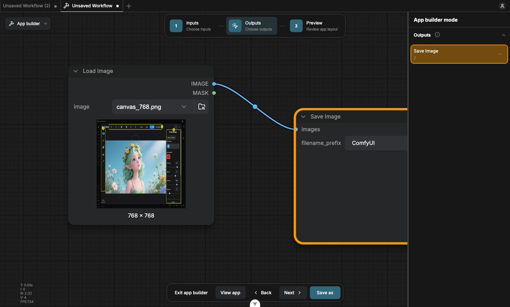

1. Wählen Sie die Ausgabe-Nodes aus, die in der App angezeigt werden sollen.
2. Ähnlich wie bei den Eingaben zeigt die rechte Seitenleiste eine Live-Vorschau der ausgewählten Ausgabe-Nodes.

### Schritt 3: Vorschau

Klicken Sie auf den Schritt **Preview**, um das endgültige Layout der App zu prüfen. Die ausgewählten Eingaben erscheinen im rechten Panel, und der Ausgabebereich wird im Canvas angezeigt.

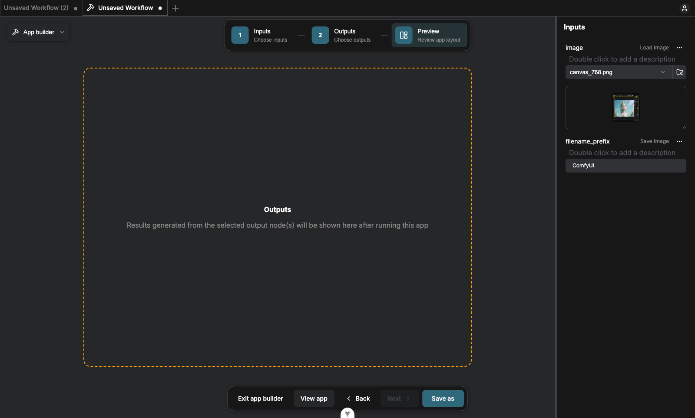

1. Dies ist der Vorschaumodus: Prüfen Sie, ob alle Eingabe- und Ausgabekonfigurationen wie erwartet erscheinen.
2. Falls Anpassungen erforderlich sind, klicken Sie auf **Back**, um zum vorherigen Schritt zurückzukehren.

### Schritt 4: Standardansicht festlegen

Klicken Sie auf den Schritt **Set a default view**. Wählen Sie, ob der Workflow standardmäßig im Modus **App** oder im Modus **Node Graph** geöffnet werden soll. Klicken Sie zur Bestätigung auf **Apply**.

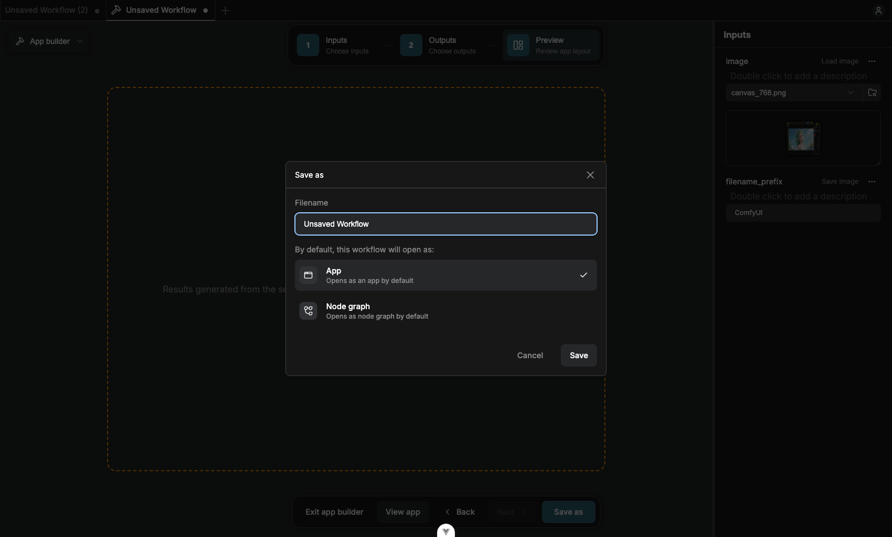

1. Legen Sie fest, ob der Workflow beim Öffnen standardmäßig im Modus **App** oder im Modus **Node Graph** angezeigt wird.
2. Wählen Sie **App** und klicken Sie zur Bestätigung auf **Apply**. Der Workflow wird dann standardmäßig im App-Modus geöffnet.

Nach dem Anwenden erscheint ein Bestätigungsdialog.

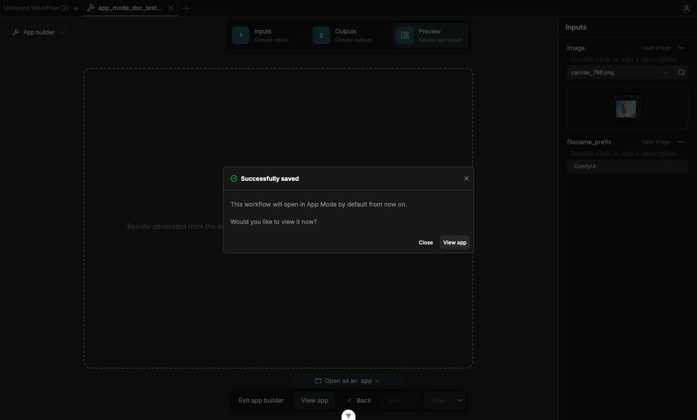

Klicken Sie auf **View app**, um den App-Modus zu starten und den Workflow zu verwenden.

## App-Modus verwenden

Im App-Modus zeigt das rechte Panel alle konfigurierten Eingabeoptionen. Passen Sie die Eingaben nach Bedarf an und klicken Sie anschließend auf **Run**, um den Workflow auszuführen.

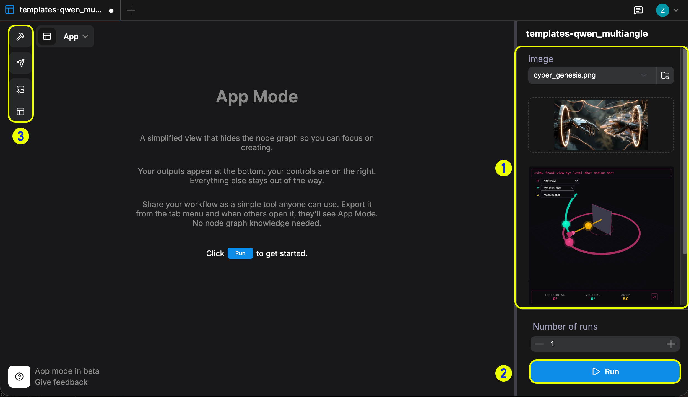

1. Im rechten **Eingabe**-Panel können Sie die Eingabeparameter vor der Ausführung anpassen.
2. Klicken Sie auf **Run**, um den Workflow auszuführen.
3. Die linke Seitenleiste bietet zusätzliche Steuerelemente, etwa zum Neuerstellen der App, zum Anzeigen von Assets und zum Öffnen des Workflow-Panels.

Der App-Modus ist außerdem für Mobilgeräte und schmale Bildschirme optimiert. Die Oberfläche wechselt in eine tabbasierte Ansicht, in der Sie zwischen Eingabe-Panel, Ausgabeansicht und Medien-Assets-Panel umschalten können.

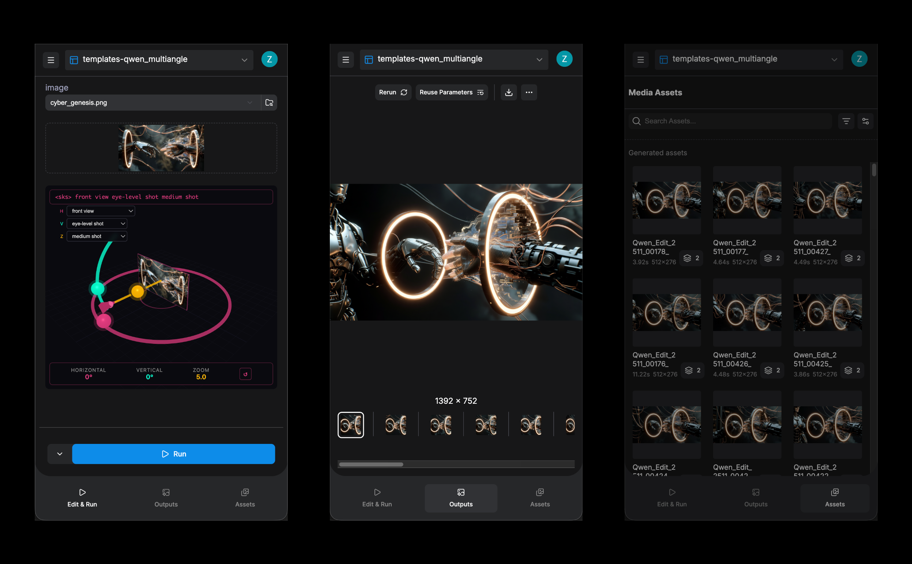

Während der Ausführung erscheint oben die Schaltfläche **Diese Ausführung abbrechen**, um die aktuelle Ausführung zu stoppen.

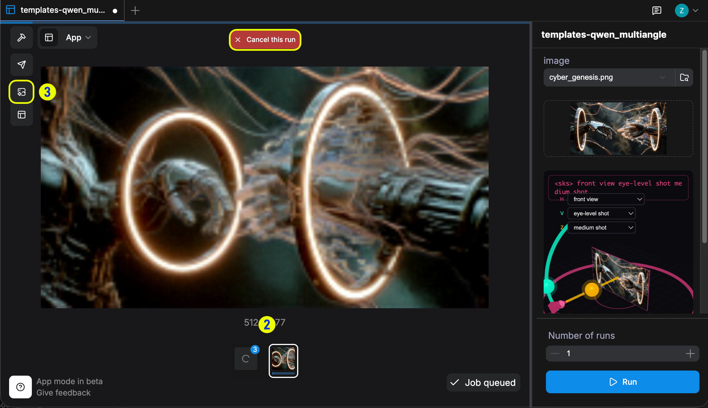

1. Klicken Sie oben auf **Diese Ausführung abbrechen**, um die aktuelle Ausführung zu stoppen.
2. Wechseln Sie im unteren Panel zwischen der Warteschlangenansicht und der Ergebnisansicht.
3. Klicken Sie auf den entsprechenden Bereich, um das Assets-Panel zu öffnen.

## Workflow speichern und teilen

### Workflow speichern

Verwenden Sie `Ctrl + S` (oder `Cmd + S` auf dem Mac), um den Workflow für die spätere Verwendung zu speichern.

Klicken Sie auf die Schaltfläche in der linken Seitenleiste, um das Panel mit den gespeicherten Workflows zu öffnen.

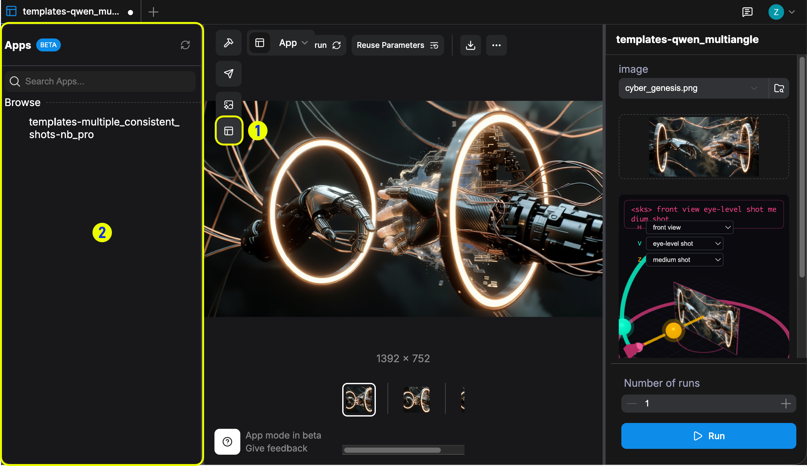

1. Klicken Sie auf die Schaltfläche in der linken Seitenleiste, um das Panel zu öffnen, in dem alle gespeicherten App-Workflows angezeigt werden.
2. Wechseln Sie in diesem Panel zwischen gespeicherten App-Workflows.

### Workflow teilen

<iframe
  className="w-full aspect-video rounded-xl"
  src="https://www.youtube.com/embed/-JEDHJktsr0"
  title="So teilen Sie Workflows"
  allow="accelerometer; clipboard-write; encrypted-media; gyroscope; picture-in-picture"
  allowFullScreen
></iframe>

Klicken Sie im App-Modus auf die Schaltfläche **Share** in der linken Seitenleiste. Wenn der Workflow noch nicht gespeichert wurde, werden Sie in einem Dialog aufgefordert, ihn zuerst zu speichern, bevor ein Link erstellt werden kann.

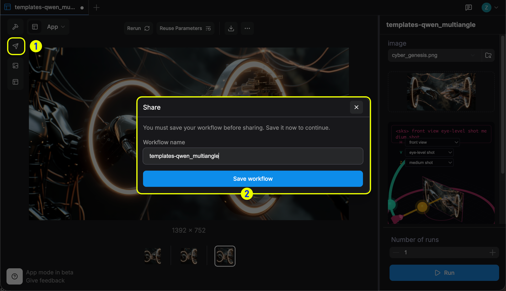

1. Klicken Sie auf die Schaltfläche Share in der linken Seitenleiste, um den Share-Dialog zu öffnen.
2. Wenn der Workflow ungespeichert ist, geben Sie einen Workflow-Namen ein und klicken Sie auf **Save workflow**, um fortzufahren.

Nach dem Speichern zeigt der Share-Dialog die Option, einen Link zu generieren.

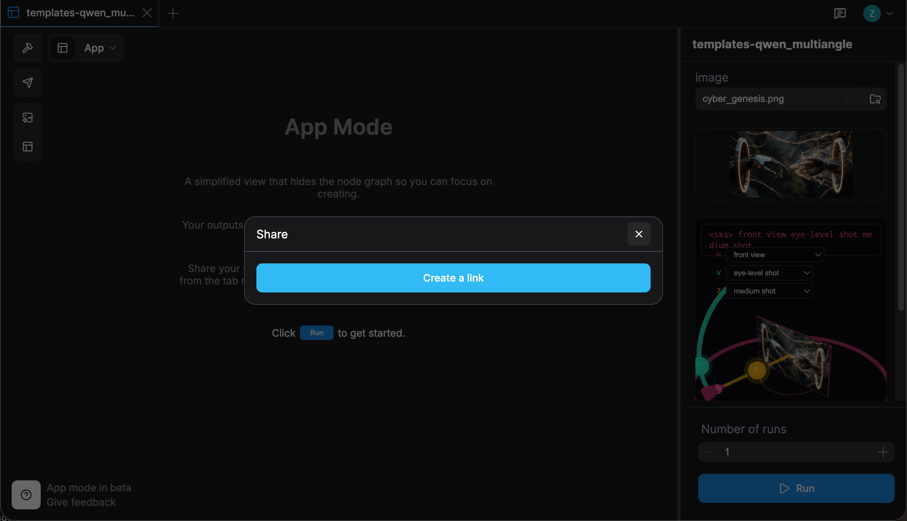

Klicken Sie auf **Create a link**, um eine teilbare URL für den Workflow zu generieren.

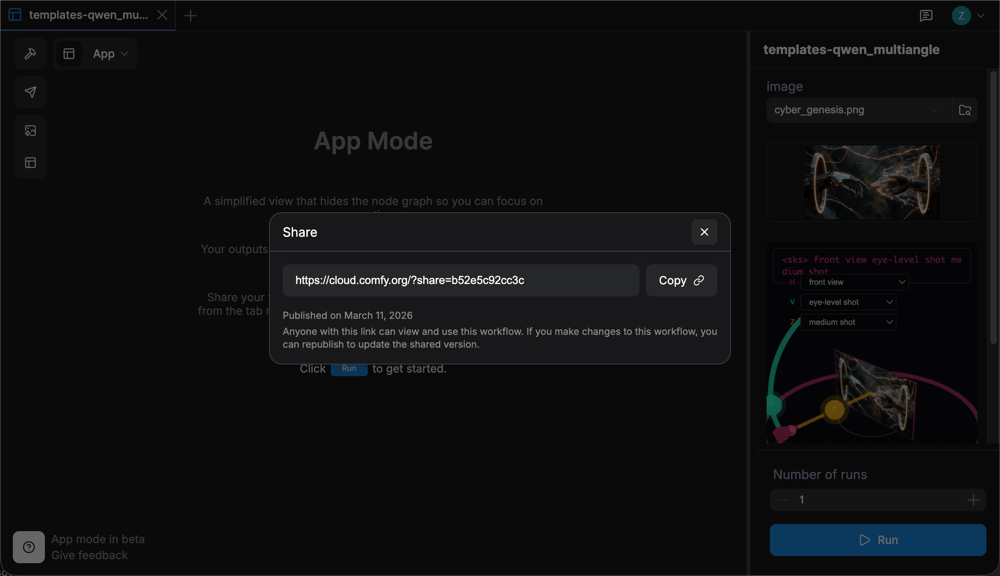

Klicken Sie auf **Copy**, um den Link zu kopieren. Empfänger können ihn öffnen und den Workflow direkt ausführen: Die vollständige Workflow-Konfiguration ist im Link enthalten.

<Note>
Share-Links werden nur in Comfy Cloud unterstützt.
</Note>
