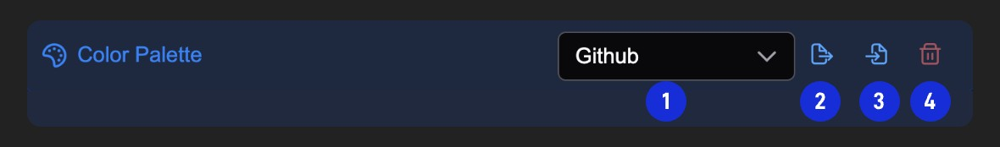
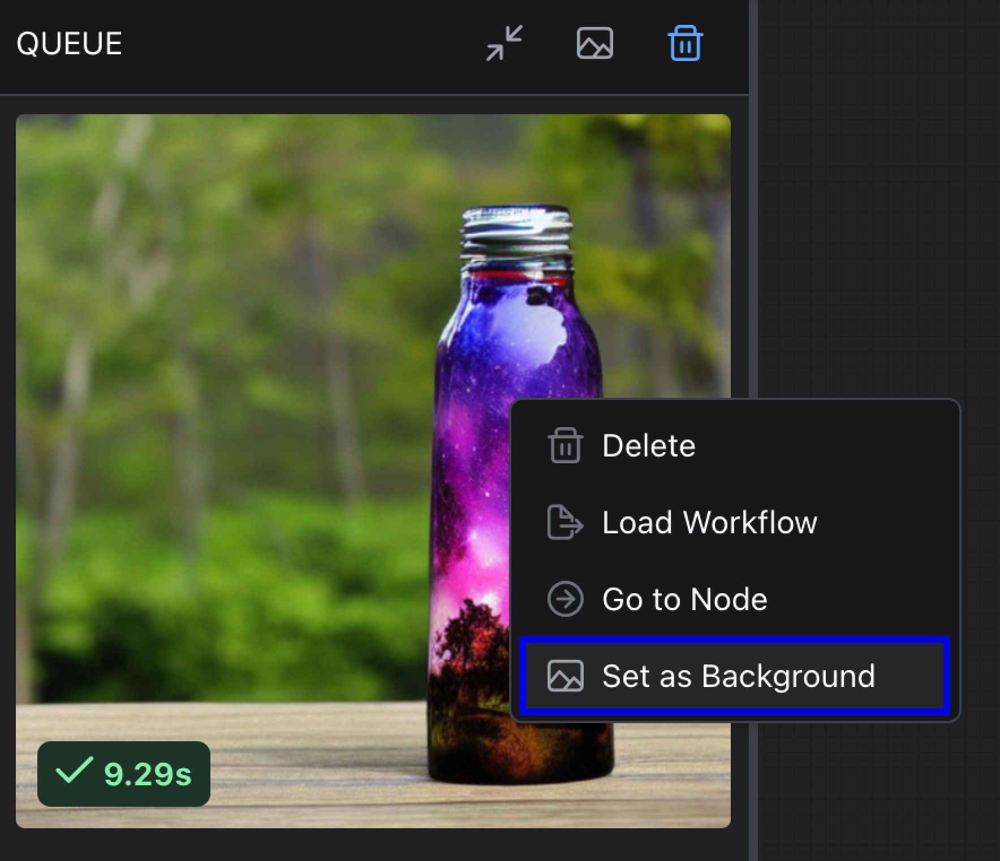
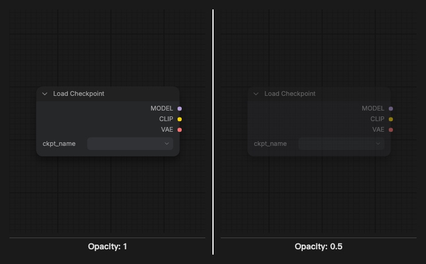
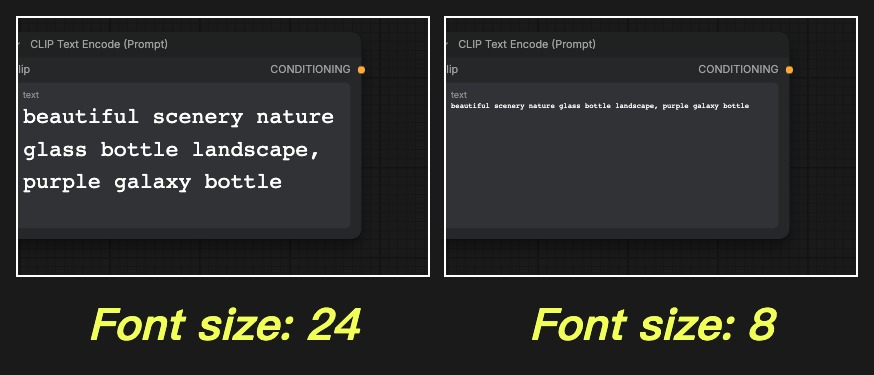
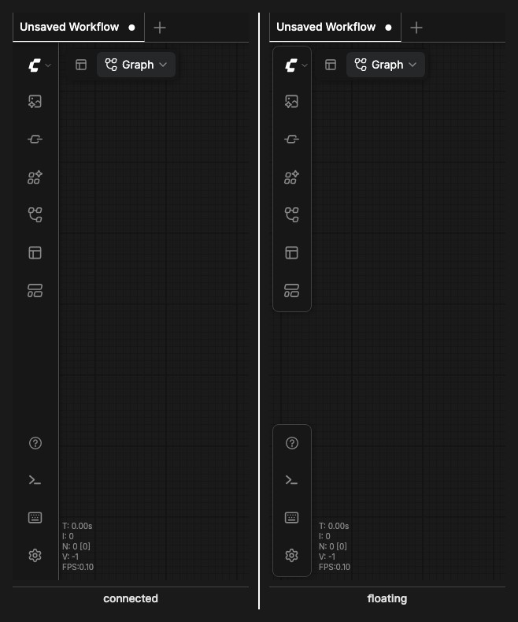
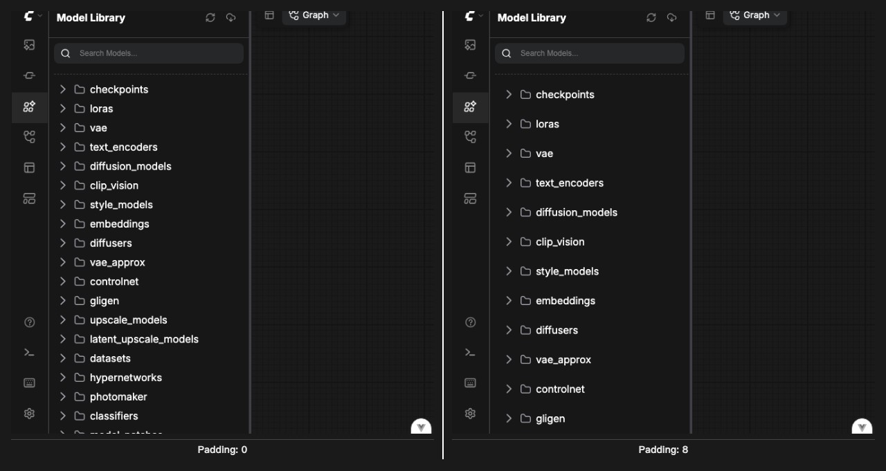

import UserDirectory from "/snippets/de/install/user-directory.mdx"
import SettingsMenuContext from "/snippets/de/interface/settings-menu-context.mdx"

<SettingsMenuContext />

ComfyUI bietet flexible Anpassungsoptionen für das Erscheinungsbild, mit denen Sie die Benutzeroberfläche nach Ihren Wünschen personalisieren können.

## Farbpalette-System

Die primäre Möglichkeit, das Erscheinungsbild von ComfyUI anzupassen, ist das integrierte Farbpalette-System.



Damit können Sie:

1. ComfyUI-Designs wechseln
2. Das aktuell ausgewählte Design im JSON-Format exportieren
3. Eine benutzerdefinierte Design-Konfiguration aus einer JSON-Datei laden
4. Eine benutzerdefinierte Design-Konfiguration löschen

<Note>
  Für Anforderungen an das Erscheinungsbild, die sich nicht mit der Farbpalette erfüllen lassen, können Sie über die Datei [user.css](#advanced-customization-with-user-css) eine erweiterte Anpassung des Erscheinungsbilds vornehmen.
</Note>

### Farbdesigns anpassen

Mit der Farbpalette lassen sich viele einzelne Eigenschaften ändern. Hier sind einige der am häufigsten angepassten Elemente aufgeführt; die Farben werden im Hexadezimalformat angegeben:

<Tip>
  1. Die JSON-Kommentare unten dienen nur zur Veranschaulichung. Kopieren Sie den Inhalt unten nicht zur Änderung, da dies zu Fehlfunktionen des Designs führt.
  2. Da wir noch häufig Änderungen vornehmen, kann sich der Inhalt unten mit Aktualisierungen des ComfyUI-Frontends ändern. Wenn Sie Änderungen vornehmen möchten, exportieren Sie bitte die Design-Konfiguration aus den Einstellungen und passen Sie diese dann an.
</Tip>

```json
{
  "id": "dark",                     // Muss eindeutig sein und darf nicht mit anderen Design-IDs übereinstimmen
  "name": "Dark (Default)",         // Designname, wird in der Design-Auswahl angezeigt
  "colors": {
    "node_slot": {                  // Farbkonfiguration der Node-Verbindungsanschlüsse
      "CLIP": "#FFD500",            // Farbe des Verbindungsanschlusses für das CLIP-Modell
      "CLIP_VISION": "#A8DADC",     // Farbe des Verbindungsanschlusses für das CLIP Vision-Modell
      "CLIP_VISION_OUTPUT": "#ad7452", // Farbe des Ausgangs-Verbindungsanschlusses für CLIP Vision
      "CONDITIONING": "#FFA931",     // Farbe des Verbindungsanschlusses für die Konditionierungssteuerung
      "CONTROL_NET": "#6EE7B7",     // Farbe des Verbindungsanschlusses für das ControlNet-Modell
      "IMAGE": "#64B5F6",           // Farbe des Verbindungsanschlusses für Bilddaten
      "LATENT": "#FF9CF9",          // Farbe des Verbindungsanschlusses für den Latent-Raum
      "MASK": "#81C784",            // Farbe des Verbindungsanschlusses für Maskendaten
      "MODEL": "#B39DDB",           // Farbe des Verbindungsanschlusses für Modelle
      "STYLE_MODEL": "#C2FFAE",     // Farbe des Verbindungsanschlusses für das Style-Modell
      "VAE": "#FF6E6E",             // Farbe des Verbindungsanschlusses für das VAE-Modell
      "NOISE": "#B0B0B0",           // Farbe des Verbindungsanschlusses für Rauschdaten
      "GUIDER": "#66FFFF",          // Farbe des Verbindungsanschlusses für den Guider
      "SAMPLER": "#ECB4B4",         // Farbe des Verbindungsanschlusses für den Sampler
      "SIGMAS": "#CDFFCD",          // Farbe des Verbindungsanschlusses für Sigmas-Daten
      "TAESD": "#DCC274"            // Farbe des Verbindungsanschlusses für das TAESD-Modell
    },
    "litegraph_base": {             // Basiskonfiguration der LiteGraph-Oberfläche
      "BACKGROUND_IMAGE": "",        // Hintergrundbild, standardmäßig leer
      "CLEAR_BACKGROUND_COLOR": "#222", // Hintergrundfarbe der Haupt-Canvas
      "NODE_TITLE_COLOR": "#999",    // Textfarbe der Node-Titel
      "NODE_SELECTED_TITLE_COLOR": "#FFF", // Titelfarbe ausgewählter Nodes
      "NODE_TEXT_SIZE": 14,          // Textgröße der Nodes
      "NODE_TEXT_COLOR": "#AAA",     // Textfarbe der Nodes
      "NODE_TEXT_HIGHLIGHT_COLOR": "#FFF", // Farbe der Texthervorhebung in Nodes
      "NODE_SUBTEXT_SIZE": 12,       // Größe des Untertexts in Nodes
      "NODE_DEFAULT_COLOR": "#333",   // Standardfarbe der Nodes
      "NODE_DEFAULT_BGCOLOR": "#353535", // Standard-Hintergrundfarbe der Nodes
      "NODE_DEFAULT_BOXCOLOR": "#666", // Standard-Rahmenfarbe der Nodes
      "NODE_DEFAULT_SHAPE": 2,        // Standardform der Nodes
      "NODE_BOX_OUTLINE_COLOR": "#FFF", // Farbe der Umrandung von Nodes
      "NODE_BYPASS_BGCOLOR": "#FF00FF", // Hintergrundfarbe umgangener Nodes
      "NODE_ERROR_COLOUR": "#E00",    // Farbe für den Fehlerzustand von Nodes
      "DEFAULT_SHADOW_COLOR": "rgba(0,0,0,0.5)", // Standardfarbe für Schatten
      "DEFAULT_GROUP_FONT": 24,       // Standardschriftgröße von Gruppen
      "WIDGET_BGCOLOR": "#222",       // Hintergrundfarbe von Widgets
      "WIDGET_OUTLINE_COLOR": "#666", // Umrandungsfarbe von Widgets
      "WIDGET_TEXT_COLOR": "#DDD",    // Textfarbe von Widgets
      "WIDGET_SECONDARY_TEXT_COLOR": "#999", // Sekundäre Textfarbe von Widgets
      "WIDGET_DISABLED_TEXT_COLOR": "#666", // Textfarbe von Widgets im deaktivierten Zustand
      "LINK_COLOR": "#9A9",          // Farbe der Verbindungslinien
      "EVENT_LINK_COLOR": "#A86",    // Farbe der Ereignis-Verbindungslinien
      "CONNECTING_LINK_COLOR": "#AFA", // Farbe der Linie beim Herstellen einer Verbindung
      "BADGE_FG_COLOR": "#FFF",      // Vordergrundfarbe von Badges
      "BADGE_BG_COLOR": "#0F1F0F"    // Hintergrundfarbe von Badges
    },
    "comfy_base": {                  // Basiskonfiguration der ComfyUI-Oberfläche
      "fg-color": "#fff",            // Vordergrundfarbe
      "bg-color": "#202020",         // Hintergrundfarbe
      "comfy-menu-bg": "#353535",    // Hintergrundfarbe des Menüs
      "comfy-menu-secondary-bg": "#303030", // Hintergrundfarbe des sekundären Menüs
      "comfy-input-bg": "#222",      // Hintergrundfarbe von Eingabefeldern
      "input-text": "#ddd",          // Textfarbe von Eingaben
      "descrip-text": "#999",        // Textfarbe von Beschreibungen
      "drag-text": "#ccc",           // Textfarbe beim Ziehen
      "error-text": "#ff4444",       // Textfarbe von Fehlermeldungen
      "border-color": "#4e4e4e",     // Rahmenfarbe
      "tr-even-bg-color": "#222",    // Hintergrundfarbe gerader Tabellenzeilen
      "tr-odd-bg-color": "#353535",  // Hintergrundfarbe ungerader Tabellenzeilen
      "content-bg": "#4e4e4e",       // Hintergrundfarbe des Inhaltsbereichs
      "content-fg": "#fff",          // Vordergrundfarbe des Inhaltsbereichs
      "content-hover-bg": "#222",    // Hintergrundfarbe des Inhaltsbereichs beim Überfahren
      "content-hover-fg": "#fff",    // Vordergrundfarbe des Inhaltsbereichs beim Überfahren
      "bar-shadow": "rgba(16, 16, 16, 0.5) 0 0 0.5rem" // Schatteneffekt der Leiste
    }
  }
}
```


## Canvas

### Hintergrundbild

- **Anforderungen**: ComfyUI Frontend-Version 1.20.5 oder neuer
- **Funktion**: Legen Sie ein benutzerdefiniertes Hintergrundbild für den Canvas fest, um einen persönlicheren Workspace zu erhalten. Sie können Bilder hochladen oder Web-Bilder verwenden, um den Hintergrund für den Canvas festzulegen.



## Allgemein

### Layout der Tab-Leiste

- **Standardwert**: Default
- **Optionen**: Default, Legacy
- **Funktion**: Legt fest, welche Elemente die integrierte Tab-Leiste enthält. Legacy zeigt die ältere Auswahl an Elementen der Tab-Leiste.

### Animationen deaktivieren

- **Standardwert**: Folgt der Einstellung für reduzierte Bewegung Ihres Betriebssystems
- **Funktion**: Schaltet die meisten CSS-Animationen und -Übergänge in der Oberfläche aus. Dies kann auch die Inferenz beschleunigen, wenn die für die Anzeige verwendete GPU ebenfalls für die Generierung genutzt wird.

## Node

### Node-Deckkraft

- **Funktion**: Legt die Deckkraft von Nodes fest. `0` steht für vollständige Transparenz und `1` für vollständige Deckkraft.



## Node-Widget

### Schriftgröße des Textbereich-Widgets

- **Standardwert**: 10
- **Bereich**: 8 - 24
- **Funktion**: Legt die Schriftgröße in Textbereich-Widgets fest. Passt die Textdarstellungsgröße in Texteingabefeldern an, um die Lesbarkeit zu verbessern.



## Seitenleiste

### Einheitliche Breite der Seitenleiste

- **Standardwert**: Aktiviert
- **Funktion**: Wenn aktiviert, wird die Breite der Seitenleiste beim Wechsel zwischen verschiedenen Seitenleisten auf eine einheitliche Breite vereinheitlicht. Wenn deaktiviert, können verschiedene Seitenleisten beim Wechsel ihre benutzerdefinierten Breiten beibehalten.

### Größe der Seitenleiste

- **Funktion**: Steuert die Größe der Seitenleiste; kann auf normal oder klein eingestellt werden.

### Position der Seitenleiste

- **Funktion**: Steuert, ob die Seitenleiste links oder rechts in der Benutzeroberfläche angezeigt wird, sodass Sie die Position der Seitenleiste an Ihre Nutzungsgewohnheiten anpassen können.

### Stil der Seitenleiste

- **Funktion**: Steuert den visuellen Stil der Seitenleiste. Optionen sind:
  - **Connected**: Die Seitenleiste erscheint mit dem Rand der Benutzeroberfläche verbunden.
  - **Floating**: Die Seitenleiste erscheint als schwebendes Panel, visuell vom Rand der Benutzeroberfläche getrennt.



## Baum-Explorer

### Innenabstand von Elementen im Baum-Explorer

- **Standardwert**: 8
- **Funktion**: Legt den Innenabstand der Elemente im Baum-Explorer (Panel in der Seitenleiste) fest und passt damit den Abstand zwischen den Elementen in der Baumstruktur an.



## Advanced Customization with user.css

For cases where the color palette doesn't provide enough control, you can use custom CSS via a user.css file. This method is recommended for advanced users who need to customize elements that aren't available in the color palette system.

### Requirements

- ComfyUI frontend version 1.20.5 or newer

### Setting Up user.css

1. Create a file named `user.css` in your ComfyUI user directory (same location as your workflows and settings - see location details below)
2. Add your custom CSS rules to this file
3. Restart ComfyUI or refresh the page to apply changes

### User Directory Location

<UserDirectory/>

After finding the above folder location, please copy the corresponding CSS file to the corresponding user directory, such as the default user folder being `ComfyUI/user/default`, then restart ComfyUI or refresh the page to apply changes.

### user.css Examples and Related Instructions

The `user.css` file is loaded early in the application startup process. So you may need to use `!important` in your CSS rules to ensure they override the default styles.

**user.css Customization Examples**

```css
/* Increase font size in inputs and menus for better readability */
.comfy-multiline-input, .litecontextmenu .litemenu-entry {
    font-size: 20px !important;
}

/* Make context menu entries larger for easier selection */
.litegraph .litemenu-entry,
.litemenu-title {
  font-size: 24px !important; 
}

/* Custom styling for specific elements not available in the color palette */
.comfy-menu {
    border: 1px solid rgb(126, 179, 189) !important;
    border-radius: 0px 0px 0px 10px !important;
    backdrop-filter: blur(2px);
}
```

**Best Practices**

1. **Start with the color palette** for most customizations
2. Use **user.css only when necessary** for elements not covered by the color palette
3. **Export your theme** before making significant changes so you can revert if needed
4. **Share your themes** with the community to inspire others

**Troubleshooting**

- If your color palette changes don't appear, try refreshing the page
- If CSS customizations don't work, check that you're using frontend version 1.20.5+
- Try adding `!important` to user.css rules that aren't being applied
- Keep backups of your customizations to easily restore them
