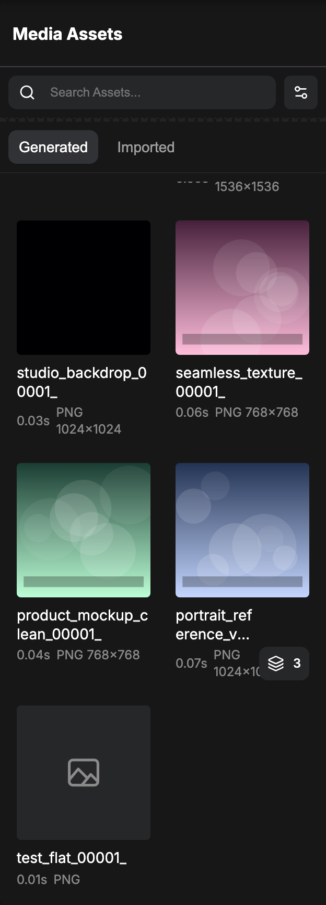
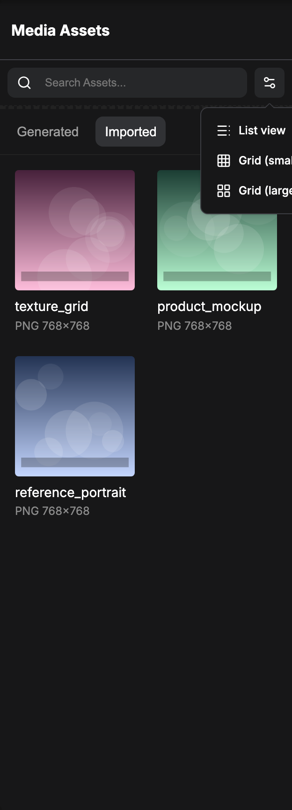
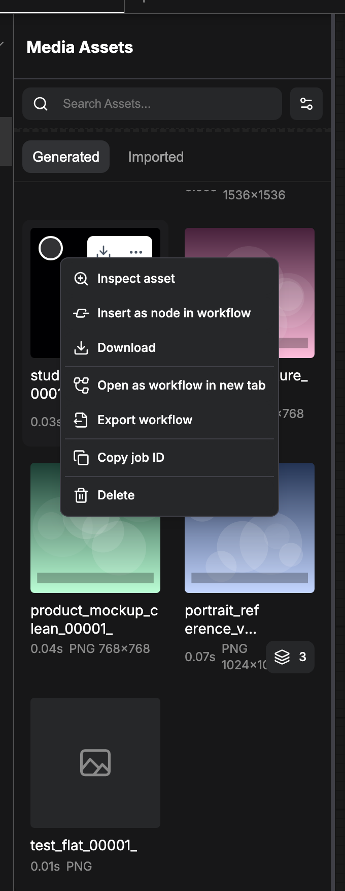
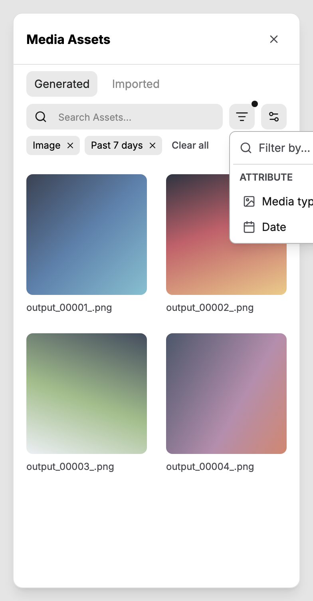
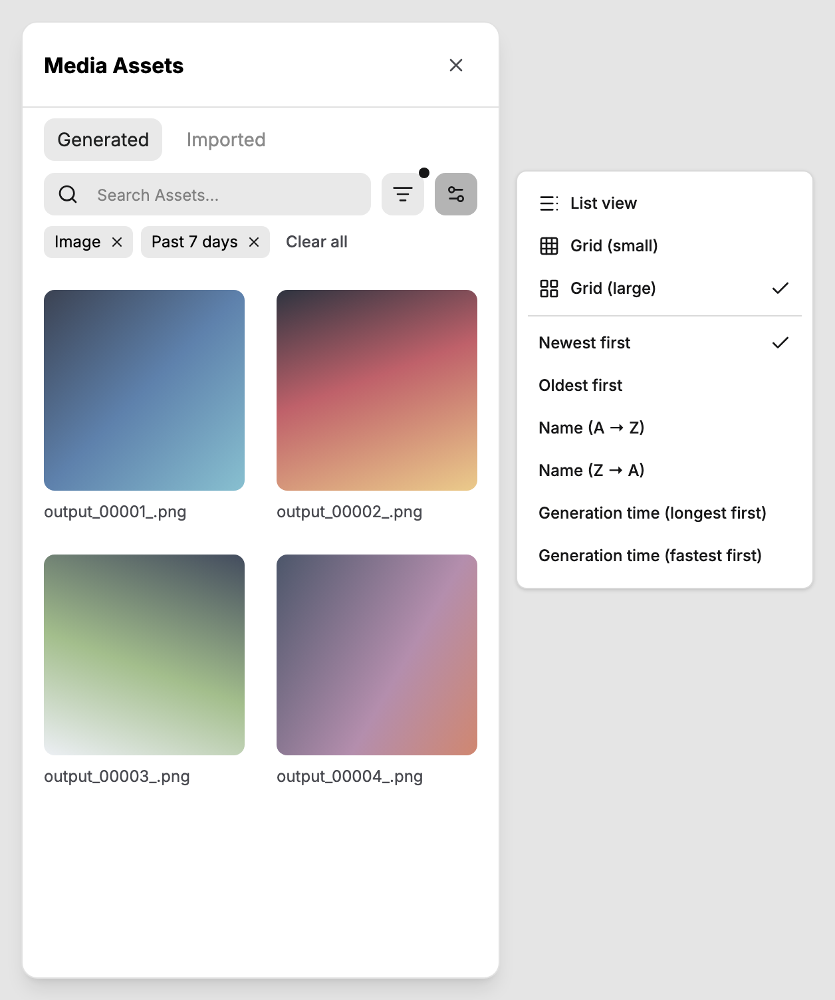

Das **Assets**-Panel ist die Bibliothek von ComfyUI für die Medien, die Ihre Workflows erzeugen und verwenden. Es sammelt jede Datei, die ein Lauf speichert, und jede Datei, die Sie importieren, sodass Sie sie durchsuchen, als Vorschau ansehen, in einem anderen Workflow wiederverwenden, herunterladen oder löschen können, ohne den Node-Graph zu verlassen.

Das Panel wird über den Eintrag **Assets** in der linken Seitenleiste geöffnet und trägt den Titel **Media Assets**. In Comfy Desktop öffnet der Eintrag **Assets** in der eigenen Seitenleiste der App eine separate Seite, die Ausgaben über Ihre Builds und Comfy Cloud hinweg durchsucht: siehe [Comfy Desktop Assets](/de/installation/desktop/usage/assets).

Die Verfügbarkeit unterscheidet sich je nach Version:

- **Comfy Cloud**: Das Assets-Panel ist standardmäßig aktiviert.
- **Selbst gehostetes ComfyUI**: Starten Sie den Server mit [`--enable-assets`](/development/comfyui-server/startup-flags), um das Assets-System zu aktivieren. Der Flag setzt eine funktionierende Datenbankverbindung voraus, behalten Sie daher den standardmäßigen Datenbankspeicherort bei oder übergeben Sie `--database-url`. Ohne den Flag öffnet sich das Panel weiterhin, aber es listet Dateien aus den lokalen Verlaufs- und Ausgabeordnern auf statt aus der Asset-Bibliothek.

Cloud ergänzt das Filtermenü, die Sortieroptionen, ZIP-Downloads und das endgültige Löschen von Dateien. Der Rest des Panels funktioniert in beiden Versionen gleich.

## Assets-Panel öffnen

Klicken Sie in der linken Seitenleiste auf das **Assets**-Symbol, um das Panel zu öffnen.

## Generierte und importierte Assets

Das Panel unterteilt Ihre Dateien in zwei Tabs:

- **Generiert**: jede Datei, die bei einem Workflow-Lauf gespeichert wurde. Wenn ein Lauf mehrere Ausgaben erzeugt, fasst das Panel sie zu einer einzigen Karte zusammen, die die Anzahl der Dateien anzeigt, und das Badge auf dieser Karte öffnet die Gruppe.
- **Importiert**: Dateien, die Sie in Workflows hochgeladen haben, etwa Referenzbilder für einen Bild-zu-Bild-Graph, oder Assets, die Sie in Ihren Comfy Cloud Workspace importiert haben.

Modelle sind nicht Teil dieses Panels. Lokale Modelldateien liegen im Panel **Models**, und wie Sie eigene Modelle in Comfy Cloud hochladen, erfahren Sie unter [Modelle importieren](/de/cloud/import-models).

## Assets finden

Der Kopfbereich des Panels enthält das Suchfeld und die Anzeigesteuerelemente.

- **Suchen**: filtert den aktuellen Tab während der Eingabe nach Dateinamen.
- **Filtern nach** (Cloud): schränken Sie die Liste nach Medientyp (`Image`, `Video`, `Audio`, `3D`, `Text`) oder nach Datum (`All time`, `Today`, `Past 7 days`, `Past 30 days`, `This year`) ein. Aktive Filter erscheinen als Chips, die Sie einzeln entfernen oder alle auf einmal leeren können.
- **Ansichtseinstellungen**: wechseln Sie zwischen `List view`, `Grid (small)` und `Grid (large)`.
- **Sortieren** (Cloud): Neueste zuerst, Älteste zuerst, Name (A bis Z), Name (Z bis A) und im Tab **Generiert** die Generierungszeit, entweder die längste oder die schnellste zuerst.

## Asset in der Vorschau anzeigen

Klicken Sie auf eine Karte, um sie auszuwählen, oder doppelklicken Sie auf ein Bild, um es in einer vergrößerten Vorschau zu öffnen. Videos werden inline mit einem Play-Overlay abgespielt, Audio- und 3D-Dateien werden in eigenen Viewern geöffnet. Klicken Sie mit der rechten Maustaste auf eine Karte und wählen Sie **Asset prüfen**, um dieselbe Vorschau zu öffnen.

## HDR- und EXR-Bilder in der Vorschau anzeigen

Eine Datei mit der Erweiterung `.exr` oder `.hdr` öffnet sich nicht in der Standard-Bild-Lightbox. ComfyUI öffnet sie im **HDR-Viewer**, einem Dialog, der das Bild in voller Auflösung rendert und Helligkeitswerte über 1.0 intakt lässt, bis Sie selbst ein Tone Mapping durchführen. Der Dialogtitel ist der Dateiname.

<video controls>
  <source src="/images/interface/assets/hdr_viewer_demo.mp4" type="video/mp4"/>
  Your browser does not support the video tag.
</video>

Der HDR-Viewer öffnet sich von drei Stellen aus:

- **Node-Bildvorschau**: Eine HDR-Ausgabe zeigt anstelle des Bildes einen Platzhalter mit der Schaltfläche **Im HDR-Viewer öffnen**. Dieselbe Aktion finden Sie auf der Sonnen-Schaltfläche in der Aktionszeile der Vorschau.
- **Assets-Panel**: Doppelklicken Sie auf die Karte eines `.exr`- oder `.hdr`-Assets, oder wählen Sie **Asset prüfen** im Rechtsklickmenü.
- **Auftragshistorie**: Doppelklicken Sie auf einen abgeschlossenen Auftrag, dessen Ausgabe eine HDR-Datei ist.

Das Seitenpanel enthält die Steuerelemente für das Tone Mapping:

- **Belichtung**: Zwischen -10 und +10 Stopps in 0.1-Stopp-Schritten einstellen. **Automatische Belichtung** wählt einen Wert für das aktuelle Bild.
- **Kanal**: `RGB`, einen einzelnen Kanal (`R`, `G`, `B`, `Alpha`) oder `Luminance` anzeigen. Das Histogramm folgt dem ausgewählten Kanal.
- **Quellfarbraum**: `sRGB` oder `Rec.2020`. Der Viewer liest die im EXR-Header aufgezeichneten Chromatizitätswerte und wählt den dazu passenden Farbraum vor. Stellen Sie ihn daher manuell ein, wenn eine Datei einen anderen Farbraum oder gar keinen aufzeichnet. Radiance-HDR-Dateien enthalten keine Chromatizitätswerte und starten deshalb mit `sRGB`.
- **Dithering**: standardmäßig aktiviert, glättet es Banding in Verläufen.
- **Clipping-Warnungen**: markieren die Pixel außerhalb des darstellbaren Bereichs.
- **Histogramm und Bildstatistiken**: Auflösung, Minimum, Maximum, Mittelwert, Standardabweichung sowie die Anzahl an NaN- und Inf-Pixeln, wenn die Datei sie enthält.
- **Einpassen** setzt das Bild in die eingepasste Ansicht zurück, und **Bild herunterladen** speichert die Originaldatei.

Mit dem Scrollrad verkleinern Sie bis auf 0.05x oder vergrößern bis auf 64x. Die Anzeige in der oberen linken Ecke folgt dem Zeiger und zeigt die Pixelkoordinaten mit den Roh-RGBA-Werten darunter. Kann der Viewer eine Datei nicht dekodieren, erscheint `HDR-Bild konnte nicht geladen werden`.

## Assets in einem Workflow wiederverwenden

- **Als Node in Workflow einfügen**: Klicken Sie mit rechts auf eine Karte und wählen Sie diesen Eintrag, um den passenden Loader-Node (zum Beispiel `Load Image`, `Load Video` oder `Load Audio`) in der Mitte des Canvas hinzuzufügen, wobei das Asset im Node bereits ausgewählt ist. Nur Dateitypen, für die es einen Loader-Node gibt, zeigen diesen Eintrag.
- **Auf den Canvas ziehen**: Ziehen Sie eine Karte auf den Canvas, um sie auf dieselbe Weise zu laden. Halten Sie `Ctrl` oder `Cmd` gedrückt, während Sie klicken, um Assets auszuwählen, statt einen Ziehvorgang zu starten.
- **In den Comfy Agent Composer ziehen**: Ein Asset, das auf dem Agent Composer abgelegt wird, wird an die Nachricht angehängt, die Sie gerade schreiben.
- **Als Workflow in neuem Tab öffnen** und **Workflow exportieren**: Verfügbar für generierte Dateien und für importierte Dateien, die Workflow-Metadaten enthalten, wie zum Beispiel PNG- und WebP-Bilder, die von ComfyUI geschrieben wurden. Exportierte Workflows werden als JSON gespeichert.

## Assets herunterladen {#downloading-assets}

Öffnen Sie das Kontextmenü per Rechtsklick auf einer oder mehreren Karten und wählen Sie **Download**, oder verwenden Sie die Download-Schaltfläche, die beim Darüberfahren mit der Maus auf einer Karte erscheint.

- Eine einzelne Datei wird direkt heruntergeladen.
- In Comfy Cloud wird beim Auswählen mehrerer Assets oder einer Karte, deren Ausführung mehrere Ausgänge erzeugt hat, stattdessen ein ZIP-Archiv vorbereitet, anstatt Datei für Datei herunterzuladen.
- Auf einem selbst gehosteten Server werden gruppierte Ausgänge in ihre einzelnen Dateien aufgeteilt.

## Mit mehreren Assets gleichzeitig arbeiten

Ziehen Sie einen Auswahlrahmen über das Raster, um einen Block von Assets auszuwählen, und verwenden Sie dann die Auswahlleiste am unteren Rand des Panels. Sie zeigt an, wie viele Assets ausgewählt sind, und bietet **Auswahl aufheben**, **Herunterladen** und **Löschen**. Ein Rechtsklick auf eine ausgewählte Karte öffnet das Sammelmenü mit **Alle Assets als Nodes einfügen**, **Alle Workflows öffnen**, **Alle Workflows exportieren**, **Alle herunterladen** und **Alle löschen**.

## Gruppierte Ausgänge

Wenn ein Lauf mehrere Dateien erzeugt hat, trägt die Karte ein Badge mit der Anzahl der Ausgänge. Ein Klick auf dieses Badge öffnet für diese Aufgabe eine Ordneransicht anstelle eines flachen Rasters. Die Kopfzeile des Ordners zeigt die Job-ID mit einer Schaltfläche zum Kopieren sowie die Ausführungszeit des Laufs, und **Zurück zu allen Assets** führt zurück zur vollständigen Liste.

## Assets löschen

Wählen Sie im Rechtsklickmenü **Löschen** oder für eine Auswahl **Alle löschen**. Ein Bestätigungsdialog listet zuerst die betroffenen Dateien auf. Was danach passiert, hängt vom Server ab:

- Comfy Cloud löscht auch die gespeicherte Datei, sodass das Asset nicht mehr vorhanden ist.
- Bei generierten Assets entfernt ein Server, der das Löschen von Dateien nicht unterstützt, das Asset nur aus der Bibliothek. Die Datei bleibt auf dem Datenträger.
- Importierte Assets lassen sich nur in Comfy Cloud löschen. Auf einem selbst gehosteten Server haben sie keinen **Löschen**-Eintrag.
- Das Löschen eines Warteschlangeneintrags ohne gespeichertes Asset wirkt sich nur auf den Verlauf aus, und die Dateien bleiben auf dem Datenträger.

Beim Löschen eines Assets wird es außerdem aus den Loader-Nodes entfernt, die darauf verwiesen haben; diese zeigen die Datei anschließend als fehlendes Medium an.

## Verwandte Seiten

- [Benutzeroberfläche im Überblick](/de/interface/overview): wo das Assets-Panel unter den anderen Einträgen der Seitenleiste liegt.
- [Modelle importieren](/de/cloud/import-models): eigene Modelle in Comfy Cloud hochladen.
- [Startup-Flags](/development/comfyui-server/startup-flags): `--enable-assets` und `--enable-asset-hashing`.
