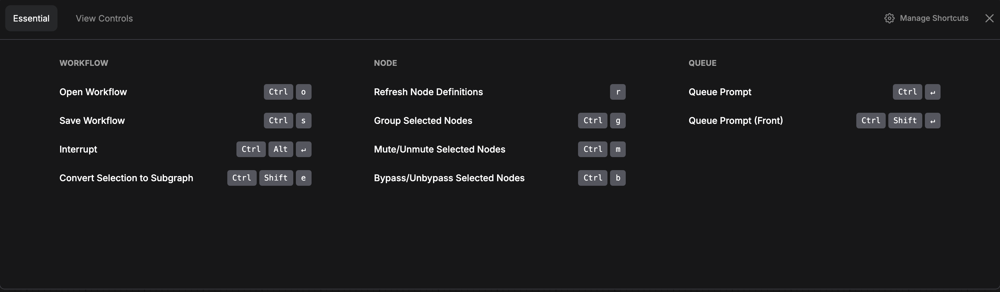
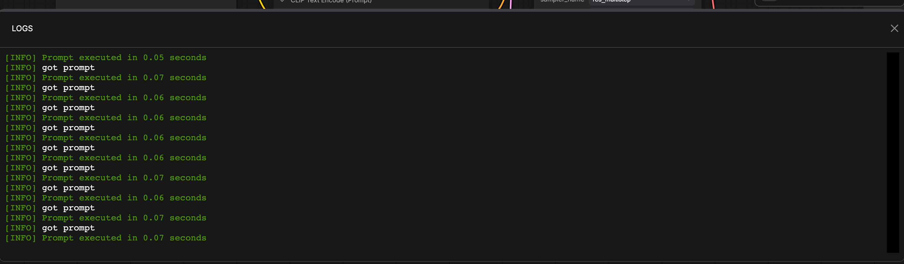
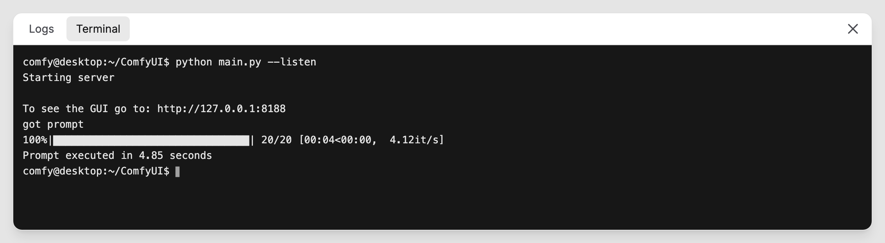

Das untere Panel ist eine angedockte Workspace-Leiste unter dem Canvas. Es enthält Tabs mit Tastenkürzel-Referenzen in jedem Build, einen **Logs**-Stream bei selbst gehosteten und Desktop-Builds sowie ein **Terminal** ausschließlich in der Desktop-App. Comfy Cloud registriert keine Terminal-Tabs; Shortcuts funktionieren weiterhin.

## Unteres Panel öffnen

Sie können das untere Panel auf verschiedene Weise öffnen:

- **Shortcuts**: Klicken Sie auf das Tastatur-Symbol unten in der linken Seitenleiste (`Workspace.ToggleBottomPanel.Shortcuts`, Standard `Ctrl` + `Shift` + `K`). Damit wird gezielt das Shortcuts-Panel umgeschaltet.
- **Konsolen-/Terminal-Panel** (nicht Cloud): Klicken Sie auf das Terminal-Symbol unten in der linken Seitenleiste. Damit wird **Unteres Panel ein-/ausblenden** ausgeführt; bevorzugt wird das Terminal-Panel, wenn Logs-/Terminal-Tabs geladen sind, andernfalls wird auf Shortcuts zurückgegriffen.
- **View**-Menü: **Unteres Panel** (`Workspace.ToggleBottomPanel`).
- **Logs-Tastenkürzel** (nicht Cloud): Standard `Ctrl` + `` ` `` schaltet den Tab Logs um (`Workspace.ToggleBottomPanelTab.logs-terminal`).

Das Panel ist ausgeblendet, solange der [Fokusmodus](/de/interface/canvas-controls) aktiv ist.

## Shortcuts-Tabs

Shortcuts registriert zwei Tabs im **Shortcuts**-Panel:

- **Grundlagen**: gängige Tastenkürzel für Bearbeitung und Warteschlange.
- **Ansichtssteuerung**: Tastenkürzel für Navigation und Ansicht.

Diese Panels spiegeln dieselben Befehls- und Tastenkürzel-Daten wider, die Sie unter Einstellungen → Tastenkürzel anpassen können. Die vollständige, bearbeitbare Liste finden Sie unter [Shortcuts](/de/interface/shortcuts).

## Logs (selbst gehostet und Desktop)

Bei Nicht-Cloud-Builds streamt ein Tab **Logs** die Runtime-Protokollausgabe des ComfyUI-Prozesses. Nutzen Sie ihn beim Debuggen von Custom Nodes, Serverfehlern oder Backend-Meldungen, ohne zu einem externen Terminal wechseln zu müssen.

Standard-Tastenkürzel: `Ctrl` + `` ` ``.

## Terminal (nur Desktop)

In der **Desktop**-App wird neben Logs ein Tab **Terminal** (Befehlsterminal) registriert. Er bietet Desktop-Nutzern eine Shell innerhalb der App. Er wird weder in reinen Browser-Sitzungen mit Selbst-Hosting noch in Comfy Cloud registriert.

Cloud-Builds überspringen die Registrierung von Logs und Terminal vollständig; nur Shortcuts bleibt.

## Verwandte Seiten

- [Shortcuts](/de/interface/shortcuts)
- [Canvas-Steuerung](/de/interface/canvas-controls) (der Fokusmodus blendet dieses Panel aus)
- [Hilfe-Center](/de/interface/help-center)
- [Benutzeroberfläche im Überblick](/de/interface/overview)