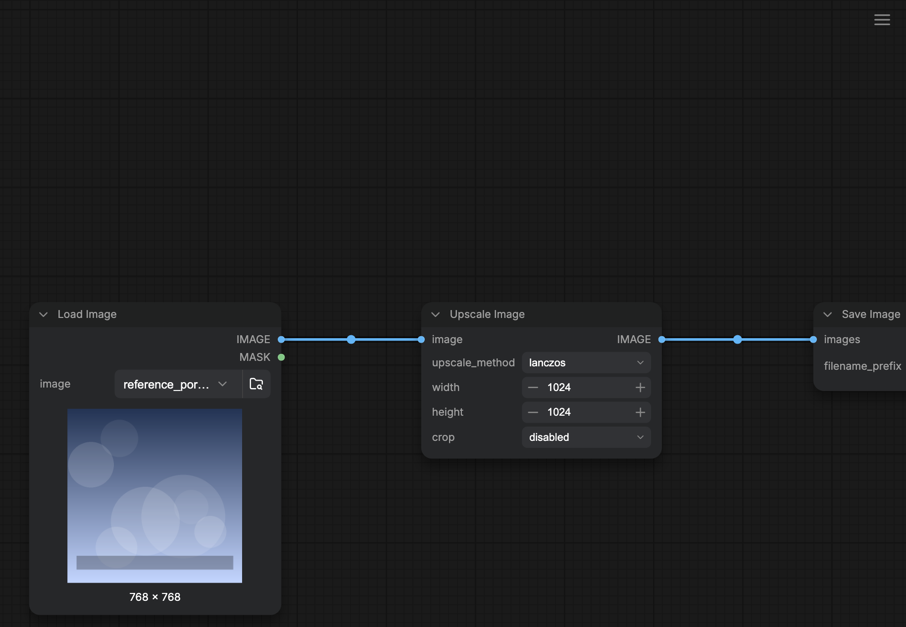
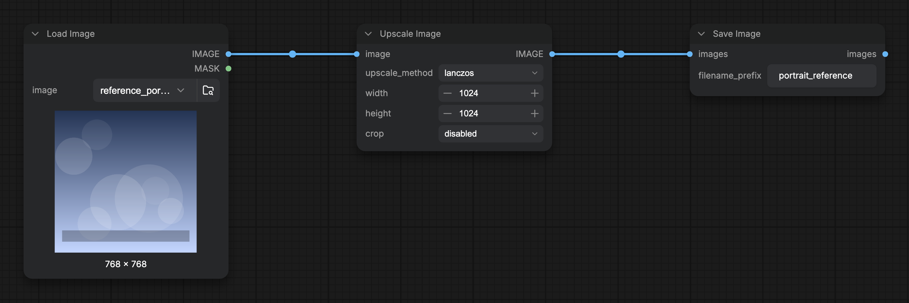
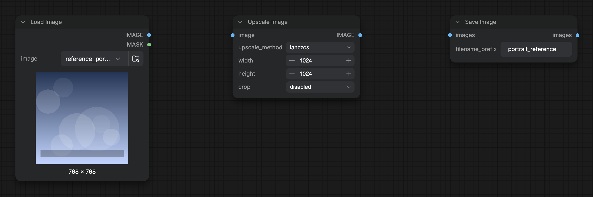

Die Canvas-Toolbar unten rechts und das **Ansicht**-Menü steuern, wie Sie sich im Node-Graph bewegen. Zu den zentralen Ansicht-Befehlen gehören Unteres Panel ein-/ausblenden, Vorlagen durchsuchen, **Fokusmodus**, Canvas-Leistung, Minikarte, Sichtbarkeit der Verbindungen, Vergrößern/Verkleinern und Ansicht anpassen.

## Canvas-Toolbar

Wenn **Graph-Canvas-Menü anzeigen** (`Comfy.Graph.CanvasMenu`) aktiviert ist (Standard), befindet sich unten rechts auf dem Canvas eine schwebende Toolbar:

| Steuerelement | Funktion |
| --- | --- |
| **Canvas-Modus** | Menü zum Wechseln zwischen **Select** (Nodes bearbeiten) und **Hand** (nur Schwenken / schreibgeschützter Canvas). Standard: `v` entsperrt Select, `h` sperrt Hand. |
| **Ansicht anpassen** | Rahmt den Graphen im Viewport ein (`Comfy.Canvas.FitView`, Standard `.`). |
| **Zoom** | Öffnet ein Popover mit Vergrößern, Verkleinern, Zoom anpassen und einem Prozentfeld (1-1000%). Zu den Standard-Tastenkürzeln gehören `Alt` + `=` / `Alt` + `-` zum Vergrößern/Verkleinern. |
| **Minikarte** | Schaltet die Übersichtskarte ein oder aus (`Comfy.Canvas.ToggleMinimap`, Standard `Alt` + `Shift` + `M`). Wird als `Comfy.Minimap.Visible` gespeichert. |
| **Verbindungssichtbarkeit** | Blendet Verbindungslinien aus oder ein, indem der Verbindungsdarstellungsmodus für ausgeblendete Verbindungen umgeschaltet wird (`Comfy.Canvas.ToggleLinkVisibility`). |

Sie können die gesamte Toolbar über **Graph-Canvas-Menü anzeigen** in den Lite Graph / Canvas-Einstellungen ausblenden.

## Menü View

Das Menü **View** registriert dieselben Navigationsbefehle, sodass Sie sie über die Menüleiste oder die Befehlspalette ausführen können:

- Unteres Panel ein-/ausblenden
- Vorlagen durchsuchen
- Fokusmodus
- Canvas-Leistung (`Comfy.ToggleCanvasInfo`, schaltet `Comfy.Graph.CanvasInfo` um)
- Minimap ein-/ausblenden
- Sichtbarkeit der Verbindungen umschalten
- Vergrößern / Verkleinern / Ansicht anpassen

## Fokusmodus

**Fokusmodus** (`Workspace.ToggleFocusMode`) blendet die Bedienelemente des Workspace aus, damit Sie sich auf den Node-Graph konzentrieren können. Solange er aktiviert ist:

- Der obere Menübereich ist ausgeblendet (neues Menü).
- Linke/rechte Seitenleisten-Panels und das untere Panel werden im Splitter-Layout nicht gerendert.
- Ein Hamburger-Steuerelement wird eingeblendet, über das Sie den Fokusmodus verlassen können (**Menü einblenden**).

Schalten Sie den Fokusmodus erneut um, oder verwenden Sie das Hamburger-Steuerelement, um den vollständigen Workspace wiederherzustellen.

## Optionen der Minikarte

Neben dem Ein- und Ausblenden steuern die Einstellungen unter Minikarte, was die Karte darstellt (Node-Farben, Verbindungen, Gruppen, Status umgangener Nodes, Fehlerstatus). Weitere Informationen finden Sie unter [Lite Graph settings](/de/interface/settings/lite-graph) und in den zugehörigen Einträgen zum Erscheinungsbild, sofern vorhanden.

## Verbindungen und globale Canvas-Einstellungen

Die Verbindungsform und ob verbundene Verbindungen angezeigt werden, stehen auch als Schnellumschalter im [Right Side Panel](/interface/right-side-panel) unter **Globale Einstellungen** zur Verfügung, wenn nichts ausgewählt ist, und vollständig in den Lite Graph-Einstellungen (`Comfy.LinkRenderMode` und verwandte Optionen). Rasterabstand und Einrasten am Raster finden Sie in denselben Bereichen Globale Einstellungen / Lite Graph.

### Verbindungen auswählen

Erfordert ComfyUI-Frontend 1.58.0 oder höher. Das Auswählen von Verbindungen mit einem Rahmen ist im Auswahlmodus Standardverhalten des Canvas (kein Einstellungs-Schalter).

Ziehen Sie einen Rahmen über die Verbindungslinien, auf die Sie einwirken möchten. Ein Rahmen, der keine Nodes, Gruppen oder Reroutes erfasst, wählt jede sichtbare Verbindung aus, die er überquert, und die Auswahl-Toolbox ersetzt ihre Node-Schaltflächen durch zwei Verbindungsaktionen: **Hide**, das die Verbindung beibehält und die Linie ausblendet, und **Delete**, das die Verbindung aus dem Graphen entfernt. Jede Aktion ist ein Rückgängig-Schritt, und `Delete` oder `Backspace` entfernen ebenfalls eine Verbindungsauswahl.

Rahmen mit `Shift` und `Alt` wählen nur Nodes und Gruppen aus, und im Canvas-Modus Hand werden niemals Verbindungen ausgewählt.

### Klicken auf einen Node-Eingang oder -Ausgang, um dessen Verbindungen zu bearbeiten

Erfordert ComfyUI-Frontend 1.60.0 oder höher. Klicken Sie auf den Eingabe- oder Ausgabepunkt eines Nodes, statt von ihm aus zu ziehen. Der Canvas wählt jede Verbindung aus, die an diesem Punkt hängt, also eine Verbindung bei einer Eingabe und alle Verbindungen bei einer Ausgabe, und die Auswahl-Toolbox bietet **Hide** und **Delete** an, dieselben Aktionen, die auch eine Rahmenauswahl verwendet.

- Wenn jede ausgewählte Verbindung bereits ausgeblendet ist, zeigt die Toolbox **Show** statt **Hide** an.
- **Hide** wirkt nur auf sichtbare Verbindungen und **Show** nur auf ausgeblendete, sodass keine der beiden einen leeren Rückgängig-Schritt erzeugt.
- **Delete** entfernt jede Verbindung an diesem Punkt, auch ausgeblendete.
- Halten Sie beim Klicken `Shift`, `Ctrl`, `Cmd` oder `Alt` gedrückt, um die aktuelle Auswahl beizubehalten.
- `Ctrl` + `Alt` + Klick trennt stattdessen die Verbindung, wie auch an anderen Stellen im Canvas.
- Ein Punkt ohne Verbindungen ignoriert den Klick, ebenso ein Canvas mit deaktivierter Verbindungssichtbarkeit, da dort jede Linie ausgeblendet ist. Ein Ziehen von einem Punkt aus startet weiterhin eine neue Verbindung.

## Verwandte Seiten

- [Benutzeroberfläche im Überblick](/de/interface/overview)
- [Tastenkürzel](/interface/shortcuts)
- [Lite Graph-Einstellungen](/de/interface/settings/lite-graph)
- [Rechte Seitenleiste](/interface/right-side-panel) (Schnellumschalter für Globale Einstellungen)
- [Unteres Panel](/interface/bottom-panel)
