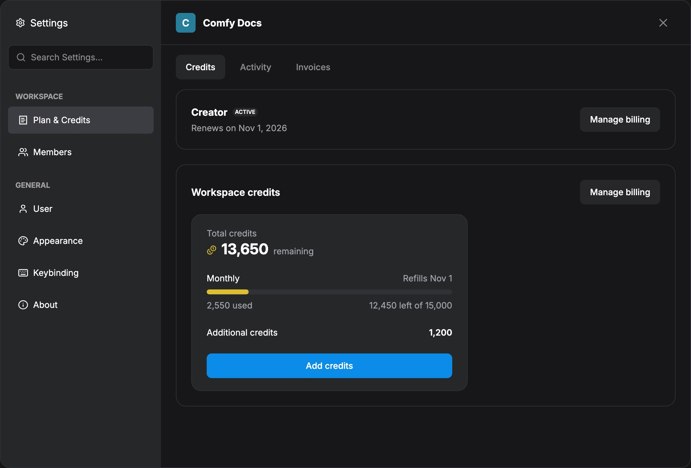
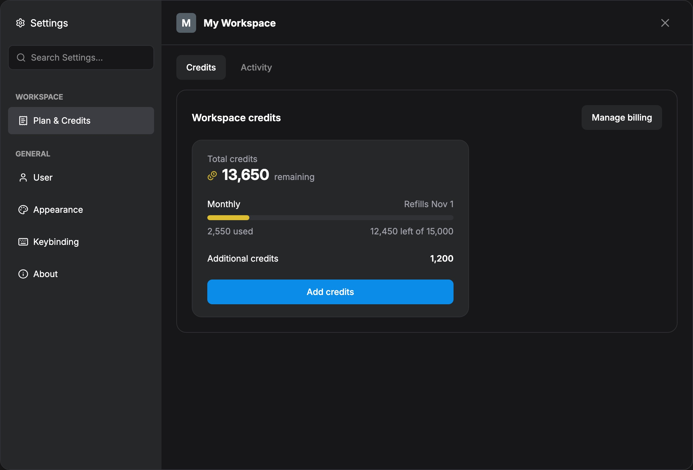
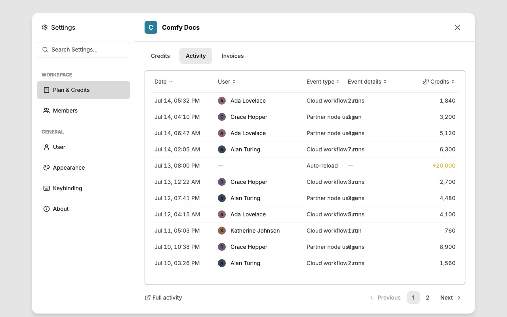
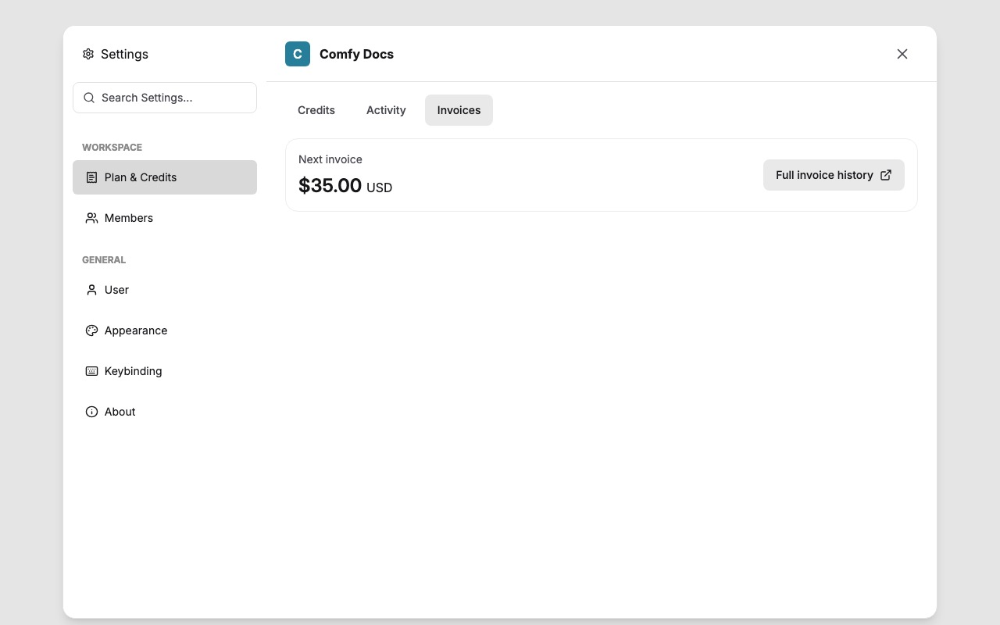
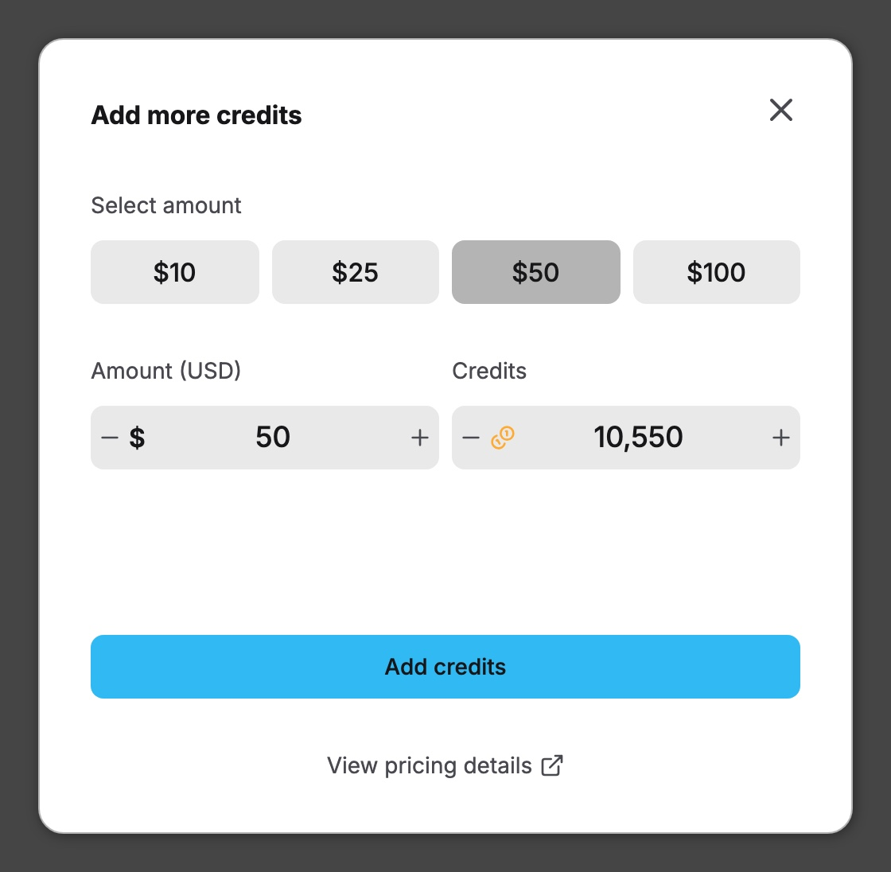
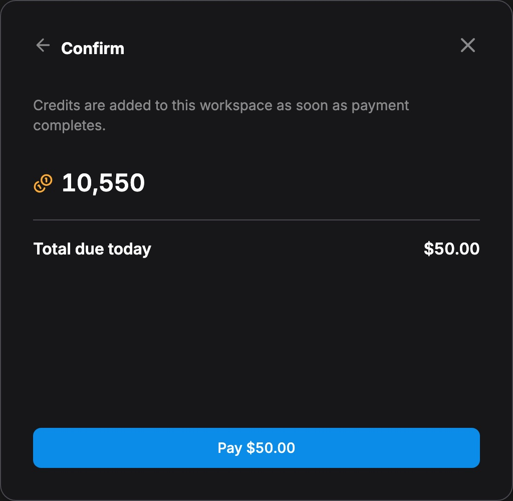
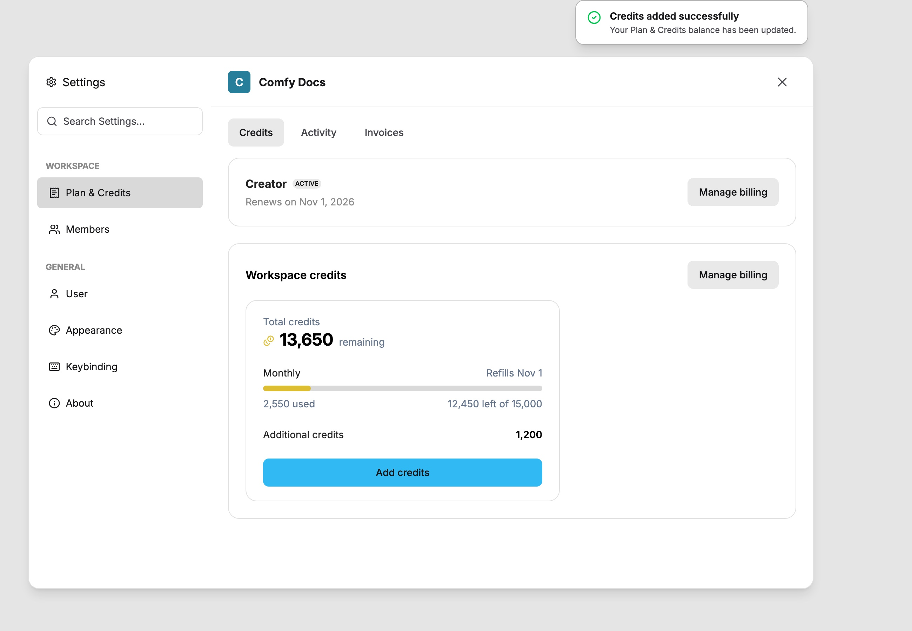

import SettingsMenuContext from "/snippets/de/interface/settings-menu-context.mdx"

<SettingsMenuContext />

Credits ermöglichen die Nutzung von **Partner-Nodes** (API-Aufrufe an Closed-Source-Modelle). ComfyUI bleibt vollständig Open Source und kostenlos für die lokale Ausführung von Node-Graphen; Credits fallen nur an, wenn Sie Partner-Nodes ausführen oder Cloud-Abrechnungsfunktionen nutzen.

Nachdem Sie sich unter **Einstellungen → Benutzer** angemeldet haben, öffnen Sie **Einstellungen → Workspace → Tarif & Credits**. Auf Comfy Cloud können Sie denselben Bereich auch über das Profilmenü mit **Tarif verwalten** öffnen.

Einige Cloud-Workspaces zeigen dieselben Tarif- und Credit-Daten in einem **Abrechnung**-Bereich anstelle von **Tarif & Credits**. Er befindet sich in derselben Gruppe **Einstellungen → Workspace** und ergänzt die Einstellung für die automatische Aufladung. Siehe [Abrechnungsbereich und automatische Aufladung](#abrechnungsbereich-und-automatische-aufladung).

<Note>
ComfyUI wird für lokale Benutzer immer vollständig Open Source und kostenlos bleiben. Die Credit-Guthaben in den Screenshots sind Beispieldaten zur Veranschaulichung.
</Note>

## Inhalte von Tarif & Credits

Öffnen Sie **Einstellungen → Workspace → Tarif & Credits**. Bei lokalen Installationen zeigt die Seitenleiste nach der Anmeldung Plan & Credits unter Workspace an (keine Mitglieder / Rechnungen). Das Panel enthält die folgenden Tabs:

| Tab | Inhalt |
| --- | --- |
| **Credits** | Guthaben, Aufladen und Tarifübersicht (lokal wird das Credits-Panel eingebettet; Cloud zeigt die Abonnement-Ansicht des Workspace) |
| **Aktivität** | Nutzungsverlauf der Credit-Ausgaben |
| **Rechnungen** | Nur Cloud, für Nutzer, die das Workspace-Abonnement verwalten können: nächste Rechnung und Stripe-Verlauf |

In einem Team-Workspace erhält die Aktivitätstabelle eine Spalte **Mitglied**, sodass Sie sehen, welches Mitglied die jeweilige Zeile ausgeführt hat. Zeilen, die einer Person zugeordnet sind, die den Workspace verlassen hat, zeigen `(former member)` nach dem Namen, und Zeilen ohne Zuordnung zeigen `-`.

Für Tarifänderungen in Cloud, das Abrechnungsportal und fehlgeschlagene Zahlungen nutzen Sie die Support-Anleitungen:

<CardGroup cols={2}>
  <Card title="Cloud-Abonnement verwalten" icon="receipt" href="/de/support/subscription/managing">
    Plan ändern, Abrechnung & Rechnungen öffnen, Team vs. Persönlich
  </Card>
  <Card title="Zahlungsverlauf" icon="file-invoice" href="/de/support/payment/payment-history">
    Rechnungen und PDFs im Stripe-Abrechnungsportal
  </Card>
</CardGroup>

## Credits kaufen

<Steps>

<Step title="Bei Ihrem ComfyUI-Konto anmelden">
Öffnen Sie **Einstellungen → Benutzer** und melden Sie sich an.

</Step>

<Step title="Tarif & Credits öffnen">
Öffnen Sie nach der Anmeldung **Einstellungen → Workspace → Tarif & Credits** (oder Cloud-Profil → **Tarif verwalten**).

</Step>

<Step title="Menge der zu kaufenden Credits festlegen">

Legen Sie im Popup die Kaufmenge fest und klicken Sie auf **Kaufen**.
</Step>

<Step title="Bestätigen und Zahlung abschließen">

Prüfen Sie die Menge und fahren Sie dann mit dem Stripe-Checkout fort, um die Zahlung abzuschließen. Verwenden Sie dieselbe E-Mail-Adresse wie für Ihr ComfyUI-Konto.
</Step>

<Step title="Guthaben prüfen">

Kehren Sie zu **Tarif & Credits** zurück und prüfen Sie, ob das Guthaben aktualisiert wurde. Aktualisieren Sie die Seite oder starten Sie bei Bedarf neu.
</Step>

</Steps>

In Workspaces, die das Panel **Abrechnung** anzeigen, beginnen Sie bei **Einstellungen → Workspace → Abrechnung**, klicken Sie auf **Credits hinzufügen** und prüfen Sie das neue Guthaben auf der Credits-Karte. Der Rest des Ablaufs bleibt gleich.

## Abrechnungsbereich und automatische Aufladung

In Workspaces, die den Bereich **Abrechnung** verwenden, fasst **Einstellungen → Workspace → Abrechnung** den Tarif des Workspaces, das Credit-Guthaben und die automatische Aufladung in einem Bereich zusammen. Inhaber können dort den Tarif ändern und Credits hinzufügen. Mitglieder sehen dasselbe Guthaben und einen Link zu ihrer Nutzung.

### Tarif und Credits

Die Tarifzeile zeigt den aktuellen Tarif, sein Abrechnungsintervall und das Datum der nächsten Rechnung. Eine geplante Tarifänderung zeigt das Datum, an dem sie wirksam wird, mit einer Schaltfläche **Beibehalten**, um diese Änderung abzubrechen. Ein gekündigtes Abonnement zeigt sein Enddatum, mit **Plan fortsetzen** zum Verlängern.

Der Wert **Verfügbar** oben auf der Credits-Karte gibt an, was der Workspace gerade ausgeben kann. Wenn Runs das Guthaben überzogen haben, vermerkt die Karte, um wie viele Credits es überschritten wurde. Hat der Workspace einen aktiven Tarif, teilt die Karte das Guthaben in zwei Posten:

- **Tarif**: der Teil des Tarifkontingents, den der Workspace in diesem Abrechnungszeitraum noch zur Verfügung hat
- **Aufladen**: Credits, die Sie hinzugefügt haben und die erst verbraucht werden, wenn das Tarifkontingent aufgebraucht ist. Es zeigt **Jetzt in Verwendung**, wenn Runs bereits aufgeladene Credits verbrauchen.

**Credits hinzufügen** öffnet den Aufladevorgang. Inhaber erhalten zusätzlich eine Schaltfläche zur gehosteten Abrechnungsseite für Zahlungsmethoden, Rechnungen und Nutzung.

### Automatische Aufladung

Die automatische Aufladung füllt das Guthaben selbstständig auf, wenn es unter einen Schwellenwert fällt, damit lange Jobs ohne manuelles Aufladen weiterlaufen können. Sie belastet die Standard-Zahlungsmethode des Workspaces, daher muss zuerst eine Zahlungsmethode hinterlegt sein. Eine fehlgeschlagene Abbuchung oder ein erreichtes monatliches Limit pausiert die Aufladung, bis Sie das Problem beheben.

Solange die automatische Aufladung aktiviert ist, zeigt die Karte die Regel, zum Beispiel die Menge und die hinzugefügten Credits sowie das Guthaben, das sie auslöst. Sie zeigt außerdem, wie viel des monatlichen Limits die automatischen Abbuchungen bereits ausgeschöpft haben. Nur automatische Abbuchungen zählen auf dieses Limit, und der Zähler wird in jedem Abrechnungszyklus zurückgesetzt.

Jede Schaltfläche auf der Karte öffnet die Abrechnungsseite in einem neuen Tab, auf der Sie die Einstellung ändern. Inhaber sehen die Aktionsschaltflächen. Mitglieder sehen dieselbe Karte ohne diese Schaltflächen, dazu einen Hinweis, sich an einen Inhaber des Workspace zu wenden.

| Status | Bedeutung |
| --- | --- |
| **Aktiv** | Die automatische Aufladung ist aktiv. **Verwalten** öffnet die Abrechnungsseite, um die Menge, den Schwellenwert oder das monatliche Limit zu ändern. |
| **Inaktiv** | Die automatische Aufladung ist nicht aktiv. **Aktivieren** öffnet die Abrechnungsseite, um sie einzurichten. |
| **Ausgesetzt** | Es ist keine Standard-Zahlungsmethode hinterlegt, daher kann die nächste Aufladung nicht abgebucht werden. **Zahlung aktualisieren** öffnet die Abrechnungsseite, um eine Karte hinzuzufügen. |
| **Limit erreicht** | Die automatischen Abbuchungen haben das monatliche Limit erreicht. Die Aufladung wird am auf der Karte angegebenen Datum fortgesetzt, oder früher, wenn Sie das Limit auf der Abrechnungsseite erhöhen. |
| **Maximum erreicht** | Die automatischen Abbuchungen haben das monatliche Maximum erreicht. Vor dem auf der Karte angegebenen Datum erfolgt keine weitere automatische Abbuchung. |
| **Fehlgeschlagen** | Die letzte automatische Abbuchung war nicht erfolgreich. **Zahlung aktualisieren** öffnet die Abrechnungsseite, alternativ können Sie Credits manuell hinzufügen. |
| **Deaktiviert** | Die Zahlungsmethode wurde dreimal in Folge abgelehnt, daher hat sich die automatische Aufladung selbst ausgeschaltet. Aktualisieren Sie die Zahlungsmethode und aktivieren Sie die automatische Aufladung dann wieder. |

## Häufig gestellte Fragen

<AccordionGroup>
  <Accordion title="Können Credits negativ werden?">
    Credits sind nicht als Kreditlinie gedacht. Partner-Nodes melden die Kosten manchmal erst nach der Ausführung, sodass ein Lauf zu einem vorübergehenden negativen Saldo führen kann. Solange der Saldo negativ ist, bleiben Partner-Nodes gesperrt, bis Sie Ihr Guthaben aufladen.
  </Accordion>

  <Accordion title="Kann ich ungenutzte Credits zurückerstattet bekommen?">
  Derzeit bieten wir keine Rückerstattung für ungenutzte Credits an.
  </Accordion>

  <Accordion title="Wie prüfe ich mein aktuelles Guthaben und meine Nutzung?">
  Öffnen Sie **Einstellungen → Workspace → Tarif & Credits**. Verwenden Sie den Tab **Credits** für das Guthaben und den Tab **Aktivität** für den Nutzungsverlauf. In Workspaces, die stattdessen das Panel **Abrechnung** anzeigen, steht das Guthaben auf der Credits-Karte, und **Nutzung anzeigen** öffnet den Nutzungsverlauf.
  </Accordion>

  <Accordion title="Kann ich meine Credits mit anderen Benutzern teilen?">
  Sie können sich auf mehreren Geräten im selben Konto anmelden. Das Teilen von Credits mit anderen Benutzerkonten wird nicht unterstützt. In Cloud Team-Arbeitsbereichen teilen sich die Mitglieder ein gemeinsames Workspace-Guthaben, und nur der Inhaber des Workspace kann Credits hinzufügen oder den Tarif ändern.
  </Accordion>

  <Accordion title="Wie erfahre ich, wie viel der Node kostet?">
  Prüfen Sie das Preis-Badge am API-/Partner-Node, bevor Sie ihn ausführen. Die tatsächlichen Kosten können je nach Bildgröße, Anzahl der Generierungen und anderen Parametern variieren.
  </Accordion>

  <Accordion title="Warum sehe ich keine Zahlungsoptionen für WeChat oder Alipay?">
  Wählen Sie die Zahlung in Comfy Credits. WeChat und Alipay sind nur für diesen Währungspfad verfügbar.
  </Accordion>

  <Accordion title="Sind Credits in einem Cloud-Tarif enthalten?">
  Nein. Der Kauf von Credits startet kein Abonnement und schaltet keine Cloud-Workflows frei: Für das Ausführen von Workflows in Cloud ist ein Tarif erforderlich. Partner-Nodes in lokalem ComfyUI und Desktop können Credits ohne Tarif nutzen.
  </Accordion>

  <Accordion title="Verfallen Credits?">
  Ja, der Verfall hängt vom Typ ab:
  - **Monatliche Credits**: Verfallen am Ende Ihres Abrechnungszeitraums
  - **Aufgeladene Credits**: Verfallen 1 Jahr ab Kaufdatum
  </Accordion>
</AccordionGroup>
