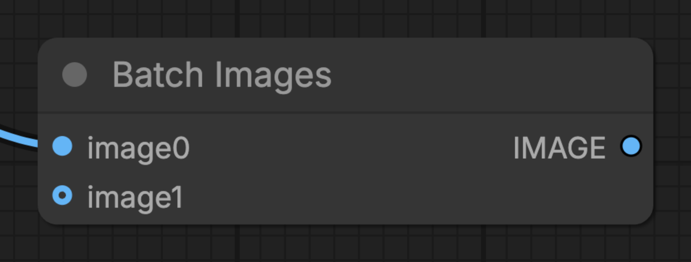
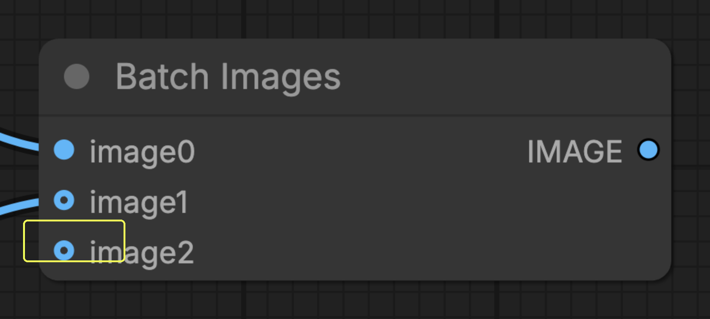

Einige Nodes in ComfyUI haben **Autogrow-Eingänge**, auch **dynamische Eingänge** genannt. Diese Nodes zeigen keine feste Liste von Slots. Sie fügen einen weiteren Eingang hinzu, sobald Sie den letzten freien verbunden haben. So kann ein einzelner Node zwei oder zwanzig Bilder bündeln, ohne zusätzliche Einrichtung.

## So funktionieren Autogrow-Eingänge

1. **Verbinden Sie den letzten freien Eingang.** Im Beispiel auf dieser Seite ist eine Bildquelle mit `image0` am **Batch Images**-Node verbunden, während `image1` noch frei ist.
2. **Beobachten Sie, wie der Node wächst.** Sobald Sie den letzten freien Eingang füllen, hängt der Node darunter einen neuen leeren Eingang an. Im folgenden Bild erscheint der neue Eingang `image2`, nachdem `image1` verbunden wurde.
3. **Wiederholen Sie dies nach Bedarf.** Jedes Mal, wenn Sie den letzten Eingang füllen, wächst der Node erneut, bis er die maximale Anzahl an Eingängen erreicht, die dieser Node zulässt.

Zwei weitere Details, die Sie kennen sollten:

- **Die Reihenfolge zählt.** Die Eingänge werden in der Reihenfolge an den Node übergeben, in der sie erscheinen. `image0` kommt also vor `image1` und so weiter. Denken Sie daran, wenn das Ergebnis von der Reihenfolge abhängt, zum Beispiel wenn Sie Bilder bündeln, die durch ein Video-Modell laufen.
- **Der freie Eingang ist ein Platzhalter.** Er ist nur dann Teil der Daten des Nodes, wenn Sie etwas damit verbinden. Ein Node, der null Eingänge zulässt, läuft trotzdem, wenn alle Slots leer sind.

## Nodes mit Autogrow-Eingängen

| Node | Wachsender Eingang | Maximale Eingänge |
|---|---|---|
| **Batch Images** | `image` | 50 |
| **Batch Masks** | `mask` | 50 |
| **Batch Latents** | `latent` | 50 |
| **And** / **Or** | `value` | 10 |
| **Nano Banana 2** und andere Partner-Nodes, die Referenzbilder aufnehmen | `image_1`, `image_2` und so weiter | bis zu 14 Bilder |

Jeder Node legt seine eigenen Grenzen fest. Bewegen Sie den Mauszeiger in ComfyUI über den Eingang, um den Tooltip zu lesen, wenn Sie nicht sicher sind, wie viele Werte er annimmt.

<Tip>
Autogrow ist Teil des ComfyUI-V3-Node-Schemas. Wenn Sie Custom Nodes schreiben, lesen Sie [Dynamische Eingänge](/de/custom-nodes/v3_migration#dynamic-inputs) für die `Autogrow`-Vorlagen-API.
</Tip>

<Card title="Batch Images-Node" icon="book-open" href="/de/built-in-nodes/BatchImagesNode">
  Kombinieren Sie mehrere Bilder zu einem Batch, mit so vielen Eingängen wie Sie benötigen.
</Card>