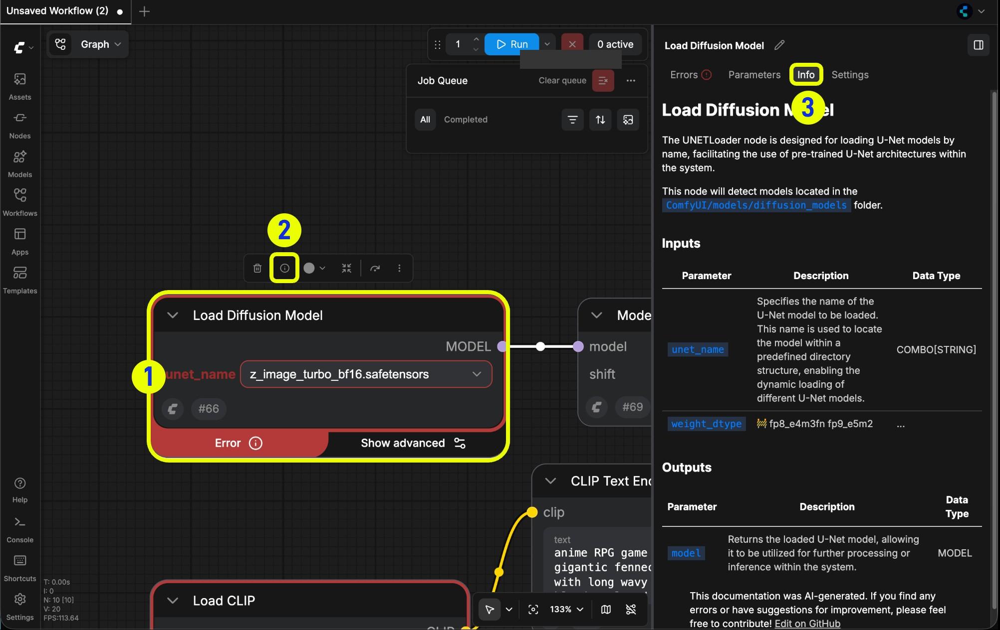
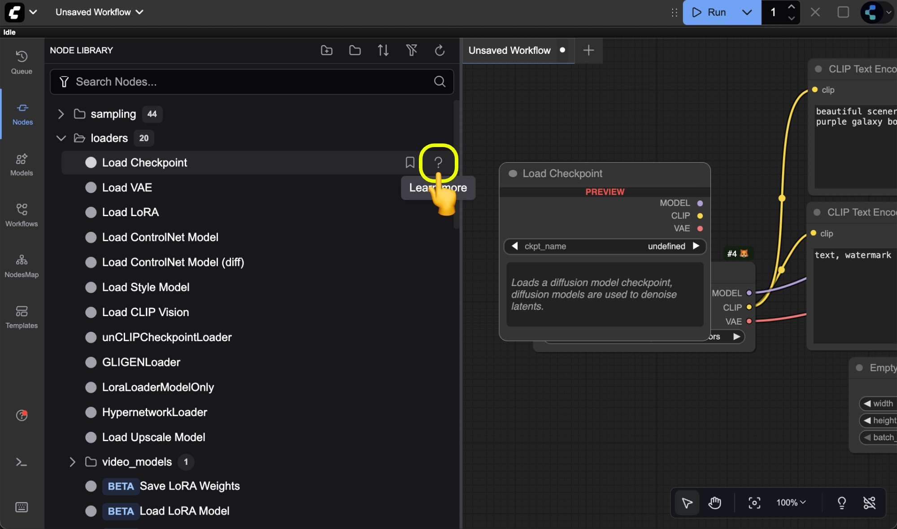

Die Node-Dokumentation bietet schnellen Zugriff auf die Dokumentation für jeden Node in Ihrem Workflow. Sie können detaillierte Informationen zur Funktionsweise, zu den Parametern und zu Nutzungsbeispielen eines Nodes direkt in ComfyUI anzeigen.

Sie können dieselbe Hilfe über das Dokumentationssymbol in der Auswahl-Toolbox, über die Hilfe-Schaltfläche in Nodes 2.0 oder über den Tab **Info** im [Rechten Seitenbereich](/de/interface/right-side-panel) öffnen, wenn ein einzelner Node ausgewählt ist, der kein Subgraph ist.

## Node-Dokumentation anzeigen

1. **Node auswählen:**  
   Klicken Sie auf einen beliebigen Node in Ihrem Workflow, um ihn auszuwählen.

2. **Node-Dokumentation öffnen:**  
   Klicken Sie in der Auswahl-Toolbox auf das Node-Info-Symbol, um die Node-Dokumentationsseite zu öffnen.

3. **Node-Dokumentation schließen:**  
   Wenn Sie die Node-Dokumentation verlassen möchten, können Sie oben links auf das Pfeilsymbol klicken.

{/* Der Einstiegspunkt „?“ in der Node-Bibliothek wurde im aktuellen Frontend entfernt. Wiederherstellen, sobald er wieder eingeführt wird.
Sie können die Node-Dokumentation auch über die Node-Bibliothek aufrufen: Fahren Sie mit der Maus über einen Node und klicken Sie dann auf das Symbol „?“, um die Node-Dokumentation zu öffnen.

*/}

## Integrierte Node-Dokumentation

Die Dokumentation für die integrierten Nodes von ComfyUI wird im [embedded-docs-Repository](https://github.com/Comfy-Org/embedded-docs) gepflegt.

**Beiträge zur integrierten Node-Dokumentation:**
- Benutzer können Verbesserungen und Ergänzungen zur Dokumentation der integrierten Nodes beitragen
- Reichen Sie Pull Requests im [embedded-docs-Repository](https://github.com/Comfy-Org/embedded-docs) ein
- Helfen Sie mit, die Dokumentationsqualität für die gesamte ComfyUI-Community zu verbessern

## Dokumentation für Custom Nodes

Custom Nodes können auch eine eigene Dokumentation enthalten. Wenn Autoren von Custom Nodes eine Dokumentation bereitstellen, erscheint sie automatisch im Bereich der Node-Dokumentation, wenn Sie ihre Nodes auswählen.

<Card title="Entwicklerhandbuch: Node-Dokumentation hinzufügen" icon="code" href="/de/custom-nodes/help_page">
  Erfahren Sie, wie Sie umfangreiche Dokumentation für Ihre Custom Nodes erstellen
</Card>