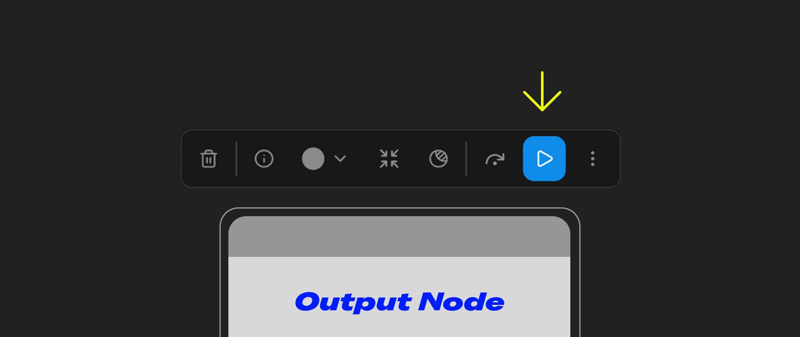
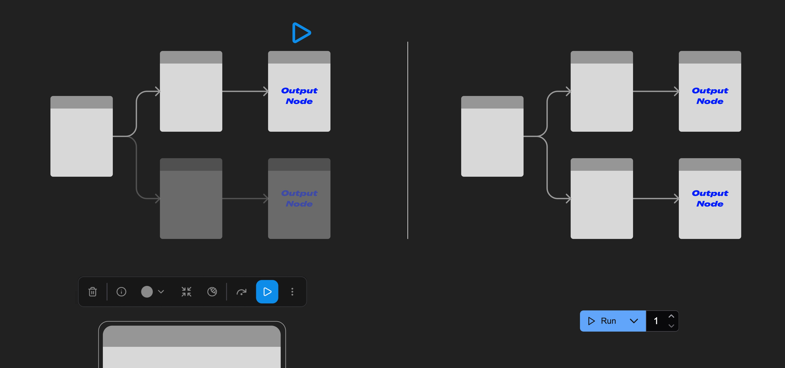
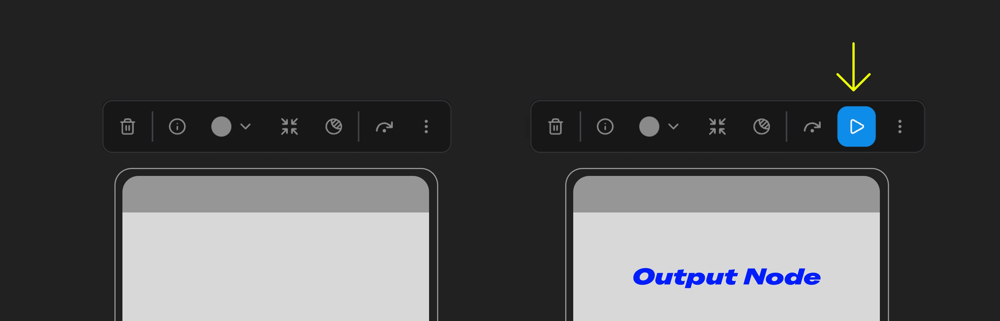

Die Funktion Teilweise Ausführung befindet sich in der Node-Auswahl-Toolbox von ComfyUI. Sie erlaubt es Ihnen, nur einen Teil Ihres Workflows auszuführen, statt alle Nodes auszuführen. Diese Funktion ist nur verfügbar, wenn der ausgewählte Node ein Output-Node ist, und erscheint, sofern verfügbar, als blaues Dreiecksymbol.

## Was ist teilweise Ausführung?

Die teilweise Ausführung lässt Sie, wie der Name schon sagt, nur einen Teil Ihres Workflows ausführen, statt alle Nodes im Workflow auszuführen.

Das obige Diagramm vergleicht die teilweise Ausführung mit dem Ausführen des gesamten Workflows:

1. Teilweise Ausführung (links): Führt nur die Verzweigung des Workflows vom Start-Node bis zum Output-Node aus.
2. Run Workflow (rechts): Führt alle Nodes im Workflow aus.

Mit dieser Funktion können Sie gezielt bestimmte Teile Ihres Workflows ausführen, anstatt jedes Mal den gesamten Workflow laufen zu lassen.

## Teilweise Ausführung verwenden

Um die teilweise Ausführung zu nutzen, muss der aktuell ausgewählte Node ein Output-Node sein, etwa ein Preview- oder Save-Node. Erfüllt der entsprechende Node diese Bedingung, wird die Schaltfläche in der Toolbox nach der Auswahl des Nodes als blaues Dreiecksymbol angezeigt. Klicken Sie auf dieses Symbol, um den Teil des Workflows auszuführen.

## Häufige Probleme

Wenn die teilweise Ausführung den gesamten Graphen auszuführen scheint, prüfen Sie zuerst die Frontend-Version:

<AccordionGroup>
  <Accordion title="Warum werden alle Nodes ausgeführt, wenn Sie diese Funktion verwenden?">
    Stellen Sie sicher, dass Ihre ComfyUI Frontend-Version neuer als v1.23.4 ist, möglicherweise ist v1.24.x erforderlich. Der entsprechende Fehler wurde etwa mit Version 1.24.x behoben. Aktualisieren Sie ComfyUI auf die neueste Version, damit das Frontend die Anforderung erfüllt.
  </Accordion>
</AccordionGroup>