<Note>
    Die Subgraph-Funktion erfordert ComfyUI Frontend-Version 1.24.3 oder höher. Wenn Sie diese Funktion nicht sehen, lesen Sie bitte unter [ComfyUI aktualisieren](/de/installation/update_comfyui) nach.
    - Die Bilder in diesem Dokument wurden mit der Nightly-Version des Frontends erstellt; bitte orientieren Sie sich an der tatsächlichen Benutzeroberfläche.
</Note>

<Tip>
Entwicklerdokumentation zur programmatischen Arbeit mit Subgraphs finden Sie im [Subgraph-Entwicklerhandbuch](/de/custom-nodes/js/subgraphs).
</Tip>

<iframe
  className="w-full aspect-video rounded-xl"
  src="https://www.youtube.com/embed/xgQoGT-VpxE?si=hD5196gcX0RW-0Ko"
  title="ComfyUI Selection Toolbox: Neue Funktionen"
  allow="accelerometer; clipboard-write; encrypted-media; gyroscope; picture-in-picture"
  allowFullScreen
></iframe>
Ein Subgraph ist eine leistungsstarke ComfyUI-Funktion, mit der Sie komplexe Workflows in einem einzigen wiederverwendbaren Subgraph-Node bündeln können, sodass sie sich leichter verwalten und teilen lassen.

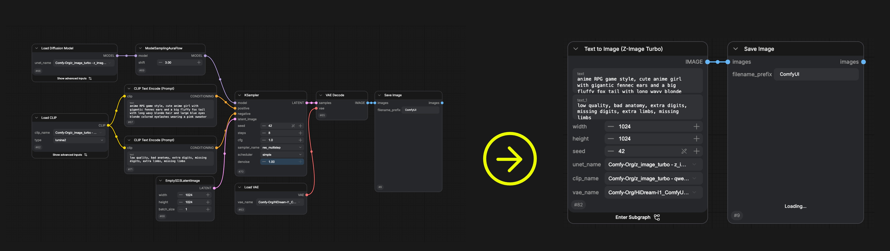

Betrachten Sie ein Subgraph als einen „Ordner“ für Ihren Workflow: Sie können zusammengehörige Nodes gruppieren und die gesamte Sammlung als einen einheitlichen Subgraph-Node verwenden.

**Mit Subgraphs können Sie:**
- Komplexe Workflows vereinfachen
- Häufige Node-Kombinationen wiederverwenden
- Effizientere Workflows mit modularen Komponenten erstellen

## Subgraph erstellen

<Steps>
    <Step title="Wählen Sie Nodes aus">
    Wählen Sie die Nodes aus, die Sie in ComfyUI gruppieren möchten.
    </Step>
    <Step title="Klicken Sie auf das Subgraph-Symbol">
        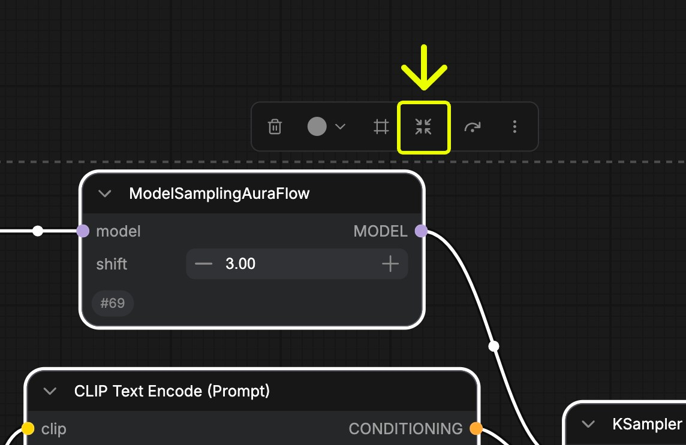
        Das Subgraph-Symbol finden Sie in der Symbolleiste.
    </Step>
    <Step title="Subgraph erstellt">
        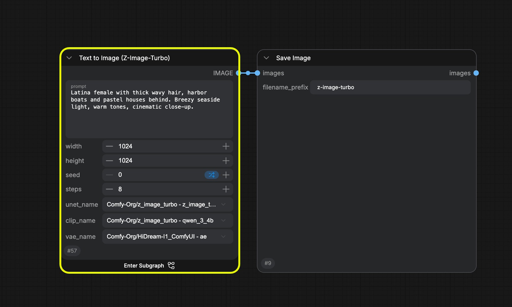
        ComfyUI erstellt automatisch einen Subgraph basierend auf den Eingängen und Ausgängen Ihrer ausgewählten Nodes.
    </Step>
    <Step title="Passen Sie Ihren Subgraph an">
        Unter [Subgraphs bearbeiten](#subgraphs-bearbeiten) erfahren Sie, wie Sie den Subgraph bearbeiten und organisieren, um einen voll funktionsfähigen Node zu erstellen.
        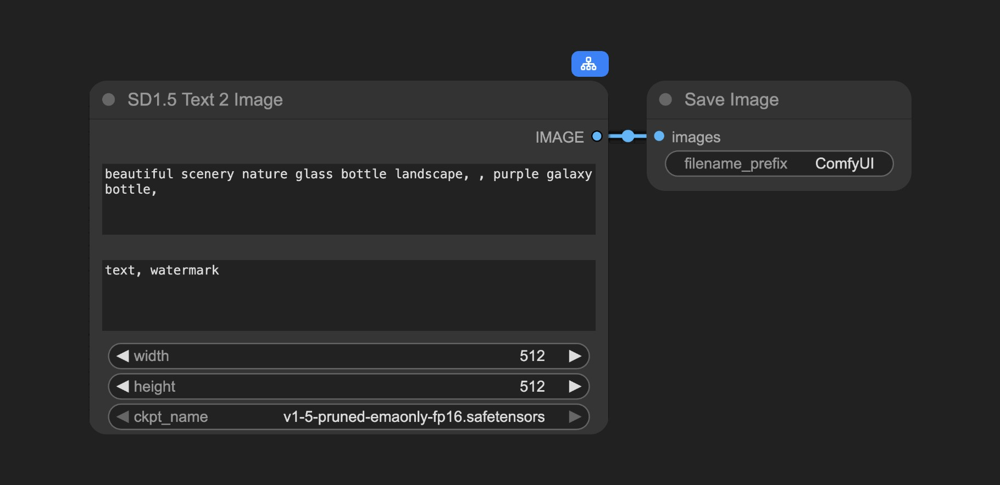
    </Step>
</Steps>

## Mit Subgraphs arbeiten

### Grundlegende Operationen

Subgraphs funktionieren genau wie normale Nodes. Sie können:
- Farben und Namen ändern
- Umgehen verwenden, um sie zu deaktivieren
- Alle Standard-Operationen für Nodes anwenden

### Subgraphs bearbeiten

**So wechseln Sie in den Bearbeitungsmodus:**
- Doppelklicken Sie auf den leeren Bereich innerhalb des Subgraphs (nicht auf Widgets), oder
- Klicken Sie auf die Schaltfläche zum Bearbeiten des Subgraphs

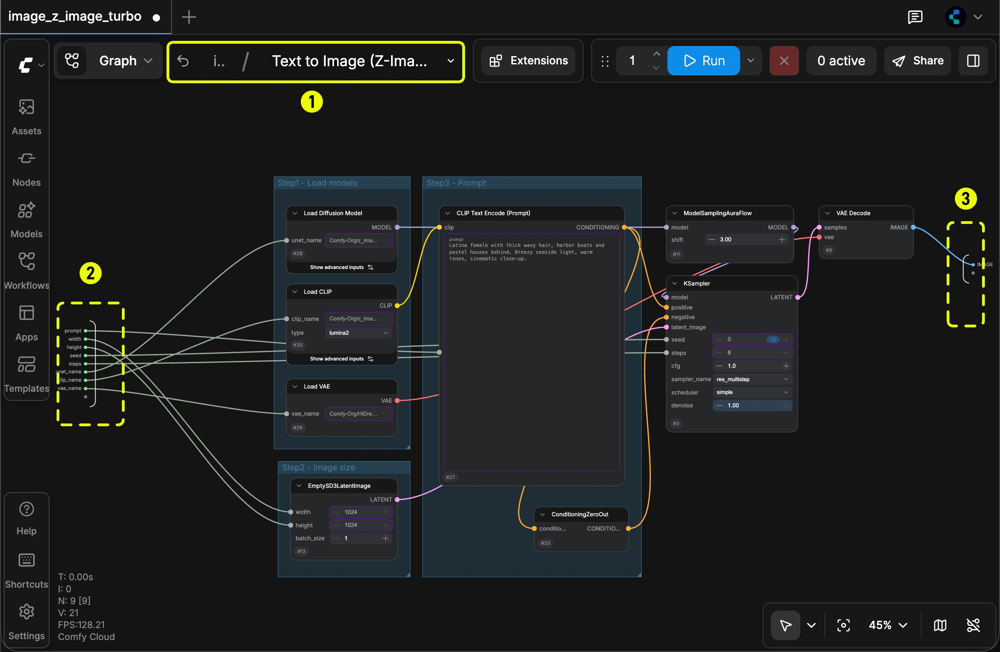

**Im Bearbeitungsmodus sehen Sie:**

1. **Navigationsleiste**: Verlassen Sie den aktuellen Subgraph und kehren Sie zur übergeordneten Ebene zurück
2. **Eingabe-Slots**: Interne Node-Eingänge, die nach außen sichtbar gemacht werden
    - Verbinden Sie Ausgänge wie bei normalen Nodes mit den Slots
    - **Klicken Sie mit der rechten Maustaste** auf Verbindungspunkte, um sichtbar gemachte Slots umzubenennen oder zu löschen
3. **Ausgabe-Slots**: Nach außen sichtbar gemachte Ausgänge (gleiche Funktionalität wie Eingabe-Slots)

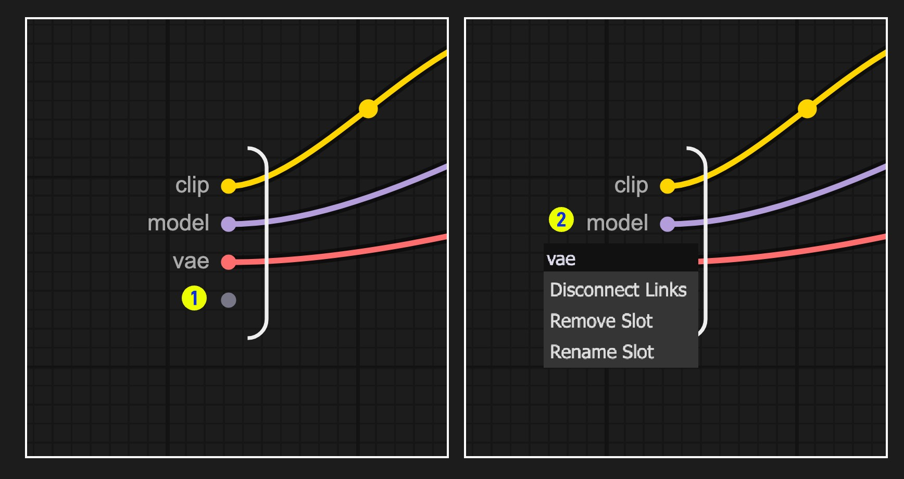

**Mit Slots arbeiten:**
1. **Standard-Slot** (mit 1 beschriftet): Verwenden Sie diesen, um neue Eingabe-/Ausgabe-Verbindungen hinzuzufügen
2. **Klicken Sie mit der rechten Maustaste** auf vorhandene Slots, um sie umzubenennen, zu löschen oder von den ursprünglichen Nodes zu trennen

> Hinweis: Slot-Verbindungen folgen den standardmäßigen Regeln zur Validierung von Datentypen

### Eingabe- und Ausgabeports neu anordnen

Jede Eingabe- und Ausgabezeile innerhalb eines Subgraphs hat einen Ziehgriff. Ziehen Sie den Griff, oder fokussieren Sie ihn und drücken Sie **Alt + Up/Down**, um den Port zu verschieben. Die Reihenfolge wird im Subgraph selbst gespeichert, sodass jede Instanz davon übernommen wird und die Verbindungen an ihren Ports erhalten bleiben. Rückgängig stellt die vorherige Reihenfolge wieder her.

<video controls>
  <source src="/images/interface/features/subgraph/subgraph_io_reorder.mp4" type="video/mp4" />
</video>

### Parameterbereich

Mit ComfyUI v0.3.66 oder später können Sie die Subgraph-Parameter direkt im Parameterbereich bearbeiten, ohne den Subgraph zu betreten.

Sie können einen beliebigen Subgraph auswählen und über die Schaltfläche „Subgraph-Widgets bearbeiten“ den Parameterbereich öffnen.
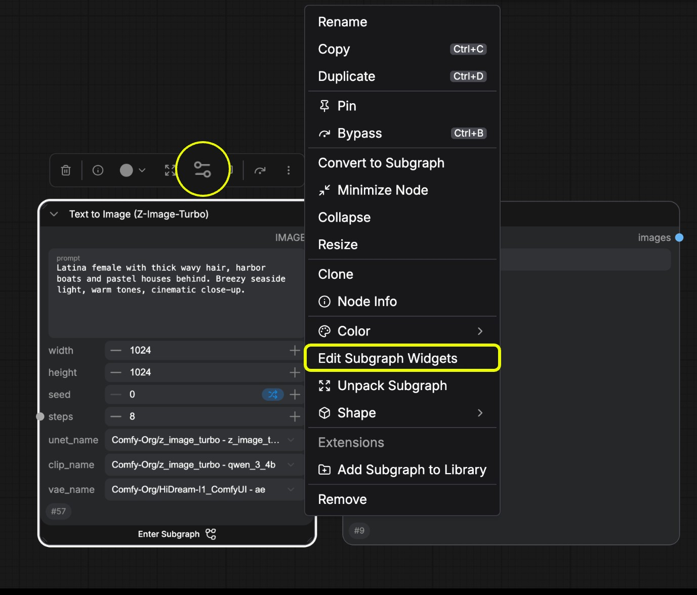

Nach dem Öffnen können Sie die Reihenfolge und Sichtbarkeit der Subgraph-Widgets direkt im Parameterbereich bearbeiten.

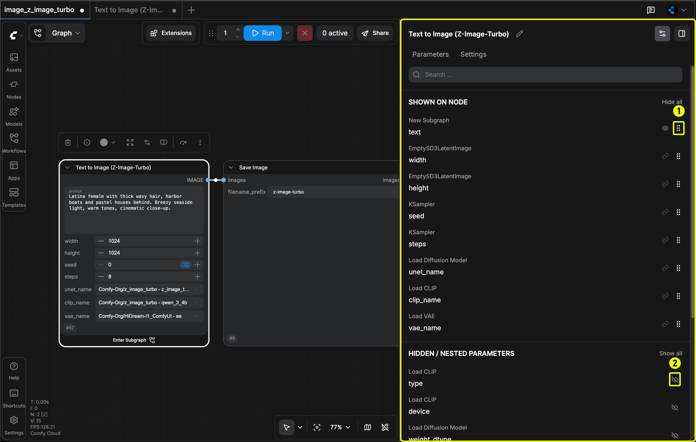
1. Neu anordnen: Klicken Sie mit der rechten Maustaste auf das Widget und halten Sie die Taste gedrückt, um es an die gewünschte Position zu ziehen
2. Sichtbarkeit: Sie können die Sichtbarkeit des Widgets prüfen, indem Sie auf das Augensymbol klicken

### Verschachtelte Subgraphs

Erstellen Sie noch komplexere Workflows, indem Sie Subgraphs in Subgraphs verschachteln.

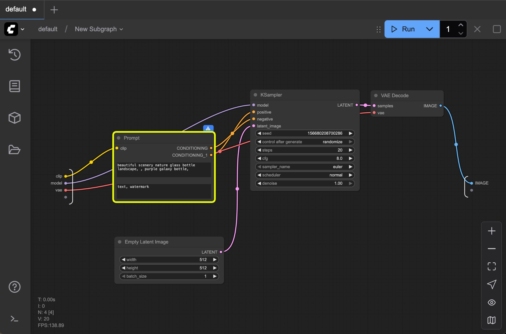

Die Navigationsleiste zeigt Ihre aktuelle Ebene und ermöglicht Ihnen, sich einfach zwischen verschachtelten Subgraphs zu bewegen.

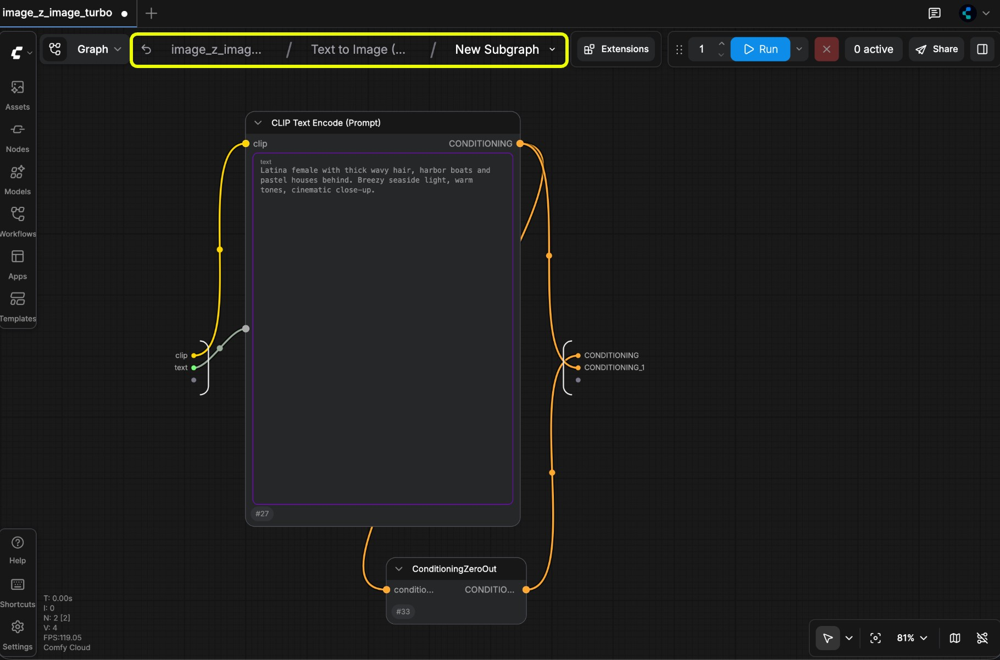

### Subgraph verlassen

So verlassen Sie einen Subgraph und kehren zur übergeordneten Ebene zurück:
- Verwenden Sie die **Navigationsleiste** (im Bild mit 1 beschriftet) oben auf dem Canvas, oder
- Drücken Sie die Taste **Esc**

Klicken Sie auf die Navigationsleiste oder drücken Sie Esc, um den aktuellen Subgraph zu verlassen und zum übergeordneten Workflow zurückzukehren.

## Subgraphs in Nodes entpacken

Wenn Sie mit dem Erstellen eines Subgraphs fertig sind, können Sie ihn bei Bedarf wieder in Nodes umwandeln.

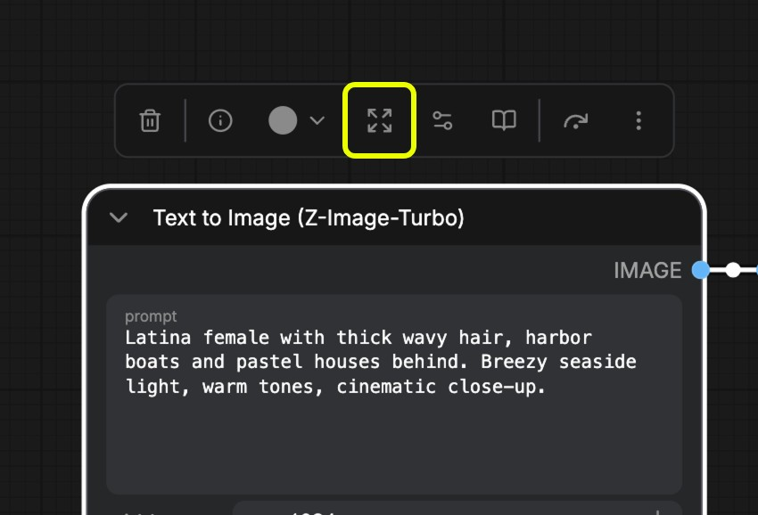

1. Sie können den Subgraph-Node auswählen und dann im Rechtsklick-Menü „Subgraph entpacken“ verwenden, um ihn wieder in Nodes umzuwandeln.
2. Klicken Sie in der Auswahl-Toolbox auf die Schaltfläche „Subgraph entpacken“, um ihn wieder in Nodes umzuwandeln.

## Subgraph-Blueprint

Mit ComfyUI Frontend-Version 1.27.7 oder höher können Sie Ihr Subgraph in der Node-Bibliothek veröffentlichen.

Diese Funktion ermöglicht es Ihnen, ein Subgraph in einen `Subgraph Blueprints`-Node umzuwandeln, das heißt in einen wiederverwendbaren Subgraph-Node.

### Subgraph in der Node-Bibliothek veröffentlichen

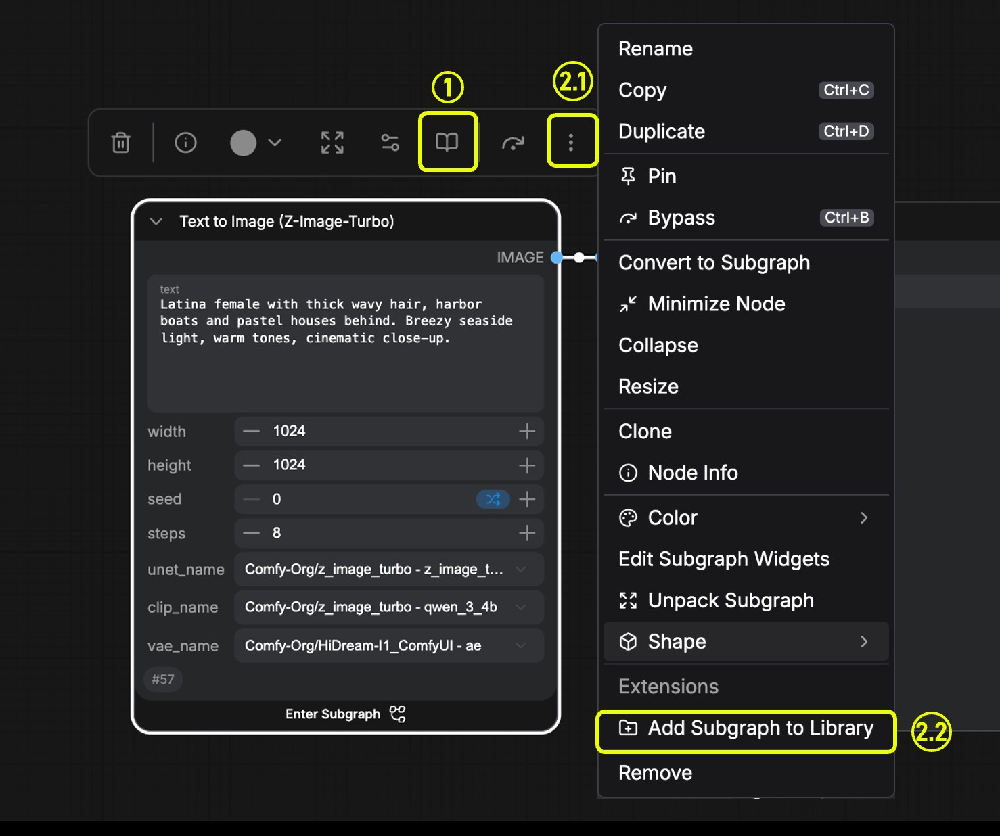

Derzeit gibt es zwei Wege, ein Subgraph in der Node-Bibliothek zu veröffentlichen; beide befinden sich in der Auswahl-Toolbox:

1. Klicken Sie in der Auswahl-Toolbox auf das Symbol `book(publish)`.
2. Öffnen Sie das Menü der Auswahl-Toolbox und verwenden Sie den Menüeintrag `Add Subgraph to Library`, um das Subgraph zu veröffentlichen.

Nachdem Sie auf das Symbol `book(publish)` oder den Menüeintrag `Add Subgraph to Library` geklickt haben, sehen Sie den folgenden Dialog:

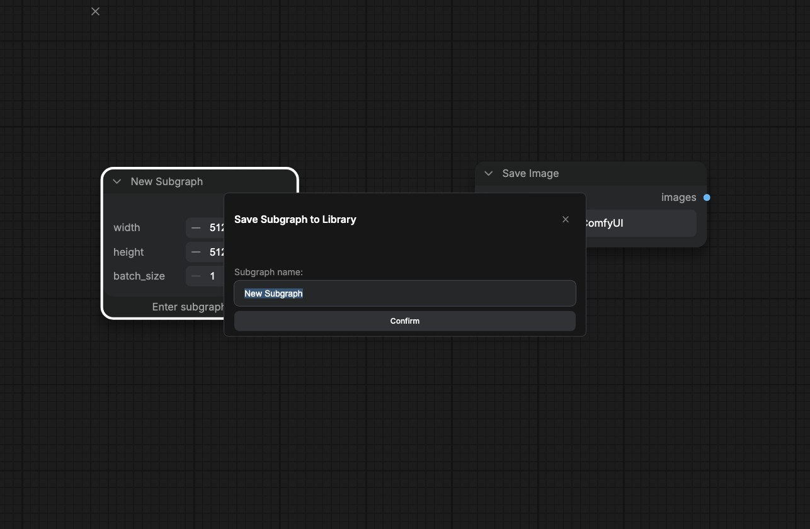

Standardmäßig verwendet das Subgraph den Namen des Subgraph-Nodes als Namen für den Subgraph-Blueprint.

Nach dem Veröffentlichen sehen Sie den Subgraph-Blueprint-Node in der Node-Bibliothek.

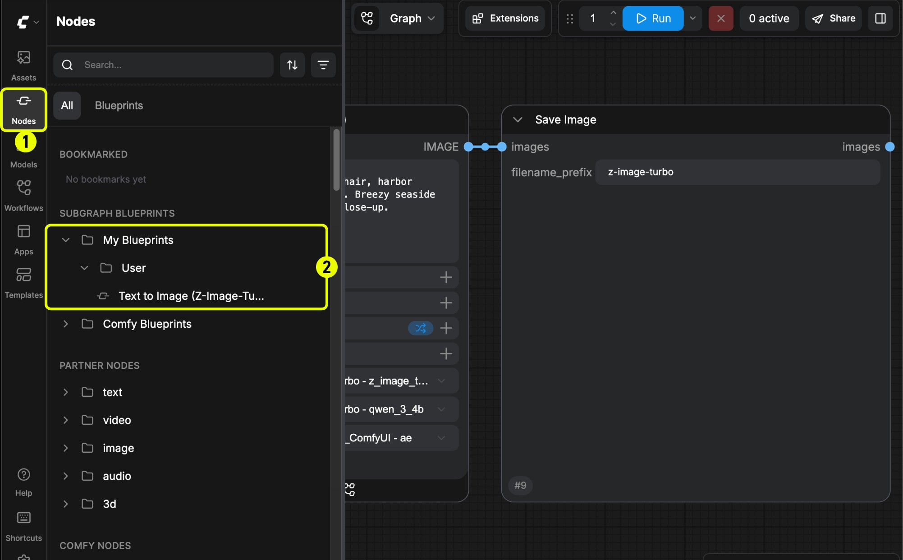

Jetzt können Sie das Subgraph genau wie einen normalen Node ziehen oder suchen. Ein neuer Subgraph-Node, der aus den Subgraph-Blueprints hinzugefügt wurde, ist weiterhin isoliert: Nachdem Sie ihn zum Workflow hinzugefügt haben, können Sie ihn unabhängig bearbeiten, und sie beeinflussen sich nicht gegenseitig.

### Subgraph-Blueprint bearbeiten

Wenn Sie den Subgraph-Blueprint bearbeiten möchten, können Sie wie im folgenden Bild auf die Schaltfläche zum Bearbeiten klicken; Sie können ihn ebenso löschen.

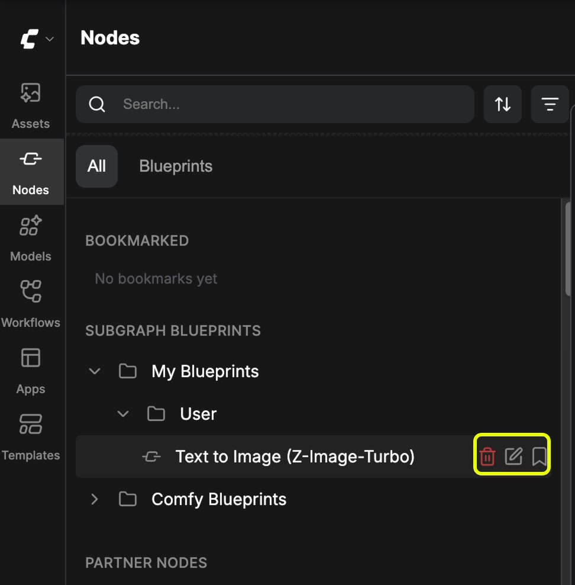

Dadurch wird der Bearbeitungsmodus für Subgraphs aktiviert.

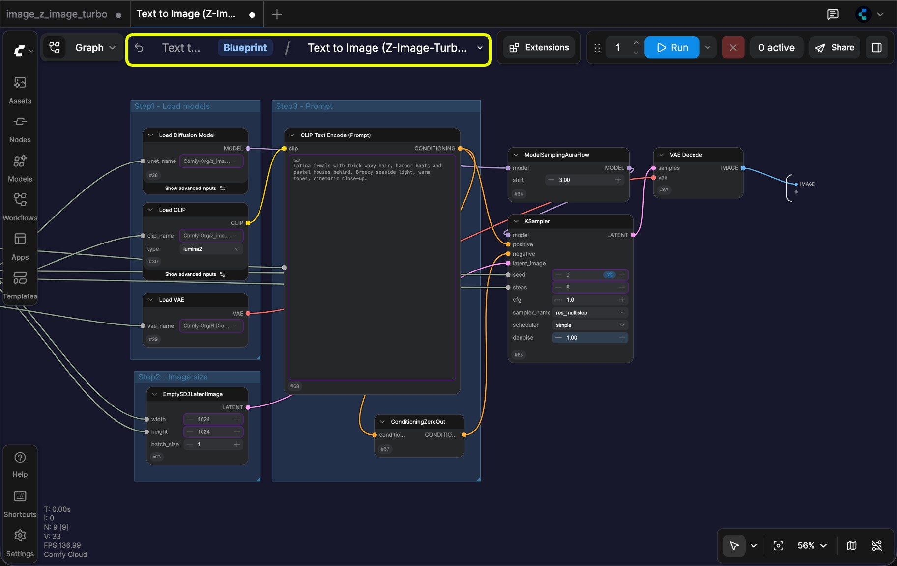

Nachdem Sie den Subgraph-Blueprint bearbeitet haben, können Sie zur übergeordneten Ebene wechseln, um das Subgraph in der Vorschau anzuzeigen.

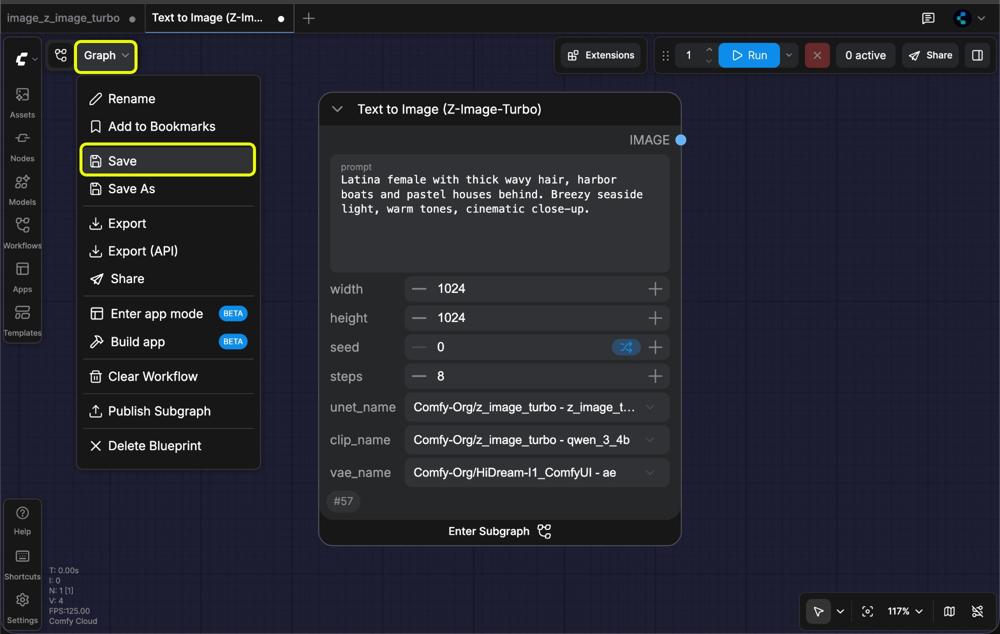

Wenn Sie den aktualisierten Subgraph-Blueprint speichern möchten, klicken Sie auf die Schaltfläche zum Speichern oder verwenden Sie die Tastenkombination Ctrl + S.
