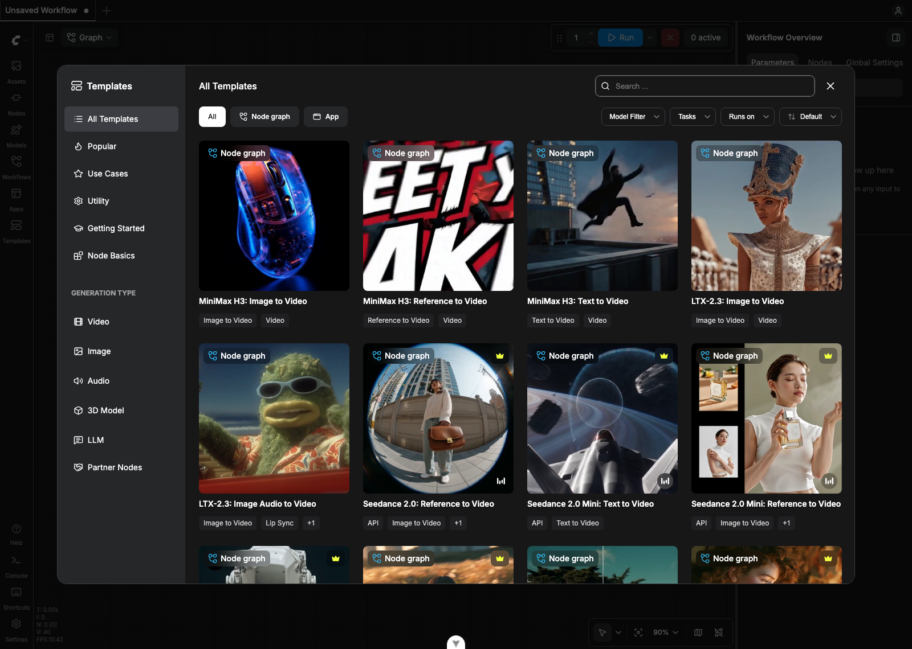
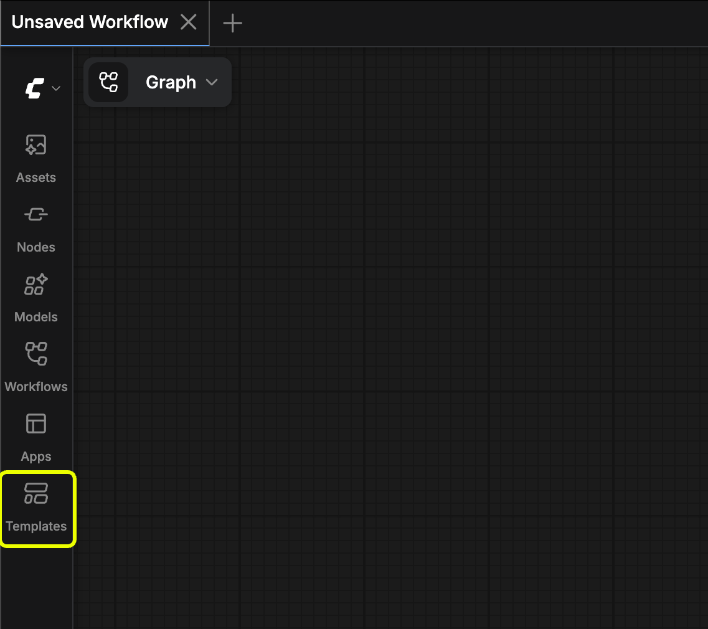
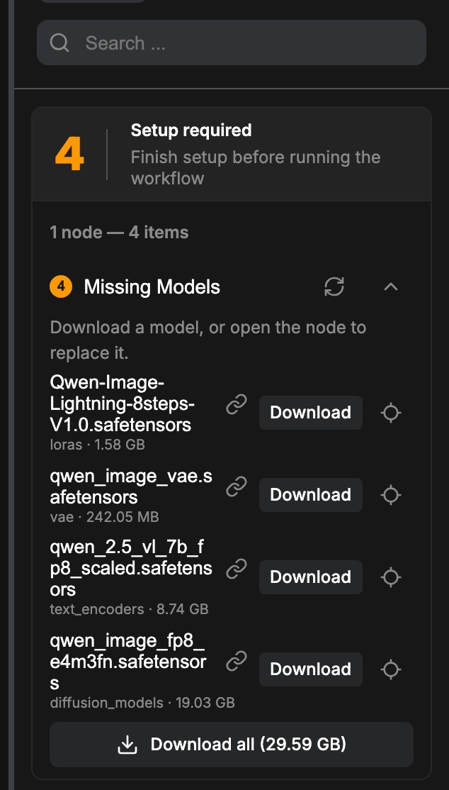

Workflow Templates ist der Browser für die von ComfyUI nativ unterstützten Modell-Workflows sowie für einige Beispiel-Workflows aus Custom Nodes.

In den Workflow Templates von ComfyUI finden Sie:

- Nativ unterstützte Modell-Workflows
- Beispiel-Workflows aus Custom Nodes



## Vorlagen in ComfyUI öffnen

Klicken Sie auf das Symbol **Vorlagen** in der Seitenleiste, um die Workflow-Vorlagen zu öffnen. Sie können sie auch über das Menü **Workflow** → **Durchsuchen von Workflow-Vorlagen** öffnen.


## Vorlagen verwenden

1. Vorlage laden: Klicken Sie auf eine beliebige Vorlage, um ihren Workflow zu laden.
2. Modelle herunterladen: Beim Laden einer Vorlage prüft ComfyUI automatisch, ob alle erforderlichen Modelldateien vorhanden sind. Wenn etwas fehlt, werden Sie aufgefordert, die Modelle herunterzuladen.
3. Workflow ausführen: Sobald alle Anforderungen wie Modelle, Eingabebilder und Prompts bereit sind, klicken Sie auf die Schaltfläche Run, um den Workflow zu verwenden.

### Speicherort der Modelle

Jede Workflow-Vorlage bettet Verknüpfungen zu den erforderlichen Modellen ein. Wenn diese Dateien bei der ersten Verwendung fehlen, zeigt ComfyUI kein separates Modal an. Stattdessen:

1. markiert es die betroffenen Loader-Nodes auf dem Canvas rot.
2. zeigt es ein kleines Banner wie **N errors found** mit **Details anzeigen**.
3. öffnet es die Details im Tab **Errors** der [Rechten Seite](/de/interface/right-side-panel) unter **Einrichtung erforderlich** / **Fehlende Modelle**.



In dieser Liste können Sie eine einzelne Datei **Herunterladen**, **Alle herunterladen**, **Aktualisieren** oder das Steuerelement zum Lokalisieren verwenden, um zu dem Node zu springen, der das Modell benötigt. Die Gruppe **Fehlende Modelle** bleibt während Ihrer Arbeit im Tab **Errors** verfügbar.

1. **Desktop**: **Herunterladen** / **Alle herunterladen** speichert die Dateien in den passenden Ordnern unter `ComfyUI/models/…`.
2. **Selbst gehostet im Browser**: Die gleichen Aktionen starten einen Browser-Download, wenn eine URL verfügbar ist. Legen Sie jede Datei im passenden Ordner ab. Beispiel für die Vorlage Qwen Image im Screenshot:

```
📂 ComfyUI/
├── 📂 models/
│   ├── 📂 loras/
│   │   └── Qwen-Image-Lightning-8steps-V1.0.safetensors
│   ├── 📂 diffusion_models/
│   │   └── qwen_image_fp8_e4m3fn.safetensors
│   ├── 📂 vae/
│   │   └── qwen_image_vae.safetensors
│   └── 📂 text_encoders/
│       └── qwen_2.5_vl_7b_fp8_scaled.safetensors
```

Die Erkennung fehlender Dateien prüft derzeit, ob eine gleichnamige Datei im entsprechenden Verzeichnis der obersten Ebene vorhanden ist (zum Beispiel direkt unter `ComfyUI/models/diffusion_models`).
Wenn das Modell bereits in einem Unterordner wie `ComfyUI/models/diffusion_models/wan_video` liegt, können Sie die Aufforderung schließen und stattdessen diese Datei im Loader-Node auswählen.

Wenn Sie wissen möchten, wie Modellverknüpfungen eingebettet werden: Wir fügen ein Feld `models` unter den `properties` des Nodes hinzu. Unten sehen Sie einen vollständigen Ausschnitt eines `DualCLIPLoader`-Nodes mit eingebetteten Modellinformationen:
```json
    {
      "id": 40,
      "type": "DualCLIPLoader",
      "pos": [
        -320,
        290
      ],
      "size": [
        270,
        130
      ],
      "flags": {},
      "order": 0,
      "mode": 0,
      "inputs": [],
      "outputs": [
        {
          "name": "CLIP",
          "type": "CLIP",
          "links": [
            64
          ]
        }
      ],
      "properties": {
        "Node name for S&R": "DualCLIPLoader",
        "cnr_id": "comfy-core",
        "ver": "0.3.40",
        "models": [
          {
            "name": "clip_l.safetensors",
            "url": "https://huggingface.co/comfyanonymous/flux_text_encoders/resolve/main/clip_l.safetensors",
            "directory": "text_encoders"
          },
          {
            "name": "t5xxl_fp16.safetensors",
            "url": "https://huggingface.co/comfyanonymous/flux_text_encoders/resolve/main/t5xxl_fp16.safetensors",
            "directory": "text_encoders"
          }
        ]
      },
      "widgets_values": [
        "clip_l.safetensors",
        "t5xxl_fp16.safetensors",
        "flux",
        "default"
      ]
    }
```

Das Feld `models` innerhalb von `properties` enthält `name`, `url` und `directory`.

- `name`: der Dateiname des Modells
- `url`: ein direkter Download-Link zur Datei (keine Repository-Seite)
- `directory`: der Unterordner unter `ComfyUI/models`, in dem die Datei gespeichert wird, z. B. `vae` bedeutet `ComfyUI/models/vae`

Derzeit werden nur Links von Hugging Face und Civitai unterstützt. Das Modellformat muss ein sicheres Format wie `.safetensors` oder `.sft` sein. Formate wie `.gguf` gelten als unsicher; beim Einbetten werden sie als unsicher markiert und der Link wird nicht angezeigt.

Mit [diesem Tool](https://comfyui-wiki.github.io/ComfyUI-Workflow-JSON-Editor/) können Sie die Modellinformationen in Workflow-Vorlagen bearbeiten. Derzeit fügt [@ComfyUI-Wiki](https://github.com/ComfyUI-Wiki) nur Support für native Nodes hinzu.

## Vorlagen aktualisieren

Vorlagen werden als separate Abhängigkeit verwaltet und aktualisiert: [`comfyui-workflow-templates`](https://pypi.org/project/comfyui-workflow-templates/).

Wenn Sie nach dem Aktualisieren von ComfyUI die Dokumentation oder neu angekündigte Vorlagen nicht sehen, müssen Sie möglicherweise die entsprechende Abhängigkeit aktualisieren. Die Versionen können Sie in [`ComfyUI/requirements.txt`](https://github.com/Comfy-Org/ComfyUI/blob/master/requirements.txt) prüfen.

In der Regel werden die folgenden drei Abhängigkeiten zusammen aktualisiert, wenn ComfyUI aktualisiert wird:

```
comfyui-frontend-package==1.24.4
comfyui-workflow-templates==0.1.52
comfyui-embedded-docs==0.2.4
```

Wenn Sie sich nicht sicher sind, wie Sie korrekt vorgehen, lesen Sie [ComfyUI aktualisieren](/de/installation/update_comfyui), um zu erfahren, wie Sie ComfyUI und seine Abhängigkeiten aktualisieren.

## Vorlagen zum ComfyUI-Repository beitragen

Alle Vorlagen werden im Repository [workflow_templates](https://github.com/Comfy-Org/workflow_templates/) gehostet. Sie können Vorlagen beitragen, indem Sie einen PR einreichen. Für offizielle Vorlagen setzen wir Folgendes voraus:

1. Verwenden Sie keine Nodes von Drittanbietern (um zusätzliche Installationen für Nutzer zu vermeiden, denen diese Nodes fehlen).
2. Die Vorlage darf keine bestehenden Vorlagen duplizieren und sollte auf unterstützte Modellfunktionen ausgerichtet sein.
3. Sie können im Repository ein Issue eröffnen, um Fragen zu stellen.

## Vorlagen für Custom Nodes

Wenn ein Autor eines Custom Node Vorlagen und Beispiel-Workflows bereitstellt, finden Sie diese auch im Vorlagen-Browser. In der Regel finden Sie alle Vorlagen, indem Sie die nach dem Node benannte Kategorie aufrufen.

Wenn Sie Autor eines Custom Node sind, beachten Sie, dass derzeit nur eine einzige Verzeichnisebene unter dem Ordner `templates` unterstützt wird (keine verschachtelten Unterverzeichnisse) und ausschließlich Vorlagen im JSON-Format möglich sind.

## Vorlagen für Custom Nodes hinzufügen

Unter [Custom Node Templates](/de/custom-nodes/workflow_templates) erfahren Sie, wie Sie Workflow-Vorlagen für Ihre Custom Nodes hinzufügen.
