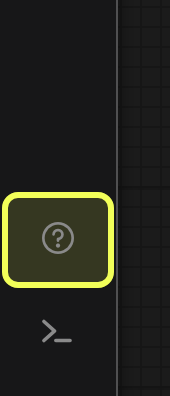
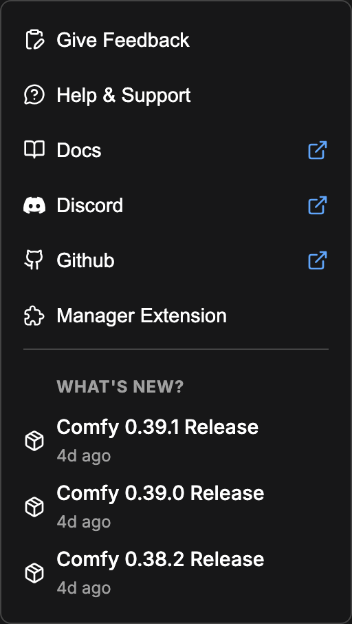
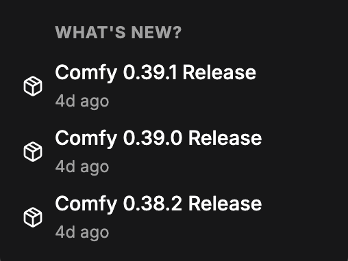
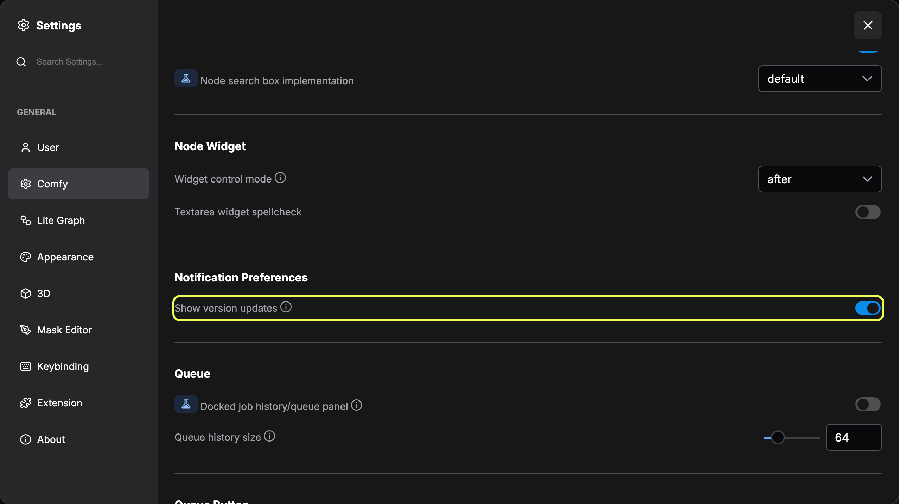

Das Hilfe-Center ist das Panel hinter dem Fragezeichen-Symbol unten in der Seitenleiste von ComfyUI. Es bündelt die Links und Aktionen, die Sie sonst außerhalb des Editors suchen müssten: Release Notes, Dokumentation, Community- und Support-Kanäle, Systemstatus, Feedback und die Aktion zum Aktualisieren von ComfyUI.

## Hilfe-Center öffnen

Klicken Sie unten in der linken Seitenleiste auf das Fragezeichen-Symbol. Der Tooltip lautet **Hilfe-Center**. Ein roter Punkt auf dem Symbol bedeutet, dass es etwas Neues zu lesen gibt.

Klicken Sie erneut auf das Symbol, um das Panel zu schließen. Im **App-Modus** (linearer Modus) öffnet dasselbe Symbol direkt das Feedback-Formular statt des Menüs.

## Menüeinträge

Das Panel listet die folgenden Einträge auf. Einige davon erscheinen nur im Comfy Cloud-Build, andere nur bei einer lokalen Installation.

| Eintrag | Funktion |
| --- | --- |
| **Feedback geben** | Öffnet das Feedback-Formular in Comfy Cloud und in Nightly-Builds. In anderen Builds startet der Eintrag den Ablauf zur Kontaktaufnahme mit dem Support. |
| **Hilfe & Support** | Öffnet den Ablauf zur Kontaktaufnahme mit dem Support. |
| **Dokumentation** | Öffnet docs.comfy.org, oder die Cloud-Seite „Erste Schritte“, wenn Sie Comfy Cloud verwenden. |
| **Discord** | Öffnet den Discord-Server von ComfyUI. |
| **Github** | Öffnet das ComfyUI-Repository. |
| **Systemstatus** | Öffnet die Comfy-Statusseite unter status.comfy.org. Nur in Comfy Cloud. |
| **Manager-Erweiterung** | Öffnet den Custom-Node-Manager. Nur bei lokalen Installationen. |
| **ComfyUI aktualisieren** | Stellt ein ComfyUI-Update in die Warteschlange. Für lokale Installationen, die den neuen Manager verwenden, mit Ausnahme der Desktop-App. |
| **Mehr...** | Zusätzliche Einträge, die nur angezeigt werden, wenn mindestens einer verfügbar ist. In der Desktop-App: **Desktop-Benutzerhandbuch**, **Entwicklerwerkzeuge öffnen** und **Neu installieren**. Bei aktiviertem Entwicklermodus: **Onboarding wiederholen**. |

## Neuigkeiten

Der Abschnitt **Neuigkeiten** im Menü listet die neuesten ComfyUI-Releases mit Versionsnummer und Veröffentlichungsdatum auf. Klicken Sie auf einen Release, um den zugehörigen Eintrag auf der Seite [Changelog](/de/changelog) zu öffnen.

Der Abschnitt folgt der Einstellung **Versionsupdates anzeigen** unter **Comfy** und dann **Benachrichtigungseinstellungen** in den Einstellungen, die standardmäßig aktiviert ist. Wenn Sie sie deaktivieren, wird der Abschnitt ausgeblendet.

## Der rote Punkt

Das Symbol in der Seitenleiste zeigt einen roten Punkt, wenn es etwas zu lesen oder zu klären gibt:

- **Ungelesene Versionshinweise**: Eine neuere Version ist verfügbar und Sie haben die zugehörigen Hinweise noch nicht geöffnet. Die Desktop-App zeigt diese Markierung, und zwar nur, solange **Versionsupdates anzeigen** aktiviert ist.
- **Node-Konflikte**: Der Custom-Node-Manager hat ein Problem mit einem installierten Custom Node gefunden, etwa eine abweichende ComfyUI- oder Frontend-Version, einen Node, der nicht importiert werden konnte, oder ein Paket, das unter Ihrem Betriebssystem oder Ihrer GPU nicht unterstützt wird.

Der Punkt verschwindet, wenn Sie die Versionshinweise öffnen und die Node-Konflikte bestätigen.
