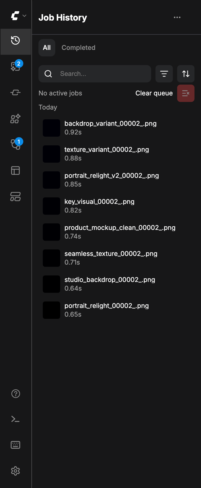
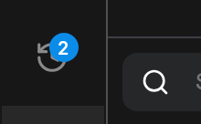

**Job History** ist ein Tab in der linken Seitenleiste, der angezeigt wird, wenn die Einstellung **Angedocktes Auftragsverlaufs-/Queue-Panel** (`Comfy.Queue.QPOV2`) aktiviert ist. Das Frontend registriert ihn **oben** in der Seitenleiste (`prepend`), sodass Sie aktive Aufträge beobachten und vergangene Läufe durchsuchen können, ohne das schwebende Queue-Overlay zu verwenden.

Wenn die Einstellung deaktiviert ist, wird der Tab entfernt und stattdessen bleibt das schwebende Job-History-Overlay verfügbar (`Comfy.Queue.ToggleOverlay`). Die Run-/Queue-Steuerelemente in der oberen Kopfzeile starten Aufträge in beiden Fällen weiterhin. Diese Seite behandelt die Job-History-Oberfläche in der **Seitenleiste**.

## Auftragshistorie aktivieren

1. Öffnen Sie **Einstellungen**.
2. Aktivieren Sie unter `Comfy` → `Queue` → `Layout` die Option **Angedocktes Auftragsverlaufs-/Queue-Panel** (`Comfy.Queue.QPOV2`).
3. Das Symbol **Auftragshistorie** wird oben in der linken Seitenleiste angezeigt.

Die Einstellung ist experimentell. In Nightly-Builds ist sie standardmäßig aktiviert; prüfen Sie bei anderen Builds die Einstellung, wenn Sie die Registerkarte nicht sehen.

## Panel öffnen

Klicken Sie auf das Symbol **Job History**. Solange Aufträge ausgeführt werden oder in der Warteschlange stehen und dieser Tab **nicht** aktiv ist, zeigt das Symbol ein numerisches Badge mit der Anzahl der aktiven Aufträge an. Beim Öffnen des Tabs wird das Badge für diese Ansicht ausgeblendet.

## Tabs: Alle, Abgeschlossen, Fehlgeschlagen

Der Kopfbereich des Panels enthält Status-Tabs:

- **Alle**: alle Aufträge im Verlauf für die aktuellen Filter.
- **Abgeschlossen**: abgeschlossene Durchläufe.
- **Fehlgeschlagen**: wird nur angezeigt, wenn mindestens ein fehlgeschlagener Auftrag in der Liste vorhanden ist.

Unterhalb der Tabs zeigt eine Zusammenfassungszeile, wie viele Aufträge gerade ausgeführt werden und in der Warteschlange stehen (oder dass keine aktiven Aufträge vorhanden sind). Ein Steuerelement **Queue leeren** bricht alle ausstehenden Aufträge ab (in der Warteschlange, aber noch nicht laufend).

## Suchen, filtern und sortieren {#search-filter-and-sort}

Nutzen Sie die Werkzeuge in der Kopfzeile, um die Liste einzugrenzen:

- **Suchen**: Aufträge nach Text filtern.
- **Filter**: **Alle Workflows** oder **Aktueller Workflow**.
- **Sortieren**: **Neueste zuerst** oder **Gesamte Generierungszeit**.

## Auftragsliste und Aktionen

Aufträge werden mit Status, Fortschritt während der Ausführung und Vorschaubildern angezeigt, wenn Ausgaben vorhanden sind. In einer Auftragszeile oder über ihr Kontextmenü können Sie:

**Laufend oder in Warteschlange**

- Als Workflow in einem neuen Tab öffnen
- Job-ID kopieren
- Auftrag abbrechen

**Abgeschlossen**

- Asset prüfen (wenn eine Vorschau vorhanden ist)
- Die Ausgabe als Loader-Node zum aktuellen Workflow hinzufügen
- Das Vorschau-Asset herunterladen
- Als Workflow in einem neuen Tab öffnen
- Workflow exportieren
- Job-ID kopieren

**Fehlgeschlagen**

- Workflow in einem neuen Tab öffnen
- Job-ID kopieren
- Fehlermeldung kopieren
- Fehler melden
- Auftrag aus der Verlaufsliste entfernen

Das Aktionsmenü in der Kopfzeile enthält **Clear history**, das einen Bestätigungsdialog öffnet. Das Leeren des Verlaufs entfernt Einträge aus dem Warteschlangenverlauf. Lesen Sie den Hinweis im Dialog dazu, wie sich das auf gespeicherte Assets Ihrer Installation auswirkt.

## Zusammenhang mit Assets und Fehlern

Ausgaben abgeschlossener Läufe erscheinen ebenfalls in [Assets](/de/interface/assets), wenn das Asset-System aktiviert ist. Fehlgeschlagene Workflows und fehlende Ressourcen werden im Tab **Errors** des [Right Side Panel](/de/interface/right-side-panel) aufgeführt, während Sie den Node-Graph korrigieren.

## Verwandte Seiten

- [Benutzeroberfläche im Überblick](/de/interface/overview)
- [Assets](/de/interface/assets)
- [Rechte Seite](/de/interface/right-side-panel)
- [Comfy-Einstellungen](/de/interface/settings/comfy)
