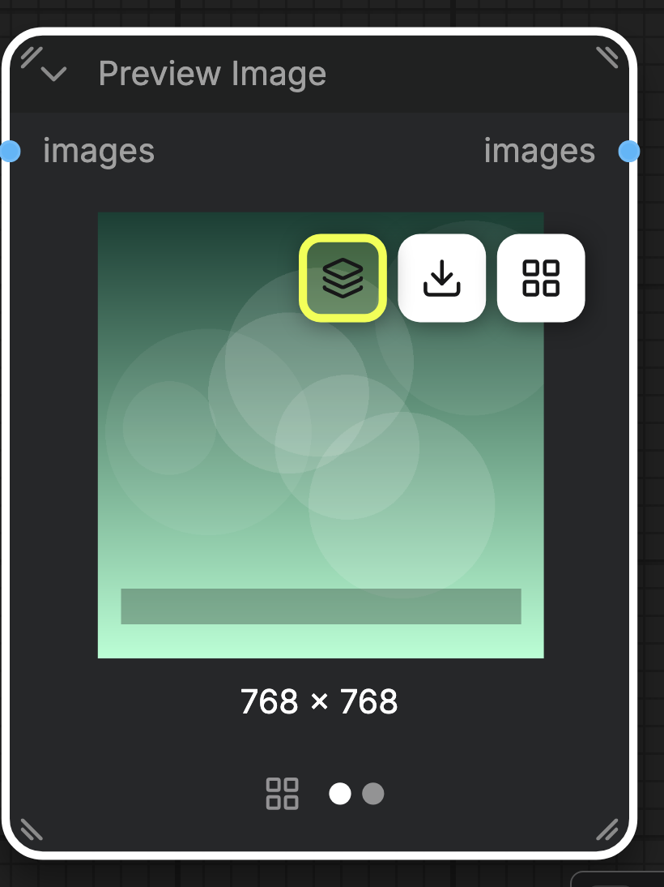
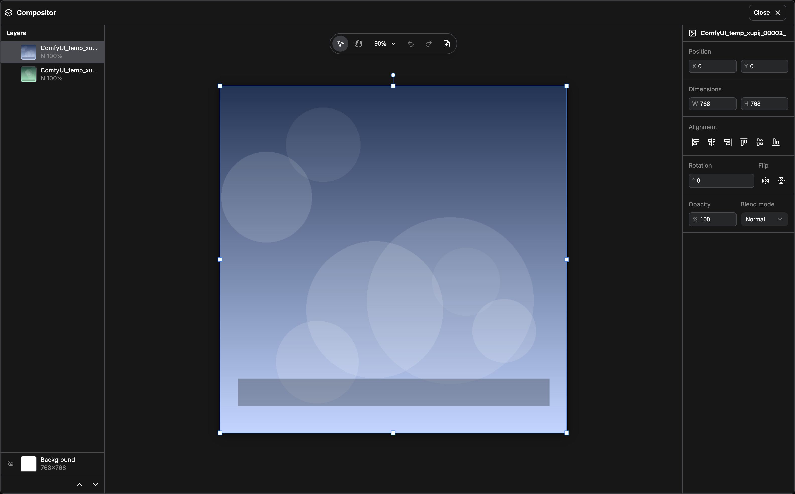

Der Layer Editor ist ein integrierter Editor im PSD-Stil, mit dem Sie Bilder zu einem mehrschichtigen Composite kombinieren. Sie öffnen ihn über einen Bildausgang auf dem Canvas, stapeln zwei oder mehr Bilder als Ebenen und passen Position, Größe, Drehung, Deckkraft und Mischmodus jeder Ebene an.

Zwei Arten von Eingaben funktionieren damit:

- **Bildausgaben von jedem Node.** Der Editor lädt die Ausgabebilder des Nodes als separate Ebenen, und Sie exportieren das fertige Composite als PSD-Datei.
- **Create Layered Image.** [Create Layered Image](/built-in-nodes/ImageCompositor) speichert eine mehrschichtige Komposition in einem optionalen `compositor`-Eingang, der ausschließlich für diesen Node gilt. Der Editor lädt die gespeicherte Komposition und schreibt Ihre Änderungen zurück, sodass der nächste Lauf des Workflows die von Ihnen erstellte Komposition verwendet. Erstellen Sie den Ebenenstapel, mit dem sie komponiert, mit [Add Layer](/built-in-nodes/AddLayer) und [Layers From Bounding Boxes](/built-in-nodes/LayersFromBoundingBoxes), die Ebenen erzeugen, anstatt eine Komposition zu speichern.

## Ebeneneditor öffnen

Es gibt zwei Möglichkeiten, den Editor vom Canvas aus zu öffnen:

1. **Vorschau der Bildausgabe**: Fahren Sie mit dem Mauszeiger über die Ausgabevorschau eines Nodes, der mehr als ein Bild erzeugt hat, und klicken Sie dann auf die Ebenenschaltfläche (**Ebeneneditor öffnen**) in der oberen rechten Ecke der Vorschau.
2. **Befehlspalette**: Wählen Sie einen einzelnen Node aus und führen Sie **Ebeneneditor für ausgewählten Node öffnen** aus.

Der Node muss mindestens zwei Ausgabebilder haben. Bei weniger als zwei meldet ComfyUI, dass der Ebeneneditor mindestens zwei Ausgabebilder benötigt.

Außerdem gibt es direkt am Node **Bild mit Ebenen erstellen** eine Schaltfläche **Compositor öffnen**. Dieser Weg setzt voraus, dass der Workflow mindestens einmal ausgeführt wurde, damit die Eingabebilder vorhanden sind. Andernfalls fordert ComfyUI Sie auf, den Workflow einmal auszuführen, um die Eingabebilder zu laden.

## Editor-Layout

Der Editor öffnet sich als Dialog über das gesamte Fenster mit vier Bereichen:

| Bereich | Position | Inhalt |
| --- | --- | --- |
| Kopfzeile | Oben | Editor-Titel, **Restore** (nur bei Bild mit Ebenen erstellen) und Schließen |
| Ebenen-Panel | Links | Ebenenliste, Ebenenreihenfolge, Sichtbarkeit und der Hintergrund-Eintrag |
| Canvas | Mitte | Live-Vorschau der Komposition und die schwebende Werkzeugleiste |
| Eigenschaften-Panel | Rechts | Einstellungen für die ausgewählte Ebene oder für den Hintergrund, wenn nichts ausgewählt ist |

## Werkzeuge und Canvas-Steuerung

Die Symbolleiste befindet sich über dem Canvas:

- **Select**: Ebenen auf dem Canvas auswählen und transformieren.
- **Hand**: Den Canvas verschieben, ohne Ebenen zu verändern.
- **Zoom**: Zoom-Voreinstellungen von 25 %, 50 %, 100 % und 200 %, plus **Fit**, um die gesamte Komposition in den sichtbaren Bereich einzupassen.
- **Undo** und **Redo**: Durch Ihre Bearbeitungen schrittweise navigieren.
- **Export PSD**: Die zusammengesetzte Komposition als PSD-Datei herunterladen.

## Mit Ebenen arbeiten

Wählen Sie eine Ebene auf dem Canvas oder im Ebenen-Panel aus und passen Sie sie anschließend im Eigenschaften-Panel an:

| Eigenschaft | Was Sie ändern können |
| --- | --- |
| Position | X- und Y-Platzierung der Ebene auf dem Canvas |
| Abmessungen | Breite und Höhe der Ebene |
| Ausrichtung | Linksbündig ausrichten, horizontal zentrieren, rechts, oben, vertikal zentrieren oder unten |
| Drehung | Die Ebene drehen |
| Spiegeln | Die Ebene horizontal oder vertikal spiegeln |
| Deckkraft | Deckkraft der Ebene |
| Mischmodus | Wie sich die Ebene mit den darunterliegenden Ebenen mischt |

Ebenen werden in der Reihenfolge der Liste gezeichnet. Mit den Aktionen zum Nach-oben- und Nach-unten-Verschieben im Ebenen-Panel legen Sie fest, welche Ebene oben liegt, und über den Sichtbarkeits-Schalter blenden Sie eine Ebene aus, ohne sie zu löschen.

Zu den Mischmodi gehören Normal, Multiplizieren, Negativ multiplizieren, Ineinanderkopieren, Abdunkeln, Aufhellen, Farbig abwedeln, Farbig nachbelichten, Hartes Licht, Weiches Licht, Differenz, Ausschluss, Linear abwedeln, Linear nachbelichten, Strahlendes Licht, Punktlicht, Lineares Licht, Harte Mischung, Subtrahieren, Dividieren, Korn extrahieren, Korn zusammenfügen, Farbton, Sättigung, Farbe und Luminanz.

Wählen Sie im Ebenen-Panel den Eintrag **Background**, um die Komposition selbst statt einer Ebene zu bearbeiten: Canvas-Breite und -Höhe (64 bis 8192 Pixel) sowie die Füllfarbe des Hintergrunds (das Steuerelement heißt **Fill**).

## Speichern und exportieren

Änderungen, die Sie in Create Layered Image vornehmen, sind Teil des Workflows: Der Ebenenstatus wird automatisch im Node gespeichert, sodass die Komposition beim erneuten Öffnen des Workflows wiederhergestellt wird. Der Node spielt die gespeicherte Komposition erneut ab, wenn die von ihm aufgezeichneten Eingänge noch mit dem aktuellen Ebenenstapel übereinstimmen. Stimmen sie nicht mehr überein, setzt er die Komposition erneut aus den Eigenschaften der Ebenen zusammen und markiert die gespeicherte Komposition als veraltet. Die Schaltfläche **Restore** in der Kopfzeile macht alle in der Sitzung vorgenommenen Änderungen rückgängig und setzt den Canvas auf den Zustand zurück, der aus dem Node geladen wurde.

**Export PSD** lädt die Komposition als PSD-Datei mit ihren Ebenen herunter, die Sie in einem Bildeditor wie Photoshop öffnen können. Für den Export ist WebGL in Ihrem Browser erforderlich. Ist WebGL nicht verfügbar, kann der Canvas nicht rendern und der Export schlägt fehl.

## Verwandte Seiten

<CardGroup cols={3}>
  <Card title="Bild mit Ebenen erstellen" icon="layer-group" href="/built-in-nodes/ImageCompositor">
    Fassen Sie einen Ebenenstapel zu einem einzelnen Bild zusammen.
  </Card>
  <Card title="Ebene hinzufügen" icon="layer-group" href="/built-in-nodes/AddLayer">
    Fügen Sie einem Kompositor-Ebenenstapel ein Bild hinzu.
  </Card>
  <Card title="Ebenen aus Bounding Boxes" icon="layer-group" href="/built-in-nodes/LayersFromBoundingBoxes">
    Erstellen Sie Kompositor-Ebenen aus Bounding Boxes.
  </Card>
</CardGroup>
