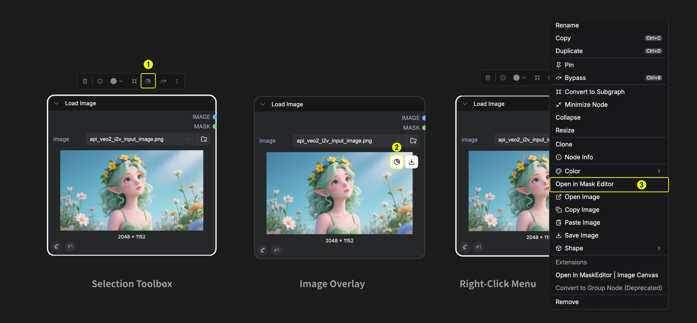
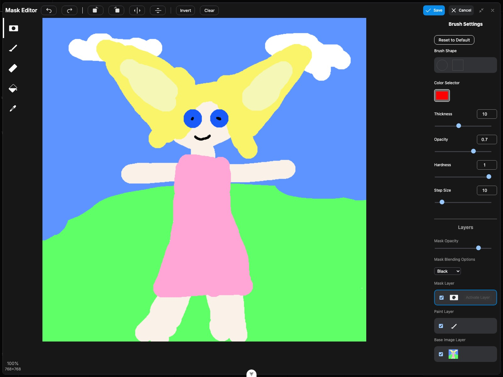
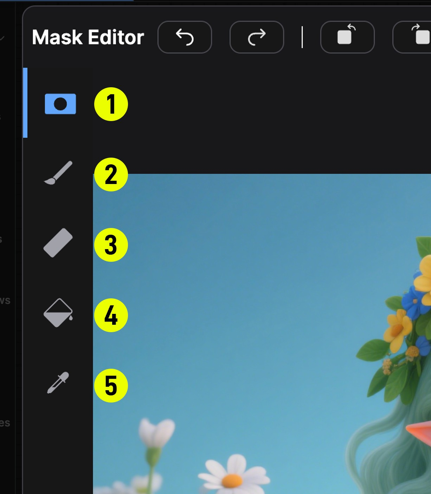
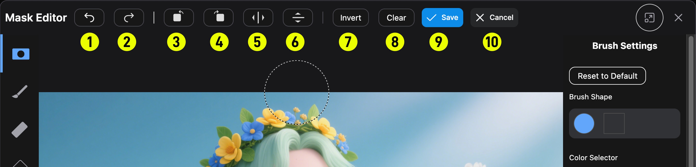

Der Maskeneditor ist ein integriertes Werkzeug in ComfyUI, mit dem Sie Maskierungen direkt auf Ihren Bildern erstellen und bearbeiten können. Ein externer Bildeditor ist nicht erforderlich. Er unterstützt mehrere Zeichenwerkzeuge, Ebenenverwaltung, Rückgängig/Wiederholen, Canvas-Transformationen und GPU-beschleunigtes Pinsel-Rendering.

---

## Maskeneditor öffnen

Es gibt drei Möglichkeiten, den Maskeneditor zu öffnen:

1. **Auswahlwerkzeugleiste**: Wählen Sie einen Load Image-Node aus, und klicken Sie dann auf die Schaltfläche mit dem Maskensymbol in der Auswahlwerkzeugleiste über dem Node.
2. **Bildüberlagerung**: Bewegen Sie den Mauszeiger über die Bildvorschau (Galeriemodus), und klicken Sie dann auf die Schaltfläche **Bild bearbeiten oder maskieren** (Maskensymbol), die oben links erscheint.
3. **Rechtsklickmenü**: Klicken Sie mit der rechten Maustaste auf einen Load Image-Node, und wählen Sie `Open in Mask Editor` aus dem Kontextmenü.

> Der Maskeneditor ist sowohl im **Graph-Modus** als auch im **App-Modus** verfügbar.

---

## Benutzeroberfläche im Überblick

Der Maskeneditor öffnet sich als modaler Dialog mit vier Hauptbereichen:

| # | Bereich | Position | Beschreibung |
|---|---------|----------|--------------|
| 1 | **Obere Leiste** | Oben | Kopfbereich mit Rückgängig/Wiederholen, Canvas-Transformationen, Invertieren/Leeren, Speichern/Abbrechen |
| 2 | **Werkzeugbereich** | Links | Werkzeugauswahl und Zoom-Informationen |
| – | **Zeigerbereich** | Mitte | Der Hauptbereich des Canvas zum Zeichnen und Bearbeiten |
| 3 | **Seitenleiste** | Rechts | Werkzeugspezifische Einstellungen und Ebenensteuerung |

---

## Werkzeuge

Die Werkzeugleiste auf der linken Seite bietet fünf Werkzeuge. Wählen Sie ein Werkzeug aus, um es zu aktivieren; im rechten Bereich werden dann seine Einstellungen angezeigt.

| # | Werkzeug | Ebene | Beschreibung |
|---|------|-------|-------------|
| 1 | **Maskierungsstift** | Maskierung | Primäres Werkzeug zum Zeichnen von Maskierungsbereichen. Klicken Sie mit der linken Maustaste und ziehen Sie, um die Maskierung auf das Bild zu malen. |
| 2 | **Malstift** | RGB (Malebene) | Malen Sie direkt auf die RGB-Ebene des Bildes. Nützlich für Inpainting oder zum Ausbessern des Basisbildes. |
| 3 | **Radierer** | Maskierung / RGB | Radiert Teile einer vorhandenen Maskierung oder Malebene. |
| 4 | **Farbeimer** | Maskierung | Füllwerkzeug auf Basis von Farbähnlichkeit. Klicken Sie auf ein Pixel, um den verbundenen Bereich mit einer Maskierung zu füllen; klicken Sie auf einen bereits maskierten Bereich, um ihn aus der Maskierung zu entfernen. Die Toleranz steuert, wie weit sich die Füllung ausbreitet. |
| 5 | **Farbauswahl** | Maskierung | Maskiert gezielt alle Pixel, die einer Zielfarbe entsprechen, mit erweiterten Abgleichalgorithmen (Simple HSL / LAB).

## Aktionen in der oberen Leiste

Die obere Leiste bietet Canvas-weite Operationen:

| # | Aktion | Beschreibung |
|---|--------|-------------|
| 1 | **Rückgängig** (Ctrl+Z) | Macht die letzte Aktion rückgängig |
| 2 | **Wiederholen** (Ctrl+Shift+Z / Ctrl+Y) | Wendet eine rückgängig gemachte Aktion erneut an |
| 3 | **Nach links drehen** | Dreht alle Ebenen um 90° gegen den Uhrzeigersinn |
| 4 | **Nach rechts drehen** | Dreht alle Ebenen um 90° im Uhrzeigersinn |
| 5 | **Horizontal spiegeln** | Spiegelt alle Ebenen horizontal |
| 6 | **Vertikal spiegeln** | Spiegelt alle Ebenen vertikal |
| 7 | **Invertieren** | Invertiert die Maskierung (Schwarz ↔ Weiß) |
| 8 | **Leeren** | Leert die gesamte Maskierung |
| 9 | **Speichern** | Speichert die Maskierung und schließt den Editor |
| 10 | **Abbrechen** | Schließt ohne zu speichern |

> **Hinweis**: Dreh- und Spiegeloperationen betreffen alle drei Ebenen (Maskierung, Paint und Basisbild) gleichzeitig. GPU-beschleunigte Texturen werden nach Transformationen neu erstellt.

---

## Ebenen

Das rechte Panel enthält einen Bereich **Ebenen**, in dem Sie die Sichtbarkeit jeder Ebene einzeln umschalten können:

- **Mask-Ebene**: Die Maskierungsüberlagerung. Sie können ihre **Deckkraft** und ihren **Mischmodus** anpassen:
  - `Schwarz`: Die Maskierung wird als schwarze Überlagerung dargestellt
  - `Weiß`: Die Maskierung wird als weiße Überlagerung dargestellt
  - `Negativ`: Invertierte Darstellung der Maskierung
- **Malebene**: Die RGB-Malebene (sichtbar, wenn Sie den Paint Pen verwenden)
- **Basisbildebene**: Das ursprüngliche Quellbild

Klicken Sie bei einer Ebene auf **Ebene aktivieren**, um den Zeichenfokus auf sie zu legen.

Beachten Sie den Screenshot des Haupteditors oben: Das rechte Panel enthält die Pinseleinstellungen und unten den Bereich Ebenen.

---

## Pinseleinstellungen

Wenn ein pinselbasiertes Werkzeug (Mask Pen, Paint Pen oder Eraser) aktiv ist, zeigt die Seitenleiste die Pinseleinstellungen:

| Einstellung | Bereich | Beschreibung |
|---------|-------|-------------|
| **Form** | Arc / Rect | Runder oder quadratischer Pinsel |
| **Farbe** | Beliebige Hex-Farbe | Die Farbe für Paint Pen oder die Maskierungsfarbe |
| **Stärke** | 1–250 | Pinseldurchmesser in Pixeln |
| **Deckkraft** | 0–1 | Transparenz des Pinselstrichs |
| **Härte** | 0–1 | Weichheit der Kanten. 1 = harte Kante, 0 = sehr weich |
| **Schrittgröße** | 1–100 | Abstand zwischen den Pinselabdrücken. Niedrigere Werte ergeben glattere Striche |

Verwenden Sie **Reset to Default**, um die Standard-Pinselparameter wiederherzustellen.

---

## Canvas-Navigation und Tastenkürzel

| Tastenkürzel | Aktion |
|----------|--------|
| **Leertaste + Ziehen** | Canvas verschieben |
| **Strg + Scrollen** | Vergrößern/Verkleinern |
| **Auf Zoom % klicken** | Zoom auf 100 % zurücksetzen |
| **Strg + Z** | Rückgängig |
| **Strg + Shift + Z** oder **Strg + Y** | Wiederholen |
| **Alt + Rechtsklick + Ziehen** | Pinsel anpassen: Bewegung nach links/rechts ändert die **Größe**, nach oben/unten die **Härte** |

---

## Einstellungen

Im Einstellungen-Panel von ComfyUI können Sie die folgenden Optionen des Maskeneditors konfigurieren:

| Einstellung | Kategorie | Standard | Beschreibung |
|---------|----------|---------|-------------|
| **Multiplikator für Anpassungsgeschwindigkeit des Pinsels** | Maskeneditor → Pinseleinstellung → Empfindlichkeit | 1.0 (0.1–2.0) | Wie schnell sich Pinselgröße und Härte ändern, wenn Sie Alt+Rechtsklick-Ziehen verwenden |
| **Pinseleinstellung auf dominante Achse beschränken** | Maskeneditor → Pinseleinstellung → Dominante Achse verwenden | An | Wenn aktiviert, wirkt sich die Anpassung je nach Ihrer dominanten Bewegungsrichtung nur auf Größe ODER Härte aus |

---

## Video Tutorial

<video controls>
  <source src="/images/interface/maskeditor/maskeditor.mp4" type="video/mp4"/>
  Ihr Browser unterstützt das Video-Tag nicht.
</video>

> **Hinweis**: Dieses Video zeigt eine ältere Version des Maskeneditors (Nodes 1.0 UI) und veranschaulicht das Anpassen der Pinselgröße sowie das Erstellen einer Maskierungsvorschau. Der grundlegende Workflow bleibt in der aktuellen Version unverändert.
